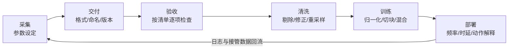

# 课程总目录与学习路线

这份目录把《具身智能数据采集需求与数据集验收技术参数清单》里的 70 个参数，全部分配到了具体课程中。每个参数都按同一个框架来学：

| 学习问题 | 你要能回答 |
|---|---|
| ① 它是什么 | 一句话说清楚定义 |
| ② 采集时控制什么 | 这个参数改变的是采集过程中的哪个环节 |
| ③ 生成什么数据 | 最终落到哪个文件、哪个字段，长什么样 |
| ④ 设置不当的后果 | 典型故障是什么，在数据里怎么表现 |
| ⑤ 对 VLA 训练与部署的影响 | 模型会学偏什么，部署时会出什么事 |
| ⑥ 验收与清洗 | 规范里怎么写，拿到数据后怎么检查 |

## 一、先理解：为什么这份清单里会有这么多不同类型的参数？

这份清单不是只为一种采集方式写的，它同时覆盖了具身智能里 **7 种主流数据来源**。分清楚每个参数属于哪种来源，是读懂清单的第一步。

| 数据来源 | 典型形态 | 清单中的代表参数 |
|---|---|---|
| A. 真机遥操作 | SO-101 主从臂、ALOHA、VR 遥操作人形机器人 | 控制频率、自由度、动作空间、输入设备型号、端到端时延 |
| B. 手持采集设备 | UMI 式手持夹爪 + 运动相机、手机采集 | 机型下限、握持或固定方式、位姿追踪方式、IMU 采样率 |
| C. 人类第一视角 | 头戴相机、全景相机、智能眼镜记录人手操作 | 佩戴位置、手部可见要求、拼接方式、投影格式、头部位姿采样率 |
| D. 动作捕捉 | 光学动捕、惯性动捕服、数据手套 | 节点数、骨骼模型、标记点数、动捕相机数量、融合方式 |
| E. 策略在线运行 | 部署后的日志、人工接管、强化学习 | 策略版本、接管触发条件、奖励定义、复位方式 |
| F. 仿真与合成 | 仿真平台生成、示范扩增、生成模型增强 | 仿真平台、种子示范来源、扩增倍数、域随机化项 |
| G. 互联网视频 | 公开视频、第三方数据集 | 视频来源、许可协议 |

另外还有一组**所有来源都要用到的通用参数**：时间戳、标定、相机参数、编码、交付格式、命名、版本。

> [!tip] 学习建议
> 先学完模块一和模块二（真机 + 视觉），它们和你的 SO-101 直接相关；模块三到模块五可以按你接下来要接触的采集方式选择性深入；模块六是交付和验收，所有人都要学。

## 二、课程地图

### 模块一：真机数据的时间与动作语义（让数据能用于训练）

| 课程 | 覆盖参数 | 状态 |
|---|---|---|
| [[第一课 时间同步方式（Time Synchronization）]] | （多机同步方式的基础） | ✅ 已学 |
| [[第二章 时间戳对齐误差]] | 时间戳对齐误差 | ✅ 已学 |
| [[第三课：State 与 Action 对齐方式]] | action与state对齐方式 | ✅ 已学 |
| [[第四课：关节状态记录项]] | 关节状态记录项 | ✅ 已学 |
| [[第五课 动作空间（Action Space）]] | 动作空间 | ✅ 已学（练习未提交，答案见第六课） |
| [[补学 第一至五课的缺口与勘误]] | 归一化、SO-101 实际数据形态、旋转表示等 | 🆕 补学 |
| [[第六课 控制频率、采样率与轨迹记录频率]] | 控制频率、采样率、轨迹记录频率 | 🆕 |
| [[第七课 机器人本体：自由度、夹爪类型与夹爪开合记录]] | 自由度、夹爪类型、夹爪开合记录、手指自由度（机器人侧） | 🆕 |
| [[第八课 标定方式（Calibration）]] | 标定方式 | 🆕 |

### 模块二：视觉观测（模型"看到"什么）

| 课程 | 覆盖参数 | 状态 |
|---|---|---|
| [[第九课 相机布局：相机数量与位置、机位、安装高度与视场角]] | 相机数量与位置、机位数量、机位高度与角度、安装高度、视场角 | 🆕 |
| [[第十课 成像参数：分辨率、帧率、曝光白平衡与防抖]] | 分辨率、帧率、曝光与白平衡、防抖 | 🆕 |
| [[第十一课 编码格式与码率]] | 编码格式、码率 | 🆕 |
| [[第十二课 深度相机与LiDAR]] | 深度或LiDAR | 🆕 |
| [[第十三课 多机同步、全景拼接与投影格式]] | 多机同步方式、拼接方式、投影格式 | 🆕 |

### 模块三：人类示范与遥操作采集

| 课程 | 覆盖参数 | 状态 |
|---|---|---|
| [[第十四课 遥操作系统：输入设备、端到端时延与力反馈]] | 输入设备型号、端到端时延、力反馈 | 🆕 |
| [[第十五课 人体追踪信号：头部位姿、手部关键点、佩戴位置与手部可见]] | 头部位姿采样率、手部关键点数、手指自由度（人手侧）、佩戴位置、手部可见要求 | 🆕 |
| [[第十六课 手持与手机采集：机型、握持、采集App、位姿追踪与上传]] | 机型下限、握持或固定方式、采集App及版本、位姿追踪方式、IMU采样率、联网与云端上传 | 🆕 |
| [[第十七课 力与触觉：采样率、量程与触觉通道]] | 力与力矩采样率、力传感量程、触觉通道数 | 🆕 |
| [[第十八课 动作捕捉：节点、骨骼模型、标记点、动捕相机与融合]] | 节点数、骨骼模型、标记点数、动捕相机数量、捕捉空间尺寸、融合方式 | 🆕 |

### 模块四：部署后的数据回流

| 课程 | 覆盖参数 | 状态 |
|---|---|---|
| [[第十九课 策略部署数据：策略版本、日志频率与人工接管]] | 策略版本、日志记录频率、接管触发条件、接管点标注方式 | 🆕 |
| [[第二十课 奖励定义与复位方式]] | 奖励定义、复位方式 | 🆕 |

### 模块五：仿真与合成数据

| 课程 | 覆盖参数 | 状态 |
|---|---|---|
| [[第二十一课 仿真合成：仿真平台、资产来源、规划方法与示范扩增]] | 仿真平台、资产来源、规划方法、种子示范来源、扩增倍数 | 🆕 |
| [[第二十二课 域随机化、生成模型与数据增强]] | 域随机化项、生成模型、增强方式 | 🆕 |

### 模块六：交付、身份与综合验收

| 课程 | 覆盖参数 | 状态 |
|---|---|---|
| [[第二十三课 数据交付：单段时长、存储容量、文件格式与命名规则]] | 单段时长、存储容量、交付文件格式、文件命名规则 | 🆕 |
| [[第二十四课 数据集身份：名称版本、许可协议与视频来源]] | 数据集名称与版本、许可协议、视频来源 | 🆕 |
| [[第二十五课 综合实战：从参数清单到验收、清洗、训练与部署]] | 全部参数串联 | 🆕 |

## 三、70 个参数速查索引

想查某个参数在哪一课，直接看这张表。

| 参数 | 课程 | 参数 | 课程 |
|---|---|---|---|
| 时间戳对齐误差 | 第二课 | 输入设备型号 | 第十四课 |
| 标定方式 | 第八课 | 轨迹记录频率 | 第六课 |
| 单段时长 | 第二十三课 | 力与力矩采样率 | 第十七课 |
| 存储容量 | 第二十三课（码率估算见第十一课） | 力传感量程 | 第十七课 |
| 交付文件格式 | 第二十三课 | 日志记录频率 | 第十九课 |
| 文件命名规则 | 第二十三课 | 策略版本 | 第十九课 |
| 分辨率 | 第十课 | 接管触发条件 | 第十九课 |
| 帧率 | 第十课 | 接管点标注方式 | 第十九课 |
| 视场角 | 第九课 | action与state对齐方式 | 第三课 |
| 防抖 | 第十课 | 奖励定义 | 第二十课 |
| 编码格式 | 第十一课 | 复位方式 | 第二十课 |
| 码率 | 第十一课 | IMU采样率 | 第十六课 |
| 曝光与白平衡 | 第十课 | 位姿追踪方式 | 第十六课 |
| 拼接方式 | 第十三课 | 夹爪开合记录 | 第七课（手持夹爪见第十六课） |
| 投影格式 | 第十三课 | 采样率 | 第六课 |
| 安装高度 | 第九课 | 触觉通道数 | 第十七课 |
| 机型下限 | 第十六课 | 佩戴位置 | 第十五课 |
| 握持或固定方式 | 第十六课 | 手部可见要求 | 第十五课 |
| 深度或LiDAR | 第十二课 | 机位数量 | 第九课 |
| 采集App及版本 | 第十六课 | 机位高度与角度 | 第九课 |
| 控制频率 | 第六课 | 多机同步方式 | 第十三课 |
| 自由度 | 第七课 | 节点数 | 第十八课 |
| 夹爪类型 | 第七课 | 骨骼模型 | 第十八课 |
| 相机数量与位置 | 第九课 | 标记点数 | 第十八课 |
| 关节状态记录项 | 第四课 | 动捕相机数量 | 第十八课 |
| 动作空间 | 第五课 | 捕捉空间尺寸 | 第十八课 |
| 头部位姿采样率 | 第十五课 | 融合方式 | 第十八课 |
| 手部关键点数 | 第十五课 | 仿真平台 | 第二十一课 |
| 端到端时延 | 第十四课 | 资产来源 | 第二十一课 |
| 联网与云端上传 | 第十六课 | 规划方法 | 第二十一课 |
| 手指自由度 | 第七课 / 第十五课 | 种子示范来源 | 第二十一课 |
| 力反馈 | 第十四课 | 扩增倍数 | 第二十一课 |
| 数据集名称与版本 | 第二十四课 | 域随机化项 | 第二十二课 |
| 许可协议 | 第二十四课 | 生成模型 | 第二十二课 |
| 视频来源 | 第二十四课 | 增强方式 | 第二十二课 |

## 四、整条数据链路：每个参数最终影响哪里

记住一个核心原则：**采集阶段没有记录下来的信息，后面任何一步都无法凭空恢复。** 清洗只能剔除和修正，训练只能利用已有信息，部署时暴露出的问题，往往要追溯到采集参数。
