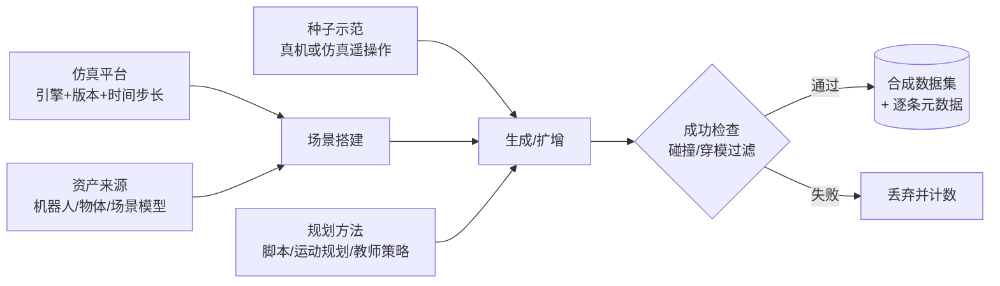

# 第二十一课：仿真合成：仿真平台、资产来源、规划方法与示范扩增

> [!abstract] 本课覆盖的参数
> **仿真平台**、**资产来源**、**规划方法**、**种子示范来源**、**扩增倍数**
> 这是模块五"仿真与合成数据"的第一课。下一课的域随机化、生成模型与数据增强，都建立在本课的仿真流水线之上。

假设你已经用 SO-101 录了 50 条"把红色方块放进盒子"的遥操作示范，训练出的 ACT 策略在你的桌面上成功率还不错。但只要方块放到你没采过的位置、换一个盒子、或者桌上多一个杯子，成功率就明显下降。要覆盖这些情况，你需要几百上千条覆盖不同位置、不同物体的示范，而每条真机示范都要人工摆放物体、遥操作、复位，一个下午可能也就几十条。

于是你想到：能不能在仿真里搭一个"虚拟 SO-101 + 虚拟方块 + 虚拟盒子"，用程序批量生成几千条示范？这正是本课要讲的。但仿真生成的数据不是"免费的真机数据"，它有自己的一整套参数：**在哪个平台上仿真、模型从哪来、动作由谁规划、扩增的"种子"是什么、扩了多少倍。** 每个参数都会在数据里留下痕迹，并最终决定模型在真机上的表现。

本课会频繁用到前面的知识：仿真的时间步长与控制频率对应 [[第六课 控制频率、采样率与轨迹记录频率]]；机器人模型的关节与限位对应 [[第四课：关节状态记录项]] 和 [[第七课 机器人本体：自由度、夹爪类型与夹爪开合记录]]；动作表示对应 [[第五课 动作空间（Action Space）]]。

---

## 1. 为什么要用仿真与合成数据

### 1.1 真机采集的三个瓶颈

| 瓶颈 | 真机采集中的表现 | 仿真能做什么 |
|---|---|---|
| 贵 | 需要硬件、场地、操作员工时；硬件会磨损、损坏 | 一台服务器可以同时运行很多个环境 |
| 慢 | 每条示范都要摆放、操作、复位；复位往往比操作还耗时 | 复位只需要重置状态，几乎瞬间完成 |
| 难覆盖长尾 | 极端光照、罕见物体位置、危险或易碎场景很难或不敢采 | 可以程序化地枚举位置、物体、光照 |

此外，仿真还能免费提供真机上很难获得的**特权信息**（privileged information）：每个物体的精确位姿、接触力、是否穿模、任务是否成功。这些信息让"自动判定成功"和"自动生成动作"成为可能。

### 1.2 核心代价：仿真到真实的差距（sim-to-real gap）

仿真里的世界是对真实世界的近似。模型在仿真数据上学到的东西，搬到真机上可能不再成立，这种差距叫**仿真到真实的差距**（sim-to-real gap）。可以把它拆成三类：

| 差距类型 | 含义 | 典型例子 |
|---|---|---|
| 视觉差距（visual gap） | 仿真图像和真实相机图像看起来不同 | 纹理太干净、阴影和反光不真实、没有运动模糊和传感器噪声 |
| 物理差距（physics gap） | 仿真中的力学行为和真实不同 | 摩擦系数不对、物体太轻、接触时不该弹开却弹开了 |
| 动作执行差距（actuation gap） | 同一条命令在仿真和真机上执行出不同结果 | 仿真关节瞬间到位，真机舵机有延迟、死区、回差和负载下的跟踪误差 |

本课的每个参数，都可以看作是在回答："这个环节引入了哪一类差距、引入了多少、有没有被记录下来？"

### 1.3 一条典型的合成数据流水线



> [!important] 本课的核心原则
> 合成数据的每一条都必须能回答："它是在哪个平台版本上、用哪些资产、由哪个规划器、从哪条种子示范、以哪个随机种子生成的，是否通过了成功检查？"回答不了这些问题的合成数据，出了问题根本无从排查。

---

## 2. 仿真平台

### ① 一句话定义

仿真平台是**生成数据所用的物理引擎与渲染器的组合，连同它的具体版本和关键配置**（时间步长、求解器、渲染方式）。

常见平台的概念性对比如下。注意：各平台都在快速迭代，下表只是帮助你建立"该问哪些问题"的框架，具体能力以你使用的版本的官方文档和实测为准。

| 平台 | 大致定位 | 你应该关心的问题 |
|---|---|---|
| MuJoCo | 以接触动力学见长的物理引擎，模型格式为 MJCF，在机器人学习研究中广泛使用 | 接触参数怎么调；渲染真实感有限，视觉数据通常需要额外处理 |
| Isaac Sim / Isaac Lab | NVIDIA 基于 Omniverse 的仿真平台，场景格式以 USD 为主，支持光线追踪渲染；Isaac Lab 是其上的机器人学习框架，强调 GPU 大规模并行 | 对 GPU 和硬件环境要求较高；版本之间 API 和行为变化较多 |
| PyBullet | Bullet 物理引擎的 Python 接口，上手简单，早期研究中很常用 | 渲染较简单；接触精度和大规模并行不是它的强项 |
| SAPIEN / ManiSkill | SAPIEN 是面向操作任务的仿真器，ManiSkill 是在其上构建的操作任务基准与环境集合 | 任务和资产生态较完整；具体并行与渲染能力看版本 |
| Genesis | 较新的平台，宣传覆盖刚体、柔体等多种物理与高速并行 | 较新，生态和长期稳定性需要自己验证 |

对比时看四个维度：**物理引擎精度**（接触、摩擦是否接近真实，对应物理差距）、**渲染真实感**（对应视觉差距）、**并行速度**（单位时间能生成多少数据）、**接触/柔体支持**（能否仿真布料、绳子、软包装等可形变物体）。

### ② 采集时它控制什么

**第一，物理行为。** 同一个"夹起方块"的动作，在不同引擎、甚至同一引擎的不同版本里，方块可能稳稳夹住、缓慢滑落或被弹飞。决定这些的是：

- 摩擦模型和摩擦系数；
- 接触模型（软接触还是硬接触、接触刚度和阻尼）；
- 关节阻尼、电机模型；
- 求解器类型和迭代次数；
- **物理时间步长**。

> [!warning] 版本也是参数
> 引擎升级可能修改接触求解、默认参数或数值精度。同一个随机种子、同一套资产，在新版本上生成的轨迹可能和旧版本不同，甚至成功率都变了。所以验收清单里不能只写"MuJoCo"，要写到具体版本号。

**第二，时间结构。** 这里直接衔接第六课。仿真里有两个时间步长：

$$
\Delta t_{\text{control}} = N_{\text{sub}} \cdot \Delta t_{\text{physics}}
$$

其中 $\Delta t_{\text{physics}}$ 是物理引擎每次积分前进的时间，$N_{\text{sub}}$ 是每个控制步内的物理子步数（有些框架把它叫 decimation，名称以你使用的框架为准）。例如物理步长 2 ms、每个控制步 10 个子步，控制频率就是：

$$
f_{\text{control}} = \frac{1}{10 \times 0.002\ \text{s}} = 50\ \text{Hz}
$$

如果你的真机数据是 30 Hz，仿真数据就应该也按 30 Hz 记录，否则混合训练时会遇到第六课讲过的"动作块覆盖时长不一致"问题。

**第三，图像外观。** 渲染器决定图像长什么样：

| 渲染方式 | 特点 | 代价 |
|---|---|---|
| 光栅化（rasterization） | 速度快，适合大规模并行；阴影、反射、间接光照是近似的 | 图像偏"游戏画面"，视觉差距较大 |
| 光线追踪（ray tracing） | 光照、阴影、反射更接近真实 | 慢得多，对 GPU 要求高 |

**第四，"完美"的观测。** 仿真默认给你的东西往往过于理想：

| 项目 | 仿真默认 | 真机实际 |
|---|---|---|
| 关节读数 | 精确，无噪声 | 有量化误差、噪声、偶尔通信失败 |
| 相机 | 无噪声、无运动模糊、无曝光变化 | 有噪声、运动模糊、自动曝光波动（第十课） |
| 时延 | 观测和动作在同一步内瞬间完成 | 相机、总线、推理都有延迟（第一、二、六课） |
| 时间间隔 | 严格等间隔 | 有抖动和卡顿 |

### ③ 最终生成什么数据

仿真平台本身不直接变成某个数据字段，但它决定了所有字段的"物理含义"，必须写进元数据。一种可行的做法是在数据集里附一个合成数据说明文件（LeRobot 没有为仿真元数据规定统一字段，以下文件名和字段名均为建议写法，以你使用的版本和团队规范为准）：

```json
{
  "sim_platform": "mujoco",
  "sim_version": "3.x.y（示意，写实际版本号）",
  "physics_dt_s": 0.002,
  "substeps_per_control": 15,
  "record_fps": 30,
  "renderer": "rasterization",
  "observation_noise": "none",
  "action_latency_steps": 0
}
```

> [!warning] 注意上面这个例子里的错误
> $15 	imes 2\ 	ext{ms} = 30\ 	ext{ms}$，控制频率约 33.3 Hz，而 `record_fps=30`。两者不相等时，记录程序要么在做重采样，要么时间戳是错的。这正是写元数据的价值：**不写出来，你根本发现不了这种不一致**。合理的配置应让控制周期是物理步长的整数倍且与记录频率一致，例如物理步长 $1/600$ s（约 1.67 ms）、每控制步 20 个子步，正好 30 Hz。

### ④ 设置不当会出什么问题

| 问题 | 在数据里的表现 |
|---|---|
| 物理步长过大 | 接触时物体抖动、穿透、被弹飞；抓取成功率不稳定 |
| 平台版本没锁定 | 重新生成同一批数据得到不同结果；新旧两批数据混在一起，成功率和轨迹分布悄悄改变 |
| 控制频率与真机不一致 | 动作块覆盖时长不同；增量动作的物理含义不同 |
| 只用光栅化且不做任何视觉处理 | 模型在仿真图像上成功率很高，到真机完全不认识场景 |
| 观测无噪声、无延迟 | 模型学会依赖"完美"的关节读数和即时反馈，真机上一有延迟就振荡或抓偏 |

### ⑤ 对 VLA 训练与部署的影响

- **视觉差距直接作用在 VLA 的视觉编码器上。** VLA 大量依赖图像理解物体位置和语义。如果仿真图像和真实图像分布差别很大，模型在仿真数据上学到的"看到哪里就伸到哪里"不能迁移。常见缓解手段是域随机化和图像增强（下一课），或提高渲染真实感。
- **物理差距让模型学错"动作的后果"。** 如果仿真里方块比真实的轻、摩擦更大，模型会学到"随便夹一下就能拿起来"，真机上就会出现夹了但滑落的失败。
- **"完美观测"让模型过度信任状态输入。** 仿真中关节状态精确且即时，模型可能主要依赖状态而不是图像；真机状态有噪声和延迟时，模型行为会变得不稳定。
- **仿真评估与真机评估结果不一致。** 仿真中 90% 成功率不代表真机 90%。更危险的是**排名翻转**：模型 A 在仿真中比 B 好，到真机反而更差。所以仿真评估适合做快速筛选和回归测试，最终结论必须以真机评估为准。

### ⑥ 验收与清洗

- 规范中写明：平台名称与**精确版本号**、物理步长、子步数、控制频率、记录频率、求解器配置、渲染方式与分辨率、是否注入观测噪声和时延；最好随数据集归档依赖清单或容器镜像标识，使数据可复现。
- 清洗时：检查每批数据的平台版本字段是否一致；版本不一致的批次要分开统计成功率和动作分布，确认没有系统性差异后再合并。

---

## 3. 资产来源

### ① 一句话定义

资产（asset）是**仿真中所有被建模的对象**：机器人模型、被操作物体模型和场景（桌子、墙、背景）。资产来源指这些模型从哪里来、经过怎样的处理、是否与真实物体一致。

### ② 采集时它控制什么

**机器人模型。** 常见格式有三种：URDF（Unified Robot Description Format，ROS 生态的通用格式，很多平台都能导入）、MJCF（MuJoCo 的原生格式，可描述更丰富的接触和执行器参数）、USD（Universal Scene Description，Isaac Sim 等平台以它为核心）。

对 SO-101 来说，社区和厂商仓库中可以找到它的模型文件（以官方仓库为准）。但"能导入"和"与真机一致"是两回事。你要逐项核对：

| 核对项 | 与真机不一致时的后果 |
|---|---|
| 连杆质量与惯量 | 动力学行为不同，负载下的跟踪误差不同 |
| 关节限位 | 仿真能到的姿态真机到不了（或相反），生成的动作在真机上被限幅 |
| 关节零位与方向 | 同样的关节数值对应不同的物理姿态（参考补学文档中关于校准的讨论） |
| 舵机特性 | SO-101 使用总线舵机，有内部位置控制、速度和力矩限制、死区和回差；仿真中通常被简化成理想的位置控制器 |
| 夹爪几何与摩擦 | 抓取是否稳定、能夹住多大的物体 |

**物体模型。** 常见来源：

| 来源 | 优点 | 风险 |
|---|---|---|
| 三维扫描重建 | 外观接近真实物体 | 网格可能有破洞、噪声；物理属性（质量、摩擦）不会自动得到 |
| CAD 模型 | 几何精确 | 往往没有真实纹理；可能和实物有加工差异 |
| 公开资产库 | 数量多，获取快 | 质量参差不齐；每个资产的许可可能不同 |
| 程序生成 | 可以无限生成形状变体 | 形状可能不像真实世界的物体 |

**物理属性是否正确。** 资产的视觉网格和碰撞网格通常是分开的。为了仿真速度，碰撞网格常被简化成凸包或若干凸块的组合（凸分解）。这会带来一个经典问题：

```text
真实杯子：有杯口凹陷，有把手孔
  ↓ 碰撞网格简化成一个凸包
仿真杯子：变成一个"实心圆柱"，把手孔被填平
  → 无法把东西放进杯子里，也无法勾住把手
```

**视觉外观。** 资产的纹理、材质、反光属性决定渲染出的图像和真实物体差多少。同一个红色方块，真实的可能是哑光塑料，仿真里却是均匀的纯色。

**资产许可。** 公开资产库里的模型可能各自有不同的许可条款，有的允许商用，有的不允许，有的要求署名。这会直接约束整个合成数据集的许可，详见 [[第二十四课 数据集身份：名称版本、许可协议与视频来源]]。具体能否使用需以协议原文为准，必要时咨询法务。

### ③ 最终生成什么数据

资产来源要落到每条数据的元数据上，并且要有一份资产清单：

```json
{
  "robot_asset": {
    "id": "so101_arm",
    "format": "mjcf",
    "source": "官方仓库（写明地址和提交号）",
    "version": "commit abc1234（示意）",
    "modified": "夹爪摩擦系数由默认值改为实测拟合值；关节限位按本机校准修改"
  },
  "object_assets": [
    {
      "id": "mug_03",
      "source": "public_library（写明库名和资产编号）",
      "mass_kg": "未提供，按体积估算",
      "collision_mesh": "convex_decomposition",
      "license": "以该资产的许可原文为准"
    }
  ],
  "scene_id": "tabletop_v2"
}
```

注意 `mass_kg: "未提供，按体积估算"` 这种写法：**宁可写明"是估算的"，也不要留一个看起来很精确但其实是默认值的数字。**

### ④ 设置不当会出什么问题

| 问题 | 在数据里的表现 |
|---|---|
| 质量用了默认值 | 很多资产导入时如果不指定质量，会按密度或默认值计算，可能和实物差很多；表现为物体被轻轻一碰就飞走，或推不动 |
| 碰撞网格过度简化 | 抓取点位置看起来合理，但夹爪"夹在空气上"或"嵌进物体里" |
| 视觉与碰撞网格不对齐 | 图像里夹爪还没碰到物体，物体已经开始移动 |
| 资产种类太少 | 所有数据只有 3 种物体，模型记住了这 3 种物体的外观而不是学会"抓取" |
| 资产许可没有记录 | 数据集无法确定是否能对外发布或商用 |

### ⑤ 对 VLA 训练与部署的影响

- **机器人模型不准，模型学到的是"仿真机器人"的动作。** 如果仿真中的关节零位和真机差几度，模型输出的关节目标在真机上就会系统性偏移，表现为"总是差一点抓不到"。
- **物体外观太单一，VLA 的语言-视觉对应会学偏。** 例如所有"杯子"都是同一个模型，模型可能把"杯子"和这个特定的形状纹理绑定，遇到真实世界的另一个杯子就不认识。
- **物理属性错误导致动作风格错误。** 仿真中物体过轻、摩擦过大时，生成的抓取往往很"随意"（夹得浅、抬得快）。用这种数据训练，真机上会频繁滑落。
- **资产是部署泛化的上限之一。** 模型很难泛化到训练中从未见过的物体类别。资产的多样性和真实性，在很大程度上决定了合成数据能带来多少泛化收益。

### ⑥ 验收与清洗

- 规范中写明：机器人模型来源、版本和所有修改项；与真机核对过的参数（关节限位、零位、夹爪尺寸）；每个物体资产的来源、物理属性来源（实测/估算/默认）、碰撞网格类型和许可。
- 清洗时：
  1. 在仿真中把机器人摆到若干个关节姿态，同时在真机上摆到同样的读数，对比两者的相机图像，检查姿态是否一致（这是最直接的机器人模型核对）。
  2. 统计每个物体资产在数据集中出现的次数，检查是否有资产占比过高。
  3. 抽查碰撞网格：把碰撞网格和视觉网格叠加渲染，看是否有明显偏差。

---

## 4. 规划方法

### ① 一句话定义

规划方法是**在仿真中自动产生动作序列的方式**，也就是"合成数据里的动作是谁生成的"。

### ② 采集时它控制什么

规划方法决定了动作序列的**来源和风格**。常见的几类：

| 方法 | 做法 | 优点 | 缺点 |
|---|---|---|---|
| 脚本化策略 / 有限状态机 | 人写规则：移动到物体上方 → 下降 → 闭合夹爪 → 抬起 → 移动到目标 → 张开 | 简单可控，用到仿真的精确物体位姿 | 只适合结构简单的任务，动作非常程式化 |
| 采样式运动规划（如 RRT 类方法） | 在关节空间中随机采样，搜索一条无碰撞路径 | 能绕开障碍物 | 原始路径往往曲折、有多余绕行，需要平滑处理 |
| 轨迹优化 | 把"平滑、无碰撞、到达目标"写成优化目标求解 | 轨迹平滑 | 可能陷入局部最优，需要好的初值 |
| 基于特权信息的专家策略 | 先用强化学习在仿真里训练一个能看到精确状态的"教师"策略，再用它生成示范 | 能处理接触丰富的复杂任务 | 训练成本高；教师可能依赖真机上不可观测的信息 |
| 仿真中遥操作 | 人用遥操作设备直接控制仿真机器人 | 动作风格最接近人类 | 仍然需要人工，速度受限 |

**特权信息**是这里的关键概念：教师策略或脚本可以直接读取物体的精确位姿、速度甚至接触力，而最终要训练的 VLA 只能看图像和关节状态。这本身没有问题，但要注意：如果某个动作决策依赖了"从图像里看不出来"的信息（例如被遮挡物体的精确位置），学生模型就学不会这个决策，只能学到一个"平均"的、有时毫无理由的动作。

### ③ 最终生成什么数据

规划方法决定了 `action` 序列的内容和风格，元数据中要记录：

```json
{
  "planner": "scripted_fsm",
  "planner_version": "pick_place_fsm v1.3（示意）",
  "planner_params": {"approach_height_m": 0.08, "max_ee_speed_mps": 0.15},
  "uses_privileged_info": ["object_pose"],
  "plan_attempts": 2
}
```

规划生成的轨迹通常有一些可以从数据中直接看出来的"指纹"：

| 特征 | 规划轨迹 | 人类遥操作轨迹 |
|---|---|---|
| 末端路径形状 | 直线或标准曲线 | 弯曲、有小幅修正 |
| 速度曲线 | 匀速或标准加减速曲线 | 快慢不均，接近物体时明显减速 |
| 停顿与犹豫 | 几乎没有 | 抓取前常有停顿、微调 |
| 失败后的恢复 | 通常没有（失败的直接丢弃） | 偶尔有"没夹住再夹一次" |
| 不同示范之间 | 高度一致 | 每次都略有不同 |

### ④ 设置不当会出什么问题

**问题 A：轨迹"太完美"，与人类示范分布不一致。**

假设你把 50 条真机人类遥操作示范和 2000 条脚本生成的仿真示范混在一起训练。数据集中约 97.6% 的示范都是匀速直线，模型会主要学到这种风格。到真机上：

- 模型以匀速直线逼近物体，不会在接近时减速微调；
- 一旦出现偏差，因为训练数据里几乎没有"修正"动作，模型不知道怎么恢复。

**问题 B：没有失败与恢复的数据。** 规划生成的数据只保留成功的那一部分，模型从没见过"夹偏了怎么办"。这和 [[第十九课 策略部署数据：策略版本、日志频率与人工接管]] 讨论的部署数据回流形成对照：真机部署时最有价值的恰恰是失败和接管的片段。

**问题 C：规划失败和碰撞没有正确过滤。** 运动规划可能找不到路径而超时，或者找到的路径在执行时因为动力学原因发生碰撞。如果只检查"最后是否成功"，可能留下"中途撞了桌子但物体最终还是到了盒子里"的轨迹。

**问题 D：多模态被抹平。** 同一个场景，人类可能有时从左边绕、有时从右边绕；脚本永远选同一条。模型只学到一种解法，遇到那条路被挡住时就不会换。

### ⑤ 对 VLA 训练与部署的影响

- **动作风格偏移。** 混合训练时，模型输出的风格会向占比更大的数据源靠拢。如果你部署时期望模型像人一样小心接近物体，就要控制规划数据的占比，或者在训练时标记数据来源（见第 7 节）。
- **对特权信息的隐式依赖。** 如果教师用了图像中不可见的信息，学生模型会学到"看似随机"的动作。部署时这些动作表现为莫名其妙的偏移或犹豫。
- **动作块的平滑性。** 规划轨迹非常平滑，模型预测的动作块也会平滑。这本身是好事，但如果真机人类数据很"抖"，两种数据的动作块统计量（[[补学 第一至五课的缺口与勘误]] 中讲的归一化统计量 stats）会差别很大，混合后的统计量对两者都不准确。

### ⑥ 验收与清洗

- 规范中写明：规划方法类型、版本、关键参数、是否使用特权信息及使用了哪些、成功判定规则、碰撞过滤规则。
- 清洗时：
  1. 对比规划数据和人类数据的速度分布、路径曲率分布、停顿时长分布，量化两者的风格差异。
  2. 检查每条轨迹的碰撞记录，而不只是最终成功标记。
  3. 对教师策略生成的数据，抽查"关键决策时刻"的图像：仅凭图像，人能否看出为什么要这么做？看不出来的，说明依赖了不可观测信息。

---

## 5. 种子示范来源与扩增倍数

这两个参数关系极其紧密，所以放在一起讲：**种子决定了"复制什么"，倍数决定了"复制多少"。**

### 5.1 先理解示范扩增的核心思路

以 MimicGen 为代表的一类示范扩增方法，核心思想可以概括为：

1. 把少量人类示范（种子）按"以物体为中心的子任务"分段。例如"抓方块"段和"放进盒子"段，前者以方块为参考，后者以盒子为参考。
2. 在每一段中，把末端执行器的位姿**表示成相对于参考物体的位姿**。
3. 在一个新场景里，物体被放到了新的位置。把这段"相对于物体的轨迹"变换到新的物体位姿下，得到新的末端轨迹。
4. 在相邻段之间插入过渡轨迹，然后在仿真中执行，**只保留成功的轨迹**。

用公式表示第 3 步。设 $T^{W}_{O}$ 是物体在世界坐标系下的位姿，$T^{W}_{E}$ 是末端位姿，则新轨迹中每一时刻的末端位姿为：

$$
T^{W}_{E,\text{new}} = T^{W}_{O,\text{new}} \left(T^{W}_{O,\text{src}}\right)^{-1} T^{W}_{E,\text{src}}
$$

直观理解：先算出"种子示范中，夹爪相对于方块在哪里"，再把这个相对关系"贴"到新位置的方块上。夹爪开合动作直接照搬。

```text
种子：方块在 (0.20, 0.00)，夹爪从方块正上方 5 cm 下降
新场景：方块在 (0.25, 0.08)，旋转了 30°
生成：夹爪从新方块正上方 5 cm、同样旋转 30° 的姿态下降
```

这个思路有几个隐含前提：

- 生成时需要知道每个子任务开始时参考物体的位姿（仿真里可以直接读取）；
- 动作需要能以末端位姿形式执行（第五课的末端执行器动作空间），关节空间的轨迹不能直接这样变换；
- 变换后的末端位姿必须是机器人**可到达**的。对 SO-101 这种 5 自由度手臂（加一个夹爪），并不是任意 6 维末端位姿都能达到，变换后的姿态经过逆运动学可能无解或只能近似，这是生成失败的一大来源。

### 5.2 种子示范来源

#### ① 一句话定义

种子示范来源指**扩增所用的原始示范是怎么来的**：真机遥操作、仿真中遥操作，还是脚本/规划生成。

#### ② 采集时它控制什么

| 种子来源 | 做法 | 要额外解决的问题 |
|---|---|---|
| 仿真遥操作 | 人在仿真里遥操作，物体位姿天然已知 | 仿真遥操作手感和真机不同，示范风格可能不像真机人类示范 |
| 真机遥操作 | 用真机采集的示范作为种子 | 需要估计每个子任务开始时的物体位姿，并把轨迹搬到仿真里（或在真机上执行生成的轨迹）；位姿估计误差会带入每一条生成数据 |
| 脚本 / 规划 | 用第 4 节的方法生成种子 | 种子本身就带有规划轨迹的风格问题 |

种子决定了扩增结果的两个上限：

- **质量上限。** 种子里的错误会被复制放大。如果某条种子在抓取前有一个多余的大幅晃动，它生成的 100 条数据都会带着这个晃动。
- **多样性上限。** 扩增只是把同一种策略搬到不同物体位姿下。如果 10 条种子都是"从正上方抓"，生成 10000 条也全是"从正上方抓"。种子里没有的抓法，扩增不会凭空产生。

#### ③ 最终生成什么数据

每条生成数据必须记录它来自哪条种子（`seed_demo_id`）、种子来源类型（`seed_source`），以及种子的子任务分段（每段的参考物体和帧范围），完整格式见第 6 节。种子本身也要有一份清单，记录每条种子的来源、质量评分、子任务分段边界和分段方式（人工标注还是自动检测）。

#### ④ 设置不当会出什么问题

| 问题 | 在数据里的表现 |
|---|---|
| 种子质量差 | 某种异常动作（抖动、多余停顿、差点碰撞）在大量生成数据里重复出现 |
| 种子数量太少、风格太单一 | 生成数据的抓取姿态、接近方向分布非常集中 |
| 子任务分段边界不准 | 生成轨迹在段与段的衔接处出现突兀跳变，或者在错误的时刻切换参考物体，导致"抓到一半就开始朝盒子走" |
| 真机种子的物体位姿估计有误差 | 所有由该种子生成的轨迹都带着同样的系统偏移 |
| 没记录种子 ID | 发现某批数据有问题时，无法追溯到是哪条种子造成的 |

#### ⑤ 对 VLA 训练与部署的影响

- **种子的错误被模型当作"大多数情况下的正确做法"。** 一条种子在 50 条原始示范里只占 2%；假设 20 条种子中其他 19 条各生成约 50 条，它却因为生成成功率高而生成了 300 条，它在合成数据中的占比就是 $300/(300+19\times 50)\approx 24\%$，它的异常动作被放大到约四分之一。
- **多样性不足导致部署时的"单一解法"。** 模型只会从一个方向接近物体，遇到障碍或物体朝向不利时就失败。
- **真机种子的好处。** 种子来自真机遥操作时，生成数据的动作风格更接近真机人类示范，有助于缩小与真机数据混合时的分布差异。代价是要解决物体位姿估计和仿真复现的问题。

#### ⑥ 验收与清洗

- 规范中写明：种子数量、来源、筛选标准、子任务分段方式；每条生成数据必须带 `seed_demo_id`。
- 清洗时：人工检查每一条种子（种子数量少，值得逐条看）；统计每条种子生成了多少条成功数据，检查分布是否极不均匀。

### 5.3 扩增倍数

#### ① 一句话定义

扩增倍数是**从 $N$ 条种子示范生成 $M$ 条数据的比例** $k = M / N$。验收时要区分"尝试生成的数量"和"通过检查后保留的数量"。

#### ② 采集时它控制什么

它控制**数据量**，但不线性地控制**多样性**。

```text
10 条种子 × 100 倍 = 1000 条
  多样性来源：物体位姿的变化（新）+ 10 种策略模式（不变）

100 条种子 × 10 倍 = 1000 条
  多样性来源：物体位姿的变化（新）+ 100 种策略模式（更丰富）
```

两者数量相同，但后者的策略多样性高得多。倍数越大，新增数据带来的边际收益越小，因为它们只是"同一种做法在更多位置上的复制"。

#### ③ 最终生成什么数据

需要记录三个数字，而不是一个：

| 统计项 | 含义 | 示例（示意数值） |
|---|---|---|
| 尝试数 $M_{\text{try}}$ | 一共尝试生成多少条 | 5000 |
| 成功数 $M$ | 通过成功检查和碰撞过滤的条数 | 2000 |
| 生成成功率 | $M / M_{\text{try}}$ | 40% |

并且按种子分别统计。数据集层面还要记录合成数据与真机数据的比例。

#### ④ 设置不当会出什么问题

**问题 A：倍数过大，模型过拟合于合成风格。** 例如 50 条真机数据 + 5000 条合成数据，真机数据只占约 1%。如果训练时均匀采样，模型几乎只在学合成数据。

**问题 B：只看总成功率，忽略按种子的成功率差异。** 某些种子的生成成功率极低（例如它的抓取姿态在大多数新位置上不可达），某些很高。如果按"每条种子尝试相同次数"生成，成功率高的种子会在最终数据中占比更高；生成结果的分布被"哪些种子更容易被复制"悄悄扭曲了。

**问题 C：生成成功率低却不深究。** 成功率低本身是一个信号：可能是物体位姿采样范围超出了可达空间，可能是碰撞网格有问题，也可能是插值过渡段撞到障碍。不排查就盲目增加尝试数，只会保留下"恰好成功"的偏颇子集。

#### ⑤ 对 VLA 训练与部署的影响

- **混合比例决定模型更像谁。** 常见做法是让真机和合成数据**分别标记来源**，训练时按设定比例采样，而不是简单按条数合并。具体比例没有通用答案，需要通过真机评估来确定。
- **合成数据主要提升"位置泛化"，未必提升"策略泛化"。** 示范扩增最擅长的是让模型见过更多物体位置；如果真机失败的原因是"不会换一种抓法"，单纯加大倍数帮助有限。
- **没有溯源就无法做消融。** 如果你想知道"去掉某条种子生成的数据会不会更好"，必须有 `seed_demo_id`。

#### ⑥ 验收与清洗

- 规范中写明：种子数 $N$、尝试数、保留数 $M$、生成成功率（总体和按种子）、合成数据与真机数据的比例、训练时的采样比例。
- 清洗时：按种子统计保留条数，对占比过高的种子做下采样；检查物体位姿覆盖（见第 8 节代码）。

---

## 6. 生成数据：每条合成数据的完整元数据

把前面五个参数汇总，每条合成数据应该附带一份完整的元数据记录。下面是一个建议格式（字段名为示意，LeRobot 中没有统一规定，可以作为额外的元数据文件随数据集一起交付，以你使用的版本和团队规范为准）：

```json
{
  "episode_index": 1203,
  "source_type": "sim_generated",
  "sim": {
    "platform": "mujoco",
    "version": "3.x.y",
    "physics_dt_s": 0.0016667,
    "substeps_per_control": 20,
    "control_freq_hz": 30,
    "renderer": "rasterization"
  },
  "assets": {
    "robot": "so101_arm@abc1234",
    "objects": ["cube_red_40mm", "box_01"],
    "scene": "tabletop_v2"
  },
  "random_seed": 918273,
  "planner": "object_centric_replay + linear_interp",
  "seed_demo_id": "real_teleop/ep_000007",
  "seed_source": "real_teleop",
  "seed_segments": [
    {"subtask": "grasp_cube", "ref_object": "cube_red_40mm", "frames": [0, 85]},
    {"subtask": "place_in_box", "ref_object": "box_01", "frames": [86, 190]}
  ],
  "initial_object_poses": {
    "cube_red_40mm": [0.25, 0.08, 0.02, 0.0, 0.0, 0.52],
    "box_01": [0.15, -0.12, 0.0, 0.0, 0.0, 0.0]
  },
  "success_check": {"passed": true, "rule": "cube_in_box_v1"},
  "collision_check": {"robot_table_contact": false, "max_penetration_m": 0.0008},
  "generation_attempt": 3
}
```

> [!tip] 随机种子的意义
> 记录 `random_seed` 加上平台版本和资产版本，理论上就能在仿真中**完全复现**这一条数据。这在排查问题时非常有用：发现某条数据异常，可以重新生成并在仿真中逐帧观察。但注意，部分 GPU 并行仿真不一定保证逐位可复现，复现性要实测确认。

---

## 7. 把五个参数串起来：一次合成数据规划的计算

假设你要为"把红色方块放进盒子"任务准备训练数据，手上已有 50 条真机遥操作示范。

**第一步：选种子。** 人工检查 50 条真机示范，剔除 5 条有明显多余动作的，挑出 20 条作为种子，覆盖"从正上方抓"和"略微倾斜抓"两种模式。

**第二步：估算尝试数。** 目标保留 2000 条合成数据。先小规模试生成，测得生成成功率约 40%（示意数值），则：

$$
M_{\text{try}} = \frac{M}{p_{\text{success}}} = \frac{2000}{0.4} = 5000
$$

**第三步：按种子检查。** 试生成后按种子统计：

| 种子 | 尝试 | 成功 | 成功率 |
|---|---|---|---|
| ep_000003 | 250 | 180 | 72% |
| ep_000007 | 250 | 160 | 64% |
| ep_000021 | 250 | 15 | 6% |
| …… | …… | …… | …… |

`ep_000021` 的成功率异常低，检查后发现它的抓取姿态手腕倾斜较大，在很多新位置上逆运动学无解。要么剔除它，要么接受它只贡献少量数据，但必须**意识到**最终数据中"倾斜抓"这种模式被削弱了。

**第四步：决定混合比例。** 最终有 2000 条合成数据和 45 条真机数据（全部 50 条减去剔除的 5 条）。如果按条数合并，真机数据只占约 2.2%。可以在训练时设定按来源采样，例如每个训练批次中真机与合成各占一半（示意比例，需通过真机评估调整），同时在数据中标记 `source_type`。

**第五步：统一时间与动作语义。** 确认仿真数据的记录频率是 30 Hz、动作空间与真机一致（例如都是关节绝对位置），并且两者的归一化统计量分开计算后比较，确认没有严重的分布差异再决定是否合并统计。

这五步之间的权衡关系：

| 想提高 | 代价 / 风险 |
|---|---|
| 扩增倍数 | 多样性边际收益递减；更容易过拟合合成风格 |
| 种子数量 | 需要更多人工采集和检查 |
| 渲染真实感 | 生成速度下降 |
| 物理精度（更小步长） | 生成速度下降 |
| 规划器复杂度 | 轨迹更合理，但开发和调试成本更高 |

---

## 8. 清洗实践

### 8.1 按种子统计生成成功率

```python
import pandas as pd

# 生成日志：每一次生成尝试一行（包括失败的），字段为示意
log = pd.read_json("gen_log.jsonl", lines=True)
# 字段示例：seed_demo_id, passed_success, has_collision

log["kept"] = log["passed_success"] & ~log["has_collision"]

stat = (log.groupby("seed_demo_id")
           .agg(tries=("kept", "size"), kept=("kept", "sum")))
stat["rate"] = stat["kept"] / stat["tries"]
stat["share"] = stat["kept"] / stat["kept"].sum()   # 在最终数据中的占比

print(stat.sort_values("rate"))

# 标记异常种子：成功率远低于中位数，或占比远高于平均（示例阈值）
low = stat[stat["rate"] < 0.3 * stat["rate"].median()]
high = stat[stat["share"] > 3 / len(stat)]
print("成功率异常低的种子：", list(low.index))
print("占比过高的种子：", list(high.index))
```

### 8.2 检查物体位姿覆盖

```python
import json
import numpy as np

# metas：每条保留数据的元数据（第 6 节格式），这里假设存成 JSON Lines 文件
with open("synthetic_meta.jsonl") as f:
    metas = [json.loads(line) for line in f]

# 每条保留数据的初始物体位置 (x, y)，单位米
xy = np.array([m["initial_object_poses"]["cube_red_40mm"][:2] for m in metas])

# 把工作区划成网格，统计每个格子里有多少条数据（范围和格子大小为示意）
x_edges = np.linspace(0.10, 0.35, 6)
y_edges = np.linspace(-0.15, 0.15, 7)
hist, _, _ = np.histogram2d(xy[:, 0], xy[:, 1], bins=[x_edges, y_edges])

print(hist.astype(int))
empty = np.argwhere(hist == 0)
print("没有数据覆盖的格子数：", len(empty))
```

如果某些格子是空的，而它们本应在采样范围内，往往说明那一片区域的生成全部失败了（例如超出可达空间）。这意味着模型部署时遇到物体放在那里会表现很差。

### 8.3 碰撞与穿模检查

```python
# 假设每条数据在生成时记录了每一步的最大穿透深度（米）和机器人-桌面接触标记
PEN_LIMIT = 0.002  # 示例阈值：2 mm

bad = []
for m in metas:
    c = m["collision_check"]
    if c["max_penetration_m"] > PEN_LIMIT or c["robot_table_contact"]:
        bad.append(m["episode_index"])
print("需要剔除或复查的数据：", bad[:20], "共", len(bad), "条")
```

> [!warning] 这些检查的局限
> 这些都是启发式检查。按种子统计只能发现数量上的不平衡，不能发现种子本身的动作问题；位姿覆盖只看了初始位置，没看朝向和轨迹；穿透深度依赖仿真引擎的报告，碰撞网格本身错了（例如杯子被简化成实心）时这个指标反而显示"一切正常"。仍然需要抽样回放生成数据的视频，人工确认。

---

## 9. 验收清单写法速查

| 字段 | 示例写法（阈值为示例，需按任务确定） |
|---|---|
| 仿真平台 | 平台名称与精确版本号；物理步长 1/600 s、每控制步 20 子步（控制频率 30 Hz），记录频率 30 Hz；渲染方式与分辨率；依赖清单或镜像标识随数据归档 |
| 观测与执行理想化 | 写明是否注入关节噪声、图像噪声、动作时延；未注入则明确写"无" |
| 机器人资产 | 模型来源与版本号；已与真机核对关节限位、零位、夹爪尺寸；列出所有修改项 |
| 物体资产 | 每个资产的来源、物理属性来源（实测/估算/默认）、碰撞网格类型、许可（以协议原文为准） |
| 规划方法 | 方法类型、版本、关键参数；使用了哪些特权信息；成功判定规则与碰撞过滤规则 |
| 种子示范来源 | 种子数量、来源（真机/仿真遥操作）、筛选标准、子任务分段方式；每条生成数据带 `seed_demo_id` |
| 扩增倍数 | 种子数、尝试数、保留数、生成成功率（总体与按种子）；单条种子在最终数据中的占比不超过 10%（示例） |
| 元数据 | 每条合成数据有完整元数据：平台版本、资产 ID、随机种子、规划器、种子 ID、成功与碰撞检查结果 |
| 数据混合 | 每条数据标记 `source_type`；写明训练时真机与合成数据的采样比例 |
| 复现性 | 抽取 N 条数据用记录的随机种子重新生成，轨迹一致（或写明不可逐位复现的原因） |

---

## 10. 第二十一课练习

**问题 1：仿真时间步长**

一个仿真环境的物理步长为 2 ms，每个控制步包含 20 个物理子步。你的真机数据集是 30 Hz。以下哪项判断正确？

A. 仿真控制频率为 50 Hz，可以直接和真机数据混合训练
B. 仿真控制频率为 25 Hz，与真机 30 Hz 不一致，混合前需要统一频率，否则动作块覆盖时长不同
C. 物理步长和控制频率无关，只要记录频率写成 30 就行

**问题 2：碰撞网格**

在仿真中生成"把勺子放进杯子"的数据，生成成功率接近 0，但从渲染图像看，勺子明明已经对准了杯口。最可能的原因是？

A. 渲染器用的是光栅化而不是光线追踪
B. 杯子的碰撞网格被简化成凸包，杯口凹陷被填平，勺子在物理上进不去
C. 随机种子设置不对

**问题 3：扩增倍数与多样性**

方案甲：5 条种子 × 400 倍；方案乙：50 条种子 × 40 倍。两者都得到 2000 条数据，种子来源和质量相同。对于部署时"物体朝向不利，需要换一种接近方式"的情况，哪个方案通常更有帮助？

A. 方案甲，因为每条种子被复制得更充分
B. 方案乙，因为策略模式（接近方式）的多样性来自种子，扩增只改变物体位姿
C. 两者完全相同，因为数据量一样

**问题 4：种子错误被放大**

你发现训练出的策略在抓取前总会先向左晃一下。检查后发现某一条种子示范有这个动作。为了确认并修复这个问题，以下哪项是**前提条件**？

A. 每条生成数据都记录了 `seed_demo_id`
B. 生成时使用了光线追踪渲染
C. 合成数据和真机数据的比例是 1:1

**问题 5：开放思考题**

你的 SO-101 策略在仿真评估中成功率 92%，在真机上只有 35%。请从本课的视觉差距、物理差距、动作执行差距三个角度，各提出一个可能原因，并说明你会如何用数据或实验去验证它。

> [!question]- 参考答案（点击展开）
> 1. **B**。$\Delta t_{\text{control}} = 20 \times 0.002 = 0.04$ s，即 25 Hz。频率不一致会让同样长度的动作块覆盖不同的时长（第六课）。C 错在：记录频率字段写成 30 并不改变数据真实的时间间隔，只会制造错误的元数据。
> 2. **B**。视觉网格和碰撞网格是分开的。图像显示的是视觉网格，物理计算用的是碰撞网格。凸包简化会把杯口填平。A 只影响图像外观，不影响物理成功与否。
> 3. **B**。示范扩增是"把同一种做法搬到新的物体位姿下"，不会产生种子里没有的接近方式。方案乙的策略模式更多。
> 4. **A**。只有记录了种子 ID，才能定位哪些生成数据来自这条有问题的种子，并把它们剔除或重新生成。这正是溯源的价值。
> 5. 参考思路：
>    - 视觉差距：仿真图像纹理和光照与真实差别大。验证方法：在真机上录几段图像，与仿真中同样姿态的渲染图对比；或者把真机图像输入模型，看它预测的动作是否明显偏离。
>    - 物理差距：仿真中方块质量或摩擦不对，抓取在仿真里稳、在真机上滑。验证方法：统计真机失败中有多少是"夹住后滑落"，并实测方块质量和摩擦，与资产参数对比。
>    - 动作执行差距：仿真中关节理想到位，真机舵机有时延和跟踪误差。验证方法：在真机和仿真中执行同一条关节轨迹，比较实际关节轨迹（state）与目标（action）的跟踪误差和滞后（可参考补学文档中"Action 领先 State"的测量方法）。
>    - 还可以检查非 gap 类原因：真机评估的物体位置是否落在仿真生成时位姿覆盖的空白区域，以及仿真和真机的控制频率、动作空间、归一化统计量是否一致。

---

## 11. 小结

一句话：**合成数据的价值在于便宜地覆盖更多情况，它的风险在于把仿真的偏差、规划器的风格和种子的错误一起批量复制进数据集；每条合成数据都必须可溯源，才能在真机表现不佳时找到原因。**

下一课 [[第二十二课 域随机化、生成模型与数据增强]] 会讨论如何主动缩小视觉和物理差距：在仿真中随机化哪些因素、用生成模型编辑已有示范时如何避免"图像和动作对不上"、以及训练时的数据增强为什么不能随便做水平翻转。
