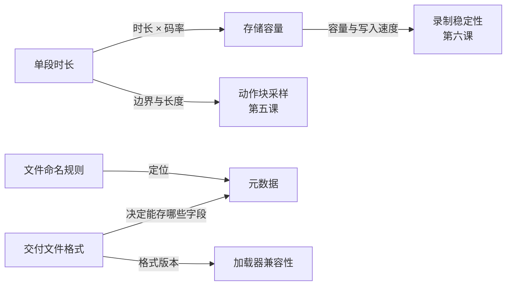
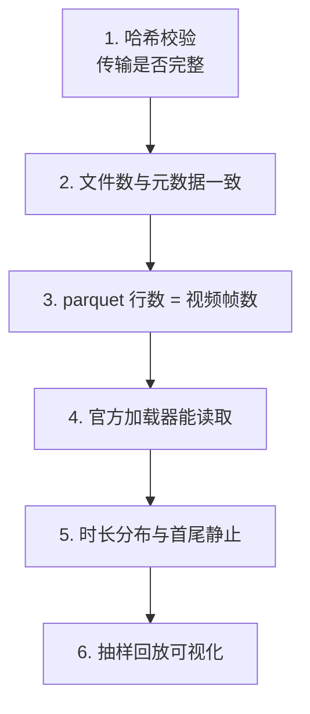

# 第二十三课：数据交付——单段时长、存储容量、文件格式与命名规则

> [!abstract] 本课覆盖的参数
> **单段时长**、**存储容量**、**交付文件格式**、**文件命名规则**
> 存储容量的码率估算基础见 [[第十一课 编码格式与码率]]。

## 0. 模块六导读：从"一行数据"到"一份交付物"

前面五个模块，你学的都是**数据内容本身**：时间戳准不准、动作表示什么、相机看到了什么、人类示范怎么记录、部署日志怎么回流、仿真数据怎么生成。模块六换一个视角：**数据作为一份交付物（deliverable），能不能被别人正确地拿到、读懂、找回、引用和合法使用。**

| 课程 | 回答的问题 |
|---|---|
| 第二十三课（本课） | 数据被切成多长一段、占多大空间、用什么格式装、文件叫什么名字 |
| [[第二十四课 数据集身份：名称版本、许可协议与视频来源]] | 这份数据是哪一版、能拿来干什么、素材从哪里来 |
| [[第二十五课 综合实战：从参数清单到验收、清洗、训练与部署]] | 把全部参数串成一条从采集到部署的流水线 |

这三课的参数看起来像"行政工作"，但它们出问题时，代价往往比一个关节单位写错还大：一个单位错误只污染一个字段，而一个格式转换错误、一次磁盘写满、一套混乱的命名，可能让整批数据无法使用或无法追溯。

---

## 1. 引入：一次真实的交接

你用 SO-101 采了三天"抓起桌上的笔放进笔筒"的数据，共 312 条，准备交给同事训练 ACT 和 SmolVLA。同事打开数据后给你发来四个问题：

1. "第 57 条只有 1.2 秒，第 203 条有 94 秒，这两条是怎么回事？"
2. "第三天下午的腕部相机视频有很多卡顿，日志里显示磁盘剩余空间不足，这批还能用吗？"
3. "我用一个 HDF5 转换脚本处理之后，时间戳全变成了整数毫秒，还和 parquet 里的对不上。"
4. "`新建文件夹(2)/张三最终版_改.mcap` 是哪个工位、哪天、哪套校准录的？"

这四个问题分别对应本课的四个参数。它们和前面课程的关系是：

- **单段时长**决定一条轨迹（episode）的边界，直接影响 [[第五课 动作空间（Action Space）]] 中动作块（Action Chunk）的采样方式；
- **存储容量**由 [[第十一课 编码格式与码率]] 的码率和 [[第六课 控制频率、采样率与轨迹记录频率]] 的记录频率共同决定，容量不足又会反过来破坏记录频率的稳定性；
- **交付文件格式**决定前面所有课程的字段（时间戳、State、Action、标定信息）能否被完整保存下来；
- **文件命名规则**决定你半年后能否找回"这条数据是谁、在哪、何时、用哪套校准录的"。

先看一份完整交付物的样子，后面每一节都会指向其中的某个部分：

```text
emb-pickpen-so101_v1.0.0/              ← 文件命名规则（交付包名称）
├── dataset/                            ← 交付文件格式（LeRobot 格式，内部文件名由框架决定）
│   ├── meta/
│   │   ├── info.json                   ← fps、总帧数、特征定义、codebase_version
│   │   ├── stats.json                  ← 归一化统计量
│   │   ├── tasks.*                     ← 任务（语言指令）列表
│   │   └── episodes/ 或 episodes.jsonl ← 每段的长度、任务等（单段时长落在这里）
│   ├── data/chunk-000/...parquet
│   └── videos/.../...mp4               ← 存储容量的大头
├── raw/                                ← 原始传感器日志（可选，如 MCAP）
├── calibration/                        ← 标定文件
├── docs/                               ← 采集规范、数据集卡片、变更日志
└── checksums.sha256                    ← 完整性校验
```

> [!warning] 版本提醒
> LeRobot 数据集的目录结构在不同版本之间变化较大，上图只是示意。本课所有涉及 LeRobot 字段名和路径的内容，都请以你使用的版本为准，并以 `meta/info.json` 中的 `codebase_version` 为判断依据。

---

## 2. 单段时长（Episode Duration）

### ① 一句话定义

单段时长是**一条轨迹从开始录制到结束录制的时间长度**，等于该段的帧数除以记录频率：

$$
T_{\text{episode}}=\frac{N_{\text{frames}}}{f_{\text{record}}}
$$

例如 30 Hz 下 600 帧对应 20 s。

### ② 采集时它控制什么

**第一，一条轨迹装下多少"任务"。** 理想情况下，一条轨迹恰好包含一次完整的任务执行：从初始状态开始，到任务完成并稳定结束。

**第二，首尾静止段有多长。** 录制按钮按下后，操作员往往要反应一下才开始动；任务完成后，往往也要等一会儿才停止录制。这两段机器人基本不动，但图像和状态都在被记录。

**第三，出错的代价。** 一条 20 s 的轨迹失败了，重录 20 s；一条 5 分钟的轨迹在第 4 分钟失败，前 4 分钟要么作废，要么需要人工切分。

**第四，录制程序的超时行为。** LeRobot 的录制流程通常可以设置每段的最长录制时间和复位时间（参数名以你使用的版本为准）。到达上限时，程序会自动结束这一段——**不管任务是否完成**。这意味着上限设得太短，会批量产生"被截断的未完成轨迹"。

| 时长问题 | 典型原因 | 在数据里的表现 |
|---|---|---|
| 太短 | 误触录制键、程序异常提前结束、上限设置过短 | 任务不完整，最后一帧夹爪还没碰到笔 |
| 太长 | 失败后反复重试、一段里做了多个子任务、操作员忘记停止 | 大量空闲帧、多次"接近—后退—再接近" |
| 首尾静止过长 | 操作员反应时间、等待确认、录制程序启动慢 | 开头或结尾几秒内动作几乎不变 |

### ③ 最终生成什么数据

单段时长不是一个单独存储的字段，而是由下面几处共同体现（以 LeRobot 为例，字段名以版本为准）：

`meta/info.json`（示意）：

```json
{
  "fps": 30,
  "total_episodes": 312,
  "total_frames": 187200
}
```

每段元数据（较早版本为 `meta/episodes.jsonl` 的一行；较新版本存放在 `meta/episodes/` 下的 parquet 中，示意）：

```json
{"episode_index": 57, "tasks": ["Pick up the pen and put it in the pen holder."], "length": 36}
```

- `length`：该段帧数。$36/30=1.2$ s，这就是同事问的第 57 条。
- 数据 parquet 中每行的 `episode_index`、`frame_index`、`timestamp`：最后一帧的 `timestamp` 约等于 $(N-1)/f$。
- 视频文件：较早版本每段一个 mp4；较新版本把多段拼接在同一个视频文件里，用每段的起止时间戳定位。

如果做了子任务标注，通常还会有一份额外的分段信息，例如（自定义格式，示意，非 LeRobot 标准字段）：

```json
{"episode_index": 120, "segments": [
  {"start_frame": 0,   "end_frame": 140, "label": "reach_pen"},
  {"start_frame": 141, "end_frame": 260, "label": "grasp_and_lift"},
  {"start_frame": 261, "end_frame": 420, "label": "place_in_holder"}
]}
```

### ④ 设置不当会出什么问题

**太短：任务不完整、上下文不足。** 1.2 s 的轨迹几乎一定是误触，里面可能只有"机械臂刚开始动"的画面。这类数据如果留在数据集里，会教给模型"任务进行到一半就结束了"。

**太长：几种不同的问题叠加在一起。**

1. **多个子任务混在一起。** 例如一段里抓了三支笔，但语言指令只有一句"抓起笔放进笔筒"。模型看到放完第一支笔后又去抓第二支，就不知道"任务完成"应该长什么样。
2. **大量空闲。** 操作员中途停下来调整姿势、接电话，数据里就是几十秒的静止帧。
3. **失败重试。** 94 s 的第 203 条，回放视频发现操作员抓了五次才成功。前四次失败的"接近—滑脱—后退"动作也被当作示范学进去了。
4. **单文件过大、出错代价大。** 一段越长，录制中途崩溃、磁盘写满时损失越大；在某些格式下，一个损坏的文件尾部会让整段都读不出来。

**首尾静止段占比过高。** 假设一条 10 s 的轨迹，前 2 s 和后 2 s 都静止，那么 40% 的帧是"什么都不做"。

**时长分布里的异常值是最有用的线索：**

| 异常 | 最可能的原因 | 处理建议 |
|---|---|---|
| 远短于中位数 | 误触录制、程序提前结束 | 回放确认，通常剔除 |
| 远长于中位数 | 失败重试、多任务、忘记停止 | 回放确认，剔除或切分并重新标注 |
| 大量轨迹恰好等于上限 | 录制上限太短，任务被截断 | 检查最后一帧任务是否完成，调整上限 |
| 某个操作员的时长明显偏长 | 操作熟练度差异 | 不一定剔除，但要在划分数据集时注意（见第二十五课） |

### ⑤ 对 VLA 训练与部署的影响

**影响一：动作块在轨迹末尾会"越界"。**

ACT、SmolVLA、π0 类模型训练时，会从轨迹中任取一帧 $t$，读取从 $t$ 开始的 $H$ 步动作作为标签。当 $t$ 靠近轨迹末尾时，$t+H-1$ 会超出轨迹范围：

```text
轨迹长度 N = 300 帧，动作块长度 H = 50
t = 100：标签取 100 ~ 149 帧，完整
t = 280：标签取 280 ~ 329 帧，其中 300 ~ 329 不存在
```

常见处理方式是**填充（padding）+ 掩码（mask）**：越界的位置用最后一帧动作重复填充，同时生成一个布尔掩码标记哪些是填充值，计算损失时把它们排除。LeRobot 中常见的做法是为这类字段额外返回一个 `*_is_pad` 掩码（以版本为准）。这带来两个后果：

- **轨迹越短，被填充的样本比例越高。** 如果 $N=60$、$H=50$，几乎每个样本都有一大半是填充。模型在这类数据上学到的有效动作很少。
- **如果实现没有正确使用掩码**，模型会学到"轨迹结尾 = 重复最后一个动作"，这在部署时会表现为任务快完成时动作变得迟滞。

经验上，单段时长应该明显大于一个动作块的时长 $T_{\text{chunk}}=H/f$（见第六课）。例如 30 Hz、$H=50$ 时，动作块约 1.67 s，抓笔任务的轨迹一般在十几秒量级，填充占比就很小。

**影响二：首尾静止段会教会模型"不动"。**

如果每条轨迹开头都有 2 s 静止，模型会看到大量"初始画面 → 动作几乎不变"的样本。部署时，机器人看到初始画面后可能**长时间原地不动**，或者在起点附近犹豫抖动。这是真机部署中非常常见的现象，原因往往不在模型结构，而在数据首尾。

但也不能把结尾裁得一帧不剩：保留一小段（例如 0.5~1 s，示意数值）稳定结束的画面，模型才能学到"任务完成后应该停住"。否则部署时机器人放下笔后可能继续乱动。

**影响三：长轨迹在训练中占的权重更大。**

大多数训练流程按**帧**均匀采样，而不是按轨迹。一条 94 s 的轨迹贡献 2,820 个样本，一条 15 s 的轨迹只贡献 450 个。也就是说，那条反复失败重试的轨迹，在训练中的权重是正常轨迹的六倍以上。

**影响四：长任务需要子任务边界。**

对于"整理桌面"这类长任务，把整个过程录成一段、配一句指令，模型很难学到阶段之间的切换。常见做法是：按子任务切分成多段，或者保留整段但标注子任务边界和对应的子指令，让模型（或上层规划器）知道"现在处于哪一步"。

### ⑥ 验收与清洗

**规范中怎么写：**

- 单段时长上下限（例如 5~60 s，示意数值），以及超时处理方式（自动结束后标记为"未完成"或要求重录）；
- 首尾静止段要求（例如开头静止 ≤ 1 s，结尾保留 0.5~1 s 稳定画面）；
- 一段只包含一次任务执行；失败重试的轨迹单独标记或剔除；
- 长任务的切分规则与子任务标注格式。

**拿到数据后怎么查：** 统计时长分布，找出异常值，再估计首尾静止段。

```python
import glob
import numpy as np
import pandas as pd

root, fps = "/path/to/dataset", 30   # 路径与 fps 以你的数据集为准
files = sorted(glob.glob(f"{root}/data/**/*.parquet", recursive=True))
df = pd.concat([pd.read_parquet(f) for f in files], ignore_index=True)

# 1) 时长分布：用每段的帧数 / fps
lengths = df.groupby("episode_index").size()
dur = lengths / fps
counts, edges = np.histogram(dur, bins=15)
for c, lo, hi in zip(counts, edges[:-1], edges[1:]):
    print(f"{lo:6.1f} ~ {hi:6.1f} s | {'#' * int(c)}")   # 终端里的简易直方图

# 2) 用四分位距（IQR）找异常短/异常长的轨迹
q1, q3 = np.percentile(dur, [25, 75])
iqr = q3 - q1
print("异常短:", dur[dur < q1 - 1.5 * iqr].index.tolist())
print("异常长:", dur[dur > q3 + 1.5 * iqr].index.tolist())

# 3) 估计首尾静止段：动作每步最大变化量低于阈值视为静止
def static_head_tail(action, fps, thr):
    step = np.abs(np.diff(action, axis=0)).max(axis=1)   # 每步所有关节中的最大变化
    moving = np.where(step > thr)[0]
    if len(moving) == 0:
        return len(action) / fps, 0.0                     # 整段都没动
    head = moving[0] / fps                                # 开始运动前的时长
    tail = (len(action) - 2 - moving[-1]) / fps           # 停止运动后的时长
    return head, tail

for ep, g in df.groupby("episode_index"):
    act = np.stack(g.sort_values("frame_index")["action"].to_numpy())
    head, tail = static_head_tail(act, fps, thr=0.3)      # 阈值单位与 action 相同，示意数值
    if head > 1.0 or tail > 2.0:
        print(f"episode {ep}: 开头静止 {head:.1f}s, 结尾静止 {tail:.1f}s")
```

这些都是启发式检查：异常值只说明"需要回放看看"，不能直接决定剔除；静止阈值和关节单位有关（SO-101 可能是归一化范围值，见补学文档），而且操作员缓慢微调时也可能被误判为静止。

---

## 3. 存储容量（Storage Capacity）

### ① 一句话定义

存储容量是**采集、交付、训练各环节需要的磁盘空间**，以及与之相关的写入速度和传输时间。它不是一个数，而是三类数据各自的容量：

| 类别 | 内容 | 典型特点 |
|---|---|---|
| 原始数据（raw） | 传感器原始日志、未压缩或轻压缩图像、录制中的临时文件 | 最大，通常只在采集端或冷存储保留 |
| 交付数据（delivery） | 编码后的视频 + parquet + 元数据 | 中等，是交付和归档的主体 |
| 训练缓存（cache） | 解码后的帧、预处理后的张量、数据加载器缓存 | 可能比交付数据大一到两个数量级 |

### ② 采集时它控制什么

**第一，录制能否完整进行。** 磁盘剩余空间决定今天还能录多少条。

**第二，写入是否会拖慢控制循环。** 第六课讲过，SO-101 常见录制流程中控制和记录是同一个循环（或紧密耦合）。如果磁盘写入速度跟不上，图像写入队列积压，循环就会变慢或丢帧。

**第三，临时空间。** LeRobot 常见录制流程会先把每一帧图像写成临时图像文件，在每段结束时再编码成视频（以版本为准）。这意味着录制过程中的峰值占用，可能远大于最终视频的大小。

### ③ 最终生成什么数据

存储容量本身不会写进某个字段，但它体现在每个文件的大小上。估算的核心公式来自 [[第十一课 编码格式与码率]]：

$$
S=\frac{R\cdot T}{8}
$$

其中 $R$ 是码率（Mbit/s），$T$ 是时长（s），$S$ 是大小（MB），除以 8 是因为 1 字节 = 8 比特。

**完整计算例子（全部为示意数值，实际以你的编码参数实测为准）：**

配置：SO-101，两路相机（顶部 + 腕部），640×480、30 FPS，编码后平均码率每路约 2 Mbit/s；每段平均 20 s；共 200 段。

**① 交付视频：**

$$
S_{\text{单路单段}}=\frac{2\times 20}{8}=5\ \text{MB}
$$

两路相机每段 10 MB，200 段约 2 GB。

**② parquet 数值数据：** 每帧 6 维 state + 6 维 action（float32，各 24 字节），加上时间戳和若干索引字段，每帧约 100 字节量级。200 段 × 600 帧 × 100 字节 ≈ 12 MB，压缩后更小。**和视频相比几乎可以忽略。**

**③ 录制时的未压缩帧：** 一帧 640×480 的 RGB 图像：

$$
640\times 480\times 3=921{,}600\ \text{字节}\approx 0.92\ \text{MB}
$$

每路每秒 $0.92\times 30\approx 27.6$ MB，两路约 55 MB/s。即使临时存成有压缩的图像格式（体积通常是未压缩的几分之一，取决于画面内容），每段 20 s 的临时文件也可能有数百 MB，而且磁盘必须能**持续**承受这样的写入速度。

**④ 如果加一路深度相机：** 640×480、16 位深度图，每帧 $640\times480\times2\approx0.61$ MB，30 FPS 下约 18.4 MB/s，20 s 约 370 MB。深度图通常需要无损压缩（有损视频编码会破坏深度值，见 [[第十二课 深度相机与LiDAR]]），压缩率有限，所以**一路深度的交付体积可能超过两路 RGB 视频的总和**。

**⑤ 高频传感器：** 例如 1000 Hz、6 轴力/力矩、float32，每秒 $1000\times6\times4=24$ KB，200 段 × 20 s ≈ 96 MB。量不大，但如果按 1000 Hz 单独存储，文件数量和对齐逻辑要提前规划。

**⑥ 训练缓存：** 如果为了加速训练，把所有帧解码成原始 uint8 数组缓存：

$$
200\times600\times2\times0.92\ \text{MB}\approx 221\ \text{GB}
$$

即使先缩放到 224×224（每帧约 0.15 MB），也要约 36 GB。**交付 2 GB 的数据，训练时可能要准备几十到上百 GB 的空间。**

**⑦ 冗余备份与传输时间：** 常见的备份原则是"至少三份副本、两种介质、一份异地"（俗称 3-2-1 原则）。传输时间的理论下限：

$$
t=\frac{S\times 8}{B}
$$

| 数据量 | 带宽 | 理论时间 | 说明 |
|---|---|---|---|
| 2 GB（交付视频） | 100 Mbit/s 上行 | $2000\times8/100=160$ s | 约 3 分钟 |
| 2 TB（原始 MCAP 含未压缩图像） | 1 Gbit/s 局域网 | $2\times10^6\times8/1000=16{,}000$ s | 约 4.4 小时 |

实际速度通常低于理论值（协议开销、磁盘读写、小文件数量多），规划时要留出余量。

### ④ 设置不当会出什么问题

| 问题 | 采集现场的表现 | 在数据里的表现 |
|---|---|---|
| 磁盘写满 | 录制程序报错或静默失败 | 最后一段视频损坏、帧数少于 parquet 行数、编码失败只剩临时图像 |
| 写入速度不足 | 循环变慢、相机读取超时 | 真实帧间隔变大（名义时间戳看不出来，见第六课第 7 节）、视频卡顿 |
| 只估算了交付容量 | 训练服务器解码缓存放不下 | 训练中途因磁盘不足崩溃，或只能用一部分数据 |
| 没有备份 | 单块硬盘故障 | 整批数据丢失，无法恢复 |
| 为省空间临时降低码率 | 现场改了编码参数 | 同一数据集内画质不一致（见第十一课） |

最隐蔽的是第二种：**磁盘慢导致的丢帧，在名义时间戳里完全看不出来**，只能通过视频帧数和 parquet 行数的对比、真实时钟时间戳或录制日志发现。同事问的"第三天下午"那批数据，就需要按这个思路逐段核查。

### ⑤ 对 VLA 训练与部署的影响

**影响一：容量压力会诱导"压缩过度"，造成训练—部署画质差异。** 训练用的是编码后再解码的图像（有压缩伪影），部署时相机输出的是未经视频编码的原始帧。码率太低时，这两者的差异足以让模型的视觉特征发生偏移。这不是"省空间"能换来的。

**影响二：数据加载成为训练瓶颈。** 视频边训练边解码会占用大量 CPU；如果 GPU 经常在等数据，训练时间成倍增长。解决方式是预留缓存空间、调整加载并行度，而不是在采集端降低质量。

**影响三：容量故障造成的帧数不一致会导致图像与动作错位。** 第六课讲过，视频比 parquet 少几帧时，越往后错位越严重。模型学到的是"看到某个画面 → 做几帧之后才该做的动作"，部署时表现为动作提前或滞后。

### ⑥ 验收与清洗

**规范中怎么写：**

- 每段、每批的预估容量（按相机路数、分辨率、码率、时长、深度与高频传感器分项估算）；
- 采集端最小剩余空间（例如开始录制前剩余空间 ≥ 预估当天容量的 2 倍，示意数值）和磁盘持续写入速度要求；
- 原始数据是否保留、保留多久；交付数据的备份策略；
- 传输方式与校验方式（见本课第 7 节的哈希校验）。

**拿到数据后怎么查：**

- 计算每段每路视频的"字节数 / 时长"，即实际平均码率。某一段明显偏低，可能是黑屏、遮挡或画面静止；明显偏高，可能是编码参数被改过。
- 对比视频帧数与 parquet 行数（第 7 节代码）。
- 检查录制日志中是否有磁盘空间或写入超时警告。

```python
def estimate_storage_gb(n_episodes, sec_per_ep, n_rgb, rgb_mbps,
                        depth_mb_per_s=0.0, other_mb_per_s=0.0):
    """按码率估算交付容量（GB）。所有输入请用你自己的实测值。"""
    rgb = n_rgb * rgb_mbps * sec_per_ep / 8                 # 第十一课公式，单位 MB
    extra = (depth_mb_per_s + other_mb_per_s) * sec_per_ep  # 已是 MB/s
    return n_episodes * (rgb + extra) / 1000

print(estimate_storage_gb(200, 20, n_rgb=2, rgb_mbps=2))    # 约 2.0 GB（示意）
```

---

## 4. 交付文件格式（Delivery File Format）

### ① 一句话定义

交付文件格式是**数据以什么容器、什么目录结构、什么字段约定交给下游**。它决定了下游用什么工具读取、能读到哪些信息。

### ② 采集时它控制什么

格式通常在采集前就要定好，因为录制程序往往**直接写出**某种格式：

- 用 LeRobot 录制 → 直接生成 LeRobot 数据集；
- 用 ROS 录制 → 生成 ROS bag 或 MCAP；
- 自研采集程序 → 常见是 HDF5 或自定义目录。

它控制的是**哪些信息有地方放**。例如：你想保存每帧的真实单调时钟时间戳（第六课建议），LeRobot 格式里可以增加一个自定义特征列；你想保存 1000 Hz 的力数据，就要决定是放进每行的窗口数组，还是单独一个文件。格式选定后，没有位置存放的信息就会在采集时被丢掉。

### ③ 最终生成什么数据

**格式一：LeRobot 数据集格式。** 这是你的 SO-101 工作流的默认格式。核心结构（以较新版本为例，示意）：

```text
dataset/
├── meta/
│   ├── info.json          # 全局信息与特征定义
│   ├── stats.json         # 每个特征的统计量（均值、方差、最小最大等）
│   ├── tasks.parquet      # 任务（语言指令）表；较早版本为 tasks.jsonl
│   └── episodes/chunk-000/file-000.parquet   # 每段元数据；较早版本为 episodes.jsonl
├── data/chunk-000/file-000.parquet           # 表格数据，多段合并存储
└── videos/observation.images.top/chunk-000/file-000.mp4
```

较早版本（例如 v2.x）是**每段一个 parquet、每段每路相机一个 mp4**，路径类似 `data/chunk-000/episode_000057.parquet`；较新版本（例如 v3.0）把多段合并存放在分块文件中，用元数据里的索引和起止时间戳定位每一段。**两者的读取代码不能混用，以你使用的版本为准。**

`info.json` 的关键字段（示意，字段以版本为准）：

```json
{
  "codebase_version": "v3.0",
  "robot_type": "so101_follower",
  "fps": 30,
  "total_episodes": 312,
  "total_frames": 187200,
  "data_path": "data/chunk-{chunk_index:03d}/file-{file_index:03d}.parquet",
  "features": {
    "action": {"dtype": "float32", "shape": [6],
               "names": ["shoulder_pan.pos", "shoulder_lift.pos", "elbow_flex.pos",
                         "wrist_flex.pos", "wrist_roll.pos", "gripper.pos"]},
    "observation.state": {"dtype": "float32", "shape": [6], "names": ["..."]},
    "observation.images.top": {"dtype": "video", "shape": [480, 640, 3],
                               "info": {"video.fps": 30, "video.codec": "av1"}},
    "timestamp": {"dtype": "float32", "shape": [1]},
    "frame_index": {"dtype": "int64", "shape": [1]},
    "episode_index": {"dtype": "int64", "shape": [1]}
  }
}
```

其中 `codebase_version` 是**格式版本号**：加载器根据它判断能否读取、是否需要转换。

**格式二：RLDS / TFDS。** RLDS（Reinforcement Learning Datasets）是一种以"轨迹 → 步"组织的数据约定，通常通过 TensorFlow Datasets（TFDS）以 TFRecord 分片存储。Open X-Embodiment 汇集的数据就采用这种形式。每一步通常包含 `observation`、`action`、`reward`、`is_first`、`is_last`、`is_terminal` 等字段，具体字段因子数据集而异。

**格式三：HDF5。** 一种层次化的二进制容器，许多机器人项目常用（例如 ALOHA/ACT 的原始代码以每段一个 HDF5 文件保存关节、动作和图像）。结构完全由项目自己定义，例如：

```text
episode_0057.hdf5
├── /observations/qpos          [T, 14]
├── /observations/images/cam_high  [T, 480, 640, 3]
└── /action                     [T, 14]
```

**格式四：ROS bag / MCAP。** 原始传感器日志格式：按话题（topic）记录每条消息及其时间戳，各传感器保持自己的原始频率，不做对齐。ROS 1 使用 `.bag`；ROS 2 支持多种存储后端，较新发行版常用 MCAP（以发行版为准）。它适合**保存原始事实**，不适合直接训练。

**四种格式对比：**

| 维度 | LeRobot | RLDS/TFDS | HDF5 | ROS bag / MCAP |
|---|---|---|---|---|
| 定位 | 训练用数据集 | 大规模训练用数据集 | 通用容器 | 原始日志 |
| 随机访问 | 好（按帧索引 + 视频定位） | 偏顺序读取，随机访问较弱 | 好（按数据集切片） | 差，需要索引或先转换 |
| 图像压缩 | 视频编码，体积小 | 多为逐帧图像编码 | 取决于实现，常见未压缩或逐块压缩 | 取决于消息类型 |
| 时间对齐 | 已对齐到统一 fps | 已按步组织 | 取决于实现 | 未对齐，保留各自时间戳 |
| 元数据表达 | `info.json` 有统一约定 | 有特征说明，语义说明常在文档里 | 完全自定义（属性 attrs） | 消息类型定义清晰，但缺少任务级语义 |
| 生态 | LeRobot 训练与可视化工具 | 部分大规模 VLA 训练框架 | 各项目自有脚本 | ROS 工具链、可视化工具 |

### ④ 设置不当会出什么问题

**最大的风险来自格式转换。** 每次"A 格式 → B 格式"，都可能悄悄丢掉信息：

| 风险 | 具体例子 | 在数据里的表现 |
|---|---|---|
| 时间戳精度丢失 | 纳秒整数时间戳被转成 float32 秒，或被取整到毫秒 | 时间戳出现阶梯或重复值；长录制中误差随时间变大 |
| 字段语义丢失 | HDF5 里叫 `qpos`，没写单位和关节顺序；转换后只剩数组 | 下游不知道是弧度还是归一化值、第 6 维是不是夹爪 |
| 重新编码损失 | 从 mp4 解码再编码成另一种 mp4 | 画质二次劣化，与原始数据和部署画面差异变大 |
| 坐标系约定丢失 | 末端位姿的参考系、四元数分量顺序没随数据迁移 | 位姿看起来"合理"但方向错了（见补学文档） |
| 对齐方式丢失 | ROS bag 转 LeRobot 时用了"最近邻"还是"插值"、用了哪个时间戳没有记录 | State/Action 配对语义无法复核（见第三课） |

同事问题 3 中"时间戳变成整数毫秒"，就是第一类风险：30 Hz 的间隔 33.333 ms 被取整后，变成 33、33、34 交替，再和原始 parquet 比对时自然对不上。

**另一个风险是格式版本不兼容。** 用新版本 LeRobot 读旧版本数据集，或反过来，常见结果是加载直接报错，或者需要先运行官方转换脚本。如果数据集里没有可靠的 `codebase_version`，下游只能靠猜。

### ⑤ 对 VLA 训练与部署的影响

- **训练框架决定格式。** LeRobot 的 ACT、SmolVLA 训练脚本直接读 LeRobot 格式；一些大规模 VLA 训练代码读 RLDS。混合训练时，往往需要把不同格式统一到一种——这正是转换风险最集中的环节。
- **转换丢失的语义会直接变成模型的偏差。** 例如转换时关节顺序被打乱，模型学到的"第 1 维"在部署端被解释成另一个关节；四元数分量顺序变了，末端姿态整体旋转。这些错误不会让训练报错，loss 照样下降，只有部署时才暴露。
- **重新编码改变了训练图像的分布。** 二次编码的伪影越多，训练图像和部署相机画面差异越大。
- **原始日志是"救命稻草"。** 当你怀疑对齐或时间戳有问题时，只有保留了 ROS bag / MCAP 等原始日志，才能重新生成训练数据。所以常见的稳妥做法是：**原始日志冷存储 + 训练格式交付**。

### ⑥ 验收与清洗

**规范中怎么写：**

- 交付格式及版本（例如 LeRobot 数据集，`codebase_version` 为 v3.0，以实际为准）；
- 是否同时交付原始日志，格式是什么；
- 如有格式转换：转换工具及版本、时间戳精度、对齐方法、是否重新编码；
- 字段说明文档：单位、关节顺序、坐标系、四元数分量顺序、标定文件版本。

**拿到数据后怎么查：**

- 用**官方加载器**读取，能成功读取并取出若干样本（第 7 节代码）；
- 核对 `info.json` 的 `features` 与说明文档是否一致；
- 转换过的数据，抽几段与原始日志逐帧比对时间戳和数值；
- 检查时间戳列的数据类型和是否存在重复值、阶梯值。

---

## 5. 文件命名规则（File Naming Convention）

### ① 一句话定义

文件命名规则是**交付包、原始记录、标定文件、日志等文件和目录的命名约定**，目的是让人和程序都能根据名字定位文件。

### ② 采集时它控制什么

命名在采集时就要生效：录制程序或操作员每天产生的原始记录、标定文件、现场照片，都要按规则命名。它控制的是四件事：

| 作用 | 例子 |
|---|---|
| 检索 | "找出 10 月 20 日 2 号工位的所有记录"能用通配符完成 |
| 去重 | 同一段被拷贝两次，名字一样就能发现 |
| 溯源 | 看到一段异常数据，能立即知道工位、操作员和时间 |
| 自动化处理 | 脚本可以按名字解析出字段，不需要人工整理 |

> [!important] 一个容易踩的坑
> LeRobot 数据集**内部**的文件名（`file-000.parquet`、`episode_000057.parquet` 等）由框架按 `info.json` 里的路径模板生成，**不要手动重命名**，否则加载器找不到文件。命名规则约束的是数据集外部的东西：交付包名称、数据集仓库名、原始日志、标定文件、文档和备份。

### ③ 最终生成什么数据

**命名应包含的要素：**

| 要素 | 示例 | 说明 |
|---|---|---|
| 项目 | `emb` | 项目代号 |
| 任务 | `pickpen` | 小写英文短名 |
| 本体 | `so101` | 机器人型号 |
| 地点与工位 | `bj01-ws02` | 采集地点 + 工位编号 |
| 操作员 | `op007` | **化名 ID**，不是真实姓名 |
| 日期时间 | `20261020T063005Z` | ISO 8601 基本格式，UTC，避免冒号 |
| 段序号 | `ep0042` | 固定位数补零，排序正确 |
| 版本 | `v1` | 处理版本或修订号 |

完整示例：

```text
emb_pickpen_so101_bj01-ws02_op007_20261020T063005Z_ep0042_v1.mcap
emb_pickpen_so101_bj01-ws02_calib_20261020T010000Z_v1.json
```

**目录层级规范（示意）：**

```text
raw/
└── 2026-10-20/                  # 按日期
    └── bj01-ws02/               # 按工位
        ├── emb_pickpen_so101_bj01-ws02_op007_20261020T063005Z_ep0042_v1.mcap
        └── ...
calibration/
└── emb_pickpen_so101_bj01-ws02_calib_20261020T010000Z_v1.json
```

**命名与元数据的分工：** 文件名只负责**定位**，语义信息必须放在元数据文件里。同一段数据的完整信息应该在元数据里有一份，例如：

```json
{
  "file": "emb_pickpen_so101_bj01-ws02_op007_20261020T063005Z_ep0042_v1.mcap",
  "episode_index": 42,
  "operator_id": "op007",
  "station": "bj01-ws02",
  "start_time_utc": "2026-10-20T06:30:05.123Z",
  "calibration_file": "emb_pickpen_so101_bj01-ws02_calib_20261020T010000Z_v1.json",
  "task": "Pick up the pen and put it in the pen holder.",
  "success": true
}
```

### ④ 设置不当会出什么问题

| 错误做法 | 会发生什么 | 正确做法 |
|---|---|---|
| 文件名含空格 | 命令行脚本需要处处加引号，漏一处就出错 | 用下划线或连字符 |
| 文件名含中文、括号、特殊字符 | 部分工具、跨平台同步、URL、压缩包中出现乱码或无法识别 | 只用小写字母、数字、`_`、`-`、`.` |
| 含操作员真实姓名 | 个人信息随文件名扩散，难以删除（见第二十四课） | 用化名 ID，对照表单独加密保存 |
| 日期写成 `10-20`、`20号` | 跨年无法区分，排序混乱 | ISO 8601，例如 `20261020T063005Z` |
| 时间里带冒号 | 部分文件系统不允许 | 用基本格式（无冒号） |
| 序号不补零 | `ep10` 排在 `ep2` 前面 | `ep0002`、`ep0010` |
| 把成功与否、校准版本只写在文件名里 | 改名即丢信息；字段多了文件名无法维护 | 写进元数据，文件名只定位 |
| `最终版`、`最终版2`、`改` | 无法判断哪个才是最新 | 用版本号（见第二十四课） |

### ⑤ 对 VLA 训练与部署的影响

命名规则不直接改变训练样本的数值，但它决定了**你能否正确地选择和组合训练数据**：

- **按批次、操作员、工位划分训练/验证集**，需要能可靠地解析出这些字段。命名混乱时，常见的退路是随机划分，结果同一操作员、同一天的数据同时出现在训练集和验证集，验证指标虚高（第二十五课详述）。
- **追溯部署问题。** 部署时发现"在 2 号工位采的数据训练出来的模型，在 1 号工位表现差"，只有命名和元数据完整，你才能把这类问题定位到机位或光照差异（见第九、十课）。
- **校准对应关系。** 补学文档讲过，重新校准会改变数据语义。如果原始记录和标定文件无法通过命名和元数据关联起来，你就无法确认某批数据用的是哪套校准，部署时也无法加载正确的校准。

### ⑥ 验收与清洗

**规范中怎么写：** 给出命名模板、每个字段的取值规则、允许字符集、时间格式与时区、目录层级，以及"文件名字段必须在元数据中有对应记录"。

**拿到数据后怎么查：** 用正则表达式批量校验，再把解析结果与元数据核对。

```python
import re
from datetime import datetime
from pathlib import Path

# 命名模板：项目_任务_本体_地点-工位_操作员_UTC时间_段序号_版本.扩展名（示例规则）
PATTERN = re.compile(
    r"^(?P<project>[a-z0-9]+)_(?P<task>[a-z0-9]+)_(?P<robot>[a-z0-9]+)_"
    r"(?P<site>[a-z]{2}\d{2})-(?P<station>ws\d{2})_(?P<operator>op\d{3})_"
    r"(?P<ts>\d{8}T\d{6}Z)_ep(?P<ep>\d{4})_v(?P<ver>\d+)\.(?P<ext>mcap|bag|hdf5)$"
)

def check_names(folder):
    bad, seen = [], {}
    for p in sorted(Path(folder).rglob("*")):
        if not p.is_file():
            continue
        m = PATTERN.match(p.name)
        if m is None:
            bad.append((p.name, "不符合命名模板"))
            continue
        try:
            datetime.strptime(m["ts"], "%Y%m%dT%H%M%SZ")   # 校验日期是否真实存在
        except ValueError:
            bad.append((p.name, "时间字段非法"))
        key = (m["station"], m["ts"], m["ep"])
        if key in seen:
            bad.append((p.name, f"与 {seen[key]} 重复"))
        seen[key] = p.name
    return bad

for name, reason in check_names("/path/to/raw"):
    print(reason, "->", name)
```

正则只能检查"格式是否合规"，不能检查"内容是否真实"：一个格式完美的文件名，也可能写错了工位。所以还要把解析出的字段与元数据、采集日志交叉核对。

---

## 6. 串联：四个参数如何互相约束

四个参数不是独立选的，它们之间有一条清晰的约束链：



**一个综合计算示例（示意数值）：** 你计划为一个"整理桌面"的长任务采集 100 段，每段约 3 分钟，两路 RGB（每路 2 Mbit/s）加一路深度（无损压缩后约 6 MB/s）。

| 项目 | 计算 | 结果 |
|---|---|---|
| 每段 RGB | $2\times2\times180/8$ | 90 MB |
| 每段深度 | $6\times180$ | 1,080 MB |
| 每段合计 | — | 约 1.17 GB |
| 100 段交付 | — | 约 117 GB |
| 三份备份 | — | 约 351 GB |

从这个表可以得到三个工程判断：

1. **深度是容量大头**，先确认任务是否真的需要深度（第十二课），而不是先去压 RGB 码率；
2. **3 分钟一段太长**：单段出错代价大，长轨迹在训练中权重过高，子任务边界不清楚。更好的做法是按子任务切分成 4~6 段，每段 30~45 s，并保留子任务标注；
3. 切分后段数变多，**命名中的段序号和子任务字段**要提前设计好，否则后续检索困难。

---

## 7. 清洗实践：交付后的完整性验收

拿到一份交付包，建议按下面顺序检查。前一步不通过，后面的检查没有意义。



**步骤 1：哈希校验。** 交付方生成哈希清单，接收方重新计算并比对。

```python
import hashlib
from pathlib import Path

def sha256(path, block=1 << 20):
    h = hashlib.sha256()
    with open(path, "rb") as f:
        for chunk in iter(lambda: f.read(block), b""):
            h.update(chunk)
    return h.hexdigest()

def verify(root, manifest="checksums.sha256"):
    root = Path(root)
    for line in (root / manifest).read_text().splitlines():
        digest, rel = line.split(maxsplit=1)          # 每行格式：哈希值  相对路径
        if sha256(root / rel) != digest:
            print("哈希不一致:", rel)
```

**步骤 2~3：文件数与帧数一致性。** 下面的代码对比 parquet 总行数与每路相机所有视频的总帧数。它不依赖"每段一个文件"还是"多段合并"，因此在新旧版本上都适用；但它只能发现总量不一致，定位到具体哪一段需要结合每段元数据。

```python
import glob, json, subprocess
import pandas as pd

root = "/path/to/dataset"
info = json.load(open(f"{root}/meta/info.json"))
rows = sum(len(pd.read_parquet(f, columns=["frame_index"]))
           for f in glob.glob(f"{root}/data/**/*.parquet", recursive=True))
print("parquet 行数:", rows, " info.total_frames:", info["total_frames"])

def count_frames(mp4):
    # 用 ffprobe 逐帧解码计数，比读取容器头信息可靠，但较慢
    out = subprocess.run(
        ["ffprobe", "-v", "error", "-select_streams", "v:0", "-count_frames",
         "-show_entries", "stream=nb_read_frames", "-of", "csv=p=0", mp4],
        capture_output=True, text=True).stdout.strip()
    return int(out)

video_keys = [k for k, v in info["features"].items() if v["dtype"] == "video"]
for key in video_keys:
    mp4s = [p for p in glob.glob(f"{root}/videos/**/*.mp4", recursive=True) if f"/{key}/" in p]
    total = sum(count_frames(p) for p in mp4s)
    flag = "OK" if total == rows else "不一致！"
    print(f"{key}: 视频总帧数 {total}  {flag}")
```

**步骤 4：官方加载器读取。**

```python
# 导入路径随版本变化：较新版本可能是 lerobot.datasets.lerobot_dataset，
# 较早版本可能是 lerobot.common.datasets.lerobot_dataset，以你安装的版本为准
from lerobot.datasets.lerobot_dataset import LeRobotDataset

ds = LeRobotDataset(repo_id="local/emb-pickpen-so101", root="/path/to/dataset")
print(ds.num_episodes, ds.num_frames)
sample = ds[0]                                   # 能取出样本，说明视频解码与索引正常
print({k: getattr(v, "shape", v) for k, v in sample.items()})
```

**步骤 5：** 用第 2 节的时长直方图和首尾静止检查代码。

**步骤 6：抽样回放。** 从每个工位、每个操作员、时长分布的两端各抽几段，用 LeRobot 自带的可视化工具（或自己把视频和关节曲线并排画出来）逐段观看。重点看：任务是否完整、图像与关节运动是否同步、首尾是否有多余片段。**自动检查只能发现"数字不对"，回放才能发现"内容不对"。**

---

## 8. 验收清单写法速查

| 字段 | 示例写法（阈值为示例，需按任务确定） |
|---|---|
| 单段时长 | 5~60 s；到达 60 s 自动结束并标记"未完成"，不计入成功示范 |
| 首尾静止 | 开头静止 ≤ 1 s；结尾保留 0.5~1 s 稳定画面；超出部分清洗时裁剪 |
| 单段内容 | 一段只包含一次任务执行；失败重试另行标记 |
| 长任务切分 | 按子任务切分，每段附子任务标签与子指令；切分规则见附录 |
| 存储容量 | 两路 RGB 640×480@30 FPS，平均码率约 2 Mbit/s/路；预估交付 2 GB/200 段；采集端剩余空间 ≥ 当日预估 2 倍 |
| 原始数据 | 保留 MCAP 原始日志 90 天，冷存储；交付数据 3 份备份 |
| 交付文件格式 | LeRobot 数据集，`codebase_version` 以实际为准；附字段说明（单位、关节顺序、标定文件） |
| 格式转换 | 如有转换，注明工具与版本、时间戳精度（不低于微秒）、对齐方法、是否重新编码 |
| 文件命名 | `项目_任务_本体_地点-工位_操作员ID_UTC时间_段序号_版本`；仅小写字母、数字、`_`、`-`；不含真实姓名 |
| 完整性 | 提供 `checksums.sha256`；parquet 行数 = 每路视频帧数 = `total_frames`；官方加载器可读取 |

---

## 9. 第二十三课练习

**问题 1：动作块与轨迹长度**

你的数据集 30 Hz，训练 ACT 时动作块长度 $H=100$。数据中有一批轨迹只有约 2 s。以下哪项描述最准确？

A. 没有影响，模型会自动忽略短轨迹
B. 这批轨迹中大部分样本的动作标签会越过轨迹末尾，需要填充和掩码，有效监督很少；应回放确认是否为误触或截断
C. 应该把动作块长度改成 60，就可以解决所有问题

**问题 2：首尾静止段**

部署时机器人看到初始画面后经常原地停留好几秒才开始动。在排查模型之前，最值得先检查的数据问题是？

A. 视频码率太高
B. 训练数据中轨迹开头的静止段过长，模型学到了"初始画面 → 不动"
C. 文件命名不规范

**问题 3：容量估算**

两路相机，每路平均码率 4 Mbit/s，每段 30 s，共 400 段。交付视频总容量约为？

A. 约 1.5 GB
B. 约 12 GB
C. 约 96 GB

**问题 4：格式转换**

同事把你的 LeRobot 数据转成 HDF5，再转回 LeRobot，发现训练效果变差。以下哪项**最不可能**是原因？

A. 视频被解码后重新编码，画质二次劣化
B. 时间戳精度被截断，导致对齐出错
C. 关节名称、单位等字段说明在 HDF5 中丢失，转回时关节顺序被弄错
D. 新数据集的文件夹名称更长

**问题 5：开放思考题**

你的同事建议："把成功与否、校准版本、任务指令都写进文件名，这样不用另外维护元数据文件。"请说出这种做法的至少两个问题，并给出你的替代方案。

> [!question]- 参考答案（点击展开）
> 1. **B**。2 s 只有约 60 帧，而动作块需要 100 帧，任取一帧作为起点，标签都会越过末尾，大部分内容是填充值。即使掩码正确，有效监督也很少；如果掩码没生效，模型还会学到"重复最后动作"。C 不对：动作块长度是模型设计决定，不应为迁就少数异常轨迹而改，应该先查清这些短轨迹为什么存在。
> 2. **B**。这是首尾静止段最典型的部署表现。模型本身可能没有问题，它只是忠实地学了数据里"开头先停一会儿"的习惯。清洗时裁剪过长的开头静止段，通常就能明显改善。
> 3. **B**。每段每路 $4\times30/8=15$ MB，两路 30 MB，400 段约 12,000 MB ≈ 12 GB。C 是忘记除以 8 的结果。
> 4. **D**。文件夹名称不影响数据内容。A、B、C 都是格式转换的典型风险：重新编码、时间戳精度、字段语义丢失。
> 5. 参考思路：
>    - 问题一：文件名一旦被改动（拷贝、上传、手动整理），信息就丢失了，且没有校验手段；
>    - 问题二：字段越来越多，文件名变得极长，超过部分工具的路径长度限制，任务指令中的空格和标点还会违反命名字符集；
>    - 问题三：修正一个标注（例如成功标签标错）需要改文件名，破坏溯源和哈希校验；
>    - 替代方案：文件名只包含定位所需的要素（项目、任务、本体、工位、操作员 ID、时间、序号、版本），成功标签、校准版本、任务指令全部写入元数据文件，并在元数据中记录文件名作为关联键。

---

一句话小结：**单段时长决定"一条数据的边界"，存储容量决定"数据能否完整落盘"，交付格式决定"信息能否完整保存"，命名规则决定"数据能否被找回"——它们共同把一堆文件变成一份可用的交付物。**

下一课 [[第二十四课 数据集身份：名称版本、许可协议与视频来源]] 会回答交付物的另外三个问题：这份数据到底是哪一版、能不能合法地用来训练和商用、里面的视频素材是从哪里来的。
