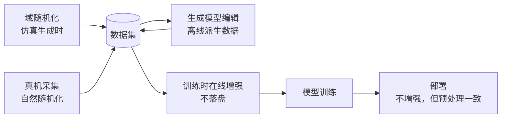

# 第二十二课：域随机化、生成模型与数据增强

> [!abstract] 本课覆盖的参数
> **域随机化项**、**生成模型**、**增强方式**
> 三者都是"人为制造多样性"的手段，但发生在数据链路的不同阶段：生成时、生成后、训练时。

上一课你用仿真为 SO-101 的"把红色方块放进盒子"任务生成了 2000 条数据，和 45 条真机数据一起训练。上午在实验室测试，成功率还不错。下午阳光从窗户斜射到桌面，或者你换了一块桌布，成功率突然掉了一大截。

问题不在动作，而在**模型没见过这样的画面**。仿真里光照永远是那盏固定的灯，桌面永远是那张灰色贴图；真机数据也只在上午那一种光照下采集。模型把"灰色桌面 + 正上方光照"当成了任务的一部分。

要让模型对这些"与任务无关的变化"不敏感，就要在数据里主动制造这些变化。本课讲三种做法：在仿真中**随机化**环境参数、用**生成模型**编辑已有示范、在训练时做**数据增强**。它们都能提升鲁棒性，但也都可能悄悄破坏"图像与动作标签的对应关系"，而这正是本课最需要警惕的地方。

本课与 [[第九课 相机布局：相机数量与位置、机位、安装高度与视场角]]、[[第十课 成像参数：分辨率、帧率、曝光白平衡与防抖]] 关系密切：真机采集时机位的微小变化、自动曝光和白平衡的波动，本质上就是"自然发生的随机化"。

---

## 1. 三种手段在数据链路中的位置

| 手段 | 发生在什么阶段 | 改变什么 | 是否写入数据集 | 最大风险 |
|---|---|---|---|---|
| 域随机化 | 仿真生成数据时 | 仿真的视觉和物理参数 | 是（参数要逐条记录） | 范围不合适：太窄无效，太宽学不会 |
| 生成模型编辑 | 数据生成之后，离线处理 | 已有示范的图像外观 | 是（作为新的派生数据） | 编辑改动了任务相关内容，图像与动作不一致 |
| 训练时增强 | 每次读取训练样本时 | 送进模型的图像（有时也包括状态） | 通常不写入，但配置必须保存 | 几何变换与动作标签不一致；强度过大破坏关键信息 |



> [!important] 本课的核心原则
> 任何改变观测的操作，都必须回答一个问题：**改完之后，原来的动作标签是否仍然正确**？如果答案是"不一定"，这条样本就可能变成教模型做错事的"毒样本"。

---

## 2. 域随机化项

### ① 一句话定义

域随机化（domain randomization）是**在仿真生成数据时，对每条（或每段）数据随机采样一组环境参数**，让模型见过足够多样的环境，从而把真实世界当成"又一种随机变化"。域随机化项就是"随机化了哪些参数、每个参数在什么范围内、按什么分布采样"。

### ② 采集时它控制什么

**视觉随机化**：

| 随机化项 | 例子 | 针对的真实变化 |
|---|---|---|
| 纹理与颜色 | 桌面、墙面、物体表面换不同贴图和颜色 | 换桌布、不同批次的物体 |
| 光照 | 光源方向、强度、色温、数量 | 白天/夜晚、窗边阳光、不同灯具 |
| 背景 | 背景图片或场景布置 | 实验室布局变化、人走动 |
| 干扰物 | 在桌面随机放置无关物体 | 真实桌面上的杂物 |
| 相机位姿与内参 | 相机位置、朝向小幅扰动；焦距、视场角变化 | 相机被碰歪、重新安装（第九课） |
| 图像噪声与后处理 | 高斯噪声、模糊、曝光偏移、白平衡偏移 | 传感器噪声、自动曝光与白平衡波动（第十课） |

**物理随机化**：

| 随机化项 | 例子 | 针对的真实变化 |
|---|---|---|
| 质量 | 物体质量在标称值附近变化 | 同款物体的个体差异、估算误差 |
| 摩擦 | 物体、桌面、夹爪指面的摩擦系数 | 材质、磨损、表面清洁程度 |
| 阻尼 | 关节阻尼 | 舵机个体差异、温度 |
| 执行器增益 | 位置控制器的刚度、最大力矩 | 舵机负载下的跟踪误差 |
| 延迟 | 观测或动作延迟若干控制步 | 相机、总线、推理时延（第十四课） |
| 观测噪声 | 关节读数加噪声 | 编码器量化与噪声 |

**随机化范围怎么定？** 这是域随机化最核心的工程判断：

| 范围 | 后果 |
|---|---|
| 太窄 | 等于没随机化，真实环境仍然落在训练分布之外 |
| 合适 | 覆盖真实世界的变化范围，并留有一定余量 |
| 太宽 | 任务变得不可学（例如延迟大到闭环控制失效），或模型学成"过于保守"的策略（例如为了应对极低摩擦，所有动作都变得缓慢、夹得很紧） |

一个可操作的做法是：**先测真实世界的变化范围，再在其外留余量。** 例如：

```text
实测：同款方块称重 18~22 g；
     在真机工作区不同时段拍照，图像平均亮度在某个区间内波动；
     端到端时延约 1~3 个控制步（第十四课的测量方法）。
随机化（示意）：质量 15~25 g；亮度覆盖实测区间并向两侧各扩展一些；延迟 0~4 步。
```

### ③ 最终生成什么数据

两样东西：**随机化配置**（范围和分布，整个数据集一份）和**每条数据实际采样到的参数值**。字段名为建议写法，LeRobot 没有统一规定，以你使用的版本和团队规范为准：

```yaml
# randomization_config.yaml：整个数据集一份
visual:
  table_texture: {type: choice, pool: textures_v3, n: 120}
  light_intensity: {type: uniform, low: 0.4, high: 1.6}   # 相对标称值，示意
  light_color_temp_k: {type: uniform, low: 3000, high: 6500}
  camera_pos_jitter_m: {type: uniform, low: -0.02, high: 0.02}
  distractors: {type: randint, low: 0, high: 4}
physics:
  cube_mass_kg: {type: uniform, low: 0.015, high: 0.025}
  cube_friction: {type: uniform, low: 0.5, high: 1.2}
  action_delay_steps: {type: randint, low: 0, high: 4}
  joint_obs_noise_std: 0.002   # 归一化单位，示意
```

```json
{
  "episode_index": 1203,
  "randomization_seed": 55120,
  "sampled": {
    "table_texture": "wood_017",
    "light_intensity": 1.32,
    "light_color_temp_k": 3400,
    "camera_pos_jitter_m": [0.011, -0.004, 0.006],
    "distractors": ["mug_03", "pen_01"],
    "cube_mass_kg": 0.021,
    "cube_friction": 0.63,
    "action_delay_steps": 2
  }
}
```

> [!warning] 为什么要逐条记录采样值
> 只记录范围，你只能知道"随机化过什么"。逐条记录采样值，你才能做**失败归因**：例如把仿真评估中的失败按"光照色温"分组，发现色温低于 3500 K 时成功率骤降，就知道问题出在暖光。

### ④ 设置不当会出什么问题

| 问题 | 在数据或模型上的表现 |
|---|---|
| 只随机化视觉，不随机化物理 | 模型看得懂真实场景，但抓取在真机上频繁滑落 |
| 范围不覆盖真实情况 | 某种真实光照或桌面下成功率骤降 |
| 范围过宽 | 生成成功率下降；训练损失降不下去；策略变得过于保守、动作迟缓 |
| 相机位姿随机化过大 | 模型难以从图像中精确定位物体，精细操作精度下降 |
| 只记录范围，不记录采样值 | 失败无法归因到具体因素 |
| 随机化在一条轨迹内突变 | 例如光照每帧都随机变，产生真实世界不存在的闪烁 |

### ⑤ 对 VLA 训练与部署的影响

- **视觉随机化让模型学会"忽略什么"。** 如果桌面纹理在数据里千变万化而任务不变，模型就被迫从纹理以外的线索（物体形状、相对位置）去决定动作，部署时对换桌布不再敏感。
- **物理随机化让动作更"留有余地"。** 在摩擦、质量变化的数据中，成功的轨迹往往夹得更稳、抬得更慢；模型学到的是对物理误差更宽容的动作。代价是速度和效率可能下降。
- **延迟随机化影响闭环行为。** 如果训练数据里包含延迟，模型更不容易在真机延迟下振荡；但延迟范围过大时，数据里的"观测→动作"关系变得模糊，模型的反应会变迟钝。
- **语言与视觉的混淆要小心。** 如果指令是"拿红色方块"，那么方块的颜色就**不是**与任务无关的因素，不能随机化；但干扰物的颜色可以随机化，甚至应该放一些红色干扰物，迫使模型同时看形状和位置。

### ⑥ 验收与清洗

- 规范中写明：随机化项清单、每项的范围与分布、确定范围的依据（实测数据）、随机化粒度（每条轨迹一次还是每段一次）；每条数据必须带采样值。
- 清洗时：统计每个随机化参数的实际分布（是否真的覆盖了配置的范围）；把真机实测值放到这些分布上，检查是否落在覆盖范围内（见第 6.3 节代码）。

---

## 3. 生成模型

### ① 一句话定义

这里的生成模型是指**用图像或视频生成模型，对已有示范的观测进行编辑或合成，派生出新的训练数据**。这些派生数据的动作和状态通常直接沿用原示范。

### ② 采集时它控制什么

常见用法（只做概念性描述，具体模型能做到什么程度以其文档和你的实测为准）：

| 用法 | 做法 | 动作标签如何处理 |
|---|---|---|
| 外观编辑 | 换背景、换桌面、换物体纹理、加干扰物、改光照 | 沿用原动作 |
| 生成新视角 | 从已有相机图像合成另一个视角的图像 | 沿用原动作，但新视角的相机位姿也要记录 |
| 视频生成 / 世界模型 | 根据当前画面（及动作或指令）生成未来视频 | 生成的视频本身没有可靠的动作标签，若要用于策略训练，动作需要另行获得，误差较大 |

外观编辑是目前最直接的用法：同一条 SO-101 示范，生成"木桌版""白桌版""杂乱桌面版"，相当于把一条示范的视觉多样性放大几倍。

**关键约束：编辑后的图像必须与原有的动作标签保持一致。**

```text
原图：方块在图像 (320, 240) 处，夹爪下一步向它下降
       动作标签：关节目标 → 夹爪到达方块位置

错误编辑：生成模型"顺手"把方块挪到了 (335, 238)，或把夹爪画成了另一种形状
       动作标签不变 → 夹爪下降到了方块旁边 15 像素处
       模型学到："看到方块后，往它旁边伸"
```

这种"图像-动作不一致"的样本就是毒样本。它比一条普通的坏数据更危险，因为它看起来非常正常，人工抽查很难发现。

常用的保护手段是**只编辑与任务无关的区域**：先分割出机械臂、夹爪和任务物体，把它们的掩码区域保护起来，只对其余区域做修复式编辑（inpainting）。但即使这样，边界附近的阴影、反光和遮挡关系也可能被改得不合理。

**另外两个问题：**

- **生成伪影。** 物体边缘融化、多出一根"手指"、文字乱码、纹理重复。
- **时间一致性。** 逐帧独立编辑会导致相邻帧的背景、光照不一致，视频看起来在闪烁。真实世界不会这样闪，模型可能学会对这种闪烁做出反应，或把闪烁当成噪声而降低对真实变化的敏感度。

### ③ 最终生成什么数据

派生数据作为新的 episode 写入数据集，并附带完整的生成记录（字段为建议写法，以你的版本和团队规范为准）：

```json
{
  "episode_index": 3051,
  "source_type": "gen_edited",
  "is_synthetic": true,
  "derived_from_episode": 37,
  "edit_type": "background_replace",
  "edited_cameras": ["observation.images.top"],
  "gen_model": {"name": "写实际模型名", "version": "写实际版本或权重哈希"},
  "prompt": "light wooden table, warm indoor lighting",
  "negative_prompt": "extra objects near the gripper",
  "seed": 4242,
  "edit_strength": 0.6,
  "protected_mask": "robot + gripper + cube + box",
  "mode": "per_frame",
  "action_state_copied_from_source": true,
  "consistency_check": {"min_object_iou": 0.94, "min_gripper_iou": 0.96, "passed": true}
}
```

生成模型的名称、版本、提示词、随机种子、编辑强度缺一不可：同一个模型换个版本、同一个提示词换个种子，结果可能完全不同。

**许可与标注。** 生成模型的使用条款可能对生成内容的用途有约束，被编辑的原始数据也有自己的许可。合成数据应明确标记（`is_synthetic`），便于下游使用者区分。具体约束以协议原文为准，必要时咨询法务，详见 [[第二十四课 数据集身份：名称版本、许可协议与视频来源]]。

### ④ 设置不当会出什么问题

| 问题 | 在数据里的表现 |
|---|---|
| 编辑改动了任务物体的位置或形状 | 编辑前后物体掩码 IoU 下降、质心偏移；训练后模型抓取系统性偏离 |
| 编辑改动了机械臂或夹爪 | 夹爪形状、开合程度和动作中的夹爪值不符 |
| 逐帧编辑导致闪烁 | 相邻帧背景差异远大于原视频 |
| 编辑强度过大 | 场景面目全非，甚至出现不合理的物理关系（物体悬空、阴影方向与光源矛盾） |
| 只编辑了一个相机 | 顶部相机是木桌，腕部相机里的桌面还是灰色，多视角之间互相矛盾 |
| 没记录生成参数 | 发现某批派生数据有问题时，无法定位是哪个模型版本或提示词导致的 |

### ⑤ 对 VLA 训练与部署的影响

- **正面作用：低成本扩展视觉多样性。** 一条真机示范的动作是真实的，外观编辑只增加视觉变化，能提升模型对背景、桌面、光照变化的鲁棒性，而且不引入仿真的物理差距。
- **毒样本让模型学到系统性偏差。** 如果大量派生数据中物体被挪动了几个像素，模型会学到"图像中的物体位置"与"实际要去的位置"之间存在固定偏差，部署时表现为总是抓偏一点。
- **多视角矛盾破坏视觉融合。** VLA 往往同时看多个相机；如果两个视角描述的不是同一个场景，模型在融合时会困惑。
- **派生数据比例过高会稀释真实信号。** 派生数据的动作和原始示范完全相同，增加它们不会增加动作多样性；比例过高时，相当于让少数几条原始示范的权重被放大了好几倍（与上一课"种子错误被放大"同理）。

### ⑥ 验收与清洗

- 规范中写明：允许的编辑类型、受保护区域、生成模型名称与版本、提示词与种子的记录要求、一致性检查方法与阈值、派生数据比例上限、每条派生数据必须带 `derived_from_episode`。
- 清洗时：逐帧比较编辑前后任务物体和夹爪的位置一致性（见第 6.2 节代码）；检查时间一致性；多相机数据检查各视角编辑是否协调；人工抽查派生视频。

---

## 4. 增强方式

### ① 一句话定义

数据增强（data augmentation）是**对训练样本施加随机变换，让模型在训练时见到更多变化**。增强方式指具体用了哪些变换、强度多大、是在线做还是离线做。

### ② 采集时它控制什么

增强不改变采集过程，但它决定了"模型在训练时实际看到了什么"。

**在线增强 vs 离线增强：**

| 方式 | 做法 | 优点 | 缺点 |
|---|---|---|---|
| 在线增强 | 每次读取样本时随机变换，不保存结果 | 每个 epoch 看到的变化都不同；不占存储 | 训练速度受影响；如果没保存配置，无法复现 |
| 离线增强 | 预先生成变换后的样本写入数据集 | 训练快；可以人工检查 | 占存储；变化是固定的；需要和原始数据区分标记 |

常见的图像增强：随机裁剪、平移、颜色抖动（亮度、对比度、饱和度、色调）、模糊、噪声、随机遮挡。

**几何增强与动作标签的耦合。** 这是增强里最容易出错的地方。以**水平翻转**为例：

假设顶部相机恰好位于机器人的左右对称面上，图像的水平方向对应机器人基座坐标系的 $y$ 轴。把图像左右翻转，等价于把场景沿 $xz$ 平面做镜像：

$$
u' = W - 1 - u \quad\Longleftrightarrow\quad y' = -y
$$

此时动作标签必须同步镜像：

| 动作空间 | 原标签 | 翻转后应变为 |
|---|---|---|
| 末端位置 $[x, y, z]$ | $[0.25, 0.08, 0.10]$ | $[0.25, -0.08, 0.10]$ |
| 末端姿态（roll, pitch, yaw） | $[r, p, \psi]$ | $[-r, p, -\psi]$ |
| SO-101 关节：底座旋转 `shoulder_pan` | $\theta$ | 约为 $-\theta$（前提是零位正对前方） |
| SO-101 关节：腕部旋转 `wrist_roll` | $\phi$ | 约为 $-\phi$（前提是零位对称） |
| 其余关节和夹爪 | 不变 | 不变 |

如果只翻转图像、不改标签：图像里方块在右边，动作却伸向左边，这就是最典型的毒样本。

即使你正确地改了标签，翻转仍然有很多陷阱，所以**大多数操作任务慎用翻转**：

- 相机往往不在对称面上，翻转后的图像不对应任何真实存在的相机位置；
- 机械臂本身不完全左右对称（舵机、线缆、夹爪的固定指和活动指），翻转后的图像里是一台"不存在的镜像机器人"；
- SO-101 的关节值通常是校准后的范围值（见 [[补学 第一至五课的缺口与勘误]]），零位不一定对称，"取负号"可能不成立；
- 腕部相机也要同步翻转并满足同样的对称条件；
- 指令中如果有"左边""右边"，语言也必须同步改写。

**随机裁剪对两类相机的不同影响：**

| 相机 | 小幅随机裁剪/平移的效果 | 注意事项 |
|---|---|---|
| 固定相机（顶部、侧面） | 近似于相机位置的小幅扰动；机械臂也在画面中，物体与夹爪的相对位置关系保留 | 裁剪过大可能把工作区边缘的物体裁掉 |
| 腕部相机 | 夹爪在画面中的位置本来是固定的，裁剪会让它"漂移" | 近距离时目标物体可能被裁出画面；幅度宜小 |

**增强强度过大会破坏任务关键信息。** 例如色调（hue）抖动让红色方块变成绿色，而指令仍是"拿红色积木"，样本就变成了"指令说红色、画面里是绿色、动作却去抓它"。亮度、对比度的适度抖动通常安全，但色调抖动在颜色相关的任务中应关闭或严格限制。

**训练与部署的一致性。** 部署时不做随机增强，但必须做与训练**相同的确定性预处理**：

| 训练时 | 部署时应该 | 常见错误 |
|---|---|---|
| 从 256×256 随机裁剪 224×224 | 中心裁剪 224×224 | 直接把 256×256 缩放到 224×224，物体在画面中的尺度变了 |
| 先缩放到某分辨率再归一化 | 同样的缩放和同样的归一化统计量 | 部署端用了不同的插值方式或通道顺序（RGB/BGR） |

**状态与动作上的噪声注入。** 除了图像，也可以在状态上加噪声：训练时给 `observation.state` 加小幅噪声，可以减少模型对精确状态的过度依赖，迫使它更多地参考图像。

另一种思想（以 DART 为代表）作用在**采集阶段**：采集示范时向实际执行的动作中注入噪声，让机器人偏离示范者的意图，同时记录示范者此刻想要纠正回来的动作作为标签。这样数据里就包含了"偏离后如何恢复"的样本。注意它与"给动作标签加噪声"不同：后者只会让标签变模糊，通常有害。

### ③ 最终生成什么数据

在线增强通常不落盘，但**增强配置必须随模型版本一起保存**，否则模型无法复现，也无法保证部署预处理一致：

```yaml
# 随模型 checkpoint 一起保存：augmentation.yaml（字段为示意）
image:
  random_crop: {size: [224, 224], apply_to: [top, wrist]}
  color_jitter: {brightness: 0.2, contrast: 0.2, saturation: 0.2, hue: 0.0}  # 颜色任务关闭 hue
  gaussian_blur: {p: 0.1, kernel: 3}
  horizontal_flip: false     # 明确写出未使用
state:
  gaussian_noise_std: 0.01   # 归一化后单位
deploy_preprocess:
  center_crop: [224, 224]
  normalization_stats: meta/stats.json
```

离线增强写入数据集的样本，和生成模型派生数据一样，需要 `derived_from_episode`、增强类型和参数、`is_synthetic` 等标记。

### ④ 设置不当会出什么问题

| 问题 | 表现 |
|---|---|
| 几何增强不改标签 | 模型动作方向混乱，部分情况下伸向镜像位置 |
| 增强强度过大 | 训练损失难以下降；精细操作（对准、插入）的精度明显下降 |
| 颜色增强与指令冲突 | 模型分不清颜色，"拿红色"和"拿绿色"表现相同 |
| 部署预处理与训练不一致 | 训练指标很好，部署时整体表现变差，物体定位偏移 |
| 增强配置没保存 | 无法复现模型，也说不清部署端该怎样预处理 |
| 与域随机化叠加过度 | 仿真数据已经做了强光照随机化，训练时再加强颜色抖动，实际变化幅度远超预期 |

### ⑤ 对 VLA 训练与部署的影响

- **适度增强提升对光照、背景、机位变化的鲁棒性。** 特别是在真机数据只来自一个场景时，颜色抖动和小幅随机裁剪往往是性价比最高的鲁棒性手段。
- **过度增强降低精细操作性能。** 精细操作依赖像素级的位置信息，随机平移和大幅裁剪会让"物体在画面中的位置"变得不可靠，模型只能学到粗略的接近动作。
- **合成与真实数据比例。** 增强、随机化、生成编辑都会产生"不像真实"的样本。它们与原始真机数据的比例需要通过真机评估来调，而不是越多越好。

### ⑥ 验收与清洗

- 规范中写明：增强类型、每项强度、在线/离线、作用于哪些相机、是否涉及几何变换及对应的标签变换规则、部署预处理；配置文件随模型版本归档。
- 清洗/检查时：把增强后的样本排成网格人工抽检（见第 6.1 节代码），重点看任务物体是否仍然可辨、颜色是否被改变、腕部相机中夹爪和目标是否被裁出画面。

---

## 5. 把三种手段串起来

### 5.1 同一个"变化"不要重复做过头

| 变化因素 | 真机自然随机化 | 域随机化 | 生成模型编辑 | 训练时增强 |
|---|---|---|---|---|
| 光照 | 不同时段采集 | 光源方向/强度/色温 | 改光照 | 亮度/对比度抖动 |
| 背景/桌面 | 换桌布采集 | 纹理随机化 | 换背景 | 一般做不到 |
| 机位 | 相机重新安装（第九课） | 相机位姿扰动 | 生成新视角 | 随机裁剪/平移 |
| 物理参数 | 不同物体个体 | 质量/摩擦/延迟 | 做不到 | 状态噪声（间接） |

规划时先填这张表，你会清楚地看到每种变化"由谁负责"，避免某个因素在三个环节被叠加放大，也避免某个因素（例如物理参数）完全没人负责。

### 5.2 一个比例计算

假设训练集组成如下（示意数值）：

| 来源 | 条数 |
|---|---|
| 真机遥操作原始数据 | 45 |
| 生成模型外观编辑（每条真机数据派生 4 条） | 180 |
| 仿真生成 + 域随机化 | 2000 |

按条数均匀采样，真机原始数据占 $45/2225 \approx 2\%$。派生数据的动作和原始数据完全相同，所以"真实动作"只有 45 条，却以 $45+180=225$ 条的形式出现，占约 10%。

如果训练时设定"真机及其派生数据占一半、仿真数据占一半"，那么每条真机原始动作被采样的频率，是每条仿真数据的约 $\frac{0.5/225}{0.5/2000} \approx 8.9$ 倍。这种比例是否合适，只能通过真机评估判断；但你至少要**算出来**，而不是让它在合并数据集时隐式决定。

---

## 6. 清洗实践

### 6.1 增强样本网格人工抽检

```python
import cv2
import numpy as np

rng = np.random.default_rng(0)

def augment(img, crop=224, bright=0.2, contrast=0.2):
    """简化的增强：随机裁剪 + 亮度/对比度抖动（不含色调变化）"""
    h, w = img.shape[:2]
    y = rng.integers(0, h - crop + 1)
    x = rng.integers(0, w - crop + 1)
    out = img[y:y + crop, x:x + crop].astype(np.float32)
    a = 1 + rng.uniform(-contrast, contrast)   # 对比度系数
    b = 255 * rng.uniform(-bright, bright)     # 亮度偏移
    return np.clip(a * out + b, 0, 255).astype(np.uint8)

img = cv2.imread("frame_top_000120.png")      # 一帧原始图像，需不小于 224×224
cells = [augment(img) for _ in range(16)]
rows = [np.hstack(cells[i:i + 4]) for i in range(0, 16, 4)]
cv2.imwrite("aug_grid.png", np.vstack(rows))  # 打开这张 4×4 网格逐格检查
```

检查要点：任务物体是否在每一格都可辨、是否被裁出画面、颜色是否仍能区分。这里的增强函数只是示意，实际检查时应直接调用训练代码中的增强函数，否则检查的不是模型真正看到的东西。

### 6.2 生成编辑前后的一致性检查

思路：用同一个分割模型（或关键点检测器）分别处理编辑前和编辑后的每一帧，比较任务物体和夹爪的掩码。

```python
import numpy as np

def mask_iou(a, b):
    """两个布尔掩码的交并比；两者都为空时返回 1"""
    union = np.logical_or(a, b).sum()
    return 1.0 if union == 0 else np.logical_and(a, b).sum() / union

def centroid(m):
    ys, xs = np.nonzero(m)
    return None if len(xs) == 0 else np.array([xs.mean(), ys.mean()])

IOU_MIN, SHIFT_MAX = 0.90, 3.0   # 示例阈值：IoU 不低于 0.9，质心偏移不超过 3 像素

def check_episode(masks_orig, masks_edit):
    """masks_*: 列表，每帧一个字典 {"cube": bool数组, "gripper": bool数组}"""
    bad = []
    for t, (mo, me) in enumerate(zip(masks_orig, masks_edit)):
        for name in mo:
            iou = mask_iou(mo[name], me[name])
            c0, c1 = centroid(mo[name]), centroid(me[name])
            if (c0 is None) != (c1 is None):   # 一边检测到、另一边没检测到
                bad.append((t, name, iou, float("inf")))
                continue
            shift = 0.0 if c0 is None else float(np.linalg.norm(c0 - c1))
            if iou < IOU_MIN or shift > SHIFT_MAX:
                bad.append((t, name, round(iou, 3), round(shift, 1)))
    return bad
```

时间一致性可以用一个更粗的指标：比较编辑后视频与原视频在背景区域的相邻帧差异。

```python
def flicker_ratio(frames_orig, frames_edit, bg_masks):
    """背景区域相邻帧平均差异之比；明显大于 1（例如 > 1.5，示例阈值）说明编辑引入了闪烁"""
    def mean_diff(frames):
        d = [np.abs(frames[t + 1].astype(np.float32) - frames[t].astype(np.float32))[bg_masks[t]].mean()
             for t in range(len(frames) - 1)]
        return np.mean(d)
    return mean_diff(frames_edit) / (mean_diff(frames_orig) + 1e-6)
```

> [!warning] 这些检查的局限
> 分割模型在编辑后的图像上本身可能失败，此时 IoU 下降不一定说明物体被挪动了（但这本身也是一个值得复查的信号）。大物体的 IoU 对几个像素的偏移不敏感，小物体则非常敏感，阈值要按物体大小设定。闪烁比只能发现明显的闪烁，发现不了缓慢的漂移。最终仍要人工回放抽查。

### 6.3 随机化参数覆盖与失败归因

```python
import pandas as pd

# 每条数据一行，列为采样到的随机化参数；仿真评估时再加一列 success
df = pd.read_json("randomization_sampled.jsonl", lines=True)

# 1. 覆盖检查：实际分布 vs 真机实测值（真机实测值为示意）
real = {"light_color_temp_k": 4800, "cube_friction": 0.7}
for k, v in real.items():
    lo, hi = df[k].quantile([0.01, 0.99])
    print(f"{k}: 数据覆盖 [{lo:.3g}, {hi:.3g}]，真机实测 {v}，", "在范围内" if lo <= v <= hi else "超出范围！")

# 2. 失败归因：按某个参数分箱统计成功率
if "success" in df:
    df["temp_bin"] = pd.cut(df["light_color_temp_k"], bins=6)
    print(df.groupby("temp_bin", observed=True)["success"].agg(["mean", "size"]))
```

如果某个分箱的成功率明显低于其他分箱，说明模型在这种条件下表现差，可以针对性地补充数据或调整随机化。注意：仿真评估中的成功率规律不一定能直接迁移到真机（上一课讲过仿真与真机评估不一致），它只是一个排查方向。

---

## 7. 验收清单写法速查

| 字段 | 示例写法（阈值为示例，需按任务确定） |
|---|---|
| 视觉随机化项 | 桌面纹理 120 种、光照强度相对标称 0.4~1.6 倍、色温 3000~6500 K、相机位置扰动 ±2 cm、干扰物 0~3 个；任务物体颜色不随机化（指令涉及颜色） |
| 物理随机化项 | 方块质量 15~25 g、摩擦 0.5~1.2、动作延迟 0~4 步；范围依据见实测记录 |
| 随机化记录 | 随机化配置文件一份；每条数据记录全部采样值与随机种子 |
| 生成模型 | 模型名称与版本（或权重哈希）、提示词、种子、编辑强度、受保护区域逐条记录；派生数据带 `derived_from_episode` 和 `is_synthetic` |
| 编辑一致性 | 每帧任务物体与夹爪掩码 IoU ≥ 0.90、质心偏移 ≤ 3 px；背景闪烁比 ≤ 1.5；多相机同步编辑 |
| 派生数据比例 | 每条原始示范派生不超过 4 条；派生数据占比不超过 20% |
| 增强方式 | 在线增强：随机裁剪 224、亮度/对比度 ±0.2、不使用色调抖动、不使用水平翻转；配置文件随 checkpoint 归档 |
| 几何增强 | 如使用翻转，写明动作与语言的镜像规则并附验证记录；否则明确写"不使用" |
| 部署预处理 | 中心裁剪 224、归一化统计量文件路径；与训练确定性预处理一致 |
| 许可 | 生成模型使用条款与原始数据许可已核对（以协议原文为准，必要时咨询法务） |

---

## 8. 第二十二课练习

**问题 1：随机化范围**

你在仿真中把动作延迟随机化为 0~30 个控制步（30 Hz 下最长 1 s），而真机实测延迟约 1~3 步。训练后策略在仿真和真机上都动作迟缓、犹豫。最可能的原因是？

A. 延迟随机化范围过宽，"观测→动作"的关系变得模糊，模型学成了保守策略
B. 延迟随机化范围太窄
C. 应该同时随机化纹理

**问题 2：水平翻转**

你对 SO-101 顶部相机图像做了随机水平翻转增强，动作是关节绝对位置，标签没有任何修改。部署后最可能出现什么现象？

A. 没有影响，关节位置和图像方向无关
B. 模型对物体左右位置的判断混乱，有时伸向物体的镜像位置
C. 模型只是速度变慢

**问题 3：生成模型编辑**

你用图像生成模型给 45 条真机示范换背景。一致性检查发现，有一批数据中方块的掩码质心在编辑后平均偏移 12 像素，但 IoU 仍在 0.8 左右。正确的处理是？

A. IoU 还有 0.8，可以保留
B. 剔除或重新生成这批数据，因为方块位置变了而动作标签没变，会教模型抓偏
C. 把这批数据的动作标签整体平移 12 像素

**问题 4：训练与部署一致性**

训练时从 256×256 图像随机裁剪 224×224。部署时以下哪种预处理最合理？

A. 把 256×256 直接缩放到 224×224
B. 中心裁剪 224×224，并使用与训练相同的归一化统计量
C. 部署时也随机裁剪，以保持一致

**问题 5：开放思考题**

指令为"把红色积木放进蓝色盒子"。请设计一套增强与随机化方案：哪些因素可以随机化或增强、哪些必须保持不变，并各说明理由。

> [!question]- 参考答案（点击展开）
> 1. **A**。延迟范围远超真实情况，数据中同一个观测对应的"正确动作"随延迟变化很大，模型只能学到一种折中的、缓慢的动作。范围应以实测为依据（例如 0~4 步）。
> 2. **B**。图像翻转后，物体在画面中左右互换，但关节标签（例如底座旋转方向）没变，样本变成"画面中物体在右，动作却伸向左"。这类样本与正常样本互相矛盾，模型的左右判断会混乱。
> 3. **B**。质心偏移 12 像素说明方块在图像中被挪动了，IoU 对较大物体的小偏移不够敏感，不能单独作为放行依据。C 不可行：像素偏移无法直接换算成关节目标的修正量，而且偏移本身就是生成模型的错误，应修正数据源而不是去迁就它。
> 4. **B**。部署时不做随机增强，但要做相同尺度的确定性预处理。A 改变了物体在画面中的尺度；C 引入了不必要的随机性，每次推理的输入都不同。
> 5. 参考思路：
>    - 可以变化：桌面纹理、背景、光照强度和方向（适度）、相机位置小幅扰动、干扰物（包括非积木形状的红色物体、其他颜色的积木）、亮度/对比度抖动、小幅随机裁剪。理由：这些与任务目标无关，模型应学会忽略它们。
>    - 必须保持不变或严格限制：积木和盒子的颜色（色调抖动关闭、纹理随机化不作用于这两个物体）；光照色温变化要限制在不会让红色和蓝色混淆的范围内；不使用水平翻转（相机不在对称面上，且需要同步改动作标签）。理由：颜色是指令中的关键信息，改变它会造成指令与画面矛盾。
>    - 可以加入红色干扰物（例如红色杯子），迫使模型同时依据形状和颜色识别目标。
>    - 所有随机化采样值逐条记录，增强配置随模型保存。

---

## 9. 小结

一句话：**随机化、生成编辑和增强都是在"不改变正确动作"的前提下扩展观测的多样性；一旦改变了任务相关的内容（物体位置、夹爪形状、指令中的颜色、左右方向）而动作标签没有同步改变，多样性就变成了毒样本。**

到这里，模块五"仿真与合成数据"结束。下一课 [[第二十三课 数据交付：单段时长、存储容量、文件格式与命名规则]] 将进入模块六：如何把采集、生成和派生的数据按统一的格式、命名和容量规划交付出去，让验收方能够逐项检查本课程讲过的所有参数。
