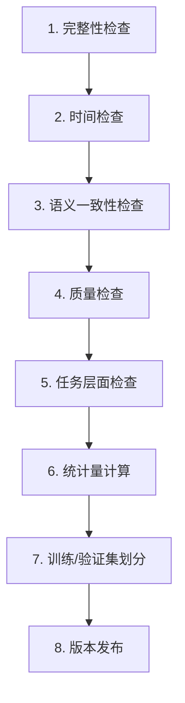
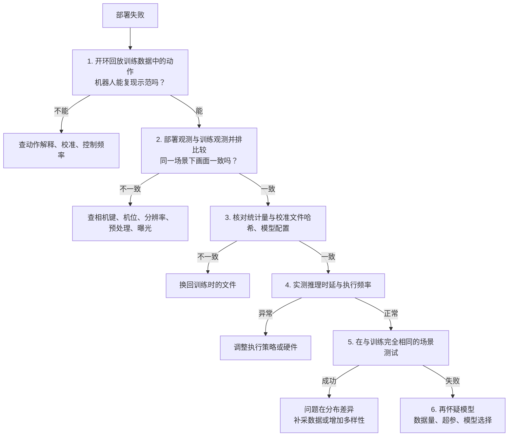

# 第二十五课：综合实战——从参数清单到验收、清洗、训练与部署

> [!abstract] 本课覆盖的参数
> **全部参数串联**。本课不引入新参数，而是把 [[00 课程总目录与学习路线]] 中的全部参数，按"数据生命周期"重新组织一遍。

你开始这套课程时的目标是：**不只学参数的表层定义，而是从数据采集一路走到数据清洗、训练和部署。** 前二十四课，你按"一个参数六个问题"的方式，逐个拆解了清单里的参数。这一课反过来：不再按参数讲，而是按**一份数据从诞生到被部署的顺序**讲，看每个参数在哪一步出场、在哪一步被检查、在哪一步必须保持一致。

| 部分 | 内容 | 你要获得的能力 |
|---|---|---|
| 第一部分 | 为 SO-101 抓笔任务写一份完整的采集与验收规范 | 根据采集方式裁剪参数清单 |
| 第二部分 | 全部参数在生命周期中的位置 | 知道每个参数在哪个环节被检查、被使用 |
| 第三部分 | 数据清洗流水线 | 按顺序组织检查，写出可组合的检查代码 |
| 第四部分 | 训练阶段 | 知道训练从数据中读取哪些配置、哪些数据问题会让训练失败 |
| 第五部分 | 部署阶段 | 部署前做一致性检查，部署失败时按正确顺序排查 |
| 第六部分 | 故障排查练习 | 从症状反推参数问题 |

> [!note] 关于参数数量
> 原始参数清单共 70 个参数，本课按总目录第三节"速查索引"中的 70 个名称逐一归类，覆盖清单的全部内容。

---

## 第一部分：SO-101 抓笔任务的《数据采集需求与验收规范》样例

下面是一份可以直接改写使用的规范样例。所有数值都是**示例**，你需要根据自己的硬件、LeRobot 版本和实测结果替换。

### 1.1 任务定义

| 项目 | 内容（示例） |
|---|---|
| 数据集名称 | `your-org/emb-pickpen-so101` |
| 目标模型 | ACT（单任务基线）、SmolVLA（带语言指令） |
| 采集方式 | A 类：真机主从臂遥操作（总目录第一节） |
| 任务 | 从桌面抓起一支笔，放入笔筒 |
| 语言指令 | `Pick up the pen and put it in the pen holder.`（全部数据使用同一句，部署时也使用同一句） |
| 成功判定 | 笔完全进入笔筒且夹爪松开、机械臂离开笔筒；由采集员当场标注，验收时回放复核 |
| 初始条件 | 笔在桌面 30 cm × 20 cm 区域内随机摆放，朝向随机；笔筒位置固定 |
| 规模 | 首批 50 段（练习可先采 20 段）；2 位操作员；1 个工位 |
| 环境 | 室内固定照明，关闭窗帘；桌面为同一块浅色桌布 |

### 1.2 适用参数逐项规范

**A. 时间与频率**

| 参数 | 规范要求（示例） | 验收方法 |
|---|---|---|
| 时间同步方式（第一课基础） | 单台上位机采集全部设备，统一使用主机单调时钟 | 检查采集程序配置 |
| 时间戳对齐误差 | 相机帧与关节读数的对齐误差 P95 ≤ 20 ms | 共同事件法（第二课），每天开工测一次 |
| 多机同步方式 | 两路 USB 相机无硬件同步，软件时间戳，记录每帧到达时刻 | 两路相机拍同一闪光事件，比较帧时刻差 |
| 控制频率 | 30 Hz；实测间隔 P95 ≤ 40 ms，最大 ≤ 100 ms | 额外记录真实时钟时间戳字段并统计 |
| 采样率 | 两路相机 30 FPS；关节每个控制周期读取一次 | 同上 |
| 轨迹记录频率 | 30 Hz，与控制循环同步；不做重采样 | `info.json` 中 `fps` = 30 |

**B. 本体与动作语义**

| 参数 | 规范要求（示例） | 验收方法 |
|---|---|---|
| 自由度 | 5 个手臂关节 + 1 个夹爪，共 6 维 | `features` 中 `shape` = [6] |
| 夹爪类型 | 单舵机驱动的两指夹爪 | 写入数据集卡片 |
| 夹爪开合记录 | 连续值，记录舵机位置（校准后范围值），不做二值化 | 检查夹爪维度分布是否覆盖全开到闭合 |
| 关节状态记录项 | `observation.state` = 从臂 6 个关节位置；不记录速度与电流 | 核对 `names` 与顺序 |
| 动作空间 | `action` = 主臂 6 个关节读数，作为从臂绝对目标位置 | 核对 `names`；确认是否记录限幅前或限幅后的值 |
| action 与 state 对齐方式 | 同一行的 action 与 state 在同一控制周期内读取；action 领先 state 的跟踪滞后视为正常并测量 | 互相关估计滞后（补学文档），记录均值 |
| 标定方式 | 一个数据集版本只使用一套校准文件；校准文件随数据归档并记录哈希 | 核对每段元数据中的校准文件名与哈希 |
| 输入设备型号 | SO-101 主臂（leader arm） | 写入数据集卡片 |
| 端到端时延 | 主臂运动到从臂开始跟随的时延，开工前测量并记录 | 高速视频或互相关估计 |
| 力反馈 | **无**（主臂不提供力反馈），写入卡片 | — |

> [!tip] "无"也是信息
> 力反馈不是"不适用"，而是"适用但没有"。主臂没有力反馈，意味着操作员感受不到接触力，数据中的接触动作可能偏猛。这会影响你对数据质量的判断，所以要明确写"无"。

**C. 视觉**

| 参数 | 规范要求（示例） | 验收方法 |
|---|---|---|
| 相机数量与位置 | 2 路：顶部固定相机 `top`、腕部相机 `wrist` | `features` 中的视频键 |
| 机位数量 | 1 个固定机位（顶部）+ 1 个随动机位（腕部） | 同上 |
| 机位高度与角度 | 顶部相机位于桌面前上方，俯视角度固定；拍摄范围覆盖随机摆放区与笔筒，不拍到操作员面部 | 每天开工拍一张参考图，与基准图叠加比对 |
| 安装高度 | 顶部相机安装高度固定（例如距桌面 60~80 cm），用支架固定并做位置标记 | 卷尺测量 + 参考图比对 |
| 视场角 | 记录相机型号与镜头视场角，全程不更换镜头 | 写入卡片 |
| 分辨率 | 640×480 | `features` 中 `shape` |
| 帧率 | 30 FPS，与记录频率一致 | 视频帧数 = parquet 行数 |
| 曝光与白平衡 | 关闭自动曝光与自动白平衡，固定为开工时调好的值 | 统计每段平均亮度与色温漂移 |
| 防抖 | 关闭（固定相机不需要；腕部相机的电子防抖会引入画面裁剪和时间不确定性） | 检查相机设置 |
| 编码格式 | 使用所用 LeRobot 版本的默认视频编码（较新版本常见为 AV1，以版本为准） | `features` 中 `video.codec` |
| 码率 | 记录编码参数；实测平均码率每路约 1~3 Mbit/s 量级 | 文件大小 / 时长 |
| 深度或 LiDAR | **不使用**（任务对深度精度要求不高，先用 RGB 建立基线） | — |

**D. 任务过程**

| 参数 | 规范要求（示例） | 验收方法 |
|---|---|---|
| 复位方式 | 人工复位：机械臂回到固定初始姿态，笔按随机表重新摆放；复位时间不录制 | 检查每段首帧姿态一致性 |
| 奖励定义 | 不做稠密奖励；每段一个二值成功标签 | 回放复核成功标签 |
| 单段时长 | 5~40 s；开头静止 ≤ 1 s；结尾保留 0.5~1 s 稳定画面；到达上限自动结束并标记未完成 | 时长直方图 + 首尾静止检查（第二十三课） |

**E. 交付与身份**

| 参数 | 规范要求（示例） | 验收方法 |
|---|---|---|
| 存储容量 | 预估交付约 0.5 GB / 50 段；采集端剩余空间 ≥ 当日预估的 2 倍；交付数据 3 份备份 | 采集前检查磁盘；交付后核对大小 |
| 交付文件格式 | LeRobot 数据集，`codebase_version` 以实际为准；附字段说明 | 官方加载器读取成功 |
| 文件命名规则 | 数据集外部文件按 `项目_任务_本体_地点-工位_操作员ID_UTC时间_段序号_版本`；数据集内部文件不改名 | 正则校验（第二十三课） |
| 数据集名称与版本 | 名称固定；内容版本 `v1.0.0` 起；格式版本单独记录；附变更日志 | 哈希清单 + 变更日志 |
| 许可协议 | 内部使用；如需公开，由法务确定许可 | 数据集卡片 `license` 字段 |
| 视频来源 | 全部自采，无公开数据集或互联网视频 | 来源清单 |

**F. 训练侧**

| 参数 | 规范要求（示例） | 验收方法 |
|---|---|---|
| 增强方式 | 交付数据不做任何增强；训练时可做轻度颜色与裁剪增强，增强配置随训练记录保存 | 核对训练配置 |

### 1.3 不适用的参数及理由

| 参数 | 为什么不适用 | 什么情况下会变得适用 |
|---|---|---|
| 拼接方式、投影格式 | 没有全景或多相机拼接 | 改用全景相机记录场景 |
| 头部位姿采样率、佩戴位置、手部可见要求、手部关键点数 | 不是人类第一视角采集 | 补充头戴相机拍摄的人手示范 |
| 手指自由度 | 两指夹爪没有独立手指，人手侧也没有采集 | 换用灵巧手，或采集人手数据 |
| 机型下限、握持或固定方式、采集App及版本、位姿追踪方式、IMU采样率、联网与云端上传 | 不是手持设备或手机采集 | 增加 UMI 式手持夹爪数据 |
| 力与力矩采样率、力传感量程、触觉通道数 | 没有力/力矩传感器和触觉传感器 | 加装腕部力传感器或指尖触觉 |
| 节点数、骨骼模型、标记点数、动捕相机数量、捕捉空间尺寸、融合方式 | 没有动作捕捉 | 用光学动捕获取真值位姿 |
| 策略版本、日志记录频率、接管触发条件、接管点标注方式 | 当前是人类示范，不是策略在线运行 | **部署后**记录策略运行日志与人工接管数据 |
| 仿真平台、资产来源、规划方法、种子示范来源、扩增倍数、域随机化项、生成模型 | 全部是真机数据，没有仿真或合成 | 用仿真扩增数据或生成模型做增强 |

### 1.4 裁剪参数清单的三个问题

对清单里的每个参数，依次问：

1. **我的采集方式里有没有这个环节？** 没有 → 标"不适用"，并写明理由和"什么情况下会适用"。
2. **有这个环节，但我选择不用？** → 写"无"或"不使用"，并说明原因（例如力反馈"无"、深度"不使用"、防抖"关闭"）。
3. **有且使用？** → 写明数值、实测方法和验收阈值。

> [!important] 为什么"不适用"也要写出来
> 一份只列适用参数的规范，读者无法区分"作者考虑过但不适用"和"作者忘了"。把不适用项连同理由一起列出，规范才是完整的。而且你的项目会演进：今天不适用的"策略版本"，在你第一次部署后就变得必需。

---

## 第二部分：参数在生命周期中的位置

### 2.1 六个环节


| 环节 | 核心问题 | 典型参数 |
|---|---|---|
| 采集前确认 | 设备、配置和规范定好了吗？ | 控制频率、相机布局、标定方式、动作空间、交付格式、许可 |
| 采集中监控 | 现在录下来的数据正常吗？ | 实测循环间隔、磁盘空间、曝光是否漂移、单段时长、手部是否可见 |
| 验收 | 交来的数据和规范一致吗？ | 帧数一致性、时间戳误差、字段定义、命名、版本、来源与许可 |
| 清洗 | 哪些要剔除、修正、裁剪？ | 跳变、丢帧、首尾静止、成功标签、角度回绕 |
| 训练 | 训练从数据里读什么？ | fps、动作与状态定义、相机键、统计量、单段时长与动作块 |
| 部署 | 部署环境和训练数据一致吗？ | 相机与机位、分辨率与预处理、控制频率、动作解释、统计量、校准 |

### 2.2 全部参数的环节矩阵

图例：**前** = 采集前确认；**中** = 采集中监控；**验** = 验收检查；**洗** = 清洗处理；**训** = 训练使用；**部** = 部署时必须保持一致。● 表示该参数在这个环节需要重点关注。

**真机通用（模块一）**

| 参数 | 前 | 中 | 验 | 洗 | 训 | 部 |
|---|---|---|---|---|---|---|
| 时间戳对齐误差 | ● | ● | ● | ● | | ● |
| action与state对齐方式 | ● | | ● | ● | ● | ● |
| 关节状态记录项 | ● | ● | ● | ● | ● | ● |
| 动作空间 | ● | | ● | | ● | ● |
| 控制频率 | ● | ● | ● | | ● | ● |
| 采样率 | ● | ● | ● | ● | | ● |
| 轨迹记录频率 | ● | | ● | ● | ● | ● |
| 自由度 | ● | | ● | | ● | ● |
| 夹爪类型 | ● | | ● | | ● | ● |
| 夹爪开合记录 | ● | ● | ● | ● | ● | ● |
| 手指自由度 | ● | | ● | | ● | ● |
| 标定方式 | ● | ● | ● | ● | | ● |

**视觉（模块二）**

| 参数 | 前 | 中 | 验 | 洗 | 训 | 部 |
|---|---|---|---|---|---|---|
| 相机数量与位置 | ● | ● | ● | | ● | ● |
| 机位数量 | ● | | ● | | ● | ● |
| 机位高度与角度 | ● | ● | ● | | | ● |
| 安装高度 | ● | ● | ● | | | ● |
| 视场角 | ● | | ● | | | ● |
| 分辨率 | ● | | ● | | ● | ● |
| 帧率 | ● | ● | ● | ● | | ● |
| 曝光与白平衡 | ● | ● | ● | ● | | ● |
| 防抖 | ● | | ● | | | ● |
| 编码格式 | ● | | ● | | ● | |
| 码率 | ● | ● | ● | | | |
| 深度或LiDAR | ● | ● | ● | ● | ● | ● |
| 多机同步方式 | ● | ● | ● | ● | | |
| 拼接方式 | ● | | ● | ● | ● | ● |
| 投影格式 | ● | | ● | | ● | ● |

**人类示范与遥操作（模块三）**

| 参数 | 前 | 中 | 验 | 洗 | 训 | 部 |
|---|---|---|---|---|---|---|
| 输入设备型号 | ● | | ● | | | |
| 端到端时延 | ● | ● | ● | ● | | ● |
| 力反馈 | ● | | ● | | | |
| 头部位姿采样率 | ● | ● | ● | ● | ● | |
| 手部关键点数 | ● | | ● | ● | ● | |
| 佩戴位置 | ● | ● | ● | | ● | |
| 手部可见要求 | ● | ● | ● | ● | | |
| 机型下限 | ● | | ● | | | |
| 握持或固定方式 | ● | ● | ● | | | |
| 采集App及版本 | ● | | ● | | | |
| 位姿追踪方式 | ● | ● | ● | ● | ● | ● |
| IMU采样率 | ● | ● | ● | ● | | |
| 联网与云端上传 | ● | ● | ● | | | |
| 力与力矩采样率 | ● | ● | ● | ● | ● | ● |
| 力传感量程 | ● | ● | ● | ● | | ● |
| 触觉通道数 | ● | | ● | ● | ● | ● |
| 节点数 | ● | | ● | | ● | |
| 骨骼模型 | ● | | ● | ● | ● | |
| 标记点数 | ● | ● | ● | | | |
| 动捕相机数量 | ● | | ● | | | |
| 捕捉空间尺寸 | ● | ● | ● | | | |
| 融合方式 | ● | | ● | ● | | |

**部署回流（模块四）**

| 参数 | 前 | 中 | 验 | 洗 | 训 | 部 |
|---|---|---|---|---|---|---|
| 策略版本 | ● | | ● | ● | ● | ● |
| 日志记录频率 | ● | ● | ● | ● | ● | |
| 接管触发条件 | ● | ● | ● | | ● | ● |
| 接管点标注方式 | ● | ● | ● | ● | ● | |
| 奖励定义 | ● | ● | ● | ● | ● | ● |
| 复位方式 | ● | ● | ● | | | ● |

**仿真与合成（模块五）**

| 参数 | 前 | 中 | 验 | 洗 | 训 | 部 |
|---|---|---|---|---|---|---|
| 仿真平台 | ● | | ● | | ● | |
| 资产来源 | ● | | ● | | | |
| 规划方法 | ● | | ● | ● | ● | |
| 种子示范来源 | ● | | ● | | ● | |
| 扩增倍数 | ● | | ● | | ● | |
| 域随机化项 | ● | | ● | | ● | ● |
| 生成模型 | ● | | ● | ● | ● | |
| 增强方式 | | | ● | | ● | ● |

**交付与身份（模块六）**

| 参数 | 前 | 中 | 验 | 洗 | 训 | 部 |
|---|---|---|---|---|---|---|
| 单段时长 | ● | ● | ● | ● | ● | |
| 存储容量 | ● | ● | ● | | ● | |
| 交付文件格式 | ● | | ● | ● | ● | |
| 文件命名规则 | ● | ● | ● | ● | | |
| 数据集名称与版本 | | | ● | ● | ● | ● |
| 许可协议 | ● | | ● | ● | ● | ● |
| 视频来源 | ● | | ● | ● | ● | |

### 2.3 这张矩阵告诉你什么

1. **"前"这一列几乎全是 ●。** 绝大多数参数必须在采集前定好。总目录的核心原则在这里再次体现：采集时没有记录的信息，后面无法恢复。
2. **"验"这一列全是 ●。** 每个适用的参数都要能被验收，规范里写不出验收方法的参数，等于没写。
3. **"洗"这一列比"验"少得多。** 很多问题只能发现、不能修复。例如机位角度不对、曝光漂移、视场角不同——清洗只能剔除，不能"修正"成正确的数据。
4. **"部"这一列就是第五部分的一致性检查表。** 凡是 ● 的参数，部署环境和训练数据之间都必须一致，或者有明确的转换。
5. **"增强方式"在"部"列是 ●，意思是"部署时不能做"。** 训练时的随机增强只用于训练；部署时的图像预处理必须是训练中"不增强"那条路径，否则输入分布会偏离。

---

## 第三部分：数据清洗流水线

### 3.1 顺序



**为什么是这个顺序？** 前面的检查是后面检查的前提：文件都不完整，时间检查没有意义；时间轴不可信，跳变检测会误报；单位和关节顺序没确认，质量阈值无法设定。而统计量必须在所有剔除和裁剪**之后**计算（补学文档），划分必须在统计量之前或同时确定口径，发布必须在最后。

| 步骤 | 检查什么 | 对应参数（课程） | 不通过怎么办 |
|---|---|---|---|
| 1. 完整性 | 文件数、parquet 行数 = 视频帧数 = `total_frames`、哈希、官方加载器能读 | 交付文件格式、存储容量、帧率（第十、二十三课） | 重新传输；损坏段剔除 |
| 2. 时间 | 时间戳单调、真实间隔分布、多相机时刻差、对齐误差 | 时间戳对齐误差、控制频率、采样率、轨迹记录频率、多机同步方式（第一、二、六、十三课） | 超阈值段剔除或在间隔处切分 |
| 3. 语义一致性 | 单位、关节顺序（`names`）、动作空间定义、校准文件版本、各批次 fps 与相机键一致 | 关节状态记录项、动作空间、action与state对齐方式、标定方式（第三、四、五、八课，补学） | 不一致的批次单独成版本或剔除，**不要混合** |
| 4. 质量 | 模糊、曝光异常、丢帧、关节跳变、角度回绕、四元数符号 | 曝光与白平衡、防抖、码率、关节状态记录项（第六、十、十一课，补学） | 剔除、修正回绕与符号、人工复核 |
| 5. 任务层面 | 成功标签复核、首尾静止裁剪、时长异常、重试段 | 单段时长、奖励定义、复位方式（第二十、二十三课） | 失败段剔除或另存；裁剪首尾 |
| 6. 统计量 | 在清洗后的数据上计算均值、方差、最小最大值等 | 关节状态记录项、动作空间（补学） | — |
| 7. 划分 | 按 episode 划分，并按批次/操作员/场景留出 | 文件命名规则、数据集名称与版本（第二十三、二十四课） | — |
| 8. 发布 | 版本号、变更日志、卡片、哈希清单、统计量哈希 | 数据集名称与版本、许可协议、视频来源（第二十四课） | — |

### 3.2 代码骨架：可组合的检查函数

核心思路：**每个检查是一个独立函数，输入一段数据，输出问题列表；流水线按顺序调用这些函数，汇总成一张报告表。** 这样新增或关闭某项检查只需改列表，报告也能逐段追溯。

```python
from dataclasses import dataclass, asdict
import glob
import numpy as np
import pandas as pd

@dataclass
class Issue:
    episode: int
    step: str       # 属于流水线的哪一步
    level: str      # "error" 剔除 / "warn" 人工复核 / "fix" 可自动修正
    message: str

def check_time(ep, g, cfg):
    out, t = [], g["timestamp"].to_numpy()
    dt = np.diff(t)
    if (dt <= 0).any():
        out.append(Issue(ep, "2-time", "error", "时间戳不单调"))
    if dt.size and dt.max() > 2.0 / cfg["fps"]:
        out.append(Issue(ep, "2-time", "warn", f"最大间隔 {dt.max() * 1000:.0f} ms"))
    return out

def check_semantics(ep, g, cfg):
    out = []
    act = np.stack(g["action"].to_numpy())
    if act.shape[1] != len(cfg["action_names"]):
        out.append(Issue(ep, "3-semantic", "error", f"动作维度 {act.shape[1]} 与定义不符"))
    lo, hi = cfg["action_range"]                  # 校准后的合理范围，示意
    if (act < lo).any() or (act > hi).any():
        out.append(Issue(ep, "3-semantic", "error", "动作超出校准范围，疑似单位或校准错误"))
    return out

def check_jumps(ep, g, cfg):
    act = np.stack(g["action"].to_numpy())
    step = np.abs(np.diff(act, axis=0))
    n = int((step > cfg["max_step"]).any(axis=1).sum())   # 每步最大变化阈值，示意
    return [Issue(ep, "4-quality", "warn", f"{n} 处动作跳变")] if n else []

def check_task(ep, g, cfg):
    out, dur = [], len(g) / cfg["fps"]
    if not cfg["dur_min"] <= dur <= cfg["dur_max"]:
        out.append(Issue(ep, "5-task", "error", f"时长 {dur:.1f}s 超出范围"))
    if not cfg["success"].get(ep, False):
        out.append(Issue(ep, "5-task", "error", "成功标签为失败或缺失"))
    return out

CHECKS = [check_time, check_semantics, check_jumps, check_task]   # 按流水线顺序排列

def run_pipeline(df, cfg):
    issues = []
    for ep, g in df.groupby("episode_index"):
        g = g.sort_values("frame_index")
        for check in CHECKS:
            issues += check(ep, g, cfg)
    report = pd.DataFrame([asdict(i) for i in issues],
                          columns=["episode", "step", "level", "message"])
    drop = sorted(report.loc[report.level == "error", "episode"].unique())
    return report, drop

# 用法示意
root = "/path/to/dataset"
df = pd.concat([pd.read_parquet(f) for f in glob.glob(f"{root}/data/**/*.parquet", recursive=True)])
cfg = {"fps": 30, "action_names": ["shoulder_pan", "shoulder_lift", "elbow_flex",
                                   "wrist_flex", "wrist_roll", "gripper"],
       "action_range": (-110, 110), "max_step": 15, "dur_min": 5, "dur_max": 40,
       "success": {}}          # {episode_index: True/False}，来自人工标注；为空时所有段都会被标为缺失
report, drop = run_pipeline(df, cfg)
report.to_csv("clean_report.csv", index=False)
print("建议剔除:", drop)
```

图像质量检查（步骤 4）通常单独做，因为要解码视频、速度慢，可以只抽样：

```python
import cv2
import numpy as np

def frame_quality(frame):
    """返回清晰度与曝光指标；阈值需要用你自己的数据标定"""
    g = cv2.cvtColor(frame, cv2.COLOR_BGR2GRAY)
    sharpness = cv2.Laplacian(g, cv2.CV_64F).var()   # 拉普拉斯方差：越小越模糊
    brightness = g.mean()
    overexposed = (g >= 250).mean()                   # 过曝像素比例
    return sharpness, brightness, overexposed
```

这两段都是启发式检查：拉普拉斯方差受画面内容影响很大（纹理少的桌面天然偏低），只能和同一机位的历史数据对比；动作跳变阈值与单位有关；成功标签必须来自人工标注或复核。**报告里的 "warn" 一定要人工回放，"error" 也建议抽查，避免误删。**

### 3.3 统计量计算与数据集划分

**统计量：** 在剔除和裁剪之后计算。严格来说应只用训练集计算，避免验证集信息泄漏；很多流程用全数据集计算，差别通常不大，但要在记录里写明口径。

```python
keep = df[~df["episode_index"].isin(drop)]
act = np.stack(keep["action"].to_numpy())
stats = {"mean": act.mean(0), "std": act.std(0), "min": act.min(0), "max": act.max(0)}
low_var = np.where(stats["std"] < 1e-3)[0]
print("几乎不变的维度（检查是否有问题）:", low_var)
```

**划分：** 必须**按 episode** 划分，而不是按帧随机划分。同一段轨迹相邻帧几乎相同，如果一部分帧在训练集、另一部分在验证集，验证损失会低得不真实。更进一步，按**批次、操作员或场景**留出整组数据，才能检验泛化：

```python
def split_by_group(meta, group_col, val_groups):
    """meta 每行一段：episode_index + 分组字段（来自命名与元数据）"""
    is_val = meta[group_col].isin(val_groups)
    train, val = meta.loc[~is_val, "episode_index"], meta.loc[is_val, "episode_index"]
    assert set(train).isdisjoint(set(val))          # 同一段不能同时出现在两边
    return train.tolist(), val.tolist()

# 例：留出操作员 op012 的全部数据，检验对操作员风格的泛化
# train_eps, val_eps = split_by_group(meta, "operator_id", ["op012"])
```

| 划分方式 | 检验的是什么 | 适用场景 |
|---|---|---|
| 按 episode 随机 | 同分布下的拟合 | 数据量少时的基本检查 |
| 按采集日期/批次留出 | 对时间漂移（光照、磨损）的鲁棒性 | 多天采集 |
| 按操作员留出 | 对示范风格差异的泛化 | 多操作员 |
| 按工位/场景留出 | 对机位、桌面、背景变化的泛化 | 多工位 |

注意：验证损失低不等于真机成功率高。对机器人策略来说，最终评估仍然要靠真机测试；验证集主要用来发现过拟合和数据问题。

---

## 第四部分：训练阶段

### 4.1 训练要从数据中读取的配置

| 配置 | 从哪里读（LeRobot 中，以版本为准） | 用错的后果 |
|---|---|---|
| `fps` | `meta/info.json` | 动作块对应的时间窗口算错；跨数据集混合时时间尺度混乱 |
| 动作与状态的维度、`names` | `features.action`、`features.observation.state` | 维度不符直接报错；顺序不符不报错但学错关节 |
| 相机键 | `features` 中 `dtype` 为 `video` 的键，例如 `observation.images.top` | 模型配置与数据键名不一致会报错；混合数据集时键名不同会被当成不同相机 |
| 图像尺寸与预处理 | `features` 中的 `shape` + 模型配置的缩放、裁剪 | 部署端预处理不同 → 输入分布偏移 |
| 归一化统计量 | `meta/stats.json` + 模型配置中每类特征的归一化方式 | 统计量错 → 输出整体偏移或幅度错误 |
| 任务指令 | 任务表（`tasks`） | 语言条件模型在部署时收到不同措辞，表现下降 |
| 动作块长度 $H$ 与每次执行步数 $n$ | 模型配置（例如 ACT、SmolVLA 的配置文件） | 与 fps 一起决定时间窗口与重规划间隔 |

训练时，加载器会根据 fps 把"未来 $H$ 步"换算成时间偏移，例如：

```python
fps, H = 30, 50
delta_timestamps = {"action": [i / fps for i in range(H)]}   # 0, 1/30, 2/30, ...
# 实际训练脚本通常根据模型配置和数据集 fps 自动生成，以你的版本为准
```

**动作块长度与控制频率的关系**（第六课的延伸）：

$$
T_{\text{chunk}}=\frac{H}{f},\qquad T_{\text{exec}}=\frac{n}{f}
$$

$T_{\text{chunk}}$ 是一个动作块覆盖的时间，$T_{\text{exec}}$ 是每次推理后实际执行的时间。以 $f=30$ Hz、$H=50$、$n=25$、推理时延 $t_{\text{infer}}=300$ ms（示意数值）为例：

| 执行方式 | 时间线 | 结果 |
|---|---|---|
| 同步：推理时机器人等待 | 每轮执行 $25/30\approx0.83$ s，然后停下等待 0.3 s | 约 27% 的时间机器人停顿，动作一顿一顿 |
| 异步：执行当前块的同时推理下一块 | 只要 $t_{\text{infer}}<T_{\text{exec}}$，下一块就能及时接上 | 动作连贯，但新块基于约 0.3 s 前的观测，衔接处需要处理 |

这也解释了为什么训练数据的单段时长要明显大于 $T_{\text{chunk}}$（第二十三课），以及为什么部署频率必须等于训练 fps（第六课）。

**混合多个数据集训练时的额外检查：** fps 是否一致（不一致要重采样或让模型知道时间尺度）、动作空间是否一致、关节顺序与单位是否一致、相机键名如何映射、统计量是统一计算还是按数据集分别归一化——这些都要在训练记录里写清楚。

### 4.2 "数据导致训练失败"清单

| 训练中的症状 | 数据层面最可能的原因 | 对应参数 | 怎么查 |
|---|---|---|---|
| loss 出现 NaN 或爆炸 | 数据含 NaN；某维度标准差接近 0 | 关节状态记录项、统计量 | 检查 NaN；检查 `std` 极小的维度 |
| loss 下降很慢、模型学不到细节 | 异常值（如 9999）把 MIN_MAX 范围撑大 | 关节状态记录项（补学） | 看 `stats.json` 的 min/max 是否离谱 |
| 验证 loss 很低，真机很差 | 按帧划分导致泄漏；验证集与训练集同批次 | 划分口径、命名与元数据 | 检查划分是否按 episode、是否留出批次 |
| 模型输出几乎不动 | 首尾静止段过长；高频下相邻动作几乎相同 | 单段时长、控制频率 | 首尾静止统计（第二十三课） |
| 夹爪从不闭合或总是闭合 | 夹爪分布严重不平衡；夹爪值单位或范围在批次间不一致 | 夹爪开合记录、标定方式 | 按批次画夹爪维度直方图 |
| 动作抖动、来回摆 | 多个操作员风格冲突；时间戳不稳；失败重试段混入 | 时间戳对齐误差、控制频率、单段时长 | 按操作员分组看轨迹；检查重试段 |
| 图像和动作错位 | 视频帧数与 parquet 行数不一致 | 帧率、存储容量、交付文件格式 | 帧数一致性检查 |
| 某个关节方向学反 | 混合数据集关节顺序或符号不同 | 关节状态记录项、动作空间 | 核对各子集 `names` 与校准 |
| 训练报键名错误 | 相机键名不一致 | 相机数量与位置、交付文件格式 | 对比各数据集 `features` |
| 训练极慢、GPU 利用率低 | 视频解码或磁盘读取瓶颈 | 存储容量、编码格式 | 观察数据加载耗时 |

---

## 第五部分：部署阶段

### 5.1 部署一致性检查表

部署前，把训练数据和部署环境逐项对照。下表对应第二部分矩阵中"部"列的核心项：

| 检查项 | 训练时（来自数据与训练记录） | 部署时要核对 | 不一致的典型表现 |
|---|---|---|---|
| 相机型号与机位 | 型号、安装高度、角度、参考图 | 同型号、同位置；与参考图叠加比对 | 换位置后成功率骤降 |
| 相机键名与对应关系 | `observation.images.top` / `wrist` | 部署代码中每个键接的是同一台物理相机 | 顶部与腕部画面接反，动作完全错乱 |
| 分辨率与预处理 | 640×480，模型内部缩放方式 | 同分辨率、同裁剪缩放、同色彩通道顺序（RGB/BGR） | 色彩通道反了、裁剪不同时，画面"看起来正常"但模型表现差 |
| 曝光与白平衡 | 固定参数 | 同样关闭自动调整、使用相同参数 | 光照变化时失败 |
| 控制频率 | `fps` = 30 | 实测执行频率 = 30 Hz | 动作整体变慢或变快 |
| 动作解释 | 绝对关节目标、关节顺序、单位（校准后范围值） | 部署代码按同样方式解释模型输出 | 方向对但幅度错，或某关节动作错乱 |
| 归一化统计量 | 训练时保存的 `stats.json`（记录哈希） | 加载同一文件，哈希一致 | "大方向对，但总是偏一点" |
| 校准文件 | 数据集版本对应的校准文件（记录哈希） | 同一份校准，或证明映射一致 | 所有关节系统性偏移 |
| 语言指令 | 训练用的指令文本 | 使用相同或训练中出现过的措辞 | 语言条件模型表现下降 |
| 初始姿态与复位 | 首帧姿态分布 | 每次从同样的初始姿态开始 | 起步阶段异常 |
| 推理时延与动作块执行 | $H$、$n$、执行方式（同步/异步/时间集成等） | 实测推理时延；执行策略与评估时一致 | 动作卡顿、衔接处跳动、反应滞后 |

### 5.2 部署失败时的排查顺序

**原则：先查数据与配置的一致性，再怀疑模型。** 模型问题需要重新训练才能验证，代价大；一致性问题往往几分钟就能确认。



第 1 步特别有用：**把训练集中某一段的动作序列直接按 30 Hz 发给机器人**（LeRobot 通常提供回放功能，以版本为准）。如果连回放都不能复现示范，说明问题在"动作 → 机器人"这一段，和模型无关。第 2 步同样简单：在部署程序里保存第一帧观测，和训练数据中同一场景的帧放在一起看。

---

## 第六部分：第二十五课练习——故障排查案例

下面每题给出一个部署或训练中的症状，选出**最可能**的参数问题，并想一想你会怎么验证。

**问题 1：** 用自己的 SO-101 数据训练 ACT，部署后机器人的动作方向和轨迹形状都对，但每次都停在离笔大约 1~2 cm 的地方，抓空。回放训练数据中的动作时，机器人能准确抓到笔。

A. 模型容量不足，需要更大的模型
B. 归一化统计量或校准文件与训练时不一致
C. 相机分辨率太低

**问题 2：** 同一个模型，在实验室台式机上部署时表现正常；换到一台笔记本上部署后，机器人的动作明显变慢，抓取动作像"慢镜头"，偶尔还会错过时机。

A. 部署实际执行频率低于训练时的 30 Hz（推理或循环太慢），动作块的执行时长被拉长
B. 笔记本上的统计量文件版本不同
C. 训练数据中的单段时长太长

**问题 3：** 模型在采集用的那张桌子上成功率很高。把整套设备搬到另一张深色桌子上，相机支架重新安装，成功率几乎降为零。

A. 控制频率变了
B. 视觉输入分布变了：背景颜色、光照，以及相机机位与角度都与训练数据不同
C. 许可协议不允许在新桌子上使用

**问题 4：** 部署时夹爪总是在离笔还有一小段距离时就提前闭合。检查训练数据发现：采集时腕部相机经过一个有缓冲的采集程序，图像比关节读数晚到约 100 ms，但时间戳记录的是"到达时刻"；部署程序直接读取最新帧，几乎没有缓冲。

A. 夹爪类型不适合抓笔
B. 训练数据中图像相对动作存在未校正的时间偏差（State/Action 与图像对齐问题），模型学到"看到这种画面就闭合"，而部署时同样的画面对应的物理时刻更早
C. 存储容量不足

**问题 5：** 训练时验证 loss 一直很低，比训练 loss 还低一点；但真机测试成功率只有 20%。检查发现划分方式是"把所有帧打乱后随机取 10% 作为验证集"。

A. 验证集按帧随机划分，同一段轨迹的相邻帧同时出现在两边，验证结果虚高，无法反映泛化能力
B. 模型训练轮数太少
C. 视频编码格式不对

> [!question]- 参考答案（点击展开）
> 1. **B**。"方向和形状对、但系统性偏一点"是统计量或校准不一致的典型表现（补学文档）。回放训练动作能抓到，说明动作解释和机器人本身没问题，问题在"模型输出 → 反归一化 → 关节目标"这一段，或者部署时加载的校准与采集时不同。验证：比较部署端加载的 `stats.json`、校准文件与训练记录中的哈希。
> 2. **A**。训练数据是 30 Hz，动作块的每一步都应该持续约 33 ms。笔记本推理或控制循环跟不上，每步持续时间变长，整个动作块被拉长（第六课）。B 的表现应该是"偏移"而不是"变慢"；C 影响训练样本，不会造成部署时的速度变化。验证：在部署程序中记录真实执行间隔。
> 3. **B**。模型只见过一种桌面颜色、一种光照和一个机位。换桌子同时改变了背景分布，重新安装支架又改变了机位角度（第九、十课）。验证：先把相机按参考图恢复到原机位，在新桌子上铺原来的桌布测试，逐个排除因素。长期方案是在采集时增加桌面、光照和机位的多样性，并在规范中写明机位标记和参考图比对。
> 4. **B**。训练时同一行的图像其实是约 100 ms 之前的画面。夹爪闭合命令发出时，训练图像里的夹爪还"差一点"才到笔的位置，模型于是学到"看到差一点的画面就闭合"。部署时图像几乎没有延迟，同样的画面出现在物理上更早的时刻，于是提前闭合（第一、二、三课）。验证：用共同事件法测量采集链路与部署链路各自的图像时延。修复：在数据中校正图像时间戳，或让部署链路与采集链路的时延一致。
> 5. **A**。按帧随机划分时，验证帧和它前后几帧的训练帧几乎一模一样，模型等于在"背答案"。应按 episode 划分，最好再按批次或操作员留出（本课第三部分）。另外要记住，验证 loss 只是辅助指标，真机测试才是最终评估。

---

## 验收清单写法速查：一份完整规范的最小骨架

| 章节 | 必须包含的字段（示例） |
|---|---|
| 任务定义 | 任务、语言指令、成功判定、初始条件与随机化、规模、采集方式 |
| 时间与频率 | 时间同步方式、对齐误差阈值、控制/采样/记录频率（名义值与实测值） |
| 本体与动作 | 自由度、夹爪类型与开合记录、状态字段、动作空间、对齐方式、标定文件及哈希、输入设备、时延、力反馈 |
| 视觉 | 相机数量与键名、机位与安装高度、视场角、分辨率、帧率、曝光白平衡、防抖、编码与码率、深度 |
| 任务过程 | 复位方式、奖励或成功标签、单段时长与首尾静止 |
| 交付与身份 | 存储预估与备份、格式与格式版本、命名规则、内容版本与变更日志、许可、来源 |
| 不适用参数 | 参数、不适用理由、何时会变得适用 |
| 清洗规则 | 每一步的阈值与处理方式（剔除 / 修正 / 复核） |
| 训练记录 | 数据集版本、统计量哈希、划分口径、模型配置（$H$、$n$）、增强配置 |
| 部署一致性 | 第五部分检查表逐项打勾 |

---

## 全课程总结

| 模块 | 一句话总结 | 回看哪几课 |
|---|---|---|
| 模块一：时间与动作语义 | 一条样本必须能准确回答"什么时刻、机器人在哪、要做什么、这个动作覆盖多长时间" | [[第一课 时间同步方式（Time Synchronization）]]、[[第二章 时间戳对齐误差]]、[[第三课：State 与 Action 对齐方式]]、[[第四课：关节状态记录项]]、[[第五课 动作空间（Action Space）]]、[[补学 第一至五课的缺口与勘误]]、[[第六课 控制频率、采样率与轨迹记录频率]]、[[第七课 机器人本体：自由度、夹爪类型与夹爪开合记录]]、[[第八课 标定方式（Calibration）]] |
| 模块二：视觉观测 | 模型看到的画面由机位、成像参数和编码共同决定，部署时必须看到"同一种画面" | [[第九课 相机布局：相机数量与位置、机位、安装高度与视场角]]、[[第十课 成像参数：分辨率、帧率、曝光白平衡与防抖]]、[[第十一课 编码格式与码率]]、[[第十二课 深度相机与LiDAR]]、[[第十三课 多机同步、全景拼接与投影格式]] |
| 模块三：人类示范与遥操作 | 示范信号的来源、时延和精度，决定了动作标签的质量上限 | [[第十四课 遥操作系统：输入设备、端到端时延与力反馈]]、[[第十五课 人体追踪信号：头部位姿、手部关键点、佩戴位置与手部可见]]、[[第十六课 手持与手机采集：机型、握持、采集App、位姿追踪与上传]]、[[第十七课 力与触觉：采样率、量程与触觉通道]]、[[第十八课 动作捕捉：节点、骨骼模型、标记点、动捕相机与融合]] |
| 模块四：部署数据回流 | 部署日志、接管和奖励把数据链路闭合成一个循环 | [[第十九课 策略部署数据：策略版本、日志频率与人工接管]]、[[第二十课 奖励定义与复位方式]] |
| 模块五：仿真与合成 | 合成数据能扩大规模和多样性，但必须记录它是怎么来的、和真实数据差在哪里 | [[第二十一课 仿真合成：仿真平台、资产来源、规划方法与示范扩增]]、[[第二十二课 域随机化、生成模型与数据增强]] |
| 模块六：交付、身份与验收 | 数据要能被正确读取、准确引用、合法使用、追溯来源 | [[第二十三课 数据交付：单段时长、存储容量、文件格式与命名规则]]、[[第二十四课 数据集身份：名称版本、许可协议与视频来源]]、本课 |

如果把整套课程压缩成三句话：

1. **采集时没有记录的信息，后面任何一步都无法恢复。** 所以规范要在采集前写好，而且要写清楚每个参数"是什么、多少、怎么验"。
2. **训练和部署之间的每一个不一致，都会变成模型的"错误"。** 但很多时候模型没有错，错的是统计量、校准、频率、机位或预处理。
3. **排查问题时，先查数据和配置，再怀疑模型。**

## 下一步实践：用 SO-101 完整走一遍

建议你用一周左右的时间，亲手完成下面这个最小闭环（20 段数据足够暴露大多数问题）：

| 步骤 | 做什么 | 产出 |
|---|---|---|
| 1. 写规范 | 按第一部分样例，改写成你自己的抓笔任务规范（包括不适用参数表） | 一份规范文档 |
| 2. 采集前测量 | 测时间戳对齐误差、主从臂跟踪滞后、真实循环间隔；拍机位参考图；归档校准文件 | 测量记录、参考图、校准文件及哈希 |
| 3. 采集 20 段 | 固定曝光白平衡，按随机表摆放笔，当场标注成功与否 | LeRobot 数据集 v0.1.0 |
| 4. 验收 | 哈希、帧数一致性、官方加载器读取、时长直方图、抽样回放（第二十三课） | 验收记录 |
| 5. 清洗 | 运行第三部分的流水线，人工复核所有 warn，剔除 error，裁剪首尾静止 | 清洗报告 `clean_report.csv`、数据集 v0.2.0 |
| 6. 统计量与划分 | 在清洗后数据上重算统计量；按 episode 划分（至少留出 3~4 段） | `stats.json` 及哈希、划分记录 |
| 7. 训练 | 训练一个小的 ACT 基线，训练记录中写明数据集版本与统计量哈希 | 模型与训练记录 |
| 8. 部署 | 按第五部分检查表逐项核对；先做开环回放，再跑模型 | 部署检查记录 |
| 9. 复盘 | 记录每次失败的现象，用第五部分的排查顺序定位原因，决定是补采、修清洗规则还是改模型 | 问题清单与下一版规范 |

做完这一轮，你会发现最有价值的产出不是那个模型，而是**一份被真实问题修订过的规范和一条能复用的清洗流水线**。之后每次采集新任务、加入新传感器或换一种采集方式，你只需要回到 [[00 课程总目录与学习路线]]，找到对应参数的课程，把它们补进这份规范里。

一句话小结：**参数清单不是一张要背下来的表，而是一条从采集到部署的检查链——你知道每个参数在哪一环出场，就知道问题出现时该往哪里找。**
