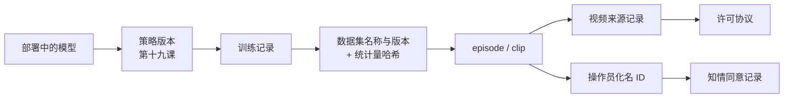
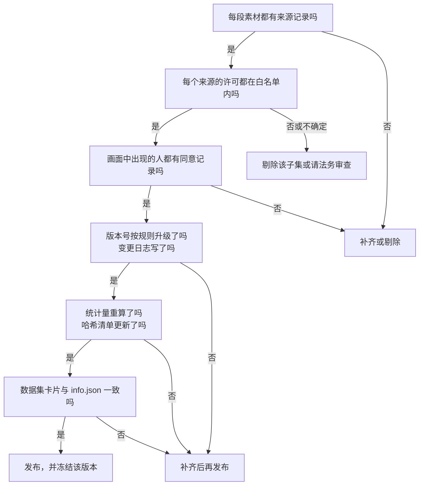

# 第二十四课：数据集身份——数据集名称与版本、许可协议与视频来源

> [!abstract] 本课覆盖的参数
> **数据集名称与版本**、**许可协议**、**视频来源**
> 与 [[第十九课 策略部署数据：策略版本、日志频率与人工接管]] 的策略版本、[[补学 第一至五课的缺口与勘误]] 的归一化统计量直接衔接。

## 1. 引入：半年后的三个问题

半年后，你用 SO-101 数据训练的 SmolVLA 模型要在一次对外演示中使用。演示前一周，负责人问了你三个问题：

1. **"这个模型是用哪份数据训练的？"** 你记得是"抓笔数据集"，但这半年里它被追加过两批数据、修正过一次成功标签、还因为重新校准重采过一部分。你不确定训练时用的是哪个状态。
2. **"这份数据能拿去做商业演示吗？"** 数据集里混入了一个公开数据集的子集，那个数据集的许可里好像有"非商业"字样；顶部相机还拍到了两位操作员的脸。
3. **"里面那批网上找的人手抓笔视频，是从哪里来的？"** 你只记得是从某个视频平台下载的，具体链接、上传者、下载日期都没有记录。

这三个问题对应本课的三个参数。上一课 [[第二十三课 数据交付：单段时长、存储容量、文件格式与命名规则]] 解决的是"数据作为文件能否被正确读取和定位"；这一课解决的是"数据作为一份**有身份的资产**，能否被准确引用、合法使用和追溯来源"。

| 问题 | 对应参数 | 回答不了的后果 |
|---|---|---|
| 它是哪份数据？ | 数据集名称与版本 | 实验无法复现，部署问题无法定位到数据 |
| 它能拿来干什么？ | 许可协议 | 可能侵权或违规，严重时整个模型都不能用 |
| 它从哪里来？ | 视频来源 | 无法核实许可，无法剔除问题素材，无法评估质量 |

> [!warning] 本课的边界
> 本课涉及许可协议和个人信息的内容，只陈述基本常识和工程做法，**不构成法律意见**。具体能否使用、如何合规，请以协议原文和适用法规为准，并咨询法务。

---

## 2. 数据集名称与版本（Dataset Name & Version）

### ① 一句话定义

**数据集名称**是一份数据集长期稳定的标识；**数据集版本**是这份数据集在某一时刻的**不可变快照**。名称回答"它是哪个数据集"，版本回答"它是这个数据集的哪一个状态"。

> [!important] 两个"版本"不要混淆
> - **格式版本**：例如 LeRobot 的 `codebase_version`，表示数据按哪一版格式规范存储（第二十三课）。
> - **内容版本**：你自己定义的数据集版本号，例如 `v1.2.0`，表示数据内容是哪一个快照。
> 
> 同一份内容可以从旧格式转换成新格式（格式版本变了，内容版本不一定变）；同一种格式下也可以发布很多个内容版本。验收规范里两者都要写。

### ② 采集时它控制什么

版本号看起来是发布时才填的，但它实际上在采集过程中就起作用：**它决定哪些数据可以合在一起。**

采集过程中发生下面这些事，就意味着新采的数据和旧数据"不是同一个版本的东西"：

- 机械臂重新校准（补学文档：重新校准等于改变数据语义）；
- 动作定义改变（例如从绝对位置改成增量，第五课）；
- 相机机位、分辨率或曝光策略改变（第九、十课）；
- 记录频率改变（第六课）。

所以采集日志里应该记录"这一批数据属于哪个目标版本"，一旦上面的条件发生变化，就必须开新版本，而不是继续往旧版本里追加。

**语义化版本（Semantic Versioning）在数据集上的用法**（这是一种常见约定，不是强制标准）：

$$
\text{版本号}=\text{主版本}.\text{次版本}.\text{修订号}
$$

| 位置 | 什么时候升 | 数据集里的例子 | 下游需要做什么 |
|---|---|---|---|
| 主版本 | 语义或格式不兼容的变化 | 动作定义改变；重新校准；关节顺序或单位改变；相机机位大改 | 不能和旧版本直接混合训练，模型需要重新训练或重新评估 |
| 次版本 | 向后兼容地新增数据 | 新增一批 episode；新增一个任务；新增一个工位 | 可以继续训练，但统计量要重算 |
| 修订号 | 修正错误，不新增数据 | 修正成功标签；修正任务指令错字；剔除少量损坏段 | 一般可以直接替换，但仍要重算统计量并在变更日志写明 |

### ③ 最终生成什么数据

**名称。** 例如在 Hugging Face Hub 上，数据集名称就是仓库 ID：

```text
your-org/emb-pickpen-so101
```

命名建议沿用第二十三课的原则：小写、短横线分隔、不含个人姓名，名称里只放稳定不变的要素（项目、任务、本体），不要把版本号、日期写进名称。

**版本。** 常见做法是用 Git 标签（tag）或独立的发布目录标记每个版本，并在交付包名称中体现，例如 `emb-pickpen-so101_v1.2.0/`。

**变更日志（Changelog）。** 每个版本一段，写清楚变了什么、为什么变、影响什么：

```markdown
## v2.0.0（2026-09-15）
- 【不兼容】全部重新校准（校准文件 calib_20260910_v2.json），旧版本数据不可混用
- 重新采集 280 段；统计量重算

## v1.2.0（2026-08-02）
- 新增 bj01-ws03 工位 80 段（操作员 op011、op012）
- 统计量重算

## v1.1.1（2026-07-20）
- 修正 episode 57、203 的成功标签（原标注为成功，回放确认为失败）
- 剔除 episode 112（腕部相机全程黑屏）
```

**数据集卡片（Dataset Card）。** 一份随数据集发布的说明文档。Hugging Face 的数据集卡片是仓库根目录的 `README.md`，开头可以有一段 YAML 元数据（例如 `license`、`task_categories`、`tags` 等字段）。内容建议覆盖：

| 卡片栏目 | 写什么 |
|---|---|
| 概述 | 数据集用途、一句话描述 |
| 采集方式 | 主从臂遥操作 / 手持夹爪 / 第一视角 / 仿真……（总目录中的七类来源） |
| 本体 | 机器人型号、自由度、夹爪类型、标定文件版本 |
| 传感器 | 相机数量、机位、分辨率、帧率、编码；其他传感器 |
| 任务列表 | 每个任务的语言指令、成功判定标准 |
| 规模 | 段数、总帧数、总时长、操作员数、工位数 |
| 数据格式 | 格式及 `codebase_version`；字段说明；单位与关节顺序 |
| 已知问题 | 例如"op007 的数据首尾静止偏长""ws02 下午光照偏暖" |
| 许可 | 许可协议名称；各来源子集的许可 |
| 联系人 | 维护者、问题反馈方式 |
| 版本 | 当前版本号、变更日志链接 |

**训练记录必须引用数据集版本。** [[第十九课 策略部署数据：策略版本、日志频率与人工接管]] 讲过策略版本要可追溯，而策略版本的追溯链必须一直延伸到数据：

```json
{
  "policy_version": "smolvla-pickpen-2026.10.03",
  "dataset": "your-org/emb-pickpen-so101",
  "dataset_version": "v1.2.0",
  "dataset_revision": "a1b2c3d",
  "stats_sha256": "9f2e...",
  "episodes_used": "train split: 0-279; val split: 280-311",
  "codebase_version": "v3.0"
}
```

（示意字段）其中 `stats_sha256` 是统计量文件的哈希，用来确认部署时加载的统计量与训练时完全一致。

### ④ 设置不当会出什么问题

| 错误做法 | 后果 |
|---|---|
| 发布后直接覆盖修改（"原地更新"） | 同一个版本号对应两份不同内容，两次训练结果不同却查不出原因 |
| 新增数据后不重算统计量 | `stats.json` 描述的是旧数据分布，新数据被错误归一化 |
| 只升次版本，实际改了校准 | 下游以为可以兼容混合，结果"同一画面配两套关节数值"（补学文档） |
| 没有变更日志 | 无法知道 v1.1 和 v1.2 的差别，回归测试无从下手 |
| 训练记录只写"抓笔数据" | 模型出问题时，无法确定是数据问题还是模型问题 |
| 数据集卡片缺"已知问题" | 下游重复踩坑，或在不知情的情况下把问题数据用于评估 |

**统计量过期**是最常见、也最隐蔽的问题。补学文档讲过，统计量用于归一化和部署时的反归一化。剔除一条带有异常值的 episode，可能让某个关节的最大值从 9999 回到 95；如果 `stats.json` 没有跟着更新，MIN_MAX 归一化后的数据会被压缩在一个极窄的区间里。

### ⑤ 对 VLA 训练与部署的影响

**影响一：可复现性。** 训练结果的差异，要么来自模型配置，要么来自数据。如果数据版本不可变且被明确引用，你才能做干净的对比实验：固定数据版本只改模型，或固定模型只换数据版本。

**影响二：统计量与版本绑定。** 模型输出的是归一化后的动作，部署时要用训练所用版本的统计量反归一化。如果部署端加载了另一个版本的 `stats.json`，表现就是补学文档里那句话："大方向对，但总是偏一点"。所以**统计量文件应作为模型产物的一部分一起保存**，而不是部署时再去数据集里"拿最新的"。

**影响三：主版本变化意味着部署配置也要变。** 例如 v2.0.0 重新校准了，那么用 v2 数据训练的模型，部署时必须加载 v2 对应的校准文件；用 v1 模型 + v2 校准，关节数值的含义就对不上了。

**影响四：数据回流形成新版本。** 第十九课讲过部署日志和人工接管数据会回流。回流数据加入训练集，应当发布新的次版本，并记录"来自哪个策略版本的部署"，否则你无法区分"人类示范"和"策略自己产生的数据"对模型的影响。

### ⑥ 验收与清洗

**规范中怎么写：**

- 数据集名称（固定）、内容版本号、格式版本号；
- 版本升级规则（什么情况升主/次/修订）；
- 发布后不可修改，修改必须发新版本；
- 每个版本附变更日志、数据集卡片、哈希清单、统计量文件；
- 训练记录必须引用数据集版本与统计量哈希。

**拿到数据后怎么查：**

- 用哈希清单核对版本内容是否与发布时一致（第二十三课第 7 节）；
- 用当前数据**重新计算统计量**，与 `stats.json` 对比，差异过大说明统计量过期；
- 检查数据集卡片栏目是否齐全、规模数字是否与 `info.json` 一致；
- 检查变更日志中的每一项是否能在数据中找到对应（例如声称剔除了 episode 112，数据中就不应再有它）。

```python
import glob
import json
import numpy as np
import pandas as pd

root = "/path/to/dataset"
df = pd.concat([pd.read_parquet(f) for f in glob.glob(f"{root}/data/**/*.parquet", recursive=True)])
stats = json.load(open(f"{root}/meta/stats.json"))   # 结构以你的版本为准

for key in ["action", "observation.state"]:
    x = np.stack(df[key].to_numpy())
    for stat, now in [("mean", x.mean(0)), ("std", x.std(0)), ("min", x.min(0)), ("max", x.max(0))]:
        old = np.asarray(stats[key][stat]).reshape(-1)
        rel = np.abs(now - old) / (np.abs(old) + 1e-6)
        if rel.max() > 0.01:                          # 示例阈值：相对差异超过 1%
            print(f"{key}.{stat} 与重算结果不一致，最大相对差 {rel.max():.3f}")
```

这个检查只能说明 `stats.json` 与当前数据是否一致，不能判断数据本身有没有异常值；而且不同版本的统计方式（例如是否包含分位数、标准差用的是哪种估计）可能不同，出现微小差异时先确认计算口径。

---

## 3. 许可协议（License）

### ① 一句话定义

许可协议是**数据权利人规定他人可以如何使用、修改和再分发这份数据的条款**。没有许可协议，不等于"可以随便用"。

### ② 采集时它控制什么

许可协议不只是发布时选一个标签，它在采集阶段就决定了三件事：

1. **哪些素材可以纳入。** 想混入某个公开数据集或互联网视频，先看它的许可是否允许你的用途。
2. **需要获取哪些同意。** 操作员的脸、声音可能被录进去；桌面上的文件、屏幕内容可能含有他人信息。是否需要、如何获取知情同意，要在采集前和法务确认。
3. **采集环境怎么布置。** 例如调整顶部相机角度避免拍到人脸，关闭麦克风录音，清理桌面上的私人物品——这比事后打码更可靠。

### ③ 最终生成什么数据

- **数据集卡片 YAML 中的 `license` 字段**，例如：

```yaml
---
license: cc-by-4.0
tags:
  - robotics
  - so101
---
```

- **LICENSE 文件**：协议全文或指向原文的说明；
- **来源清单中每个子集/每段素材的许可字段**（见第 4 节）；
- **知情同意记录**：通常不随数据集分发，而是单独保存，数据中只用操作员化名 ID 关联。

**常见许可的基本区别**（只列常识性要点，具体条款以协议原文为准）：

| 许可 | 是否允许商用 | 是否要求署名 | 是否要求相同方式共享 | 常见用途 |
|---|---|---|---|---|
| CC0 | 允许 | 不要求（权利人放弃权利） | 不要求 | 希望尽量放开使用的数据 |
| CC BY 4.0 | 允许 | 要求 | 不要求 | 公开数据集常用 |
| CC BY-SA 4.0 | 允许 | 要求 | 要求（衍生作品需以相同许可发布） | 希望衍生作品保持开放 |
| CC BY-NC 4.0 | **不允许商用** | 要求 | 不要求 | 仅限研究等非商业用途 |
| Apache-2.0 | 允许 | 要求保留版权与许可声明 | 不要求 | 主要为软件设计，也有数据集使用；含专利授权条款 |
| MIT | 允许 | 要求保留版权与许可声明 | 不要求 | 主要为软件设计，条款很短 |

此外还有 CC BY-NC-SA（非商业 + 相同方式共享）、带"禁止演绎"（ND）条款的变体，以及一些机构自定义的研究许可。**遇到自定义许可时，务必请法务逐条阅读。**

> [!note] 关于"什么算商用""什么算衍生作品"
> 这类问题在不同场景下可能有不同解读，上表只是帮你快速分类，不能用来下结论。

### ④ 设置不当会出什么问题

**问题 A：许可缺失或被工具自动填写。** 一些上传工具会自动填一个默认许可。如果你没检查，发布出去的许可可能并不是你（或你的机构）想要的，也可能与你实际有权授予的范围不符。

**问题 B：混合数据集时许可不兼容。** 把 CC BY-NC 子集和 CC BY 子集合并后，以 CC BY 发布整个数据集——一般而言，你不能授予比自己拥有的更多的权利，这样做很可能违反 NC 子集的条款。同理，SA 条款要求衍生作品使用相同许可，和其他条款组合时可能产生冲突。具体组合是否兼容，需法务判断。

**问题 C：数据许可向模型的传递。** "用 CC BY-NC 数据训练出的模型能否商用"目前**存在争议**，不同法域、不同解读可能得出不同结论。工程上能做的是：如实记录每个模型用了哪些数据、每份数据是什么许可，把判断交给法务。

**问题 D：个人信息与肖像。** 顶部相机拍到操作员的脸、麦克风录到说话声、画面里出现电脑屏幕或文件，这些都可能涉及个人信息。中国的《个人信息保护法》、欧盟的通用数据保护条例（General Data Protection Regulation，GDPR）等法规对个人信息处理都有要求，人脸等生物识别信息通常受到更严格的保护。是否需要同意、如何告知、保存多久、如何响应删除请求，都需要合规审查，本课不给法律结论。

**问题 E：第三方资产。** 仿真场景中使用的三维模型、纹理（第二十一课的资产来源），生成模型产出的图像或视频（第二十二课），用于自动标注的预训练模型（例如手部姿态估计模型），都有各自的许可或服务条款。数据集的许可不能覆盖这些第三方资产本身的限制。

### ⑤ 对 VLA 训练与部署的影响

- **许可决定了"能放进训练混合的数据有哪些"。** VLA 预训练依赖大量多样数据，但商业部署的模型，往往只能使用许可明确允许的子集。这直接影响模型能见到的场景和任务多样性。所以要在训练前就按许可过滤，而不是训练完再追溯。
- **删除请求可能触发重新训练。** 如果某位操作员撤回同意，你需要找到他参与的所有 episode、包含这些 episode 的所有数据集版本、以及用这些版本训练的所有模型。是否需要重新训练由法务和负责人决定，但**数据工程上必须做到"能查得到"**——这依赖化名 ID、版本引用和训练记录。
- **事后打码会造成训练—部署视觉差异。** 如果训练图像里人脸被模糊处理，而部署时相机看到的是清晰人脸，模型面对的是一种训练中没见过的画面。人脸不一定是任务相关区域，影响通常有限，但更好的做法是从机位布置上避免拍到人脸（第九课），而不是依赖后处理。
- **模型卡片应继承数据的限制。** 发布模型时，在模型卡片里写明训练数据的版本与许可，让下游知道这个模型受哪些约束。

### ⑥ 验收与清洗

**规范中怎么写：**

- 数据集整体许可，以及每个来源子集的许可；
- 允许纳入的许可白名单（例如本项目只接受 CC0、CC BY、自采数据，示例）；
- 知情同意要求：所有出现在画面或录音中的操作员均有同意记录，以化名 ID 关联；
- 采集环境要求：顶部相机不拍人脸，不录音，桌面无私人文件；
- 第三方资产清单及其许可。

**拿到数据后怎么查：**

- 每个子集/每段素材都有许可字段，且在白名单内（第 6 节代码）；
- 数据集卡片的 `license` 与 LICENSE 文件、来源清单一致；
- 所有操作员 ID 都能在同意记录中找到（只核对 ID，不在数据中存储真实身份）；
- 抽样回放检查画面中是否出现人脸、屏幕、文件等敏感内容；如需批量检查，可以用人脸检测模型做初筛，再人工复核。

---

## 4. 视频来源（Video Source）

### ① 一句话定义

视频来源是**数据集中每段视频（以及由它派生的标签）从哪里来、经过了哪些处理**的记录。

### ② 采集时它控制什么

视频来源决定了数据的"出身"，进而决定了它的质量上限、标签可得性和使用限制：

| 维度 | 自采数据 | 公开数据集 | 互联网视频 |
|---|---|---|---|
| 动作标签 | 有（关节、夹爪） | 通常有，但定义各异 | **没有** |
| 时间语义 | 可控、可验证 | 依赖原作者说明 | 常被剪辑、变速、转码 |
| 规模与多样性 | 有限 | 中等 | 极大 |
| 许可清晰度 | 清晰（自己决定） | 一般有明确许可 | 往往不清晰，受平台条款约束 |
| 画质一致性 | 高 | 子集之间差异大 | 差异极大 |
| 与你的机器人匹配度 | 完全匹配 | 本体、相机多不同 | 人手，不是机械臂 |

对 SO-101 抓笔项目来说，自采数据是主体；公开数据集和互联网视频通常只作为预训练或辅助数据。

### ③ 最终生成什么数据

一份**来源清单（source manifest）**，每段素材一条记录，例如 JSONL 格式（字段为示意）：

```json
{"clip_id": "web-000123", "source_type": "internet_video", "platform": "某视频平台", "url": "https://...", "uploader": "channel_xxx", "retrieved_at": "2026-05-12T08:30:00Z", "original_license": "unknown", "tos_reviewed": false, "transcoded": true, "original_fps": 29.97, "original_resolution": [1920, 1080], "clip_start_s": 12.0, "clip_end_s": 19.5, "original_sha256": "4c1d...", "processing": ["crop_center", "resize_480p", "reencode_h264"], "dedup_group": null}
{"clip_id": "self-ep0042", "source_type": "self_collected", "station": "bj01-ws02", "operator_id": "op007", "license": "internal", "transcoded": false}
{"clip_id": "pub-000001", "source_type": "public_dataset", "dataset": "<数据集名称>", "dataset_version": "<版本>", "original_license": "<以原数据集声明为准>"}
```

关键字段的作用：

| 字段 | 作用 |
|---|---|
| `url` / `platform` / `uploader` | 追溯原始出处；需要下架或核实时能找到 |
| `retrieved_at` | 内容和许可可能随时间改变，需要知道你拿到的是哪个时间点的状态 |
| `original_license` / `tos_reviewed` | 记录原始许可和是否审查过平台服务条款 |
| `transcoded` / `processing` | 记录做过哪些处理，评估画质损失与时间语义是否被破坏 |
| `original_fps` | 判断是否存在帧率转换、变速 |
| `original_sha256` / `dedup_group` | 去重与完整性 |

### ④ 设置不当会出什么问题

**问题 A：来源不可追溯。** 只记得"从网上下载的"，就无法核实许可、无法响应下架请求、无法剔除被发现有问题的素材。这批数据在合规审查中通常只能整体弃用。

**问题 B：平台服务条款。** 很多视频平台的服务条款可能限制下载、自动化抓取或再分发，这与视频本身的许可是两回事。是否可以使用，需要结合具体条款和法务意见。

**问题 C：视频质量参差。** 互联网视频常见的问题：

| 问题 | 在数据中的表现 | 对模型的危害 |
|---|---|---|
| 剪辑与转场 | 画面突然切换、淡入淡出 | 模型看到"物体瞬移"，学到不存在的物理 |
| 字幕、水印、台标 | 固定位置的文字或图标 | 成为与任务无关但高度显著的视觉特征 |
| 画中画 | 一个画面里有两个视角 | 空间关系混乱 |
| 慢动作、快进、变速 | 动作速度与真实不符 | **破坏时间语义**（见下） |
| 可变帧率、帧率转换 | 帧间隔不均匀、重复帧或插值帧 | 时间轴不可信 |
| 重复上传、合集 | 同一段内容出现多次 | 训练权重偏高；泄漏到验证集 |

**变速为什么特别危险？** [[第六课 控制频率、采样率与轨迹记录频率]] 讲过，相邻两帧之间的时间间隔决定了动作的物理含义。一段 2 倍慢动作视频，如果被当作正常速度处理，模型学到的"手的移动速度"只有真实的一半；如果变速只发生在视频中间某一段，时间轴会在那里突然拉伸，连"动作持续多久"都不可信。

**问题 D：内容安全。** 大规模抓取的视频可能包含暴力、成人、个人隐私等不适宜内容，需要过滤后才能使用。

### ⑤ 对 VLA 训练与部署的影响

**互联网视频的价值。** 大量人类操作视频（做饭、整理、使用工具）包含丰富的物体、场景和"物体被如何操作"的常识。对于 VLA 来说，它们常被用于预训练视觉表示，或学习"接下来世界会怎么变化"。

**核心难点：没有动作标签。** 互联网视频只有画面，没有关节角度或末端位姿。常见的思路（概念层面）：

1. **从视频中估计人手的运动。** 用手部姿态估计模型提取手部关键点（见 [[第十五课 人体追踪信号：头部位姿、手部关键点、佩戴位置与手部可见]]），把手的轨迹当作"伪动作"。难点在于人手和机械夹爪的形态差异（本体差距，embodiment gap），以及单目视频的深度和尺度不确定。
2. **学习潜在动作（latent action）。** 让模型从相邻帧的变化中学习一个压缩的"动作编码"——它不对应任何真实关节，只表示"从这一帧到下一帧发生了什么变化"。先用大量无标签视频学会这种编码，再用少量真实机器人数据把它映射到真实动作。

这两种方式都依赖**时间语义可信**：如果视频被变速或剪辑，提取出的"伪动作"或"潜在动作"本身就是错的。

**视频质量问题会变成模型的捷径。** 例如某个频道的视频都带水印，而且恰好都是成功的演示，模型可能把"右下角有水印"和"任务成功"关联起来。字幕、台标同理。

**部署时的直接影响有限但真实。** 互联网视频不会直接决定 SO-101 部署时输出什么动作，但它影响预训练表示的质量：如果预训练数据中大量是转场和变速片段，模型对"连续物理运动"的理解就会变差，在少量真机数据微调后也可能残留这种偏差。

### ⑥ 验收与清洗

**规范中怎么写：**

- 允许的来源类型与比例（例如自采 ≥ 90%，示例）；
- 每段素材必须有完整来源记录（字段列表见上）；
- 互联网视频必须经过：许可与条款审查、场景切换检测、变速与帧率检查、去重、内容安全过滤；
- 处理流程（裁剪、缩放、重编码）逐项记录。

**拿到数据后怎么查：** 见第 6 节代码——字段完整性、场景切换、重复帧、感知哈希去重。

---

## 5. 串联：一条可追溯链

三个参数合在一起，构成一条从部署模型一直追溯到原始素材的链：



**用一个场景检验这条链：** 操作员 op007 提出删除自己的数据。

| 步骤 | 需要的信息 | 依赖哪个参数 |
|---|---|---|
| 1. 找到 op007 参与的所有段 | 元数据中的 `operator_id` | 文件命名与元数据（第二十三课） |
| 2. 找到包含这些段的所有数据集版本 | 各版本的段列表 | 数据集版本 |
| 3. 找到用这些版本训练的所有模型 | 训练记录中的 `dataset_version` | 数据集版本 + 策略版本 |
| 4. 发布不含这些段的新版本 | 变更日志、统计量重算 | 数据集版本 |
| 5. 决定已有模型如何处理 | 许可、同意条款与法务意见 | 许可协议 |

任何一环断掉，这个请求都无法被准确执行。**这就是"身份"参数的意义：它们不改变数据内容，却决定了数据能否被负责任地使用。**

**发布前的身份检查顺序。** 每次发布新版本前，可以按下面的顺序过一遍。任何一步答案是"否"或"不确定"，都先停下来补齐，而不是先发布再说：



注意这个顺序的设计：**先确认"能不能用"（来源、许可、同意），再处理"怎么发布"（版本、统计量、卡片）**。因为剔除一个子集会改变数据内容，统计量和卡片必须在剔除之后才能定稿。

**自采数据也需要来源记录。** 很多人觉得来源记录只和互联网视频有关。但自采数据同样会经历"录制 → 重编码 → 格式转换 → 裁剪首尾 → 合并到新版本"的处理链。如果某一版数据是从另一版的视频重新编码得到的，画质已经不同于原始录制，这一点也要写进 `processing` 字段，否则下游会误以为两版画质一致。

**另一个检验：混合数据集的统计量。** 假设你把自采数据 v1.2.0 和一个公开数据集子集混合训练。你需要记录两者各自的版本，混合后的统计量要在混合后的数据上重新计算（或明确说明按数据集分别归一化），并在训练记录中保存统计量文件。这部分会在第二十五课的训练环节展开。

---

## 6. 清洗实践：身份与来源的检查

**检查 1：许可与来源字段完整性。**

```python
import pandas as pd

src = pd.read_json("sources.jsonl", lines=True)
REQUIRED = {
    "internet_video": ["url", "platform", "retrieved_at", "original_license", "tos_reviewed", "transcoded"],
    "public_dataset": ["dataset", "dataset_version", "original_license"],
    "self_collected": ["station", "operator_id", "license"],
}
ALLOWED = {"cc0-1.0", "cc-by-4.0", "internal"}            # 示例白名单，由法务确定

for _, r in src.iterrows():
    for col in REQUIRED.get(r["source_type"], []):
        if col not in r or pd.isna(r[col]) or r[col] in ("", "unknown"):
            print(f"{r['clip_id']}: 缺少或未知字段 {col}")
    if r["source_type"] == "internet_video" and r.get("tos_reviewed") != True   # 未填写或为 False 都提示:
        print(f"{r['clip_id']}: 平台服务条款尚未审查")
    lic = r.get("license") if pd.notna(r.get("license")) else r.get("original_license")
    if lic not in ALLOWED:
        print(f"{r['clip_id']}: 许可 {lic} 不在白名单内，需人工审查")
```

字段齐全只说明"记录了"，不说明"记录的是真的"。对互联网视频，还需要抽样打开链接核实。

**检查 2：场景切换检测（基于相邻帧颜色直方图差异）。**

```python
import cv2

def detect_cuts(path, thr=0.5):
    """返回疑似场景切换的帧号。thr 为巴氏距离阈值（0~1），示例值。"""
    cap = cv2.VideoCapture(path)
    prev, cuts, i = None, [], 0
    while True:
        ok, frame = cap.read()
        if not ok:
            break
        hsv = cv2.cvtColor(frame, cv2.COLOR_BGR2HSV)
        hist = cv2.calcHist([hsv], [0, 1], None, [32, 32], [0, 180, 0, 256])
        cv2.normalize(hist, hist, 1.0, 0.0, cv2.NORM_L1)          # 归一化为概率分布
        if prev is not None:
            d = cv2.compareHist(prev, hist, cv2.HISTCMP_BHATTACHARYYA)
            if d > thr:
                cuts.append(i)
        prev, i = hist, i + 1
    cap.release()
    return cuts
```

局限：快速摇镜头、开关灯、物体突然进入画面也可能触发；淡入淡出这类渐变转场可能漏检。它只用于筛选"需要人工看一眼"的片段。

**检查 3：变速与帧率线索。** 两个简单信号：容器中的名义帧率与平均帧率是否一致（不一致提示可变帧率），以及几乎相同的相邻帧占比（偏高可能是帧率转换补出的重复帧，或慢动作）。

```python
import subprocess
import cv2
import numpy as np

def frame_rates(path):
    out = subprocess.run(["ffprobe", "-v", "error", "-select_streams", "v:0",
                          "-show_entries", "stream=r_frame_rate,avg_frame_rate",
                          "-of", "csv=p=0", path], capture_output=True, text=True).stdout
    return out.strip()            # 例如 "30/1,30/1"；两者明显不同时提示可变帧率

def near_duplicate_ratio(path, thr=1.0):
    cap, prev, dup, n = cv2.VideoCapture(path), None, 0, 0
    while True:
        ok, f = cap.read()
        if not ok:
            break
        g = cv2.cvtColor(cv2.resize(f, (160, 90)), cv2.COLOR_BGR2GRAY).astype(np.float32)
        if prev is not None:
            dup += float(np.abs(g - prev).mean()) < thr      # 平均像素差小于阈值视为几乎相同
            n += 1
        prev = g
    cap.release()
    return dup / max(n, 1)
```

局限：静止场景本身就会有很多"几乎相同"的帧；而通过插值生成的慢动作并不产生重复帧，这个方法检测不到。可靠的变速判断通常需要结合运动幅度分析和人工抽查。

**检查 4：重复视频检测（感知哈希）。** 感知哈希（perceptual hash）把一帧图像压缩成一个对缩放、轻微压缩不敏感的短指纹。两段视频的指纹序列足够接近，就可能是重复内容。

```python
import cv2
import numpy as np

def dhash(frame, size=8):
    """差值哈希：比较相邻像素明暗，得到 64 位指纹"""
    g = cv2.cvtColor(frame, cv2.COLOR_BGR2GRAY)
    g = cv2.resize(g, (size + 1, size), interpolation=cv2.INTER_AREA)
    return np.packbits((g[:, 1:] > g[:, :-1]).flatten())

def video_signature(path, n=16):
    """在视频中均匀取 n 帧，返回指纹列表"""
    cap = cv2.VideoCapture(path)
    total = int(cap.get(cv2.CAP_PROP_FRAME_COUNT))     # 容器给出的帧数，可能不精确
    sig = []
    for idx in np.linspace(0, max(total - 1, 0), n).astype(int):
        cap.set(cv2.CAP_PROP_POS_FRAMES, int(idx))
        ok, f = cap.read()
        if ok:
            sig.append(dhash(f))
    cap.release()
    return sig

def signature_distance(a, b):
    """对应位置指纹的平均汉明距离（0~64），越小越相似"""
    k = min(len(a), len(b))
    return np.mean([np.unpackbits(a[i] ^ b[i]).sum() for i in range(k)]) if k else 64.0

# 用法示意：距离小于约 10（示例阈值）的两段视频列为疑似重复，人工确认
```

局限：这种"按位置对应"的比较只适合整段重复；如果一段是另一段的剪辑片段、或者有时间偏移、镜像翻转，就需要更复杂的帧级匹配。另外，SO-101 自采数据中同一工位的不同 episode 画面本来就非常相似，不要用这个方法给自采数据去重。

---

## 7. 验收清单写法速查

| 字段 | 示例写法（阈值为示例，需按项目确定） |
|---|---|
| 数据集名称 | `your-org/emb-pickpen-so101`，名称固定不含版本与日期 |
| 内容版本 | 语义化版本 `主.次.修订`；升级规则见附录；发布后不可修改 |
| 格式版本 | LeRobot `codebase_version` 以实际为准，与内容版本分开记录 |
| 变更日志 | 每个版本必填：变更内容、原因、影响、是否需重新训练 |
| 统计量 | 每个版本重算；`stats.json` 哈希写入训练记录；部署端加载同一文件 |
| 数据集卡片 | 必含：采集方式、本体、传感器、任务列表、规模、格式、已知问题、许可、联系人 |
| 许可协议 | 整体许可 + 各来源子集许可；仅接受白名单内许可；最终由法务确认 |
| 个人信息 | 操作员签署知情同意（化名 ID 关联）；顶部相机不拍人脸；不录音 |
| 第三方资产 | 列出资产、生成模型、自动标注模型及其许可或条款 |
| 视频来源 | 每段有来源记录：类型、URL/平台、上传者、获取时间、原始许可、条款审查、转码与处理步骤 |
| 来源质量 | 互联网视频需经场景切换检测、变速/帧率检查、感知哈希去重、内容安全过滤 |

---

## 8. 第二十四课练习

**问题 1：版本号怎么升**

你的 SO-101 数据集当前是 v1.3.2。由于舵机更换，你重新校准了机械臂，并在新校准下重采了 100 段。新版本号应该是？

A. v1.3.3，因为只是修正
B. v1.4.0，因为新增了数据
C. v2.0.0，因为重新校准改变了关节数值的语义，与旧数据不兼容

**问题 2：统计量与版本**

你从 v1.1.0 升级到 v1.2.0（新增了一个工位 80 段），但忘了重算 `stats.json`。用 v1.2.0 训练、部署时加载数据集里的 `stats.json`。最可能的结果是？

A. 程序报错
B. 新工位数据的分布没有反映在统计量中，归一化有偏，模型在部分状态下输出整体偏移
C. 没有任何影响，因为统计量只和机器人型号有关

**问题 3：许可混合**

你把一个 CC BY 4.0 的公开子集和一个 CC BY-NC 4.0 的公开子集合并，加上自采数据，准备以 CC BY 4.0 发布整个数据集供商业使用。最合理的判断是？

A. 可以，CC BY 4.0 是最常见的许可
B. 很可能不合适：你一般不能授予比自己获得的更多的权利，NC 子集带有非商业限制；应在发布前请法务审查，或把 NC 子集剔除
C. 可以，只要在卡片里署名所有原作者

**问题 4：互联网视频**

你从视频平台收集了 2,000 段人手抓取物体的视频，准备用于预训练。以下哪项**不是**必须优先处理的问题？

A. 是否有动作标签，以及准备用什么方式获得监督信号
B. 是否存在慢动作、快进或剪辑，破坏了时间语义
C. 视频文件名是否全部为英文
D. 平台服务条款和原始许可是否允许这种使用

**问题 5：开放思考题**

一位同事说："版本控制太麻烦了，我们每次加数据直接覆盖上传，训练时永远用最新的就行。"请从可复现性、部署和数据回流三个角度，各说一个这样做会带来的问题。

> [!question]- 参考答案（点击展开）
> 1. **C**。重新校准意味着同一个物理姿态在新旧数据中对应不同数值（补学文档），属于语义不兼容的变化，应升主版本，并在变更日志中写明"不可与旧版本混合"。
> 2. **B**。统计量描述的是旧数据的分布。新工位数据可能让某些关节的范围或均值变化，归一化后的分布与模型实际看到的不一致；部署时反归一化也会带来偏移。程序通常不会报错，所以这个问题很隐蔽。
> 3. **B**。NC 子集的非商业限制不会因为你换了一个更宽松的标签而消失。署名只满足 BY 条款的要求，解决不了 NC 的问题。最终结论需要法务确认。
> 4. **C**。文件名规范属于交付层面的问题，可以随时整理。A、B、D 都直接决定这批视频能否使用、能提供什么监督、是否合法。
> 5. 参考思路：
>    - 可复现性：两次训练用的"最新数据"其实是不同内容，结果差异无法归因，也无法回到某次好结果对应的数据；
>    - 部署：统计量随每次覆盖而变化，部署端加载的统计量可能与训练时不同，出现"总是偏一点"的问题；校准变化也无法被标记出来；
>    - 数据回流：部署回流数据和人类示范混在一起覆盖上传，无法区分哪些数据来自哪个策略版本，也无法评估回流数据对模型的影响；遇到删除请求时也无法确定影响了哪些模型。

---

一句话小结：**名称与版本让数据"可被准确引用"，许可协议让数据"可被合法使用"，视频来源让数据"可被追溯和核实"——没有身份的数据，再干净也不能放心地用。**

下一课 [[第二十五课 综合实战：从参数清单到验收、清洗、训练与部署]] 是整套课程的总结：用 SO-101 抓笔任务写一份完整的采集与验收规范，把所有参数串成"采集 → 验收 → 清洗 → 训练 → 部署"的一条流水线。
