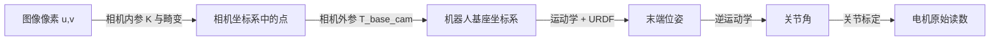

# 第八课：标定方式（Calibration）

> [!abstract] 本课覆盖的参数
> **标定方式**
> 清单里它只是一个参数，但"标定"至少包含五类对象，本课逐一展开：**关节 / 本体标定**、**相机内参标定**、**相机外参标定（含手眼标定）**、**时间标定**、**传感器标定**。最后讲标定的有效期、版本归档与漂移检测。

设想这样一周：周一你用 SO-101 采了 50 条"把笔放进笔筒"的数据；周三你把腕部相机从原装支架换到一个更稳的新支架上；周四有人不小心撞了一下从臂，你担心出问题，就重新跑了一遍校准，接着又采了 50 条。

打开数据集，每一行都完整，时间戳均匀，`names` 正确，按前七课的检查清单逐项通过。但训练出来的模型在周一那批场景里表现不错，在周四之后的场景里明显更差。原因不在任何一行数据里，而在数据"背后"：腕部相机的视角变了，从臂的同一个物理姿态对应的数值也变了。

补学文档里说过一句话："重新校准机械臂，等于改变了数据的语义。"这一课把它展开成完整的知识：**标定（Calibration）就是建立"传感器读数"与"物理世界"之间映射关系的过程。** 每一次标定都会生成一组参数，这组参数决定了数据中每个数字的物理含义。它和前面课程的关系是：

| 前面课程 | 对应的标定 |
|---|---|
| [[第四课：关节状态记录项]]（单位、方向、关节映射） | 关节 / 本体标定 |
| [[第五课 动作空间（Action Space）]]（末端动作的坐标系） | 相机外参、手眼标定 |
| [[第一课 时间同步方式（Time Synchronization）]]、[[第二章 时间戳对齐误差]] | 时间标定 |
| [[第七课 机器人本体：自由度、夹爪类型与夹爪开合记录]]（夹爪读数到宽度的映射） | 关节标定与传感器标定的一部分 |

---

## 1. 先看全貌：五类标定各管什么

| 标定对象    | 回答的问题                       | 典型产物             | 错了会怎样                  | 纯 2D 图像策略是否直接读取  |
| ------- | --------------------------- | ---------------- | ---------------------- | ---------------- |
| 关节 / 本体 | 电机读数对应关节的哪个物理位置？            | 校准文件（零位偏置、方向、范围） | 同一姿态读数不同；主从臂有恒定偏差      | **是**（动作和状态都依赖它） |
| 相机内参    | 像素和相机坐标系中的射线如何对应？           | 焦距、主点、畸变系数       | 深度反投影点云变形；测量尺寸错        | 通常否              |
| 相机外参    | 相机在哪、朝哪？相机之间、相机与机器人之间的位姿关系？ | 4×4 变换矩阵         | 相机系与基座系之间换算错，抓偏        | 通常否              |
| 时间      | 各数据流之间差多少时间？                | 时间偏移量、延迟分布       | 图像与状态错位；动作时机偏          | 间接（影响样本配对）       |
| 传感器     | 传感器读数的零点和尺度对不对？             | 偏置、尺度、配准参数       | 力"看起来一直在接触"；深度与 RGB 错位 | 用到该传感器时是         |

一条坐标链可以把前三类标定串起来：



时间标定横跨整条链路：它保证链路两端的数据描述的是同一个时刻。传感器标定则保证力、IMU、深度这些额外数据流本身的数值是可信的。

> [!important] 一个贯穿全课的观点
> 对很多直接"图像 → 关节动作"的 2D 策略来说，内参、外参的**绝对准确**不那么重要，但**采集与部署之间的一致**非常重要。标定的变化 = 数据语义的变化：哪怕你从不读取外参，相机挪了 3°，模型看到的世界也变了。

---

## 2. 关节 / 本体标定（Joint / Robot Calibration）

### ① 一句话定义

关节标定是**建立"电机编码器原始读数"与"关节物理位置（或记录数值）"之间映射**的过程，核心是三件事：零位在哪、方向是正是负、范围有多大。

### ② 采集时它控制什么

SO-101 使用的总线舵机内置绝对式编码器，常见为 12 位分辨率，即每圈 4096 个刻度（以舵机手册为准）。原始刻度本身没有"关节角"的含义，必须通过校准把它映射到有意义的数值。

**LeRobot 中 SO-101 的校准流程**（命令和交互提示以你使用的版本为准，较新版本为 `lerobot-calibrate`，旧版本用的是其他脚本入口）：

1. **摆到中位。** 把手臂的各关节摆到各自行程的大致中间位置，按回车。程序据此写入零位偏置（homing offset），让这个姿态对应记录值的中点。
2. **走完整行程。** 依次把每个关节从一端转到另一端，程序记录每个关节出现过的最小、最大原始读数（range_min、range_max）。部分版本对可连续旋转的关节有特殊处理，以版本为准。
3. **主臂（leader）和从臂（follower）各做一遍**，分别保存，靠各自的 id 区分。

之后，记录时的数值由原始读数按范围线性映射得到。以身体关节映射到 $[-100,100]$ 为例（示意，具体实现以版本为准）：

$$
x=\frac{r-r_{\min}}{r_{\max}-r_{\min}}\times 200-100
$$

夹爪通常映射到 $[0,100]$，也可以通过配置改为以角度记录。这就是补学文档里说"数值可能不是角度"的来源。

**主从臂校准一致性。** 遥操作时，主臂读数先按主臂的校准映射成范围值，再按从臂的校准反映射成从臂的目标刻度。如果两条臂的"中位"摆得不一样、或行程没有转到同样的极限，同一个范围值在两条臂上对应的物理角度就不同。

举个计算例子（示意数值，假设两条臂原始刻度与物理角度的对应关系相同，只是记录的范围不同）：

| 臂 | range_min | range_max |
|---|---|---|
| 主臂 | 1000 | 3000 |
| 从臂 | 900 | 3100 |

主臂读数 2500 映射为：

$$
x=\frac{2500-1000}{2000}\times200-100=50
$$

从臂把 50 反映射为目标刻度：

$$
r=900+\frac{50+100}{200}\times2200=2550
$$

主臂在 2500，从臂被命令到 2550，差 50 个刻度，约 $50\times\frac{360^\circ}{4096}\approx4.4^\circ$。而且这个差值随位置变化（在中点附近接近 0，越靠近两端越大），是一种**缩放误差**，不是简单的固定偏移。

**工业机器人的情况。** 工业臂和协作臂的关节零位通常由厂家标定好（各家称呼不同），用户更常遇到的是**运动学标定**：修正连杆长度、关节轴向等参数，提高"绝对定位精度"。要区分两个指标：**重复定位精度**（回到同一个点的一致性）通常远好于**绝对定位精度**（到达一个由坐标指定的点的准确度）。末端动作、手眼标定都依赖后者。

### ③ 最终生成什么数据

SO-101 的校准文件是一个 JSON，每个电机一项。常见存放位置类似 `~/.cache/huggingface/lerobot/calibration/robots/so101_follower/<id>.json`，主臂在 `teleoperators/so101_leader/<id>.json` 下（路径和字段名以你使用的版本为准）：

```json
{
  "shoulder_pan":  {"id": 1, "drive_mode": 0, "homing_offset": -1180, "range_min": 760,  "range_max": 3320},
  "shoulder_lift": {"id": 2, "drive_mode": 0, "homing_offset": 950,   "range_min": 820,  "range_max": 3240},
  "elbow_flex":    {"id": 3, "drive_mode": 0, "homing_offset": -640,  "range_min": 880,  "range_max": 3100},
  "wrist_flex":    {"id": 4, "drive_mode": 0, "homing_offset": 210,   "range_min": 860,  "range_max": 3200},
  "wrist_roll":    {"id": 5, "drive_mode": 0, "homing_offset": -30,   "range_min": 0,    "range_max": 4095},
  "gripper":       {"id": 6, "drive_mode": 0, "homing_offset": 1400,  "range_min": 2010, "range_max": 3450}
}
```

（数值全部为示意。）各字段的含义：`homing_offset` 决定零位，`drive_mode` 决定方向，`range_min / range_max` 决定映射范围。**这个文件不在数据集里，但数据集里每一个关节数值的含义都由它决定。**

### ④ 设置不当会出什么问题

| 问题 | 原因 | 在数据里的表现 |
|---|---|---|
| 重新校准后混用数据 | 两次校准的零位、范围不同 | 同一物理姿态（如初始姿态）在两批数据中读数不同；状态直方图出现平移或缩放 |
| 中位摆放不准 | 校准时目测摆位 | 某关节记录值整体偏向一侧；到不了对称的 ±100 |
| 行程没有转到底 | 校准时动作不充分 | 后续采集中数值超出 $[-100,100]$，或被裁剪在边界上 |
| 方向反了 | 驱动模式设置不一致 | 主臂往上抬，从臂往下压（通常当场就能发现） |
| 主从臂不一致 | 两条臂校准时姿态不同 | 从臂相对主臂有随位置变化的偏差；示范者会下意识补偿，导致画面中"手到了"但 action 数值偏离 |
| 碰撞后机械偏移 | 齿轮跳齿、联轴松动、舵机更换 | 同一读数对应的物理姿态变了，但读数本身看起来完全正常 |

最后一种最隐蔽：**校准文件没变，物理映射却变了。** 数据里不会有任何报错。

### ⑤ 对 VLA 训练与部署的影响

- **动作数值的含义直接由校准决定。** 模型输出"肩部 = 50"，部署时由当前校准把它翻译成舵机刻度。如果部署时机器已重新校准，模型输出的每一个数值都会被翻译成不同的物理姿态。表现和补学文档里"统计量用错"很像——大方向对，但总是偏一点，而且偏差随姿态变化。
- **混合两套校准的数据，相当于给同一画面配了两套标签。** 模型只能学到两者的折中，对两种校准都不准。
- **跨台部署。** 你在 A 台 SO-101 上采数据，在 B 台上部署。两台的校准不同，就算型号完全一样，也等价于"换了一点点本体"。以物理角度记录并让零位有一致的物理定义（例如用定位夹具摆零位），有利于跨台复用。
- **末端动作依赖关节零位的绝对准确。** 正运动学把关节角换算为末端位姿，零位偏 2°，0.25 m 长的大臂末端就偏 $0.25\times\tan 2^\circ\approx 8.7\ \text{mm}$。

### ⑥ 验收与清洗

**规范里写清楚：** 校准方法（流程版本）、校准文件随数据集归档、每条 episode 记录所用校准的版本号、一个数据集版本内只用一套校准、重新校准的触发条件。

**拿到数据后检查：**
1. 校准文件是否齐全（主臂、从臂都要），文件哈希是否与 episode 元数据一致；
2. 是否存在超出 $[-100,100]$（夹爪 $[0,100]$）的数值，或大量贴在边界上的数值；
3. **参考姿态比对**：如果每条 episode 都从同一个初始姿态开始，比较各 episode 首帧状态，突然整体平移的那一批很可能换了校准或发生了机械偏移（代码见第 8 节）；
4. 主从差值统计：静止时 action 与 state 之差应接近 0，如果某关节静止时也存在稳定差值，说明主从不一致。

---

## 3. 相机内参（Camera Intrinsics）

### ① 一句话定义

相机内参描述**相机坐标系中的三维点如何投影到图像像素**，包括焦距、主点和镜头畸变。它只和相机本身（镜头、传感器、分辨率、对焦）有关，和相机放在哪里无关。

针孔模型下，相机坐标系中的点 $(X,Y,Z)$ 投影到像素 $(u,v)$：

$$
u=f_x\frac{X}{Z}+c_x,\qquad v=f_y\frac{Y}{Z}+c_y
$$

写成矩阵形式：

$$
K=\begin{bmatrix} f_x & 0 & c_x\\ 0 & f_y & c_y\\ 0 & 0 & 1\end{bmatrix}
$$

其中 $f_x,f_y$ 是以像素为单位的焦距，$(c_x,c_y)$ 是主点（光轴与图像的交点，通常在图像中心附近）。真实镜头还有**畸变**：径向畸变让直线在画面边缘弯曲（桶形或枕形），切向畸变来自镜头与传感器不完全平行。

### ② 采集时它控制什么

内参标定通常用已知尺寸的标定板，从多个角度拍摄，求解内参和畸变：

| 标定板 | 特点 |
|---|---|
| 棋盘格 | 最常见；必须看到完整的棋盘才能检测 |
| ChArUco（棋盘格 + ArUco 码） | 每个角点有唯一编号，部分遮挡、只拍到一部分也能用，适合广角和边角覆盖 |
| 圆点阵列 | 对模糊相对鲁棒 |

**拍摄要求决定标定质量：**

- **覆盖画面各个区域，尤其是四角**——畸变在边缘最大，标定图集中在中间会导致边缘畸变外推不准；
- 标定板要有足够的倾斜和距离变化，不能全是正对着拍；
- 图像清晰，避免运动模糊；
- **分辨率、对焦、变焦必须与采集时一致**，最好关闭自动对焦并锁定；
- 标定板要平整，方格尺寸要实测。

**畸变模型的选择：**

| 模型 | 参数 | 适用 |
|---|---|---|
| 针孔 + 径向/切向畸变（OpenCV 默认，ROS 中常称 `plumb_bob`） | $k_1,k_2,p_1,p_2,k_3$ | 普通视场角镜头 |
| 鱼眼模型（等距投影，OpenCV `cv2.fisheye`，ROS 中常称 `equidistant`） | $k_1,k_2,k_3,k_4$ | 广角、鱼眼镜头 |

视场角很大的镜头用普通针孔畸变模型往往拟合不好，边缘误差很大，应改用鱼眼模型。运动相机、全景相机的投影问题会在 [[第十三课 多机同步、全景拼接与投影格式]] 继续讨论。

**质量指标：重投影误差（reprojection error）。** 用求得的内参把标定板的三维角点重新投影到图像上，和实际检测到的角点比较：

$$
e_{\text{RMS}}=\sqrt{\frac{1}{N}\sum_{i=1}^{N}\left\|\hat{\mathbf{u}}_i-\mathbf{u}_i\right\|^2}
$$

经验上，良好的标定 RMS 常在 1 像素以内，精细标定可以到零点几像素（示意量级，与分辨率和标定板质量有关）。**但重投影误差小不等于标定好**：如果所有图像都集中在画面中间，误差可以很小，边缘却完全不准。

### ③ 最终生成什么数据

内参通常存成一个 JSON 或 YAML 文件，每台相机、每种分辨率一份：

```json
{
  "camera_name": "cam_top",
  "serial": "示意-001",
  "width": 1280,
  "height": 720,
  "model": "pinhole",
  "distortion_model": "opencv_radtan",
  "K": [[910.2, 0.0, 641.7],
        [0.0, 909.8, 362.4],
        [0.0, 0.0, 1.0]],
  "dist": [0.091, -0.214, 0.0004, -0.0007, 0.103],
  "dist_order": "k1,k2,p1,p2,k3",
  "rms_reproj_px": 0.31,
  "num_images": 32,
  "autofocus": "off, focus locked",
  "calib_date": "2026-10-12",
  "calib_version": "calib_v003"
}
```

（数值为示意。）如果使用 ROS，内参对应 `CameraInfo` 消息里的 `K`（ROS 2 中为小写 `k`）、`D`、`distortion_model`、`width`、`height` 等字段。很多深度相机出厂带有内参，可以通过 SDK 读出，但仍应记录读出的值和分辨率。

**分辨率变化时内参要跟着变。** 图像整体缩放为原来的 $s$ 倍时，近似有：

$$
f_x'=s f_x,\quad f_y'=s f_y,\quad c_x'=s c_x,\quad c_y'=s c_y
$$

（严格换算还要考虑像素中心约定，差异在半个像素量级。）畸变系数在等比缩放时不变。**裁剪则不改变焦距，但会平移主点。**

### ④ 设置不当会出什么问题

| 问题 | 在数据里的表现 |
|---|---|
| 改了分辨率却沿用旧内参 | 用内参做的任何 3D 计算都按比例错 |
| 自动对焦没关 | 对焦变化时焦距和畸变随之变化，不同帧的内参不同 |
| 鱼眼镜头用针孔模型 | 画面中心看起来正常，边缘去畸变后严重拉伸 |
| 标定图没覆盖边角 | 重投影误差很小，但边缘区域的 3D 测量误差大 |
| 相机内部已做去畸变（部分运动相机的"线性"视角模式），又按原始镜头标定 | 畸变被"校正两次"，画面反而弯曲 |
| 去畸变后裁剪了画面，但没记录新的内参 | 主点和视场与内参文件不符 |

**深度反投影的例子。** 已知像素和深度，反投影到三维：

$$
X=\frac{(u-c_x)\,Z}{f_x}
$$

一个点在 $u-c_x=200$ 像素处，深度 $Z=0.8$ m，真实 $f_x=600$（示意数值）：

$$
X=\frac{200\times0.8}{600}\approx0.267\ \text{m}
$$

如果内参文件里 $f_x$ 写成了 660（错 10%），算出 $X\approx0.242$ m，偏了约 2.4 cm。所有点都按同样的比例向光轴收缩，点云整体"变窄"；如果畸变系数错，点云的边缘还会弯曲。对于要在三维空间里定位抓取点的方法，这已经足以抓偏一支笔。

### ⑤ 对 VLA 训练与部署的影响

- **多数纯 2D 图像策略不直接使用内参。** ACT、SmolVLA 一类模型直接吃 RGB 图像，内参文件写得对不对，并不影响训练过程。
- **但内参变化 = 图像几何变化。** 换了一台相机、换了镜头、改了分辨率或视角模式，同一个场景在画面中的大小、位置、边缘形变都变了，对模型来说就是观测分布变化。部署时如果用了视场角不同的相机，模型看到的物体大小和位置都"不像训练时"。
- **用 3D 表示的方法离不开内参。** 用深度图生成点云、把 2D 检测结果提升到 3D、做 3D 关键点或抓取位姿预测时，内参错了，三维结构就错了。
- **数据增强要同步内参。** 对 3D 方法做随机裁剪、缩放增强时，必须同步更新内参，否则训练时的几何关系与真实不符。

### ⑥ 验收与清洗

**规范里写清楚：** 每台相机的型号与序列号、标定分辨率、畸变模型、标定板类型与尺寸、标定图数量与覆盖情况、RMS 重投影误差（及阈值，例如 ≤ 0.5 px 为示例）、对焦是否锁定、标定日期与版本。

**拿到数据后检查：**
1. 内参文件中的分辨率与视频实际分辨率一致；
2. 用内参去畸变一帧画面，桌边、门框等直线是否变直；
3. 若有深度，用内参生成点云，桌面是否平整、已知尺寸物体是否尺寸正确；
4. 查看每张标定图的单独误差，误差显著偏大的图（检测错误、模糊）应剔除后重新标定（代码见第 8 节）。

---

## 4. 相机外参与手眼标定（Extrinsics & Hand-Eye Calibration）

### ① 一句话定义

相机外参是**相机坐标系相对于另一个坐标系（另一台相机、机器人基座、机器人末端）的位置和朝向**，通常写成一个 4×4 齐次变换矩阵：

$$
T^{\text{base}}_{\text{cam}}=\begin{bmatrix} R & t\\ \mathbf{0}^{\top} & 1\end{bmatrix},\qquad p^{\text{base}}=T^{\text{base}}_{\text{cam}}\,p^{\text{cam}}
$$

其中 $R$ 是 3×3 旋转矩阵，$t$ 是平移向量。这里的约定是：$T^{\text{base}}_{\text{cam}}$ 把**相机系中的点**变换到**基座系**。它的逆 $T^{\text{cam}}_{\text{base}}$ 方向相反。**这个约定必须写进规范**，弄反是外参最常见的错误。

### ② 采集时它控制什么

外参分三种情况：

| 情况                           | 求什么                                   | 典型方法                                    |
| ---------------------------- | ------------------------------------- | --------------------------------------- |
| 相机与相机之间                      | $T^{\text{cam1}}_{\text{cam2}}$       | 两台相机同时看同一块标定板，分别求出相对标定板的位姿再相乘；双目相机的立体标定 |
| 相机固定在场景中（eye-to-hand）        | 相机相对基座 $T^{\text{base}}_{\text{cam}}$ | 标定板固定在末端，机械臂摆多个姿态                       |
| 相机装在机械臂末端（eye-in-hand，如腕部相机） | 相机相对末端 $T^{\text{ee}}_{\text{cam}}$   | 标定板固定在桌面，机械臂摆多个姿态                       |

后两种合称**手眼标定**。以 eye-in-hand 为例说明 $AX=XB$ 的思想：

- 机械臂从姿态 $i$ 移动到姿态 $j$。末端的相对运动 $A$ 可以由正运动学算出；
- 相机看着固定的标定板，用 PnP 算出相机相对标定板的位姿，相机的相对运动 $B$ 也能算出；
- 相机和末端是刚性连在一起的，它们之间的固定变换 $X=T^{\text{ee}}_{\text{cam}}$ 就是要求的未知量。

两条路径描述的是同一个刚体运动，于是：

$$
AX=XB
$$

每一对姿态给出一个方程，多对姿态联立求解 $X$。eye-to-hand 的结构类似，只是把"末端相对基座"的位姿取逆后代入。OpenCV 提供 `cv2.calibrateHandEye`，内置 Tsai、Park、Horaud、Andreff、Daniilidis 等几种求解方法；做 eye-to-hand 时通常把基座到末端的位姿取逆后传入（具体用法以 OpenCV 文档为准）。

**影响手眼标定精度的因素：**

- **姿态的旋转要多样。** 理论上至少需要两次旋转轴不平行的相对运动，实际常用十几到二十几个姿态，旋转幅度越大、轴向越分散越好。只平移不旋转的姿态对求解旋转几乎没有帮助。
- **正运动学要准。** $A$ 来自关节读数和 URDF。SO-101 这类低成本舵机臂存在回差、关节零位误差和连杆加工误差，手眼标定精度通常达不到工业臂的水平，以实测为准。
- **标定板检测要准**，这又依赖相机内参。**内参误差会传递到外参。**

### ③ 最终生成什么数据

外参文件至少包含：父坐标系、子坐标系、矩阵、单位、约定说明、方法和残差：

```json
{
  "parent_frame": "so101_base",
  "child_frame": "cam_top_optical",
  "convention": "p_parent = T @ p_child",
  "unit": "m",
  "T": [[ 0.0123, -0.9998,  0.0151,  0.312],
        [-0.7071, -0.0194, -0.7068,  0.405],
        [ 0.7070, -0.0019, -0.7072,  0.540],
        [ 0.0,     0.0,     0.0,     1.0  ]],
  "method": "eye-to-hand, cv2.calibrateHandEye (TSAI), 18 poses",
  "residual_mm": 4.2,
  "intrinsics_ref": "cam_top_intrinsics.json@calib_v003",
  "calib_date": "2026-10-12",
  "calib_version": "calib_v003"
}
```

（矩阵数值为示意，未必是严格正交的旋转矩阵。）腕部相机的外参 `parent_frame` 应是末端或腕部连杆，它同时依赖夹爪和相机支架的安装方式。

一个机器人系统中的坐标系关系可以画成一棵树：

```text
world
└── so101_base
    ├── cam_top_optical        (T_base_cam_top，eye-to-hand 标定)
    └── shoulder → ... → wrist_link
                          ├── gripper_tip   (URDF)
                          └── cam_wrist_optical   (T_wrist_cam，eye-in-hand 标定)
```

还要注意相机坐标系本身的约定：OpenCV 的相机光学坐标系是 $x$ 向右、$y$ 向下、$z$ 沿光轴向前；很多机器人软件里的"相机连杆"坐标系约定不同，两者之间还有一个固定旋转。

### ④ 设置不当会出什么问题

| 问题 | 在数据里的表现 / 后果 |
|---|---|
| 变换方向弄反（$T^{\text{a}}_{\text{b}}$ 当成 $T^{\text{b}}_{\text{a}}$） | 换算后的点完全不在合理位置，例如物体出现在桌面以下 |
| 单位混用（mm 与 m） | 平移部分错 1000 倍 |
| 相机被碰、支架松动 | 外参悄悄失效；顶部相机画面中固定物体（桌角、底座）的位置整体偏移 |
| 腕部相机换了支架 | eye-in-hand 外参失效；腕部画面中夹爪的位置和大小改变 |
| 只平移不旋转地采集标定姿态 | 求解病态，旋转部分误差大 |

**旋转误差会被距离放大。** 外参旋转误差 $1^\circ$，在距离相机 0.8 m 处造成的位置误差约为：

$$
0.8\times\tan1^\circ\approx0.8\times0.0175\approx0.014\ \text{m}=1.4\ \text{cm}
$$

**相机系与基座系换算错误的典型故障。** 例如用顶部相机检测到笔在相机系中的位置，再用外参换算到基座系，交给 IK 求关节。外参偏 1.4 cm，夹爪就会稳定地抓偏 1.4 cm——不是随机误差，而是固定方向的偏差，这种偏差往往是外参问题的特征。

### ⑤ 对 VLA 训练与部署的影响

- **纯 2D 策略不读外参，但对相机位置极其敏感。** 相机挪动、转动，画面中所有物体的位置都变了。模型学到的"画面某处 → 关节到某处"的对应关系，在新视角下不再成立。这是 [[第九课 相机布局：相机数量与位置、机位、安装高度与视场角]] 的核心话题。对这类模型来说，外参标定的作用更多是**记录**：让你知道采集和部署时相机分别在哪，并判断两者是否一致。
- **末端动作要求外参和坐标系明确。** 第五课说过末端动作需要写清坐标系。动作写在基座系、相机系还是末端系，换算都需要外参。有些方法把动作或观测表示在相机坐标系中，以提高对机位变化的适应性，这时外参的准确度直接决定动作标签的准确度。
- **多视角融合和 3D 表示离不开外参。** 把多台相机的点云拼到同一坐标系、把检测结果变换到基座系，都需要外参；外参错了，多视角点云会出现"重影"。
- **跨机位混训时，外参就是"视角标签"。** 不同机位采的数据混在一起时，外参能帮你分析模型在哪些机位上表现差，也能用于按机位分层评估。

### ⑥ 验收与清洗

**规范里写清楚：** 每个外参的父子坐标系、约定（谁变换到谁）、单位、方法、姿态数量、残差、所依赖的内参版本；相机安装方式与支架版本。

**拿到数据后检查——投影叠加法（最直观的检查）：** 用关节读数做正运动学得到夹爪尖在基座系的位置，用外参和内参把它投影到顶部相机画面上，画一个点，看它是否落在画面中的夹爪尖上。逐帧叠加做成视频，标定好的情况下这个点会一直跟着夹爪走。

```python
import numpy as np
import cv2

# p_base: 由正运动学得到的夹爪尖位置（基座系，单位 m），形状 (3,)
# T_base_cam: 外参（相机系 -> 基座系），K、dist: 内参
def project_to_image(p_base, T_base_cam, K, dist):
    T_cam_base = np.linalg.inv(T_base_cam)          # 基座系 -> 相机系
    R, t = T_cam_base[:3, :3], T_cam_base[:3, 3]
    rvec, _ = cv2.Rodrigues(R)
    uv, _ = cv2.projectPoints(p_base.reshape(1, 3).astype(np.float64),
                              rvec, t.astype(np.float64), K, dist)
    return uv.reshape(2)                            # 像素坐标 (u, v)

# 在一帧图像上画出投影点，人工对照是否落在夹爪尖上
# u, v = project_to_image(p_tip, T_base_cam, K, dist)
# cv2.circle(frame, (int(u), int(v)), 6, (0, 0, 255), 2)
```

这个检查同时验证了内参、外参、关节标定和 URDF 四样东西，所以它只能告诉你"链路上有问题"，不能直接告诉你是哪一环。SO-101 上出现几毫米到一两厘米的偏差并不罕见，要结合任务精度判断是否可接受。

---

## 5. 时间标定（Temporal Calibration）

### ① 一句话定义

时间标定是**测量各数据流的时间戳与它所描述的物理事件之间的固定偏移和延迟**，并据此把它们对齐到同一时刻。

它和第一课的时间同步的区别是：时间同步让各设备的时钟读数一致；时间标定回答"即使时钟一致，相机打上 10:00:00.100 的这帧，画面到底是哪一刻的世界"。第二课讲过的采集延迟、传输延迟，就是时间标定要测出来的量。

### ② 采集时它控制什么

| 要测的偏移 | 常见做法 |
|---|---|
| 相机与 IMU 之间 | 用相机-IMU 联合标定工具（例如 Kalibr 一类工具），在估计外参的同时估计时间偏移；需要充分激励各个方向的运动 |
| 相机与关节读数之间 | 让机械臂做明显的往复运动，从画面中跟踪一个标志点，与关节读数换算出的运动做互相关，找使两者最吻合的时间偏移 |
| 相机自身的延迟 | 让相机拍摄屏幕上显示的高精度计时器，比较画面里的时间和收到该帧时的系统时间 |
| 遥操作端到端延迟 | 用高帧率相机同时拍主臂和从臂，测从"主臂开始动"到"从臂开始动"的时间；或用补学文档中的 action / state 互相关法估计 |

遥操作端到端延迟的完整讨论在 [[第十四课 遥操作系统：输入设备、端到端时延与力反馈]]。这里要记住的是：**这些偏移需要测出来、写下来、在数据处理中统一使用，而不是假设为 0。**

### ③ 最终生成什么数据

```json
{
  "reference_stream": "observation.state",
  "convention": "t_event = t_stamp + offset_ms / 1000",
  "offsets": {
    "observation.images.top":   {"offset_ms": -42.0, "std_ms": 4.5, "method": "挥臂互相关"},
    "observation.images.wrist": {"offset_ms": -35.0, "std_ms": 5.1, "method": "挥臂互相关"},
    "imu":                      {"offset_ms": 2.1,   "std_ms": 0.4, "method": "相机-IMU 联合标定"}
  },
  "teleop_latency_ms": {"mean": 85, "p95": 120, "method": "高帧率相机拍主从臂"},
  "applied_in_dataset": false,
  "calib_date": "2026-10-12"
}
```

（数值为示意。）两个字段特别重要：`convention` 说明偏移的符号含义；`applied_in_dataset` 说明数据集里的时间戳**是否已经补偿过**。缺了这两个字段，下游的人可能把偏移再补偿一次，或者补偿反方向。

### ④ 设置不当会出什么问题

- **不补偿偏移：** 图像描述的是几十毫秒前的世界，却和当前时刻的状态、动作配成一行，即第二课的对齐误差。
- **偏移造成的空间误差** 可以用速度乘以时间估计：末端以 $0.3\ \text{m/s}$ 运动，偏移 $30\ \text{ms}$，画面与状态之间相差 $0.3\times0.03=9\ \text{mm}$。
- **符号弄反：** 本该减去 40 ms 却加了 40 ms，误差从 40 ms 变成 80 ms。
- **偏移不是常数：** USB 带宽紧张、CPU 负载高、曝光时间随光照变化（补学文档的曝光时刻）时，偏移会变化。只测一次、永久使用，会在条件变化后失效。

### ⑤ 对 VLA 训练与部署的影响

- **模型学到的"看到什么就做什么"被平移了。** 如果图像系统性地比状态晚 40 ms，模型会学到"画面里夹爪已经碰到笔，这时才开始合"，部署时就会晚合。对第七课讲的夹爪维，这种偏差最致命。
- **训练和部署的延迟结构要一致。** 训练时如果做了偏移补偿，部署时模型拿到的是"未补偿"的实时画面，两者也会不一致。关键不是"一定要补偿到 0"，而是**训练数据中的时间关系要和部署时模型实际面对的时间关系一致**，或者至少你清楚两者差了多少。
- **高速任务更敏感。** 慢速抓放对几十毫秒的偏移有一定容忍度；投掷、接物、快速插入则不行。

### ⑥ 验收与清洗

**规范里写清楚：** 参考数据流、每路数据流的偏移与标准差、测量方法、符号约定、是否已在数据集中补偿、复测周期。

**拿到数据后检查：** 对每条 episode 用互相关估计"画面运动"和"关节运动"之间的偏移，看它是否与标定值一致、是否在 episode 之间漂移；明显偏离的 episode 单独复核。

---

## 6. 传感器标定（Sensor Calibration）

### ① 一句话定义

传感器标定是**确定力/力矩传感器、IMU、深度相机等传感器读数的零点、尺度以及与其他传感器的配准关系**，让读数能被解释为真实物理量。

### ② 采集时它控制什么

| 传感器     | 主要标定项                                | 常见做法                                     |
| ------- | ------------------------------------ | ---------------------------------------- |
| 力/力矩传感器 | 零点漂移（零漂）、去皮（tare）、工具重力补偿、温漂          | 无接触时记录偏置并减去；在多个姿态下测量，估计工具质量和质心，按当前姿态补偿重力 |
| IMU     | 陀螺仪零偏、加速度计零偏与尺度、噪声参数、IMU 与相机的外参和时间偏移 | 静止段求均值估计陀螺零偏；多个静止朝向估计加速度计参数；长时间静止数据做噪声分析 |
| 深度相机    | 深度相机内参、深度与 RGB 之间的外参、深度尺度、深度到彩色图的配准  | 多数设备出厂标定，通过 SDK 读出；配准时把深度图对齐到彩色相机视角      |

**力传感器去皮的时机很关键。** 去皮时传感器上必须只有工具本身，不能夹着物体、不能接触桌面。另外，工具（夹爪）的重力在传感器坐标系中的投影会随手臂姿态变化——在一个姿态去皮，换个姿态读数就不再是 0，这正是需要重力补偿的原因。力与触觉的更多细节放在 [[第十七课 力与触觉：采样率、量程与触觉通道]]。

**深度尺度。** 深度图常以整数存储，乘以深度尺度才得到米。不同设备、不同配置的尺度可能不同（例如有的以毫米为单位），必须从设备读出并记录，不要假设。深度相机本身的原理和误差在 [[第十二课 深度相机与LiDAR]] 详细讲。

### ③ 最终生成什么数据

```json
{
  "ft_sensor": {
    "bias": [0.82, -0.35, 1.94, 0.012, -0.004, 0.001],
    "bias_unit": "N, N·m",
    "tool_mass_kg": 0.42,
    "tool_com_m": [0.0, 0.0, 0.065],
    "tare_condition": "无接触、夹爪张开、初始姿态",
    "values_in_dataset": "raw"
  },
  "imu": {
    "gyro_bias_rad_s": [0.0012, -0.0008, 0.0003],
    "accel_bias_m_s2": [0.03, -0.02, 0.05]
  },
  "depth": {
    "depth_scale_m_per_unit": 0.001,
    "aligned_to": "cam_top_color",
    "T_color_depth": "见 T_color_depth.json"
  }
}
```

（数值为示意。）`values_in_dataset` 一类字段要写清数据集里存的是**原始读数**还是**已补偿读数**，否则下游可能重复减去偏置。

### ④ 设置不当会出什么问题

| 问题 | 在数据里的表现 |
|---|---|
| 去皮时夹着物体或碰着桌面 | 无接触时力读数为负值或不为零，整个 episode 都偏 |
| 采集过程中零漂 | 无接触片段的力读数缓慢爬升，看起来像"持续轻微接触" |
| 只去皮、没做重力补偿 | 手臂换个姿态，力读数就变化，与是否接触无关 |
| IMU 陀螺零偏未补偿 | 积分得到的朝向持续漂移（手持设备位姿追踪尤其受影响，见第十六课） |
| 深度与 RGB 未配准或配准错 | 物体边缘处深度错位，点云出现"飞点"和边缘重影 |
| 深度尺度弄错 | 整个点云尺度错，常见是错 1000 倍或错几倍 |

### ⑤ 对 VLA 训练与部署的影响

- **把力作为输入的策略，对偏置极其敏感。** 训练数据的偏置和部署时不同，模型会认为"已经接触"或"还没接触"。例如插入任务中，模型可能在离孔还有一段距离时就减速、开始"找孔"动作。
- **偏置在不同批次间不同，等于引入了与任务无关的输入差异。** 模型可能把偏置当成区分批次的特征，泛化变差。
- **深度、点云策略依赖配准。** 配准错了，物体边缘的三维位置错，抓取点落在物体边缘外侧。
- **手持设备依赖 IMU 标定。** UMI 式手持夹爪等方案依赖视觉-惯性追踪得到位姿，IMU 标定不好，动作标签本身就会漂（第十六课）。

### ⑥ 验收与清洗

**规范里写清楚：** 每个传感器的标定项、标定方法与条件、去皮时机（例如每条 episode 开始前在无接触姿态去皮）、数据中存的是原始值还是补偿值、深度尺度与配准方式。

**拿到数据后检查：**
1. 每条 episode 开头的无接触静止段，力读数均值是否接近 0、在 episode 之间是否稳定；
2. 长 episode 中无接触片段的力读数是否有缓慢趋势（零漂）；
3. 深度图与 RGB 叠加显示，物体边缘是否重合；
4. 用已知尺寸物体检查点云尺度。

---

## 7. 标定的有效期与复核

标定不是"做一次就永远有效"。每一组标定参数都有它成立的前提条件，前提被破坏，标定就失效。

### 7.1 什么时候必须重新标定

| 事件 | 失效的标定 | 建议动作 |
|---|---|---|
| 机械臂碰撞、关节被外力扳动 | 关节标定（可能）、依赖 FK 的外参 | 先做参考姿态比对；有偏差则重新校准，新数据升级版本 |
| 更换舵机、拆装机械臂 | 关节标定 | 重新校准，新数据升级版本 |
| 拆装或碰到相机、更换支架 | 该相机外参；腕部相机的 eye-in-hand 外参 | 重新标定外参；对纯 2D 策略还要评估视角变化 |
| 更换相机、镜头，改分辨率、视角模式、对焦 | 内参（以及依赖它的外参） | 重新标定内参，再标外参 |
| 更换夹爪或指尖 | 夹爪读数到宽度映射；可能影响腕部相机外参和工具重力参数 | 重新实测映射；检查腕部相机 |
| 温度变化大、长时间连续运行 | 力传感器零漂、IMU 零偏，部分相机内参也会轻微变化 | 定期去皮；关键任务前复测 |
| 软件或驱动升级 | 时间偏移、记录数值的映射方式 | 复测时间偏移；确认校准文件格式和映射方式未变 |

### 7.2 标定版本随数据归档

LeRobot 标准数据集格式里没有专门存放标定文件的位置，建议自己扩展一个目录，并在每条 episode 的元数据中记录所用的标定版本（以下为建议写法）：

```text
my_so101_pen_dataset/
├── meta/
│   ├── info.json
│   └── episodes/...            # 每条 episode 增加 calib_version 字段（自定义扩展）
├── data/...
├── videos/...
└── calibration/
    ├── calib_v003/
    │   ├── so101_follower.json
    │   ├── so101_leader.json
    │   ├── cam_top_intrinsics.json
    │   ├── cam_wrist_intrinsics.json
    │   ├── T_base_cam_top.json
    │   ├── T_wrist_cam_wrist.json
    │   ├── time_offsets.json
    │   └── NOTES.md            # 标定日期、操作人、方法、标定时的照片说明
    └── calib_v004/
        └── ...
```

规则很简单：**一条 episode 必须能追溯到它采集时生效的全部标定参数。** 标定换了版本，数据集至少要能按版本拆分。

### 7.3 如何从数据中发现标定漂移

即使没有人记录"相机被碰过"，数据本身也会留下痕迹：

| 漂移类型 | 数据中的线索 |
|---|---|
| 相机外参漂移 | 画面中固定标志物（贴在桌角的 ArUco 码、机械臂底座）在不同 episode 中的像素位置发生变化 |
| 关节标定漂移 | 每条 episode 的初始姿态读数在某一批之后整体平移 |
| 主从不一致 | 静止时 action 与 state 之差在某一批之后变大 |
| 力传感器零漂 | 无接触段力读数均值在 episode 之间缓慢变化 |
| 时间偏移变化 | 互相关估计的画面-关节偏移在某一批之后改变 |

建议在场景里**固定贴一个 ArUco 标志**，不影响任务，却能给每一帧提供一个"相机有没有动"的参照。

---

## 8. 清洗实践：内参标定、标志物漂移与参考姿态检查

### 8.1 用 OpenCV 做内参标定并检查重投影误差

```python
import glob
import cv2
import numpy as np

pattern = (9, 6)        # 棋盘格内角点数（列, 行），按你的标定板修改
square = 0.025          # 方格边长，单位 m（示意，以实测为准）

# 标定板角点在标定板坐标系中的三维坐标（Z=0 平面）
objp = np.zeros((pattern[0] * pattern[1], 3), np.float32)
objp[:, :2] = np.mgrid[0:pattern[0], 0:pattern[1]].T.reshape(-1, 2) * square

obj_pts, img_pts, files, size = [], [], [], None
for f in sorted(glob.glob("calib_imgs/*.png")):
    gray = cv2.imread(f, cv2.IMREAD_GRAYSCALE)
    size = gray.shape[::-1]                         # (宽, 高)
    ok, corners = cv2.findChessboardCorners(gray, pattern)
    if not ok:
        continue
    corners = cv2.cornerSubPix(                     # 亚像素精化
        gray, corners, (11, 11), (-1, -1),
        (cv2.TERM_CRITERIA_EPS + cv2.TERM_CRITERIA_MAX_ITER, 30, 1e-3))
    obj_pts.append(objp); img_pts.append(corners); files.append(f)

rms, K, dist, rvecs, tvecs = cv2.calibrateCamera(obj_pts, img_pts, size, None, None)
print("有效图像", len(files), "总体 RMS 重投影误差 %.3f px" % rms)
print("K =\n", K, "\ndist =", dist.ravel())     # dist 顺序为 k1, k2, p1, p2, k3

# 每张图的重投影误差：找出拖后腿的图
for i, f in enumerate(files):
    proj, _ = cv2.projectPoints(obj_pts[i], rvecs[i], tvecs[i], K, dist)
    err = np.sqrt(np.mean(np.sum((img_pts[i] - proj) ** 2, axis=2)))
    if err > 2 * rms:                               # 示例阈值
        print("误差偏大:", f, "%.3f px" % err)

# 角点覆盖检查：所有检测到的角点是否覆盖到画面四角
allc = np.concatenate(img_pts).reshape(-1, 2)
print("角点覆盖范围 x: %.0f~%.0f, y: %.0f~%.0f (画面 %dx%d)"
      % (allc[:, 0].min(), allc[:, 0].max(), allc[:, 1].min(), allc[:, 1].max(), *size))
```

**局限：** 总体 RMS 小只说明模型能拟合这些图，不保证画面边缘准确；覆盖检查只看了外包框，中间有大块空白也看不出来。鱼眼镜头需要换用 `cv2.fisheye.calibrate`。

### 8.2 用固定 ArUco 标志检测相机是否移动

```python
import cv2
import numpy as np

# 需要 OpenCV 4.7 及以上的 aruco 接口；旧版本接口不同
dictionary = cv2.aruco.getPredefinedDictionary(cv2.aruco.DICT_4X4_50)
detector = cv2.aruco.ArucoDetector(dictionary, cv2.aruco.DetectorParameters())
MARKER_ID = 7                                       # 贴在桌角的标志编号（示意）

def marker_center(frame_bgr):
    gray = cv2.cvtColor(frame_bgr, cv2.COLOR_BGR2GRAY)
    corners, ids, _ = detector.detectMarkers(gray)
    if ids is None or MARKER_ID not in ids.ravel():
        return None
    k = list(ids.ravel()).index(MARKER_ID)
    return corners[k].reshape(4, 2).mean(axis=0)    # 四个角点的平均 = 中心像素

# 对每条 episode 取首帧，记录标志中心；与第一条 episode 比较
# centers = {ep: marker_center(first_frame_of(ep)) for ep in episodes}
# ref = centers[0]
# for ep, c in centers.items():
#     if c is not None and np.linalg.norm(c - ref) > 3.0:   # 示例阈值：3 像素
#         print("相机可能移动:", ep, np.round(c - ref, 1))
```

读取首帧的方式取决于你的视频编码和解码库（LeRobot 新版本常用 AV1 编码，部分 OpenCV 构建可能无法直接解码，以你的环境为准）。**局限：** 标志被遮挡、光照变化导致检测失败时会返回空；只能发现"相机动了"，不能区分是平移还是旋转。

### 8.3 用初始姿态读数检查关节标定漂移

```python
import numpy as np
import pandas as pd

df = pd.read_parquet("data/chunk-000/file-000.parquet")   # 路径以版本为准
eps, rows = [], []
for ep, g in df.groupby("episode_index"):
    g = g.sort_values("frame_index")
    eps.append(ep)
    rows.append(np.asarray(g["observation.state"].iloc[0]))   # 每条 episode 首帧状态
S0 = np.stack(rows)                              # 形状 [episode 数, 关节数]

med = np.median(S0, axis=0)
dev = np.abs(S0 - med)
TH = 5.0                                         # 示例阈值（记录值单位）
for ep, d in zip(eps, dev):
    if (d > TH).any():
        print("episode", ep, "初始姿态偏离中位数:", np.round(d, 1))
```

这个检查的前提是：**规范要求每条 episode 从同一个初始姿态开始**（例如回到一个用定位夹具确定的姿态）。如果初始姿态本来就是随意摆的，这个检查就没有意义。连续多条 episode 同时偏离、且偏离方向一致，比单条偏离更值得怀疑是标定变化。

---

## 9. 串联：一个末端误差预算

假设你要用顶部相机定位一支笔，再换算到基座系让 SO-101 去抓。各环节的误差（全部为示意数值）：

| 来源 | 设定 | 造成的位置误差 |
|---|---|---|
| 相机内参 | $f_x$ 误差 1%，物体偏离光轴 0.25 m | 约 $0.25\times1\%=2.5\ \text{mm}$ |
| 相机外参 | 旋转误差 $0.5^\circ$，距离 0.8 m | 约 $0.8\times\tan0.5^\circ\approx7\ \text{mm}$ |
| 时间偏移 | 20 ms 未补偿，末端速度 0.2 m/s | $0.2\times0.02=4\ \text{mm}$ |
| 关节零位 | 肩部 $2^\circ$，大臂 0.25 m | 约 $0.25\times\tan2^\circ\approx8.7\ \text{mm}$ |

如果各项相互独立，可以用平方和开方粗略估计总误差：

$$
e\approx\sqrt{2.5^2+7^2+4^2+8.7^2}\approx\sqrt{147}\approx12\ \text{mm}
$$

一支笔直径约 8~10 mm，12 mm 的误差足以抓空。这个例子说明两件事：

1. **对依赖几何换算的方法，标定误差会叠加，最弱的一环决定上限。** 这里关节零位和外参旋转是大头，优先改进它们收益最大。
2. **对"图像 → 关节动作"的纯 2D 策略，上表中的大部分误差不会直接进入模型**——模型不做显式换算，它直接从示范中学习"画面到动作"的映射，示范者已经用眼睛闭环修正了这些误差。但前提是：**部署时的相机、校准、时间关系都和采集时一样。** 一旦其中任何一个变了，模型学到的映射就整体偏移，而且偏移量正是这张表里的量级。

所以对不同类型的方法，标定的要求侧重不同：

| 方法类型 | 标定的关键要求 |
|---|---|
| 纯 2D 图像 → 关节动作（ACT、SmolVLA 类） | **一致性**：采集与部署的关节校准、机位、相机参数不变；变化必须记录并评估 |
| 末端动作 / 跨本体统一动作空间 | 关节标定 + 运动学的**准确性**；坐标系约定明确 |
| 3D 表示（点云、深度、3D 关键点） | 内参、外参、深度配准的**准确性** |
| 跨机位泛化、多视角融合 | 外参的准确性与**完整记录** |
| 力 / 触觉输入 | 传感器偏置与重力补偿在训练、部署间**一致** |

---

## 10. 验收清单写法速查

| 字段 | 示例写法（阈值为示例，需按任务确定） |
|---|---|
| 关节标定 | LeRobot 校准流程（记录软件版本）；主臂、从臂校准文件随数据集归档于 `calibration/calib_v003/` |
| 校准一致性 | 一个数据集版本内只用一套校准；每条 episode 记录 `calib_version` |
| 参考姿态复核 | 每天开工前回到定位夹具姿态，各关节读数与基准差 ≤ 2（记录值单位） |
| 相机内参 | 每台相机按采集分辨率标定；ChArUco 板；≥ 20 张且覆盖四角；RMS ≤ 0.5 px；对焦锁定 |
| 相机外参 | `T_base_cam_top`：eye-to-hand，18 个姿态，残差 ≤ 5 mm；约定 `p_base = T @ p_cam`，单位 m |
| 腕部相机外参 | `T_wrist_cam_wrist`：eye-in-hand；记录相机支架版本 |
| 时间标定 | 各相机相对关节读数的偏移及标准差；方法、符号约定；数据集中未补偿 |
| 传感器标定 | 力传感器每条 episode 开始前无接触去皮；数据中存原始值，偏置另存 |
| 深度配准 | 深度对齐到顶部彩色相机；记录深度尺度 |
| 重新标定触发条件 | 碰撞、拆装相机或舵机、换夹爪/指尖、改分辨率/对焦、软件升级 |
| 漂移监测 | 桌角固定 ArUco 标志；episode 间中心位置偏移 ≤ 3 px，否则停采复核 |

---

## 11. 第八课练习

**问题 1：重新校准后的数据**

你用 SO-101 采了 60 条数据后重新跑了一遍校准，又采了 40 条。检查发现，同一个初始姿态下肩部读数从约 12.0 变成了约 18.5。最合理的处理方式是？

A. 直接合并 100 条数据训练，模型会自己适应
B. 把两批视为不同的数据语义：能可靠换算就换算到同一套校准，否则分版本管理、选择其中一批训练或补采
C. 只要重新计算归一化统计量就可以合并

**问题 2：分辨率改变后的内参**

顶部相机在 1280×720 下标定得到 $f_x=900$、$c_x=640$。后来采集改为 640×360（等比缩小一半）。正确的内参约为？

A. $f_x=900$、$c_x=640$，内参与分辨率无关
B. $f_x\approx450$、$c_x\approx320$
C. $f_x\approx1800$、$c_x\approx1280$

**问题 3：纯 2D 策略与相机移动**

你的 ACT 策略只用顶部相机和腕部相机的 RGB 图像，不读取任何内外参。部署前顶部相机被碰歪了约 3°，你没有重新标定外参。下面哪个说法最准确？

A. 没有影响，因为模型根本不使用外参
B. 模型虽不读取外参，但画面视角变了，观测分布与训练不同，性能可能明显下降；应恢复机位，或记录新机位并评估、必要时补采数据
C. 只要重新标定外参并写进文件，模型就会自动适应

**问题 4：外参旋转误差**

外参的旋转误差为 $1^\circ$，目标物体距离相机约 0.8 m。由此造成的位置误差大约是？

A. 约 1.4 mm
B. 约 1.4 cm
C. 约 14 cm

**问题 5：开放思考题**

请为你的 SO-101 采集台设计一个"每天开工前 5 分钟"的标定复核流程，说明每一步检查什么、用什么判断标准、发现问题后怎么办。

> [!question]- 参考答案（点击展开）
> 1. **B**。校准决定了"读数 → 物理姿态"的映射，两批数据的同一数值对应不同物理姿态。A 会让模型学到两套标签的折中；C 错在统计量只能统一数值范围，不能修正物理含义的差异。如果两份校准文件都在，且确认机械结构没有变化，可以按两套映射把数据换算到同一套校准，再用参考姿态验证换算结果。
> 2. **B**。等比缩放时，焦距和主点按同一比例缩放：$900\times0.5=450$，$640\times0.5=320$（严格换算还有半个像素量级的差异）。畸变系数不变。
> 3. **B**。外参是否被读取和模型是否受影响是两回事。相机视角变了，画面中所有物体的位置都变了，模型学到的"画面 → 动作"映射不再成立。C 也不对：纯 2D 策略不会读取新外参，记录外参的意义在于知道机位变了多少、帮助判断是否需要恢复或补采。
> 4. **B**。$0.8\times\tan1^\circ\approx0.8\times0.0175\approx0.014$ m，约 1.4 cm。
> 5. 参考思路：
>    - 第 1 步，关节：把从臂和主臂放到定位夹具确定的参考姿态，读取各关节数值，与基准相差超过阈值（例如 2 个记录值单位）则停采，检查机械结构，必要时重新校准并升级标定版本。
>    - 第 2 步，主从一致：主臂缓慢走几个位置，静止时 action 与 state 之差应接近 0。
>    - 第 3 步，相机：拍一帧，检测桌角 ArUco 标志的像素位置，与基准相差超过阈值（例如 3 px）则检查支架，恢复机位或重新标定外参。
>    - 第 4 步，相机参数：确认分辨率、对焦锁定、曝光设置与规范一致。
>    - 第 5 步（如有力传感器）：无接触去皮，检查读数接近 0。
>    - 记录：每天的复核结果写进日志，与当天的 episode 关联；任何标定变化都更新 `calib_version`。

---

## 12. 小结

一句话总结：**标定把"读数"翻译成"物理世界"——关节标定管关节数值、内参管像素与射线、外参管坐标系之间的位置关系、时间标定管时刻、传感器标定管零点和尺度；每次标定变化都是一次数据语义变化，必须版本化、随数据归档、定期复核。**

到这里，模块一"真机数据的时间与动作语义"全部结束：你已经知道一条样本的时刻、配对、状态、动作、频率、本体和标定分别如何定义和验收。

下一课 [[第九课 相机布局：相机数量与位置、机位、安装高度与视场角]] 进入模块二"视觉观测"：模型到底"看到"什么。本课反复提到"相机挪了，观测分布就变了"，下一课会具体讲清楚：用几台相机、放在哪里、装多高、选多大的视场角，这些选择如何决定模型能看到哪些信息，又会给部署带来哪些约束。
