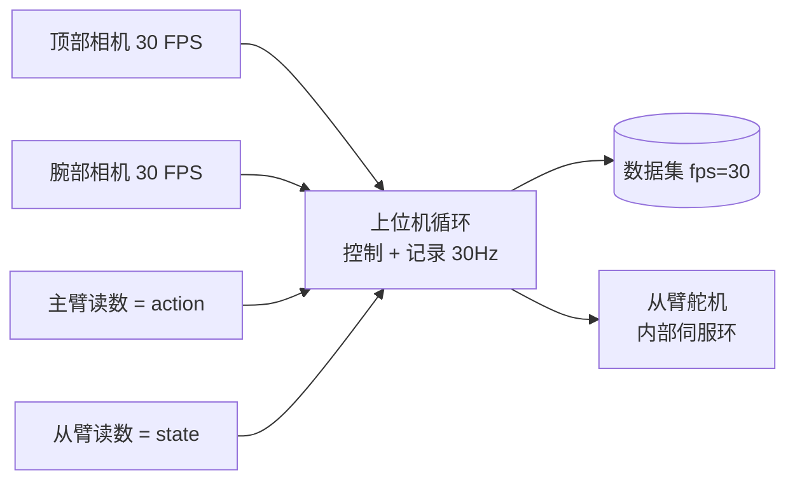

# 一、第五课练习参考答案

第五课的练习你还没有提交答案，这里直接给出参考答案和解析。先自己对照一遍，答错的题回到第五课对应小节重读。

| 题目 | 参考答案 | 核心原因 |
|---|---|---|
| 问题 1：绝对位置与位置增量 | C | 增量要加到参考位置上：$20^\circ+3^\circ=23^\circ$ |
| 问题 2：关节动作与末端动作 | B | 世界坐标系下的 $[x,y,z]$ 描述的是夹爪在空间中的位置，属于末端执行器动作 |
| 问题 3：动作空间与 Action Chunk | B | 动作空间决定"每一步怎么表示"，动作块长度决定"一次预测多少步"，两者互相独立 |
| 问题 4：部署语义不一致 | A | 训练的是增量，部署当成绝对位置，数值的物理含义完全不同 |

### 问题 1 的一个延伸细节

题目说"增量相对于当前位置"，但在真实系统里，"当前位置"有两种常见约定：

| 参考点 | 目标位置计算 | 特点 |
|---|---|---|
| 当前实际状态 $s_t$ | $q_{\text{target}}=s_t+\Delta q$ | 误差不会一直累积，但会受机器人跟踪滞后影响 |
| 上一次发出的目标 $q^*_{t-1}$ | $q_{\text{target}}=q^*_{t-1}+\Delta q$ | 不受跟踪滞后影响，但一旦出错会持续累积 |

两种约定在机器人正在加速、或者被物体挡住时会得到不同结果。所以验收清单里不能只写"增量动作"，还要写"增量相对于什么"。

---

# 二、第六课：控制频率、采样率与轨迹记录频率

> [!abstract] 本课覆盖的参数
> **控制频率**、**采样率**、**轨迹记录频率**
> 同时为后续课程中的 IMU 采样率、头部位姿采样率、力与力矩采样率、日志记录频率打基础。

这一课是模块一的最后一课。前五课你学的都是"一个时刻"的问题：这一刻的图像、状态和动作如何对应。这一课要回答的是"连续时刻"的问题：**相邻两个时刻之间隔多久，以及这个间隔会怎样改变数据的含义。**

## 1. 先看一个常见误解

你打开一份 SO-101 数据集的 `meta/info.json`，看到：

```json
"fps": 30
```

很多人会理解成"相机是 30 帧"。但这个数字实际上说的是**数据集里每秒有 30 行记录**，每一行包含图像、状态和动作。它并没有告诉你：

- 舵机内部用多快的速度追踪目标位置；
- 相机实际上是否稳定输出 30 帧；
- 部署时模型多久推理一次；
- 每一行之间的真实间隔是否真的是 33.3 ms。

这四个问题分别对应四种不同的"频率"。在验收清单里，如果只写"频率 30Hz"，读者无法知道你说的是哪一个。

## 2. 一条数据链路里的五个频率

| 频率 | 由谁决定 | SO-101 中的情况（示意） | 回答的问题 |
|---|---|---|---|
| 底层伺服环频率 | 舵机或驱动器固件 | 在舵机内部运行，远快于上位机，通常不可配置，也不会被记录 | 电机如何追踪目标位置？ |
| 传感器采样率 | 各个传感器 | 相机常见 30 FPS；关节读数在每次控制循环中通过总线读取 | 每个传感器多久产生一次新数据？ |
| 控制频率 | 上位机控制循环 | 遥操作时，读取主臂 → 发给从臂的循环频率 | 多久发出一条新命令？ |
| 轨迹记录频率 | 数据记录程序 | 数据集的 `fps` | 数据集中每秒保存多少行？ |
| 推理与执行频率 | 部署程序 | 模型多久推理一次；动作按什么节奏下发 | 部署时多久做一次决策？ |

在 LeRobot 的常见 SO-101 录制流程中，**控制循环和记录循环是同一个循环**：每一轮读取主臂、发送命令、读取从臂和相机、写入一行数据。所以控制频率和记录频率通常相同。但在很多工业机器人系统中，它们是分开的：例如底层控制以数百到上千赫兹运行，而数据集只以十几赫兹记录。



> [!warning] 验收清单写法
> 永远不要只写"频率 30Hz"。要写清楚：**哪个环节、名义值多少、实测值多少。**

---

## 3. 控制频率

### ① 一句话定义

控制频率是上位机控制程序**每秒向机器人发出多少条新命令**。控制周期是它的倒数：

$$
\Delta t=\frac{1}{f_{\text{control}}}
$$

例如 30 Hz 对应约 33.3 ms，100 Hz 对应 10 ms。

### ② 采集时它控制什么

**第一，每条命令持续多久。** 在下一条命令到来之前，机器人一直在执行当前命令。

**第二，每一步的动作幅度。** 同样的运动速度，频率越低，每一步的变化越大：

| 关节速度 | 控制频率 | 每步位置变化 |
|---|---|---|
| $60^\circ/\text{s}$ | 10 Hz | $6^\circ$ |
| $60^\circ/\text{s}$ | 30 Hz | $2^\circ$ |
| $60^\circ/\text{s}$ | 100 Hz | $0.6^\circ$ |

计算方式：$\Delta q = v\cdot\Delta t$，例如 $60^\circ/\text{s}\times\frac{1}{30}\text{s}=2^\circ$。

**第三，反应速度。** 从环境发生变化到机器人发出新命令，最多要等一个控制周期。10 Hz 意味着最坏情况下要晚 100 ms 才能做出反应。

### ③ 最终生成什么数据

每秒产生 $f$ 条动作。如果动作是**绝对位置**，数值本身和频率无关；但如果动作是**位置增量或速度**，数值的物理含义就和 $\Delta t$ 绑定在一起：

- 位置增量 $+2^\circ$ 在 30 Hz 下意味着 $60^\circ/\text{s}$；
- 同样的 $+2^\circ$ 在 10 Hz 下只意味着 $20^\circ/\text{s}$。

**所以，增量动作数据离开了控制频率，就无法被正确解释。**

### ④ 设置不当会出什么问题

**频率过低：**
- 动作粗糙，轨迹呈"阶梯状"；
- 接触、碰撞等快速事件发生在两个周期之间，机器人来不及反应；
- 每步增量变大，模型更难学到平滑的运动。

**频率过高：**
- 上位机来不及完成一轮循环（读相机、读舵机、写磁盘），实际频率低于设定值，而且间隔忽长忽短；
- 舵机总线读写被占满，出现通信超时；
- 相邻两步的动作几乎相同，模型容易学到"照抄上一步动作"的捷径，而不是从图像中学习何时改变动作。

**名义频率 ≠ 实际频率。** 这是最常见、也最容易被忽视的问题。例如设定 30 Hz，但相机读取偶尔阻塞 50 ms，那么部分间隔会变成 66 ms 甚至更长。如果数据中的时间戳是按"帧号 ÷ fps"生成的，这种问题在数据表里完全看不出来（见本课第 7 节）。

### ⑤ 对 VLA 训练与部署的影响

**影响一：动作块的物理时长由控制频率决定。**

第五课讲过 Action Chunk。模型一次预测 $H$ 步动作，这段动作覆盖的真实时间是：

$$
T_{\text{chunk}}=\frac{H}{f_{\text{control}}}
$$

| 动作块长度 $H$ | 控制频率 | 覆盖时长 |
|---|---|---|
| 50 | 10 Hz | 5.0 s |
| 50 | 30 Hz | 约 1.67 s |
| 50 | 50 Hz | 1.0 s |

同一个模型配置，换了频率，"一次规划多远的未来"就完全变了。

**影响二：训练频率和部署频率必须一致。**

假设模型用 30 Hz 数据训练，动作是绝对关节位置，动作块长度 50。部署时由于电脑性能不足，只能以 15 Hz 执行：

- 原本 1.67 s 内完成的动作块，现在要 3.33 s 才执行完；
- 机器人动作整体变慢，但环境（例如传送带上的物体）不会等它；
- 如果动作是增量形式，每步增量没变而周期变长，动作速度直接减半。

**影响三：推理时延可能比控制周期还长。**

VLA 模型一次推理通常需要几十到几百毫秒（取决于模型规模和硬件），而 30 Hz 的控制周期只有 33 ms。模型不可能每个控制周期都推理一次。这正是 Action Chunk 被广泛使用的原因之一：**推理一次，执行多步**。但这也带来一个问题：执行动作块后段时，机器人用的是"几百毫秒前的观测"做出的决策。这个问题会在 [[第十四课 遥操作系统：输入设备、端到端时延与力反馈]] 和 [[第十九课 策略部署数据：策略版本、日志频率与人工接管]] 中继续讨论。

### ⑥ 验收与清洗

- 规范中写明：控制循环名义频率、实测间隔的均值、P95 和最大值。
- 清洗时：统计每条轨迹的实际间隔分布，标记间隔超过阈值（例如超过 2 倍名义周期）的位置，评估是否需要剔除或切分轨迹。

---

## 4. 采样率

### ① 一句话定义

采样率是**某一个传感器每秒产生多少次新数据**。不同传感器的采样率可以相差很大。

| 传感器 | 常见采样率范围（量级参考） |
|---|---|
| RGB 相机 | 15 ~ 60 FPS |
| 关节编码器（上位机读取） | 数十到数百 Hz |
| IMU | 100 ~ 1000 Hz |
| 力/力矩传感器 | 数百到数千 Hz |
| 头显位姿追踪 | 数十到一百多 Hz |

以上只是常见量级，具体数值以设备手册和实测为准。

### ② 采集时它控制什么

采样率决定了这个传感器**能捕捉多快的变化**。一个简化但很重要的规律是：要能还原一个变化，采样频率至少要高于该变化最高频率成分的两倍（奈奎斯特采样定理）。工程上一般会留出更大的余量。

举个例子：夹爪碰到桌面时，力传感器上的冲击可能只持续几毫秒。如果力传感器以 30 Hz 采样（每 33 ms 一次），这个冲击很可能落在两次采样之间，数据里根本看不到。

### ③ 最终生成什么数据

每个传感器产生一条**自己节奏**的数据流。当所有数据要写进 LeRobot 这种"每行一个时间步"的格式时，就必须做出选择：

| 方案 | 做法 | 代价 |
|---|---|---|
| 降采样到记录频率 | 每行只保留一个值 | 丢失高频信息 |
| 窗口统计 | 每行保存该周期内的均值、最大值等 | 丢失细节，但保留了关键特征 |
| 窗口原始数据 | 每行保存该周期内的全部原始样本 | 数据量大，模型输入维度变大 |
| 单独存储 | 高频数据单独存文件，用时间戳关联 | 训练时需要额外的对齐逻辑 |

### ④ 设置不当会出什么问题

- **采样率过低：** 快速事件丢失，或者出现**混叠**（aliasing）——高频振动被错误地记录成低频波动，看起来像真实运动。
- **采样率过高：** 数据量增大，高频噪声也被完整记录下来。
- **降采样前没有滤波：** 直接从 1000 Hz 隔点取到 30 Hz，同样会产生混叠。正确做法是先低通滤波（或取窗口平均），再降采样。

### ⑤ 对 VLA 训练与部署的影响

- 多速率传感器融合是 VLA 数据处理中的常见难题。例如如何把 1000 Hz 的力信号喂给一个 30 Hz 推理的模型？常见做法是取窗口统计量或用单独的编码器处理高频片段。
- 训练时用的降采样方法，部署时必须用同样的方法。如果训练时取窗口平均，部署时取瞬时值，输入分布就会不同。

### ⑥ 验收与清洗

- 规范中逐个列出每个传感器的名义采样率、实测采样率和时间戳来源。
- 清洗时检查每个数据流是否有长时间中断、重复时间戳或时间倒退。

---

## 5. 轨迹记录频率

### ① 一句话定义

轨迹记录频率是**写进数据集的频率**，也就是数据集里每秒有多少行。在 LeRobot 中，它就是 `info.json` 中的 `fps`。

### ② 采集时它控制什么

它控制**训练样本的时间粒度**。记录频率可以等于控制频率，也可以低于控制频率。例如一些研究数据集在底层以很高频率控制机器人，但只以 15 Hz 左右记录数据。

### ③ 最终生成什么数据

- `info.json` 中的 `fps`；
- 每行的 `frame_index`、`timestamp`；
- 视频文件中的帧数应与 parquet 数据的行数对应。

> [!important] 一个关键细节
> 在常见的 LeRobot 录制流程中，`timestamp` 往往是按 `frame_index / fps` 计算出来的**名义时间**，而不是每一帧的真实采集时刻（请在你使用的版本中核实）。这意味着即使实际循环出现了卡顿，数据表里的时间戳仍然是完美的等间隔。

### ④ 设置不当会出什么问题

**问题 A：记录频率低于控制频率，而动作是增量形式。**

假设控制频率 50 Hz，每步增量 $+0.2^\circ$。现在要把数据降到 10 Hz（每 5 步取 1 步）：

| 做法          | 每行动作         | 是否正确              |
| ----------- | ------------ | ----------------- |
| 每 5 行取 1 行  | $+0.2^\circ$ | ❌ 错误，丢掉了其余 4 步的增量 |
| 每 5 个增量求和   | $+1.0^\circ$ | ✅ 正确              |
| 由绝对位置重新计算增量 | $+1.0^\circ$ | ✅ 正确              |

错误做法训练出来的模型，在 10 Hz 下每步只走 $0.2^\circ$，运动速度只有原来的五分之一。

**不同动作类型的降采样规则：**

| 动作类型 | 正确做法 | 常见错误 |
|---|---|---|
| 绝对位置 | 取对应时刻的值（最近邻或插值） | — |
| 位置增量 | 区间内累加，或从绝对位置重新计算 | 直接隔行取 |
| 速度 | 区间平均 | 取瞬时值，噪声大 |
| 夹爪开合等离散事件 | 确保事件不丢失 | 隔行取可能跳过短暂的开合 |

**问题 B：视频帧数与数据行数不一致。** 例如相机丢帧导致视频比数据表少几帧，训练时读取的图像就会和状态、动作逐渐错位，越往后错得越多。

### ⑤ 对 VLA 训练与部署的影响

- **混合不同频率的数据集。** 公开的大规模机器人数据集中，各子数据集的记录频率可能从个位数赫兹到数十赫兹不等。同样是"预测 50 步"，在 5 Hz 数据里是 10 秒，在 50 Hz 数据里是 1 秒。混合训练时，要么把数据重采样到统一频率，要么让模型知道每个数据集的时间尺度。
- **部署频率要和记录频率匹配**，原因同控制频率一节。

### ⑥ 验收与清洗

- 规范中写明：记录频率、是否与控制循环同步、`timestamp` 的生成方式、是否做过重采样及方法。
- 清洗时：检查视频帧数和数据行数是否一致；如果做过重采样，按动作类型核对重采样方法。

---

## 6. 把三个频率串起来：一次部署的时间线

假设你的 SO-101 以 30 Hz 采集训练数据，模型一次预测 50 步动作，推理一次需要约 300 ms（示意数值）：

```text
时间 0 ms     采集观测，开始推理
时间 300 ms   推理完成，得到 50 步动作（覆盖约 1.67 s）
时间 300 ms ~ 起，以 30 Hz（每 33 ms）依次执行动作
              ……执行若干步后，采集新观测，再次推理
```

注意两个事实：

1. 第一步动作在**观测之后 300 ms** 才开始执行，这段时间里世界可能已经变化；
2. 动作块的执行节奏必须是 30 Hz，因为训练数据就是 30 Hz。

---

## 7. 清洗实践：如何检查真实频率

如果数据集只有名义时间戳，下面的检查会得到"完美"结果，但这不代表采集真的稳定：

```python
import numpy as np
import pandas as pd

df = pd.read_parquet("data/chunk-000/file-000.parquet")  # 路径以你的数据集版本为准
fps = 30

for ep, g in df.groupby("episode_index"):
    dt = np.diff(g["timestamp"].to_numpy())
    print(ep, "mean=%.4f  p95=%.4f  max=%.4f" % (dt.mean(), np.percentile(dt, 95), dt.max()))
```

如果所有间隔都恰好等于 $1/30$ s，说明时间戳很可能是按帧号生成的名义值。要真正检查采集稳定性，需要：

1. **在采集程序中额外记录真实时间。** 例如每行写入一个由单调时钟（第一课讲过）得到的时间戳字段。
2. **检查录制日志。** 很多录制程序会在循环超时时打印警告。
3. **用动作跳变间接检测。** 如果某一行的动作变化量远大于相邻行，可能是中间丢失了若干周期：

```python
act = np.stack(g["action"].to_numpy())          # 形状 [T, 关节数]
step = np.abs(np.diff(act, axis=0))             # 每步变化量
threshold = 5 * np.median(step, axis=0) + 1e-6  # 示例阈值：中位数的 5 倍
suspect = np.where((step > threshold).any(axis=1))[0]
print("可疑跳变位置:", suspect[:20])
```

这只是启发式检查：快速但真实的运动也可能触发它，需要结合视频人工确认。

---

## 8. 验收清单写法速查

| 字段 | 示例写法（阈值为示例，需按任务确定） |
|---|---|
| 控制频率 | 上位机控制循环名义 30 Hz；实测间隔 P95 ≤ 40 ms，最大间隔 ≤ 100 ms |
| 采样率 | 顶部、腕部相机名义 30 FPS；关节状态每个控制周期读取一次；力传感器 1000 Hz，单独存储 |
| 轨迹记录频率 | 30 Hz，与控制循环同步；`timestamp` 为 `frame_index / fps`；另存真实单调时钟时间戳字段 |
| 重采样 | 无；如有，写明方法（绝对位置取最近邻，增量重新计算） |
| 推理与执行配置 | 动作块长度 50，执行频率 30 Hz，每执行 N 步重新推理 |
| 异常处理 | 单条轨迹中间隔超过 100 ms 的次数 > 3 次则剔除，或在该处切分 |

---

## 9. 第六课练习

**问题 1：每步动作幅度**

一个关节以 $60^\circ/\text{s}$ 匀速运动，控制频率为 30 Hz。每个控制周期的目标位置变化约为多少？

A. $0.5^\circ$
B. $2^\circ$
C. $6^\circ$

**问题 2：增量动作降采样**

一份 50 Hz 的数据集，动作定义为相邻两步的关节位置增量。要降到 10 Hz，正确做法是？

A. 每 5 行取 1 行
B. 每 5 个连续增量求和作为新的一步
C. 取 5 个增量的平均值

**问题 3：训练与部署频率不一致**

模型用 30 Hz 数据训练，动作为绝对关节位置，动作块长度 50。部署时只能以 15 Hz 执行。以下哪项描述正确？

A. 没有影响，因为绝对位置不依赖频率
B. 动作块从约 1.67 s 变成约 3.33 s 执行完，动作整体变慢，与环境的时间关系被打乱
C. 机器人会运动得更快

**问题 4：名义时间戳**

你检查一份 LeRobot 数据集，发现所有相邻 `timestamp` 的差值都恰好是 33.33 ms。能否据此证明采集过程没有卡顿？

A. 能，间隔完全均匀说明采集很稳定
B. 不能，时间戳可能是按帧号计算的名义值，需要真实时钟记录或日志来验证

**问题 5：开放思考题**

你的 SO-101 数据集里有一个力传感器，以 1000 Hz 采样，而数据集记录频率是 30 Hz。请写出两种把力数据放进训练样本的方案，并各说一个缺点。

> [!question]- 参考答案（点击展开）
> 1. **B**。$60^\circ/\text{s}\times\frac{1}{30}\text{s}=2^\circ$。
> 2. **B**。增量必须累加。隔行取会丢失 4/5 的运动量；取平均得到的是 $0.2^\circ$，同样只有正确值的五分之一。
> 3. **B**。绝对位置的数值不依赖频率，但执行节奏依赖频率。每个目标位置停留的时间翻倍，整个动作块的执行时长翻倍。
> 4. **B**。这正是本课第 7 节的重点。
> 5. 参考思路：
>    - 方案一：每行保存这 33 个样本的均值。缺点：短暂的冲击被平均掉了。
>    - 方案二：每行保存这 33 个样本的最大值和均值。缺点：仍然丢失了力变化的时序形状。
>    - 方案三：每行保存全部 33 个原始样本。缺点：输入维度变大，需要专门的编码器处理。
>    - 方案四：单独存储高频数据，训练时按时间戳取窗口。缺点：数据加载逻辑更复杂，必须保证时间对齐正确。
>    - 无论哪种方案，训练和部署必须采用同一种处理方式。

---

## 10. 模块一小结

到这里，你已经学完了"让真机数据能够用于训练"的六个核心知识点：

| 课程                | 一句话总结                |
| ----------------- | -------------------- |
| 时间同步              | 不同设备要有统一的时间基准        |
| 时间戳对齐误差           | 有时间戳不等于时间准确，要测量误差分布  |
| State 与 Action 对齐 | 动作标签的时间语义必须明确定义      |
| 关节状态记录项           | 先保证位置、单位、关节映射正确      |
| 动作空间              | 动作数值的含义取决于表示方式       |
| 控制频率与采样率          | 相邻时刻的间隔决定了动作幅度和动作块时长 |

如果把这六课压缩成一句话：**一条训练样本要让人能准确回答"这是什么时刻、机器人在哪、看到了什么、接下来要做什么、这个'接下来'有多长"。**

下一课 [[第七课 机器人本体：自由度、夹爪类型与夹爪开合记录]] 会进入机器人本体：为什么 6 自由度和 7 自由度的机械臂数据不能直接混用，夹爪开合应该记录成连续值还是二值，以及灵巧手的手指自由度会给数据带来什么挑战。
