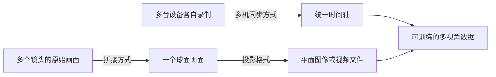

# 第十三课：多机同步、全景拼接与投影格式

> [!abstract] 本课覆盖的参数
> **多机同步方式**、**拼接方式**、**投影格式**
> 这三个参数在"人类第一视角采集"中几乎总是同时出现：多台设备要对齐时间，全景相机要把多个镜头拼成一张图，拼好的球面画面要展开成某种平面格式。

设想一个家务数据采集项目：采集员头戴一台消费级 360 全景相机（两颗背靠背的鱼眼镜头），胸前再挂一台运动相机，手腕上戴一台记录 IMU 的手表或手机，每天在五户人家里同时开工，录"整理餐桌""洗碗""叠衣服"。一周后你拿到数据，发现三个问题：

1. 胸前相机和头戴相机的画面，开头对得好好的，录到第 40 分钟时，胸前相机里"手碰到碗"比头戴相机早了大约 4 帧；
2. 采集员的手经常出现在全景画面的拼接缝上，手指在缝两边错开，像被切成了两截；
3. 交付的是 3840×1920 的全景 mp4，你直接缩放成 224×224 喂给视觉编码器，画面上下两端被拉得面目全非。

这三个问题分别对应本课的三个参数。它们和前面课程的关系：

| 前面学过的 | 本课的延伸 |
|---|---|
| [[第一课 时间同步方式（Time Synchronization）]] | 四种同步方式，在多台独立设备上如何落地 |
| [[第二章 时间戳对齐误差]] | 设备时钟漂移，让误差随录制时长增长 |
| [[第九课 相机布局：相机数量与位置、机位、安装高度与视场角]] | 全景相机是一种极端的"超大视场角"布局 |
| [[第十二课 深度相机与LiDAR]] | 多台主动深度设备需要错开曝光，这也是一种多机同步 |



---

## 1. 多机同步方式

### ① 一句话定义

多机同步方式是**多台独立采集设备（多台相机、多台手机或运动相机、多套采集终端）之间，用什么手段建立共同的时间基准，以及同步到什么精度。**

第一课讲的是"一台电脑上的几个传感器"；这一课的设备各有各的电池、各有各的晶振，彼此之间可能连一根线都没有。

### ② 采集时它控制什么

**第一，选用哪种同步手段。** 第一课的四种方式在多设备场景下具体落成下面这些工程手段：

| 手段 | 原理 | 精度量级（示意，以实测为准） | 适用场景 |
|---|---|---|---|
| 硬件触发线 / genlock | 一根信号线让所有相机在同一时刻开始曝光；genlock（同步锁相）让多台视频设备锁定到同一个参考信号 | 微秒级，曝光级同步 | 固定机位的多相机阵列、动捕棚 |
| PTP | 网络上的精确时间协议，需要交换机和网卡支持硬件时间戳 | 亚微秒到微秒级 | 有线网络连接的工业相机、多台工控机 |
| NTP | 普通网络校时 | 局域网内常见毫秒级，公网可能几十毫秒 | 多台电脑、多台手机的粗同步 |
| 时间码（Timecode） | 给每帧打上"时:分:秒:帧"的标签，由时间码发生器分发 | 帧级；是否曝光级取决于设备是否同时锁相 | 影视设备、部分运动相机和录音设备 |
| 事后共同事件对齐 | 录制时制造一个所有设备都能记录到的事件，事后找到它 | 取决于事件的锐利程度，常见一帧到几帧 | 消费级设备、无法连线的移动采集 |

**事后对齐的共同事件**常见有四种：

| 事件 | 怎么用 | 局限 |
|---|---|---|
| 拍手 | 画面中手掌闭合那一帧，加上声音波形的尖峰 | 画面判断只能精确到帧；镜头看不到手时只能用声音 |
| 闪光 | 闪光灯或手机屏幕全白闪一下，找亮度突变的帧 | 卷帘快门下，闪光可能只照亮画面的一部分行 |
| 声音波形互相关 | 所有带麦克风的设备都录下了环境声，计算两段音频的互相关峰值 | 需要设备有音频；音频与视频之间本身也有固定偏移 |
| 画面中的屏幕计时器 | 一块显示毫秒计时的屏幕同时出现在所有相机画面里 | 屏幕刷新率限制分辨率（60 Hz 屏幕约 16.7 ms 一次刷新） |

**第二，同步到"帧级"还是"曝光级"。**

- **帧级同步**：知道 A 的第 $i$ 帧和 B 的第 $j$ 帧"大致是同一时刻"，用最近邻配对。两台 30 FPS 相机各自自由运行时，配对后两帧的曝光时刻最多相差半个帧周期，约 16.7 ms。
- **曝光级同步**：两台相机在同一时刻开始曝光，偏差在微秒级。只有硬件触发或 genlock 能做到。

对"头戴相机 + 胸前相机"这种移动采集，通常只能做到帧级；对动捕棚里的多相机三维重建，必须做到曝光级（见 [[第十八课 动作捕捉：节点、骨骼模型、标记点、动捕相机与融合]]）。

**第三，是否处理时钟漂移。** 每台设备的时钟来自自己的晶振，标称频率和实际频率之间有微小偏差，用 ppm（parts per million，百万分之一）表示。两台设备的相对漂移为 $r$ ppm 时，录制 $T$ 秒后累积的时间差为：

$$
\Delta t=r\times10^{-6}\times T
$$

| 相对漂移 | 1 小时后的累积偏差 | 30 FPS 下相当于 |
|---|---|---|
| 10 ppm | 36 ms | 约 1 帧 |
| 20 ppm | 72 ms | 约 2 帧 |
| 40 ppm | 144 ms | 约 4 帧 |

计算方式：$20\times10^{-6}\times3600\ \text{s}=0.072\ \text{s}$。消费级晶振的漂移常见在几到几十 ppm 量级，还会随温度变化（示意，以实测为准）。这就是开头场景里"开头对齐、40 分钟后差 4 帧"的原因：**只在开头做一次对齐，误差会随时间线性增长。**

还有一种比晶振漂移大得多的"假漂移"：**名义帧率不一致**。一台设备是 30 FPS，另一台是 29.97 FPS，如果你都按 30 FPS 用帧号换算时间，一小时后会差出 3.6 秒，约 108 帧。手机录像还常常是**可变帧率**（Variable Frame Rate，VFR），帧号与时间根本不是线性关系（衔接 [[第十课 成像参数：分辨率、帧率、曝光白平衡与防抖]]）。

**第四，分布式多工位怎么办。** 五户人家同时采集，工位之间不需要彼此同步（它们录的是不同的事件），但**每个工位内部**的多台设备必须同步，并且每个工位都要用同一套流程。常见做法：每个工位的设备在开录和结束时都做一次共同事件；所有设备的时钟用 NTP 校到同一个服务器，至少保证日期时间可比；每条记录带工位编号和设备编号。

### ③ 最终生成什么数据

同步本身不产生画面，但产生**让画面能够对齐的元数据**：

```json
{
  "session_id": "home03_20261018_am",
  "reference_device": "head_360",
  "devices": {
    "head_360":  {"model": "<型号>", "nominal_fps": 30.0,  "vfr": false, "clock": "device_rtc"},
    "chest_cam": {"model": "<型号>", "nominal_fps": 29.97, "vfr": false, "clock": "device_rtc"},
    "wrist_imu": {"model": "<型号>", "nominal_hz": 200,    "clock": "phone_monotonic"}
  },
  "sync_method": "post_hoc_audio_xcorr + clap_at_start_and_end",
  "sync_events": [
    {"name": "clap_start", "t_ref_s": 3.412},
    {"name": "clap_end",   "t_ref_s": 2431.880}
  ],
  "offsets": {
    "chest_cam": {"offset_s": -1.274, "drift_ppm": 18.5, "residual_ms": 6.0},
    "wrist_imu": {"offset_s": 0.533,  "drift_ppm": 4.1,  "residual_ms": 3.0}
  }
}
```

含义：把每台设备的本地时间换算到参考设备时间轴的公式是 $t_{\text{ref}}=t_{\text{local}}+o+r\times10^{-6}\times(t_{\text{local}}-t_0)$，其中 $o$ 是偏移、$r$ 是漂移、$t_0$ 是开头同步事件在该设备本地时间轴上的时刻；`residual_ms` 是用其他事件验证时剩下的误差。字段名为示意，按你们的规范定义。

如果用了时间码，视频文件的元数据里会带起始时间码，例如 `timecode: 10:23:41:12`。如果用了硬件触发，相机通常会在每帧附带触发计数或硬件时间戳。

### ④ 设置不当会出什么问题

| 故障 | 在数据里的表现 |
|---|---|
| 只在开头对齐一次 | 偏差随时间线性增长，长视频后半段多视角错位 |
| 名义帧率不同却按帧号对齐 | 偏差以每小时秒级的速度增长 |
| 可变帧率视频按固定帧率解读 | 偏差忽大忽小，没有线性规律 |
| NTP 在录制中途校时 | 系统时钟突然跳变几十毫秒，时间戳出现跳跃或倒退（第一课讲过单调时钟的意义） |
| 以为时间码 = 曝光同步 | 两台设备时间码相同，但实际曝光时刻差半帧以内的任意值 |
| 拍手只拍了一次且在画外 | 只能用声音，而声音到视频的偏移又未知 |
| 设备中途重启或换电池 | 本地时钟重置，后半段的偏移完全不同，但文件名看不出来 |

还有一个容易忽略的细节：**音频和视频在同一台设备内部也有偏移**。用声音做互相关得到的是"音频轨对音频轨"的偏移，换算成视频偏移时，还要加上每台设备自己的音视频偏移。不同设备的这个值不同，严格的项目会用"拍手的画面帧 + 拍手的声音"同时校验一次。

### ⑤ 对 VLA 训练与部署的影响

**影响一：多视角之间错位。** 如果胸前相机比头戴相机晚 4 帧，而你用头戴视角估计手的位置、用胸前视角估计手指状态，再拼成一个动作标签，那么手的位置和手指状态来自不同时刻。在手快速运动时（例如抓起物体的瞬间），模型学到的是"手已经移开了却还没张开"这种物理上不存在的组合。

**影响二：视频与 IMU 错位。** 第一视角数据常用 IMU 或视觉惯性里程计估计头部位姿，再用头部位姿把手的位置换算到世界坐标系。视频和 IMU 差 50 ms，头部快速转动时（转头速度每秒上百度并不少见），换算出来的手部位置会错开好几厘米，这些错误会直接进入从人类视频提取的动作轨迹（衔接 [[第十五课 人体追踪信号：头部位姿、手部关键点、佩戴位置与手部可见]] 和 [[第十六课 手持与手机采集：机型、握持、采集App、位姿追踪与上传]]）。

**影响三：错位是"有偏"的，不是随机噪声。** 漂移让错位在一条长视频里单调增长，所以模型学到的不是"略有噪声的对应关系"，而是"视频越往后，动作越超前或越滞后"。如果把长视频切成很多短片段训练，不同片段的错位大小不同，相当于给同一种画面配了时间语义不同的动作标签。

**影响四：部署时多相机也要同步。** 训练时的多视角数据是同步的，部署时机器人上的两台相机却是各自自由运行，模型看到的两路画面可能差一帧以上。对静态场景影响不大，对快速运动的任务会造成输入分布偏移。

### ⑥ 验收与清洗

**规范里要写清楚：** 参考设备是谁；同步手段；每台设备的名义帧率、是否可变帧率；共同事件的类型和次数（至少开头和结尾各一次，长录制建议中途再加）；漂移是否校正；验收残差阈值。

**拿到数据后怎么查：** 用开头和结尾两个共同事件分别计算偏移，二者之差就是漂移量；再用中间某个可识别事件（例如关门声、物体落地声）检查校正后的残差。代码见第 5 节。

---

## 2. 拼接方式

### ① 一句话定义

拼接方式是**把多个镜头拍到的画面合成一个连续的大视角画面（通常是 360° 全景）时，在哪里拼、用什么算法拼、拼接参数是什么。**

### ② 采集时它控制什么

**第一，在哪里拼：机内拼接还是后期拼接。**

| 方式 | 做法 | 优点 | 缺点 |
|---|---|---|---|
| 机内拼接 | 相机实时输出已拼好的全景视频 | 简单，文件直接可用 | 算法固定、参数不可调；原始鱼眼画面往往不保留 |
| 后期软件拼接 | 相机保存原始双鱼眼素材，导出时用厂商软件或第三方工具拼接 | 可调拼接距离、可换更好的算法、可重新导出 | 多一步处理，软件版本和参数必须记录 |

消费级 360 相机常见的是**双鱼眼背靠背**结构：两颗视场角超过 180° 的鱼眼镜头，各拍半个球，重叠部分用来拼接。

**第二，视差：为什么近处物体在拼接缝处错位。**

两颗镜头的光学中心不在同一点，它们之间有一段距离 $b$（几厘米量级，示意）。同一个物体从两个镜头看过去的方向略有不同，夹角约为：

$$
\alpha\approx\frac{b}{D}
$$

其中 $D$ 是物体到相机的距离。拼接算法只能假设"所有物体都在某个距离上"，在这个距离上缝两边对得上，其他距离就会错位。示意数值：$b=3$ cm，输出全景宽 3840 像素，即每度约 $3840/360\approx10.7$ 像素：

| 物体距离 $D$ | 视差角 $\alpha$ | 缝处错位（约） |
|---|---|---|
| 3 m | 约 0.57° | 约 6 像素 |
| 1 m | 约 1.7° | 约 18 像素 |
| 0.3 m | 约 5.7° | 约 61 像素 |

计算方式：$0.03/0.3=0.1$ rad，约 $5.7^\circ$，乘以 10.7 像素每度约 61 像素。拼接算法会把这部分错位"揉"进重叠区域，表现为**重影（ghosting）或物体被切断**。

**第一视角采集恰恰是最糟糕的情况：手离头戴相机只有 30~60 cm，而且一直在动。** 远处的墙壁拼得天衣无缝，手却在缝上断成两截。

**第三，用什么算法拼。**

- **固定模板拼接**：按出厂标定的镜头参数和一个固定拼接距离直接映射，速度快，近处错位明显；
- **可调拼接距离**：后期软件允许把拼接距离调到手所在的距离附近，手对齐了，背景又会错位；
- **光流拼接（optical flow stitching）**：在重叠区估计两侧画面的像素运动，按光流把两边"扭"到一起，重影明显减少；代价是会**改变局部形状**，手指可能被拉弯或变粗，而且光流在相邻帧之间不稳定时会产生闪烁；
- **多相机阵列拼接**：专业设备用 4 到十几个镜头围成一圈，单个镜头畸变更小，但拼接缝更多，每条缝都有视差问题。

**第四，拼接相关的附加处理。** 很多全景相机在拼接时还会做**防抖和水平锁定**：利用机内 IMU 把画面旋转到"地平线永远水平、方向不随头转动而大幅变化"。这对观看很友好，对数据却是一个陷阱：**输出画面的像素方向不再固定对应相机机身**。如果你还想用画面估计头部朝向，或者把 IMU 与画面联合使用，必须知道是否开启了这项处理（衔接 [[第十课 成像参数：分辨率、帧率、曝光白平衡与防抖]] 的防抖一节）。

**第五，两个镜头的曝光与色彩。** 一个镜头朝向窗户、另一个朝向室内时，两侧亮度差很大，拼接后缝两边出现明显的亮度台阶。

### ③ 最终生成什么数据

```text
session_home03_am/
├── raw/
│   ├── VID_0012_lens0.<厂商原始格式>    # 原始鱼眼，未拼接
│   └── VID_0012_lens1.<厂商原始格式>
├── stitched/
│   └── VID_0012_erp_3840x1920.mp4       # 拼好的等距柱状投影全景
└── meta/
    ├── lens_calibration.json            # 每个镜头的内参、两镜头之间的外参
    └── stitch_params.json
```

`stitch_params.json`（字段为示意）：

```json
{
  "stitch_location": "post",
  "software": "<软件名>", "software_version": "<版本>",
  "algorithm": "optical_flow",
  "stitch_distance_m": 0.5,
  "stabilization": false,
  "horizon_lock": false,
  "seam_yaw_deg": [90.0, -90.0],
  "color_matching": true
}
```

其中 `seam_yaw_deg` 记录拼接缝在全景中的方位。很多双鱼眼相机的两条缝在左右两侧（取决于镜头朝向和佩戴方式），知道缝在哪里，清洗时才能针对缝区域检查。

### ④ 设置不当会出什么问题

| 故障 | 在数据里的表现 |
|---|---|
| 手经常出现在缝上 | 手指断裂、重影，手部关键点检测在缝附近失败或跳变 |
| 光流拼接参数激进 | 手指形状被扭曲，相邻帧闪烁；看起来"干净"，其实几何关系被改了 |
| 开启了水平锁定却没记录 | 画面方向与头部 IMU 不一致，头部位姿估计出现莫名其妙的偏差 |
| 只保留机内拼接结果 | 发现问题后无法用更好的算法重拼，也无法回到单镜头做精确几何计算 |
| 拼接软件版本变了 | 同一份原始素材，两批导出的画面在缝附近不一致 |
| 两镜头曝光差异大 | 缝两侧亮度台阶，模型可能把这条亮度边界当作场景特征 |

### ⑤ 对 VLA 训练与部署的影响

**影响一：拼接改变了像素的几何关系。** 一张理想的全景图，每个像素都对应一个"从同一个中心点出发"的方向。拼接缝附近这个假设被破坏：像素实际来自两个光学中心，还可能被光流扭过。手部姿态估计、从视频重建三维手部轨迹、计算物体在相机坐标下的方向，都依赖精确的相机模型，在缝附近会出现系统性误差。**这些误差会直接写进从人类视频提取出来的"动作标签"。**

**影响二：模型可能学到拼接伪影。** 如果手部经常在缝附近出现重影，而训练数据中只有全景相机这一种来源，模型会把"重影的手"当成正常的手。部署到机器人上时，机器人相机没有拼接缝，这部分学到的特征全部失效。

**影响三：原始鱼眼素材的价值。** 保留原始鱼眼素材，意味着你可以：针对手部区域只用一个镜头的画面（没有视差问题）；用镜头标定参数做精确的几何计算；将来用更好的拼接算法重新生成全景。存储成本更高，但这是"采集时不记录，后面无法恢复"原则的又一个例子。

### ⑥ 验收与清洗

**规范里要写清楚：** 机内还是后期拼接；软件与版本；算法类型；拼接距离；防抖与水平锁定是否开启；拼接缝的方位；是否交付原始鱼眼素材与镜头标定。采集操作上，**让拼接缝避开手的主要活动区域**（例如调整佩戴朝向，使一颗镜头正对前下方、缝落在左右两侧）。

**拿到数据后怎么查：** 抽查缝附近的画面，统计手部检测框与缝区域重叠的帧比例；对比缝两侧的亮度差；检查手部关键点在缝附近是否频繁跳变。

---

## 3. 投影格式

### ① 一句话定义

投影格式是**把球面上的画面展开成平面图像时采用的映射规则**，它规定了"图像上的一个像素对应空间中的哪个方向"。

### ② 采集时它控制什么

它控制像素和方向之间的映射关系，进而决定了哪些方向被分配了更多像素、哪些区域被拉伸。常见四种格式：

| 格式 | 英文 | 形态 | 特点 |
|---|---|---|---|
| 等距柱状投影 | Equirectangular Projection，ERP | 一张 2:1 的图，横向是经度、纵向是纬度 | 最通用；两极严重拉伸 |
| 立方体贴图 | Cubemap | 6 个 90° 视场角的正方形透视面 | 每个面都是普通透视图；面与面之间有接缝 |
| 鱼眼原始格式 | Fisheye | 每个镜头一个圆形画面 | 未拼接，最接近传感器原始数据；畸变很大 |
| 透视裁剪 | Perspective Crop | 从全景中按某个方向、某个视场角裁出一张普通图像 | 和普通相机最像；只保留一部分视角 |

**ERP 的映射公式。** 设经度 $\lambda\in[-\pi,\pi)$（向右为正），纬度 $\phi\in[-\pi/2,\pi/2]$（向上为正），图像宽 $W$、高 $H=W/2$，像素坐标 $(u,v)$ 从左上角开始：

$$
u=\left(\frac{\lambda}{2\pi}+\frac{1}{2}\right)W,\qquad v=\left(\frac{1}{2}-\frac{\phi}{\pi}\right)H
$$

反过来：

$$
\lambda=\left(\frac{u}{W}-\frac{1}{2}\right)2\pi,\qquad \phi=\left(\frac{1}{2}-\frac{v}{H}\right)\pi
$$

对应的单位方向向量（取 $x$ 向右、$y$ 向上、$z$ 向前的约定）：

$$
\mathbf{d}=(\cos\phi\sin\lambda,\ \sin\phi,\ \cos\phi\cos\lambda)
$$

**像素坐标与经纬度是线性关系**，这正是 ERP 好用的地方：横向每个像素固定代表 $360^\circ/W$，纵向固定代表 $180^\circ/H$，宽 3840 时都是约 0.094°。

**两极为什么被拉伸。** 每一行都有 $W$ 个像素，但纬度 $\phi$ 处那一圈的实际周长只有赤道的 $\cos\phi$ 倍。所以在纬度 $\phi$ 处，同样的物理角度在水平方向占的像素是赤道的 $1/\cos\phi$ 倍：

| 纬度 | 水平拉伸倍数 $1/\cos\phi$ |
|---|---|
| 0°（地平线） | 1.0 |
| 45° | 约 1.41 |
| 60° | 2.0 |
| 80° | 约 5.8 |

第一视角里，手和桌面经常位于**向下 30°~70°** 的范围（低头看手），这片区域在 ERP 里被横向拉伸 1.15 到 2.9 倍左右。一个圆形的盘子在 ERP 里会变成扁椭圆。

上面的公式只是一种常见约定。不同软件对"经度零点在哪里、向右还是向左为正、$y$ 轴朝上还是朝下"的约定不同，**必须以你的素材和工具链为准**。

**立方体贴图**把球面投到外接立方体的 6 个面上，每个面是视场角 90° 的标准透视图，局部畸变小，常见排布有 3×2、十字形等，排布方式和面的朝向同样需要约定。还有一些改进格式（例如等角立方体贴图）调整了每个面内的像素分布。

**鱼眼原始格式**常用的模型之一是等距模型 $r=f\theta$：像素到画面中心的距离 $r$ 与入射光线和光轴的夹角 $\theta$ 成正比。实际镜头需要用标定得到的多项式模型修正，例如 OpenCV 的 fisheye 模块就采用这类模型。

### ③ 最终生成什么数据

投影格式决定了**文件里的像素怎么解释**，这些信息必须随文件交付：

- **容器内的球面元数据（spherical metadata）**：例如 Google 提出的球面视频元数据规范（早期版本用一段 XML 描述，后来的版本在 MP4 里用 `st3d`、`sv3d` 等盒子描述立体模式和投影类型）。播放器依靠它识别"这是一段 360° 视频"；
- **数据集自己的元数据**：

```json
{
  "projection": "equirectangular",
  "resolution": [3840, 1920],
  "yaw_zero": "camera_front",
  "longitude_positive": "right",
  "latitude_positive": "up",
  "initial_view_yaw_pitch_roll_deg": [0, 0, 0],
  "stereo_mode": "mono",
  "derived_views": [
    {"name": "front_down_crop", "type": "perspective",
     "fov_deg": 90, "size": [640, 480], "yaw_deg": 0, "pitch_deg": -45}
  ]
}
```

注意 `derived_views`：如果你从全景中裁出了给模型用的透视视图，裁剪参数也是数据的一部分。

### ④ 设置不当会出什么问题

| 故障 | 在数据里的表现 |
|---|---|
| 转码时丢失球面元数据 | 播放器把全景当普通视频显示；下游工具不知道这是 ERP |
| 经度零点或方向约定弄反 | 裁剪"正前方"时裁到了身后；左右手方向颠倒 |
| 直接把 ERP 缩放成正方形 | 横纵比被破坏，两极拉伸叠加缩放，物体严重变形 |
| 多次投影转换 | 鱼眼 → ERP → 立方体 → 透视，每一次重采样都在模糊细节 |
| 透视裁剪参数没记录 | 不知道裁出的视角对应哪个方向、多大视场角，无法与其他视角或 IMU 关联 |
| ERP 分辨率不足 | 3840 宽的全景，裁成 90° 透视图时只剩约 960 像素宽的有效信息，手指细节不足 |

最后一点值得算一下：全景把 3840 个像素分给了 360°，90° 视场角只分到 $3840\times90/360=960$ 像素。一台普通 1920 宽、90° 视场角的相机，在同样视角下的像素密度是它的两倍。**全景相机的"高分辨率"是被整个球面摊薄了的。**

### ⑤ 对 VLA 训练与部署的影响

**影响一：预训练分布不匹配。** 大多数视觉编码器在大量普通照片（透视投影）上预训练。它们学到的"直线是直的、物体比例正常、视场角几十度"这些先验，在 ERP 上都不成立：直线变成曲线，两极拉伸，视场角 360°。直接输入 ERP，等于让模型在一个它没见过的图像分布上工作，特征质量下降，而且很难通过少量微调弥补。

**影响二：人类第一视角数据要转换成接近机器人相机的视角。** 用人类全景视频作为示范数据源时，最终要服务的是机器人上的相机，通常是头部或腕部的普通透视相机。常见做法是从全景中裁出一个与机器人相机**视场角、朝向、分辨率相近**的透视视图（衔接 [[第九课 相机布局：相机数量与位置、机位、安装高度与视场角]]）。如果机器人的头部相机是 90° 视场角、向下 40° 俯视，那么裁剪参数就应该朝这个方向靠近。

**影响三：投影约定错误会让动作标签方向出错。** 从全景视频中估计手部方向、头部朝向，再转换成动作轨迹时，经度方向弄反会让所有"向右"的动作变成"向左"。这种错误不会让训练报错，但会让模型学到镜像的动作。

**影响四：全景的优势要用对。** 全景能保证"手永远在画面里"，对提取手部轨迹和理解环境很有价值。合理的做法是：用全景（或原始鱼眼）做标注和轨迹提取，用透视裁剪作为模型的视觉输入。

### ⑥ 验收与清洗

**规范里要写清楚：** 投影类型、分辨率、经纬度约定、文件内球面元数据是否保留、派生视图的裁剪参数。

**拿到数据后怎么查：** 用 `ffprobe` 读取视频流的附加信息，检查投影元数据是否存在；检查宽高比是否为 2:1；抽一帧做透视裁剪，确认"正前方"真的是采集员的正前方。代码见第 5 节。

---

## 4. 串联：一次同步误差在全景中会放大成多少像素

把三个参数放到一个场景里算一笔账。采集员头戴全景相机，胸前运动相机作为第二视角，手在约 0.4 m 处以 1 m/s 的速度移动（伸手拿东西时很常见，示意数值）。

**同步误差变成位置误差：**

胸前相机与头戴相机之间残留 20 ms 的同步误差，手在这段时间内移动 $1\times0.02=0.02$ m，即 2 cm。从头戴相机看，2 cm 在 0.4 m 处对应的角度约为 $0.02/0.4=0.05$ rad，约 $2.9^\circ$。

**角度误差变成全景像素误差：**

ERP 宽 3840 时每度约 10.7 像素，$2.9^\circ$ 约等于 30 像素。如果这只手恰好在纬度 $-60^\circ$ 附近（低头看手），水平方向还要再乘以 $1/\cos60^\circ=2$，约 60 像素。

**再叠加拼接视差：**

如果此时手还在拼接缝附近，按第 2 节的表，0.4 m 处的视差错位约为 $0.03/0.4\approx0.075$ rad，约 $4.3^\circ$，约 46 像素。

```text
误差来源                     数值（示意）        对应全景像素
同步残差 20 ms × 手速 1 m/s   手位移约 2 cm        约 30 像素（地平线）
纬度 -60° 的水平拉伸          × 2                  约 60 像素
拼接缝视差（0.4 m 处）        约 4.3°              约 46 像素
```

三者叠加后，同一只手在两路数据中的位置可能相差上百个全景像素。这说明三个参数之间存在明显的权衡：

| 想要的效果 | 需要的组合 |
|---|---|
| 精确的手部三维轨迹 | 更严格的同步、原始鱼眼素材、让缝避开手、用单镜头计算 |
| 大量低成本数据 | 事后对齐 + 机内拼接 + ERP，但要接受误差，并在清洗时剔除缝区域和快速运动片段 |
| 给 VLA 当视觉输入 | 透视裁剪，视场角和朝向向机器人相机靠拢 |

---

## 5. 清洗实践：同步、漂移与投影检查

**检查一：用音频互相关估计两台设备的偏移。**

```python
import numpy as np
from scipy.io import wavfile
from scipy.signal import correlate, correlation_lags

def audio_offset_s(wav_a, wav_b, max_lag_s=10.0):
    """返回 b 相对 a 的偏移（秒）。正值表示同一事件在 a 中出现得更晚。
    建议只截取包含拍手的前几分钟音频，整段长音频做互相关很耗内存。"""
    sr_a, a = wavfile.read(wav_a)
    sr_b, b = wavfile.read(wav_b)
    assert sr_a == sr_b, "请先把两段音频重采样到相同采样率"
    a = a.mean(axis=1) if a.ndim > 1 else a.astype(np.float64)   # 多声道取平均
    b = b.mean(axis=1) if b.ndim > 1 else b.astype(np.float64)
    a = (a - a.mean()) / (a.std() + 1e-9)
    b = (b - b.mean()) / (b.std() + 1e-9)
    c = correlate(a, b, mode="full", method="fft")
    lags = correlation_lags(len(a), len(b), mode="full")
    keep = np.abs(lags) <= max_lag_s * sr_a                     # 只在合理范围内找峰值
    return lags[keep][np.argmax(c[keep])] / sr_a
```

局限：环境声很弱或有周期性噪声（空调、风扇）时，互相关峰值可能不唯一；结果是音频轨之间的偏移，换算到视频还需加上各设备自己的音视频偏移。拿到结果后，最好对照拍手画面人工确认一次。

**检查二：用开头和结尾两个事件估计漂移。**

```python
def drift_ppm(offset_start_s, offset_end_s, t_start_s, t_end_s):
    """两次同步事件处测得的偏移之差，除以间隔时长，换算成 ppm。"""
    return (offset_end_s - offset_start_s) / (t_end_s - t_start_s) * 1e6

# 示例：开头偏移 -1.274 s，40 分钟后偏移 -1.230 s
r = drift_ppm(-1.274, -1.230, 3.4, 2431.9)
print(f"相对漂移约 {r:.1f} ppm")   # 约 18 ppm，40 分钟累积约 44 ms
```

如果算出的"漂移"达到几百甚至上千 ppm，通常不是晶振问题，而是名义帧率不一致（30 与 29.97 相差约 1000 ppm）或可变帧率，应先检查帧率。

**检查三：检查视频中的球面元数据与宽高比。**

```python
import json
import subprocess

def check_projection(path):
    out = subprocess.run(
        ["ffprobe", "-v", "error", "-select_streams", "v:0",
         "-show_streams", "-of", "json", path],
        capture_output=True, text=True, check=True).stdout
    st = json.loads(out)["streams"][0]
    w, h = st["width"], st["height"]
    spherical = [sd for sd in st.get("side_data_list", [])
                 if "spherical" in sd.get("side_data_type", "").lower()]
    print(f"{path}: {w}x{h}, 宽高比 {w / h:.2f}")
    print("球面元数据:", spherical if spherical else "未检测到")
    if spherical == [] and abs(w / h - 2) < 0.01:
        print("警告：看起来像 ERP，但没有投影元数据，需要人工确认")
```

局限：`ffprobe` 输出的字段名随版本变化；部分早期格式的球面信息以其他形式存放，"未检测到"不等于一定没有，需要人工确认。

**检查四：从 ERP 裁出透视视图，验证方向约定。**

```python
import cv2
import numpy as np

def erp_to_perspective(erp, fov_deg=90, out_w=640, out_h=480, yaw_deg=0, pitch_deg=0):
    """从 ERP 全景中裁出透视视图。约定：经度向右为正、纬度向上为正、ERP 中心为正前方。"""
    H, W = erp.shape[:2]
    f = (out_w / 2) / np.tan(np.radians(fov_deg) / 2)          # 虚拟针孔相机焦距（像素）
    xs, ys = np.meshgrid(np.arange(out_w), np.arange(out_h))
    x = (xs - (out_w - 1) / 2) / f                              # 相机坐标：x 右，y 上，z 前
    y = -(ys - (out_h - 1) / 2) / f
    rays = np.stack([x, y, np.ones_like(x)], axis=-1)
    rays /= np.linalg.norm(rays, axis=-1, keepdims=True)

    p, q = np.radians(pitch_deg), np.radians(yaw_deg)
    Rx = np.array([[1, 0, 0], [0, np.cos(p), np.sin(p)], [0, -np.sin(p), np.cos(p)]])  # pitch>0 抬头
    Ry = np.array([[np.cos(q), 0, np.sin(q)], [0, 1, 0], [-np.sin(q), 0, np.cos(q)]])  # yaw>0 向右
    d = rays @ (Ry @ Rx).T

    lam = np.arctan2(d[..., 0], d[..., 2])                       # 经度
    phi = np.arcsin(np.clip(d[..., 1], -1, 1))                   # 纬度
    map_u = ((lam / (2 * np.pi) + 0.5) * W - 0.5).astype(np.float32)
    map_v = ((0.5 - phi / np.pi) * H - 0.5).astype(np.float32)
    # BORDER_WRAP 处理经度 ±180° 的接缝；裁剪区域靠近两极时纵向回绕并不正确
    return cv2.remap(erp, map_u, map_v, cv2.INTER_LINEAR, borderMode=cv2.BORDER_WRAP)

# 用法：裁出"正前方向下 45°"的视图，人工确认画面里是采集员的手和桌面
# view = erp_to_perspective(frame, fov_deg=90, pitch_deg=-45)
```

如果裁出来的是天花板，说明纬度方向约定反了；如果是采集员身后，说明经度零点不在正前方。这段代码的约定和你的素材可能不同，以素材实测为准。

---

## 6. 验收清单写法速查

| 字段 | 示例写法（阈值为示例，需按任务确定） |
|---|---|
| 参考设备 | 头戴 360 相机为时间参考，其他设备换算到其时间轴 |
| 多机同步方式 | 事后对齐：开头、结尾各拍手一次，配合音频互相关；设备时钟每日开工前 NTP 校时，录制中禁止自动校时 |
| 帧率核对 | 所有视频设备名义帧率统一为 30.00 FPS，禁止可变帧率；不一致的设备单独登记 |
| 漂移校正 | 按首尾事件线性校正；中间事件验证残差 ≤ 1 帧（33 ms） |
| 分布式工位 | 每工位独立完成同步流程；记录工位编号、设备编号、设备重启事件 |
| 拼接方式 | 后期拼接，软件与版本记录在 `stitch_params.json`；拼接距离 0.5 m；防抖与水平锁定关闭 |
| 拼接缝 | 佩戴时使缝位于左右两侧；手部检测框与缝区域重叠的帧占比 ≤ 10% |
| 原始素材 | 交付原始双鱼眼文件与镜头标定 |
| 投影格式 | ERP，3840×1920，经度向右为正、ERP 中心为正前方；保留容器内球面元数据 |
| 派生视图 | 训练用透视裁剪：90° 视场角，640×480，pitch -45°，参数写入元数据 |

---

## 7. 第十三课练习

**问题 1：时钟漂移**

两台运动相机的相对时钟漂移约为 30 ppm，只在开头做了一次对齐，连续录制 2 小时。结束时两者的累积时间差约为多少？

A. 约 2.2 ms
B. 约 216 ms
C. 约 21.6 s

**问题 2：帧级同步与曝光级同步**

两台 30 FPS 相机各自自由运行，没有硬件触发，但时间戳都已换算到同一时钟。用最近时间戳配对后，配对的两帧曝光时刻最大可能相差多少？

A. 几乎为 0，因为时间戳已经统一
B. 约半个帧周期，约 16.7 ms
C. 正好一个帧周期，33.3 ms

**问题 3：拼接缝上的手**

头戴双鱼眼全景相机录制的数据中，采集员的手经常出现在拼接缝上，手指出现重影和断裂，而远处的墙面拼得很好。以下做法哪个最合理？

A. 这是正常现象，直接用拼接后的全景训练
B. 原因是近距离视差；应调整佩戴朝向让缝避开手部活动区域、保留原始鱼眼素材，对手部相关计算优先用单镜头画面
C. 提高视频码率就能解决

**问题 4：ERP 像素与方向**

一张 3840×1920 的 ERP 全景，约定经度向右为正、图像中心为正前方。像素 $(u,v)=(2880,960)$ 对应哪个方向？

A. 正前方
B. 右侧 90°，与地平线平齐
C. 正上方

**问题 5：开放思考题**

你打算用一批人类第一视角的 ERP 全景视频，配合一个在普通照片上预训练的视觉编码器，训练一个最终部署在机器人上的 VLA。机器人头部相机是 90° 视场角、略向下俯视的普通相机。你会如何处理这批全景视频？请说明理由和需要记录的参数。

> [!question]- 参考答案（点击展开）
> 1. **B**。$30\times10^{-6}\times7200\ \text{s}=0.216\ \text{s}$，约 216 ms，30 FPS 下约 6.5 帧。这就是为什么长录制必须在结尾再做一次同步事件。
> 2. **B**。时间戳统一只解决"怎么比较时间"，不改变两台相机各自的曝光时刻。自由运行时曝光相位是任意的，最近邻配对后最大相差半个周期。只有硬件触发或 genlock 才能做到曝光级同步。
> 3. **B**。视差角约为 $b/D$，手离相机很近所以错位大，远处墙面视差小所以拼得好。码率与视差无关；直接训练会让模型学到拼接伪影，并让手部姿态估计在缝附近出错。
> 4. **B**。$\lambda=(2880/3840-0.5)\times360^\circ=90^\circ$，$\phi=(0.5-960/1920)\times180^\circ=0^\circ$，即右侧 90°、地平线高度。
> 5. 参考思路：
>    - 不直接输入 ERP：预训练编码器适应的是透视图像，ERP 的畸变和拉伸造成分布偏移。
>    - 从 ERP（或更好地从原始鱼眼）裁出透视视图，视场角取 90°，俯仰角向机器人相机的俯视角靠拢，分辨率与机器人相机相近；注意全景的像素密度被摊薄，裁出的视图有效分辨率有限。
>    - 用全景做手部轨迹和头部位姿的提取，用透视裁剪做模型输入，二者通过同一时间轴关联。
>    - 记录：裁剪的 yaw、pitch、视场角、输出分辨率；ERP 的经纬度约定；是否开启了防抖或水平锁定；与 IMU 和其他设备的同步残差。
>    - 进一步：人类视角与机器人视角在身体高度、手的外观上仍有差别，这部分会在后续人类示范课程中讨论。

---

## 8. 小结

一句话：**多机同步决定"不同设备的画面是不是同一时刻"，拼接方式决定"多个镜头的画面拼起来后几何关系还准不准"，投影格式决定"文件里的每个像素对应哪个方向"；三者都要写进元数据，否则数据只能看，不能算。**

到这里，模块二"视觉观测"全部结束。从下一课开始进入模块三"人类示范与遥操作采集"：不再只关心"模型看到什么"，而是关心"示范是怎么被人做出来的"。下一课 [[第十四课 遥操作系统：输入设备、端到端时延与力反馈]] 会讲遥操作用什么设备输入、从操作者动手到看见机器人响应要多久，以及操作者能不能"感觉到"机器人碰到了什么。
