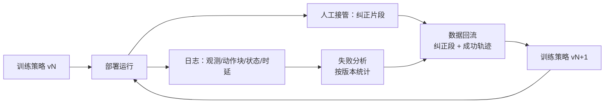

# 第十九课：策略部署数据——策略版本、日志频率与人工接管

> [!abstract] 本课覆盖的参数
> **策略版本**、**日志记录频率**、**接管触发条件**、**接管点标注方式**
> 这是模块四"部署后的数据回流"的第一课。前面所有课程讨论的都是"人采集的示范数据"，从这一课开始，数据的生产者变成了**机器人自己**。

## 1. 模块四导读：为什么部署数据是数据飞轮的来源

你用 SO-101 采集了 200 条"把笔放进笔筒"的示范，训练了一个 ACT 策略。部署后测试 50 次，成功 32 次。剩下 18 次失败里，有的是夹爪没夹住笔，有的是笔放到了笔筒边缘，有一次机械臂一直悬在笔筒上方不动。你在旁边握着主臂，看到不对就接手操作，把任务完成。

这一下午的运行过程中，产生了三类非常有价值的数据：

1. **策略自己的运行轨迹**：告诉你模型在真实环境中会走到哪些状态；
2. **失败案例**：告诉你模型在哪里出问题；
3. **人工纠正片段**：告诉你"在模型犯错的那个状态下，正确做法是什么"。

第三类数据是示范数据里最缺的。原因在于：行为克隆（Behavior Cloning）只在专家走过的状态上学习。部署时模型一旦出现小偏差，就会进入专家从没走过的状态，在那里它不知道该怎么做，偏差越积越大。这个问题常被称为**误差累积**（Compounding Error）或**协变量偏移**（Covariate Shift）。

**DAgger**（Dataset Aggregation）的思想正是针对这个问题：让当前策略去运行，收集它实际访问到的状态，由专家为这些状态提供正确动作，把这些数据并入训练集，重新训练，再部署，循环往复。真机上让专家事后给每一帧补标动作很困难，所以常见的变体是**人工门控**（Human-Gated）：人在旁边看着，只在必要时接管，接管期间人的操作就是纠正标签。



这个循环要转起来，前提是部署数据被**正确地记录**：知道是哪个策略产生的（策略版本），记录得足够细（日志频率），知道什么时候、为什么由人接手（接管触发条件），并且在数据里能准确分出哪些帧是策略控制、哪些帧是人控制（接管点标注方式）。这就是本课的四个参数。

本课会用到 [[第三课：State 与 Action 对齐方式]] 的时间语义、[[第五课 动作空间（Action Space）]] 的动作块、[[第六课 控制频率、采样率与轨迹记录频率]] 的推理与执行频率、[[补学 第一至五课的缺口与勘误]] 的归一化统计量，以及 [[第十四课 遥操作系统：输入设备、端到端时延与力反馈]] 的遥操作链路。

---

## 2. 策略版本

### ① 一句话定义

策略版本是一组能**唯一确定"这条部署数据是由哪个策略、在什么配置下产生的"**的标识信息。它不只是一个模型文件名，而是权重、训练数据、归一化统计量、推理配置和代码的组合。

### ② 采集时它控制什么

策略版本决定了**被记录下来的行为分布**。同一台机器人、同一个任务，换一个策略版本，机器人会走到不同的状态、犯不同的错误。一个完整的策略版本至少包含：

| 组成部分 | 示例内容 | 如果漏记会怎样 |
|---|---|---|
| 权重 | 检查点文件的哈希、训练步数 | 两个都叫 `last.ckpt` 的文件，无法区分 |
| 训练数据集版本 | 数据集名称、版本号、包含哪些 episode | 无法知道新数据是否已经训练进去 |
| 归一化统计量版本 | `stats` 的来源与哈希 | 权重没变但统计量换了，输出整体偏移，成功率骤降，却找不到原因 |
| 推理配置 | 动作块长度、每次执行步数、是否启用时间集成、控制频率 | 只改了"每次执行几步"，行为就明显不同，却被当成同一版本 |
| 代码版本 | 推理代码的提交号、主要依赖库版本 | 预处理（图像缩放、裁剪）变了，模型输入分布随之改变 |
| 机器人侧配置 | 校准文件、相机序列号与分辨率 | 换了一台从臂或一个相机，本质上是换了"环境" |

以 LeRobot 的 ACT 为例，推理行为至少受动作块长度（如 `chunk_size`）、每次推理后执行的步数（如 `n_action_steps`）和时间集成相关参数影响。具体参数名以你使用的版本为准。

### ③ 最终生成什么数据

每个部署 episode 的元数据中记录完整的策略版本块：

```json
{
  "episode_id": "deploy_20261020_0137",
  "policy_version": {
    "policy_id": "act_pen_v3",
    "checkpoint_sha256": "9f2c...e41a",
    "train_step": 80000,
    "train_dataset": {"repo_id": "lab/so101_pen", "version": "v1.2", "num_episodes": 200},
    "stats_sha256": "51ab...07cd",
    "inference_config": {"chunk_size": 100, "n_action_steps": 50, "temporal_ensemble": false, "control_hz": 30},
    "code_commit": "a1b2c3d",
    "robot_calibration": "so101_follower_A_2026-10-01.json"
  }
}
```

逐帧数据中也建议保留一个短字段 `policy_version`（例如 `act_pen_v3`），这样不同版本的数据合并后仍能直接筛选。以上字段名均为示例。

### ④ 设置不当会出什么问题

| 错误做法 | 后果 |
|---|---|
| 只记录"v3"或"latest" | 权重文件被覆盖后，无法复现当时的行为 |
| 只记录权重，不记录统计量和推理配置 | 两次部署"同一个模型"成功率差异很大，却无从排查 |
| 调试时改了配置，忘记更新版本号 | 成功率变化被错误地归因于模型 |
| 多个版本的部署数据合并后丢失版本信息 | 无法按版本分析失败模式，也无法判断某个失败是否已在新版本中修复 |

### ⑤ 对 VLA 训练与部署的影响

**第一，部署数据是 on-policy 数据。** 第 $k$ 版策略产生的日志，反映的是第 $k$ 版策略会走到的状态分布。人工纠正片段告诉你"在第 $k$ 版会犯错的状态下怎么纠正"。训练出第 $k+1$ 版后，模型会走到新的状态，这时第 $k$ 版的纠正数据仍然有用（它们本身是正确的专家动作），但它覆盖的是旧版本的失败模式。知道每段数据来自哪个版本，才能判断"新版本的失败是不是旧问题"。

**第二，强化学习和离线分析需要知道行为策略。** 如果后续要用这些数据做离线强化学习或策略评估，很多方法需要知道"是哪个策略产生了这些动作"。版本信息缺失，这些数据只能当作普通示范使用。

**第三，部署时要能回滚。** 新版本上线后成功率下降，你需要立刻恢复上一版本的**完整配置**，而不只是权重。

### ⑥ 验收与清洗

**规范写法：** 列出策略版本块必须包含的全部字段，规定"任何一项改变都产生新的版本号"。

**拿到数据后：** 检查每个 episode 的版本块是否完整；对检查点文件和统计量文件重新计算哈希，确认和日志一致：

```python
import hashlib

def sha256_of(path, chunk=1 << 20):
    """计算文件的 SHA-256，用于核对日志中记录的权重/统计量哈希。"""
    h = hashlib.sha256()
    with open(path, "rb") as f:
        while True:
            b = f.read(chunk)
            if not b:
                break
            h.update(b)
    return h.hexdigest()
```

---

## 3. 日志记录频率

### ① 一句话定义

日志记录频率是部署时**每秒写入多少条运行记录**，以及每条记录包含哪些内容。部署日志通常是分层的：不同内容可以有不同的记录频率。

### ② 采集时它控制什么

**第一，记录哪些内容。** 一份能用于失败分析和数据回流的部署日志，至少应该包括：

| 内容 | 记录时机 | 用途 |
|---|---|---|
| 观测（图像、关节状态） | 每个控制周期，或按训练数据的 fps | 复现模型当时看到了什么；作为回流训练的观测 |
| 模型原始输出（整个动作块） | 每次推理一次 | 判断错误来自模型还是来自后处理 |
| 实际执行动作 | 每个控制周期 | 真正下发给机器人的命令 |
| 机器人状态 | 每个控制周期 | 和执行动作对比，判断跟踪误差 |
| 推理时延 | 每次推理 | 发现"模型来不及"的问题 |
| 时间戳 | 观测采集时刻、推理开始和结束时刻、动作下发时刻 | 还原整条时间线（见 [[第二章 时间戳对齐误差]]） |
| 安全层事件 | 事件发生时 | 记录动作被限幅、急停、限位保护等 |
| 控制来源 | 每个控制周期 | 区分策略控制和人工控制（见第 5 节） |

**第二，日志频率与控制频率的关系。** 执行动作和机器人状态应该**至少以控制频率记录**，否则就和第六课讲的"隔行取样"一样丢失信息。动作块不需要每个周期都记，每次推理记录一次即可，但要能和执行动作对应起来。

**第三，"模型输出"和"实际执行"可能不一样。** 在动作块和机器人之间，通常还有几层处理：时间集成（多个动作块的加权平均）、限幅（单步变化量或速度上限）、安全区裁剪。只记录执行动作，你就无法区分"模型输出本身就错了"和"模型输出是对的，但被安全层改坏了"。

**第四，存储代价。** 全量高频记录的数据量很大，尤其是图像。下面是一个估算（示意数值）：

$$
\text{每小时存储} \approx (\text{视频码率} \times N_{\text{cam}} + \text{其他数据率}) \times 3600\ \text{s}
$$

假设两路相机，每路压缩后约 4 Mbit/s（示意），其余数据忽略不计，每小时约 $4\times2\times3600/8\approx3600$ MB，即约 3.6 GB。一台机器人每天运行 8 小时就是近 30 GB，多台机器人长期部署时，全量保存会很快变得不现实。码率估算方法见 [[第十一课 编码格式与码率]]。

**常见折中：环形缓冲（Ring Buffer）。** 在内存中始终保留最近 $N$ 秒的全量高频数据。一旦触发事件（失败、接管、安全层报警），就把事件前后各 $N$ 秒的完整数据写盘；平时只保存低频摘要。

```text
时间轴 ──────────────────────────────────────────────►
平时：      [低频摘要 2 Hz] [低频摘要] [低频摘要] ...
内存缓冲：  始终保留最近 10 s 的全量数据（示意）
事件发生：                         ▲ 接管
写盘：                    [前 10 s 全量][接管期间全量][后 10 s 全量]
```

如果部署数据计划用于回流训练，**成功的 episode 也要完整保存**，否则回流数据里只有失败和接管，没有正常执行的样本。

### ③ 最终生成什么数据

一种分层组织方式（示意）：

```text
deploy_logs/2026-10-20/
├── episodes/
│   └── deploy_20261020_0137/
│       ├── meta.json                # 策略版本、任务、结果、接管列表
│       ├── frames.parquet           # 每个控制周期一行：状态、执行动作、控制来源……
│       ├── chunks.parquet           # 每次推理一行：完整动作块、时延
│       ├── events.jsonl             # 安全层事件、触发事件
│       └── videos/
│           ├── top.mp4
│           └── wrist.mp4
└── summary_2hz.parquet              # 全天低频摘要
```

`frames.parquet` 的一行（字段名为示例）：

```json
{
  "frame_index": 412,
  "t_capture_s": 13.7331,
  "observation.state": [12.1, -35.4, 60.2, 18.9, -3.0, 22.5],
  "action_executed": [12.4, -35.0, 59.8, 19.1, -3.0, 18.0],
  "inference_id": 9,
  "step_in_chunk": 22,
  "safety_clipped": false,
  "control_source": "policy",
  "intervention_id": null,
  "policy_version": "act_pen_v3"
}
```

`chunks.parquet` 的一行：

```json
{
  "inference_id": 9,
  "obs_frame_index": 390,
  "t_infer_start_s": 13.0012,
  "t_infer_end_s": 13.0874,
  "inference_latency_ms": 86.2,
  "chunk": "[100, 6] 的动作数组"
}
```

通过 `inference_id` 和 `step_in_chunk`，任何一个执行动作都能追溯到它来自哪次推理、动作块的第几步，以及那次推理用的是哪一帧观测。

### ④ 设置不当会出什么问题

| 问题 | 后果 |
|---|---|
| 只记录低频摘要（例如 5 Hz） | 夹爪在 100 ms 内滑脱，摘要里只看到"前一刻夹着、后一刻没了"，无法分析原因 |
| 只记录执行动作，不记录动作块 | 无法判断失败是模型输出导致的，还是时间集成或限幅导致的 |
| 不记录推理时延 | 机器人偶尔"卡一下"，无法确认是不是推理超时 |
| 时间戳只记录写盘时刻 | 写盘排队导致时间戳和真实采集时刻不符，时间线还原错误 |
| 日志写入阻塞控制循环 | 记录本身导致控制周期抖动，问题在不开日志时消失，很难排查 |
| 只保存失败和接管片段 | 回流数据中缺少正常执行的样本，分布严重偏向失败 |

最后一类"日志拖慢控制"的问题很隐蔽。解决办法是把写盘放到独立线程或进程，控制循环只把数据放进队列。

### ⑤ 对 VLA 训练与部署的影响

**第一，回流数据必须和训练数据格式一致。** 部署日志要作为下一轮的训练数据，就必须满足和原始示范数据相同的要求：同样的 fps、同样的动作语义、同样的图像分辨率和预处理。尤其要注意：训练时的动作标签是"主臂读数"（人的意图），而部署日志中策略段的动作是"模型输出"。**策略段的动作不是专家标签**，不能直接当作模仿目标（第 5 节详细讨论）。

**第二，时延分布决定部署配置。** 通过日志中的推理时延分布，你可以判断每次推理后应该执行多少步再重新推理。第六课讲过：观测到执行之间隔得越久，动作越"过时"。

**第三，观测分布对比。** 日志里的图像可以和训练集做统计对比（亮度、颜色、物体位置分布），帮助判断失败是否来自环境变化，例如部署现场的光线和采集时不同。

### ⑥ 验收与清洗

**规范写法：** 列出每一层日志的内容、频率和保存策略（全量 / 环形缓冲 / 摘要），写明时间戳的含义（采集时刻还是写盘时刻）。

**拿到数据后：**

1. 检查 `frames` 的时间间隔分布（方法同第六课第 7 节）；
2. 检查执行动作与动作块的一致性：在没有时间集成和限幅的情况下，`action_executed[t]` 应该等于对应动作块的第 `step_in_chunk` 步。不一致的帧要么被安全层改过，要么是日志错位：

```python
import numpy as np
import pandas as pd

frames = pd.read_parquet("frames.parquet")
chunks = pd.read_parquet("chunks.parquet").set_index("inference_id")

mismatch = []
for _, row in frames[frames["control_source"] == "policy"].iterrows():
    chunk = np.stack(chunks.loc[int(row["inference_id"]), "chunk"])  # [H, D]
    planned = chunk[int(row["step_in_chunk"])]
    if not np.allclose(planned, row["action_executed"], atol=1e-3):
        mismatch.append((row["frame_index"], bool(row["safety_clipped"])))

print("不一致帧数:", len(mismatch), " 其中标记为限幅的:", sum(c for _, c in mismatch))
```

这段代码假设动作块按嵌套列表存储；如果启用了时间集成，执行动作本来就是多个动作块的加权结果，需要改为按集成公式重算后再比较。"不一致但没有限幅标记"的帧最值得排查，它往往意味着日志字段错位。

---

## 4. 接管触发条件

### ① 一句话定义

接管触发条件是**规定在什么情况下中止策略控制、切换到人工操作或安全动作**的规则。

### ② 采集时它控制什么

**第一，触发来源。**

| 类型 | 触发条件示例 | 特点 |
|---|---|---|
| 人工主动接管 | 操作员看到即将碰撞、即将掉落、明显走错方向 | 灵活，能识别语义错误；但依赖注意力，标准因人而异 |
| 力超限 | 末端力或关节力矩估计超过阈值 | 客观；只能发现"已经碰上了"的问题 |
| 关节限位 | 关节接近软限位 | 防止机械损伤 |
| 碰撞检测 | 电流或力矩与预期偏差过大 | 可以较早发现意外接触 |
| 离开安全区 | 末端位置离开预设的工作空间盒子 | 防止机械臂伸向人或设备 |
| 任务超时 | 单个 episode 超过规定时长 | 处理"悬停不动"、反复尝试的情况 |
| 模型不确定性高 | 例如多次采样得到的动作差异大，或集成模型之间分歧大 | 有可能在失败之前发出预警；但不确定性估计本身不一定可靠 |

**第二，触发后由谁控制。** 可以是人工遥操作接手、机器人进入安全停止、或者执行一段脚本（例如抬起并退回初始位置）。只有"人工遥操作接手"会产生纠正数据。

**第三，触发时机决定接管数据的分布。** 这是本节最重要的一点：

| 触发时机 | 接管数据里有什么 | 问题 |
|---|---|---|
| 太晚（等失败已经发生） | 大量"挽救"动作：把掉落的笔捡起来、从卡住的姿态中退出 | 纠正数据描述的是"怎么收拾残局"，而不是"怎么避免犯错" |
| 太早（稍有偏差就接管） | 策略几乎没机会自己纠正，接管片段很多但都很短 | 看不到策略真实的失败模式，还可能把策略本来能自行修正的偏差也当成错误 |
| 标准不一致（不同操作员不同习惯） | 同一类状态下有时接管、有时不接管 | 接管段的分布杂乱，难以分析 |

比较理想的做法是：事先写清楚"什么样的状态必须接管"，例如"夹爪闭合时笔不在两指之间""末端偏离笔筒正上方超过 3 cm 且仍在下降"（示例），让不同操作员的判断尽量一致。

**第四，控制权切换必须平滑。** 这是 SO-101 主从臂部署时最容易踩的坑：

```text
策略控制期间：从臂按模型输出运动，主臂放在一边没动
人工接管瞬间：从臂的目标突然变成主臂当前读数
结果：        从臂从当前位置"跳"到主臂所在位置，可能撞到桌面或笔筒
```

常见的处理方法：

| 方法 | 做法 | 代价 |
|---|---|---|
| 先对齐再接管 | 接管前操作员先把主臂摆到和从臂相近的姿态，系统检测到两者差值小于阈值才允许切换 | 需要时间，紧急情况下来不及 |
| 平滑过渡 | 在一小段时间内（例如 0.3~0.5 s，示例）从策略输出线性过渡到主臂读数 | 过渡期间的动作既不是策略也不是人，需要单独标记 |
| 相对模式 | 接管后从臂执行"接管起点 + 主臂相对接管时刻的变化量" | 主从臂绝对位置不再一一对应，需要记录偏移 |

**交还控制权也要小心。** 人工操作结束、交回策略时，动作队列中残留的是接管前推理出的旧动作块，必须清空，并用当前观测重新推理，否则机器人会执行一段"过时"的动作。

### ③ 最终生成什么数据

触发规则写进 episode 元数据，触发事件写进事件日志：

```json
{
  "takeover_rules": {
    "manual": "foot_pedal",
    "auto": [
      {"type": "force_limit", "threshold_N": 15.0},
      {"type": "workspace_box", "bounds_m": [[0.10, 0.45], [-0.25, 0.25], [0.02, 0.35]]},
      {"type": "timeout", "max_duration_s": 40}
    ],
    "handover": {"method": "blend", "blend_duration_s": 0.4}
  }
}
```

```json
{"t_s": 18.402, "frame_index": 552, "event": "trigger", "type": "force_limit", "measured_N": 17.3, "threshold_N": 15.0}
```

以上数值均为示例。

### ④ 设置不当会出什么问题

| 问题 | 在数据里的表现 |
|---|---|
| 自动阈值太紧 | 大量误触发，接管片段很短、很碎；纠正段里大部分动作是"什么都不用改" |
| 自动阈值太松 | 碰撞已经发生才触发，数据中出现大量异常力和挽救动作，还可能损坏设备 |
| 只有力触发，没有语义判断 | "抓错了物体""放错了位置"这类不产生异常力的失败永远不会触发，数据里看不到 |
| 切换不平滑 | 接管点出现动作和状态的跳变 |
| 没记录触发原因 | 只知道"这里接管了"，不知道为什么 |

### ⑤ 对 VLA 训练与部署的影响

- **接管数据的分布由触发条件塑造。** 如果触发总是太晚，回流数据教给模型的主要是"如何收拾残局"，模型在关键时刻犯错的倾向并不会减少。
- **触发条件决定你能看到哪些失败。** 只靠力触发的系统，统计出来的失败原因会严重偏向"碰撞类"，而"语义类"失败被低估。据此做出的改进方向可能是错的。
- **切换跳变会污染训练数据。** 如果接管点附近的跳变帧没有被剔除，模型会学到"在某些状态下突然大幅改变动作"，部署时表现为偶发的猛冲。

### ⑥ 验收与清洗

**规范写法：** 列出全部触发条件及阈值、人工接管的判定标准（用可操作的语言写）、切换方式与过渡时长、交还控制权时的处理方法。

**拿到数据后：** 按触发类型、策略版本统计接管次数和接管率；抽检一部分自动触发事件，确认是真实问题还是误触发；统计每次接管的持续时长分布，持续时长极短的接管往往是误触发或者操作员习惯性干预。

---

## 5. 接管点标注方式

### ① 一句话定义

接管点标注方式是**在数据中记录"哪些帧由策略控制、哪些帧由人控制、何时开始和结束、为什么接管、谁接管"的方法和字段设计**。

### ② 采集时它控制什么

**第一，自动记录还是事后标注。**

| 方式 | 做法 | 优点 | 缺点 |
|---|---|---|---|
| 自动记录 | 踏板、按键、手柄按钮等接管事件，由程序带时间戳写入日志 | 时间精确，不依赖人工回忆 | 只记录了"切换时刻"，不知道原因 |
| 事后人工标注 | 回看视频，标注接管原因、失败开始时刻 | 可以补充语义信息 | 费时，标注者之间可能不一致 |
| 两者结合 | 自动记录切换时刻，事后补充原因和失败起点 | 兼顾精度和语义 | 需要设计标注工具和流程 |

推荐做法是两者结合：**控制权切换的时刻必须自动记录**，原因类别可以在接管时快速选择（例如踏板配几个按钮），或者事后补标。

**第二，"按下踏板的时刻"不等于"失败开始的时刻"。** 人的反应需要时间（通常在数百毫秒量级），从策略开始犯错到操作员意识到问题再按下踏板，中间还有一段。所以除了接管开始帧，最好在事后标注中再加一个 `failure_onset_frame`：策略开始偏离正确行为的那一帧。这对后面把"接管前片段"用作失败示例非常重要。

**第三，字段设计。** 逐帧字段和逐次接管记录要配合使用：

| 层级 | 字段（示例） | 含义 |
|---|---|---|
| 逐帧 | `control_source` | `policy` / `human` / `blend`（过渡期） |
| 逐帧 | `intervention_id` | 属于第几次接管；策略控制时为空 |
| 逐帧 | `policy_version` | 当前策略版本 |
| 逐帧 | `inference_latency_ms` | 当前动作所属那次推理的时延 |
| 逐次接管 | `start_frame`、`end_frame` | 接管开始和结束 |
| 逐次接管 | `failure_onset_frame` | 事后标注的失败起点 |
| 逐次接管 | `reason` | 从固定类别中选：抓取失败、碰撞风险、目标错误、停滞不动、超时、其他 |
| 逐次接管 | `trigger` | 人工 / 力超限 / 安全区 / 超时 …… |
| 逐次接管 | `operator` | 接管者编号 |
| 逐次接管 | `outcome` | 接管后任务是否完成 |

**原因必须用固定类别**，可以附带一句自由文本备注，但不能只写自由文本，否则无法统计。

### ③ 最终生成什么数据

逐帧数据片段（示意）：

```text
frame  control_source  intervention_id  policy_version  inference_latency_ms
548    policy          null             act_pen_v3      85.1
549    policy          null             act_pen_v3      85.1
550    blend           3                act_pen_v3      null
...
562    human           3                act_pen_v3      null
...
701    human           3                act_pen_v3      null
702    policy          null             act_pen_v3      91.4
```

接管记录（`meta.json` 中，字段名为示例）：

```json
{
  "interventions": [
    {
      "intervention_id": 3,
      "start_frame": 550,
      "blend_end_frame": 561,
      "end_frame": 701,
      "failure_onset_frame": 531,
      "trigger": "manual_pedal",
      "reason": "grasp_failure",
      "note": "夹爪闭合时笔在指尖外侧，笔开始滑落",
      "operator": "op_02",
      "outcome": "task_completed_by_human"
    }
  ],
  "result": {"success": true, "success_by": "human_assisted"}
}
```

注意 `result` 中区分了"策略独立成功"和"人工协助后成功"。统计策略成功率时，**人工协助的成功不能算作策略成功**。

### ④ 设置不当会出什么问题

| 错误做法 | 后果 |
|---|---|
| 只在 episode 级别标记"有接管" | 无法区分哪些帧是人控制的，整条 episode 要么全用、要么全丢 |
| 只记录开始，不记录结束 | 交还控制权之后的策略段被误当作人工数据 |
| 原因只写自由文本 | "没夹住""夹空了""抓取失败"被当成三类，无法统计 |
| 不标记过渡段 | 混合动作被当作人的纠正标签 |
| 接管时刻用写盘时间而不是事件时间 | 标注边界和真实切换错开若干帧 |
| 人工协助的成功算作策略成功 | 成功率被高估，版本比较失真 |

### ⑤ 对 VLA 训练与部署的影响

接管数据在训练中有几种常见用法：

| 用法 | 做法 | 注意事项 |
|---|---|---|
| 只用人工纠正段训练 | 把 `control_source == human` 的片段（去掉过渡段）加入模仿学习数据集 | 这是人工门控 DAgger 类方法的核心思路；纠正段的起始状态正好是策略容易犯错的状态 |
| 对纠正段加权 | 和原始示范混合训练时，提高纠正段的采样权重 | 权重过高可能让模型过度关注少数失败场景，需要实验确定 |
| 接管前片段作为失败示例 | `failure_onset_frame` 到 `start_frame` 之间的策略段，标记为"失败" | 可用于训练失败检测器或奖励模型，或在离线强化学习中赋予负奖励；**不能作为模仿目标** |
| 人机协同强化学习 | 例如 HIL-SERL 这类方法：策略在线学习，人在必要时干预，干预产生的转移数据进入回放缓冲区，与策略自身的经验一起用于更新 | 具体的数据分配和更新方式以原论文和代码为准；LeRobot 近期版本也提供了相关流程，以你使用的版本为准 |

**最常见的错误是把整条部署 episode 当作示范数据训练。** 策略段的动作是模型自己的输出，里面包含了导致失败的那些动作。把它们当作模仿目标，等于让模型模仿自己的错误。只有**策略独立成功**的 episode，其策略段才可以谨慎地作为额外的正样本使用，而且最好单独标记来源，方便做对比实验。

**纠正段的动作语义要和训练数据一致。** SO-101 人工接管时，动作是主臂读数，与原始示范一致；如果接管使用的是手柄或键盘（动作是末端速度或增量），就需要转换成和训练数据相同的动作空间，否则回流数据和原始数据混在一起会出现第五课讲过的"动作语义不一致"问题。

### ⑥ 验收与清洗

**规范写法：** 列出逐帧字段和逐次接管字段、原因类别表、过渡段处理方式、`failure_onset_frame` 的标注规则（例如"策略动作开始明显偏离任务所需方向的第一帧"）。

**拿到数据后：** 检查字段一致性（`control_source == policy` 时 `intervention_id` 必须为空）；统计接管段；检测切换点附近的跳变；按版本统计成功率。代码见第 7 节。

---

## 6. 串联：一次带接管的部署 episode 时间线

把四个参数放到同一条时间线上（示意数值）：

```text
t = 0.0 s    episode 开始，记录策略版本 act_pen_v3（版本块写入 meta.json）
t = 0.0 s    第 1 次推理，时延 86 ms，动作块 100 步，执行前 50 步
             frames 以 30 Hz 全量记录：状态、执行动作、inference_id、step_in_chunk
t = 1.7 s    第 2 次推理……
t = 17.7 s   failure_onset：夹爪闭合位置偏外（事后标注）
t = 18.3 s   操作员踩下踏板（人的反应延迟约 0.6 s）→ 接管开始，进入 0.4 s 过渡段
t = 18.7 s   过渡结束，control_source = human
t = 23.4 s   人工完成放笔，松开踏板 → 清空动作队列，重新推理
t = 24.0 s   episode 结束，结果：human_assisted 成功
写盘：        成功与否都保存全量；同时把接管前后 10 s 额外标记为重点片段
```

从这一条 episode 中可以得到：

| 片段 | 帧范围 | 用途 |
|---|---|---|
| 策略正常段 | 0 ~ 17.7 s | 分析策略行为；不作为模仿目标 |
| 失败段 | 17.7 ~ 18.3 s | 失败示例、失败检测器训练 |
| 过渡段 | 18.3 ~ 18.7 s | 剔除 |
| 纠正段 | 18.7 ~ 23.4 s | 加入回流训练集 |

**一个数据量估算（示意）：** 某天部署 50 个 episode，平均每次 25 s，接管率 36%，每次接管平均 5 s。那么当天得到的纠正数据约为 $50\times0.36\times5=90$ s，只相当于 3~4 条完整示范。这说明两件事：一是纠正数据很宝贵，必须标注准确；二是单靠一天的接管数据不足以重新训练，通常要积累多轮或与原示范数据混合使用。

---

## 7. 清洗实践

### 7.1 提取接管段并统计

```python
import numpy as np
import pandas as pd

def intervention_segments(df):
    """df: 单个 episode 的逐帧表，需含 frame_index、control_source 列。
    返回连续的人工控制段（含过渡段）列表 [(start, end), ...]，end 为包含式。"""
    is_h = df["control_source"].isin(["human", "blend"]).to_numpy()
    frames = df["frame_index"].to_numpy()
    segs, start = [], None
    for k, h in enumerate(is_h):
        if h and start is None:
            start = k
        if not h and start is not None:
            segs.append((frames[start], frames[k - 1]))
            start = None
    if start is not None:
        segs.append((frames[start], frames[-1]))
    return segs

def consistency_check(df):
    """控制来源与 intervention_id 必须一致。返回不一致的行数。"""
    bad = ((df["control_source"] == "policy") & df["intervention_id"].notna()) | \
          ((df["control_source"] != "policy") & df["intervention_id"].isna())
    return int(bad.sum())
```

### 7.2 切换点跳变检测

```python
def switch_jumps(df, fps, ratio=5.0):
    """检测控制来源切换前后的动作跳变。ratio: 相对于该 episode 中位步长的倍数（示例阈值）。"""
    act = np.stack(df["action_executed"].to_numpy())                 # [T, D]
    step = np.linalg.norm(np.diff(act, axis=0), axis=1)              # 每步变化量
    med = np.median(step) + 1e-9
    src = df["control_source"].to_numpy()
    switch_idx = np.where(src[1:] != src[:-1])[0]                    # 第 k 行到第 k+1 行发生切换
    report = []
    for k in switch_idx:
        lo, hi = max(k - 3, 0), min(k + 4, len(step))
        local_max = step[lo:hi].max()                                # 切换前后几步内的最大步长
        report.append((int(df["frame_index"].iloc[k + 1]), src[k], src[k + 1],
                       round(local_max / med, 1), local_max > ratio * med))
    return report   # (切换帧, 切换前来源, 切换后来源, 最大步长/中位步长, 是否超阈值)
```

如果某个切换点的局部最大步长是中位步长的几十倍，基本可以确定切换不平滑。这类切换点前后的若干帧应从训练数据中剔除，同时回头检查切换逻辑。注意：人工接管段本身可能动作较快，阈值需要结合可视化确定。

### 7.3 按策略版本统计成功率

```python
meta = pd.read_json("episodes_meta.jsonl", lines=True)   # 每行一个 episode 的元数据（示例格式）

meta["policy_success"] = meta["success_by"].eq("policy")       # 只统计策略独立成功
meta["had_intervention"] = meta["n_interventions"] > 0

summary = meta.groupby("policy_version").agg(
    n=("episode_id", "count"),
    policy_success_rate=("policy_success", "mean"),
    intervention_rate=("had_intervention", "mean"),
)
summary["std_err"] = np.sqrt(summary["policy_success_rate"] * (1 - summary["policy_success_rate"]) / summary["n"])
print(summary.round(3))
```

`std_err` 是成功率的近似标准误。当每个版本只测了二三十次时，几个百分点的差异很可能只是随机波动，不能据此判断哪个版本更好。

---

## 8. 验收清单写法速查

| 字段 | 示例写法（阈值为示例，需按任务确定） |
|---|---|
| 策略版本 | 每个 episode 记录：策略 ID、检查点 SHA-256、训练步数、训练数据集版本、统计量哈希、推理配置、代码提交号、校准文件名；任一项变化即为新版本 |
| 日志内容 | 观测、执行动作、机器人状态、控制来源逐帧记录；动作块每次推理记录；推理时延；安全层事件 |
| 日志频率 | 逐帧数据与控制频率一致（30 Hz）；图像与训练数据同分辨率、同 fps；全天低频摘要 2 Hz |
| 保存策略 | 所有 episode 全量保存；额外标记接管和安全事件前后 10 s；写盘异步，不阻塞控制循环 |
| 时间戳 | 记录观测采集时刻、推理开始/结束时刻、动作下发时刻，统一使用单调时钟 |
| 接管触发条件 | 人工踏板；力 > 15 N；末端离开工作空间盒子；单 episode > 40 s；人工接管判定标准附表 |
| 切换方式 | 接管时 0.4 s 线性过渡，过渡段标记为 `blend`；交还时清空动作队列并重新推理 |
| 接管点标注 | 逐帧 `control_source`、`intervention_id`；逐次记录起止帧、失败起点、触发类型、原因类别、操作员、结果 |
| 成功统计 | 区分策略独立成功与人工协助成功；按版本报告成功率、接管率与样本数 |
| 回流使用规则 | 只将人工纠正段（去掉过渡段）作为模仿目标；接管前片段标记为失败示例 |

---

## 9. 第十九课练习

**问题 1：版本信息**

同一个检查点文件（哈希完全相同）在两天的部署中成功率分别是 70% 和 35%，环境和任务都没有变。下面哪一项最值得优先排查？

A. 机器人的颜色
B. 归一化统计量和推理配置（例如每次推理后执行的步数）是否在两天之间被改动
C. 训练时用了多少张 GPU

**问题 2：日志频率**

你的部署日志只以 5 Hz 记录执行动作的摘要。某次失败中，笔在约 100 ms 内从夹爪中滑落。下面哪种改进最合理？

A. 把所有内容都改成每秒 1 次，节省存储
B. 逐帧数据按控制频率记录，并用环形缓冲在接管或安全事件发生时保存前后若干秒的全量数据
C. 只保存失败瞬间的一张图片

**问题 3：控制权切换**

SO-101 部署时，操作员踩下踏板接管，从臂突然猛地向一侧跳动。最可能的原因和合理的修复是？

A. 舵机损坏，需要更换
B. 主臂和从臂接管前的姿态差距很大，从臂目标瞬间变为主臂读数；应在接管前对齐，或在一小段时间内平滑过渡
C. 日志频率太低

**问题 4：接管数据的用法**

你积累了一批带接管标注的部署 episode，打算回流训练。以下哪种做法最符合人工门控 DAgger 的思路？

A. 把所有部署 episode 的全部帧都作为模仿学习数据
B. 只把人工纠正段（去掉过渡段）加入模仿学习数据，接管前的策略段不作为模仿目标
C. 只用策略控制段训练，因为它们是模型自己的数据，分布最一致

**问题 5：开放思考题**

你的系统只有一种自动接管条件：末端力超过 15 N。运行一个月后，统计显示"碰撞"占了全部失败原因的 90%。你认为这个统计结论可靠吗？如果不可靠，你会怎样修改触发条件和标注流程？

> [!question]- 参考答案（点击展开）
> 1. **B**。权重相同不代表策略相同。归一化统计量换了，模型输出会整体偏移；推理配置改了，执行行为也会改变。这正是策略版本必须包含统计量和推理配置的原因。
> 2. **B**。100 ms 的事件在 5 Hz（每 200 ms 一条）的摘要中最多只留下一个点，无法分析。逐帧数据应至少以控制频率记录；如果存储有压力，用环形缓冲保证事件前后的全量数据被保存。
> 3. **B**。策略控制期间主臂没有跟随从臂，两者姿态可能相差很大。接管瞬间从臂目标跳变为主臂读数，就会猛冲。修复方法是先对齐再切换、平滑过渡或使用相对模式，同时把过渡段单独标记，不作为训练标签。
> 4. **B**。策略段的动作是模型自己的输出，包含导致失败的动作，不能作为模仿目标。人工门控 DAgger 类方法的核心就是只收集人在策略犯错状态下给出的纠正动作。接管前片段可以另作失败示例使用。
> 5. 参考思路：
>    - 不可靠。触发条件只看力，所以只有"产生异常力"的失败会被发现和记录；抓错物体、放错位置、悬停不动等不产生异常力的失败根本不会触发，统计自然偏向碰撞类。这是触发条件造成的**选择偏差**。
>    - 修改触发条件：增加任务超时、离开安全区、人工主动接管（并给出可操作的接管标准），有条件时加入不确定性预警。
>    - 修改标注流程：每次接管从固定类别中选择原因；对没有触发接管但最终失败的 episode 也要事后标注失败原因；统计时按触发类型分别报告，避免把不同来源的失败混在一起比较。

---

一句话小结：**部署数据是数据飞轮的燃料，但只有当它记录了"谁产生的（策略版本）、记得多细（日志频率）、何时由人接手（触发条件）、哪些帧是人做的（接管标注）"时，它才能被正确地分析和回流训练。**

下一课 [[第二十课 奖励定义与复位方式]] 将讨论部署和在线学习中另外两个关键问题：怎样定义"成功"和"做得好"，以及每个 episode 结束后如何把环境恢复到一个合适的初始状态。
