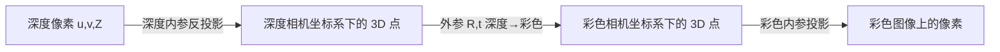

# 第十二课：深度相机与LiDAR

> [!abstract] 本课覆盖的参数
> **深度或LiDAR**
> 具体拆成三层：用哪种原理获取深度（被动双目、主动双目、结构光、ToF、LiDAR）、它在你的工作距离上有多准、最终以什么格式落盘并与 RGB 对齐。

假设你给 SO-101 的腕部换上一台带深度输出的相机，想采一个"把透明玻璃杯放到杯垫上"的任务。录完回放 RGB 画面一切正常，但打开深度图一看：杯子所在的位置是一片黑洞（深度为 0），杯垫边缘有一圈"漂浮"在半空中的点，而夹爪快要碰到杯子的最后十几帧，整张深度图几乎全部无效。你原本打算用深度给每一帧标注"夹爪离杯子还有多远"，结果关键帧恰好全是空的。

这一课要解决的就是这个问题：**深度不是 RGB 的一个附加通道那么简单，它是一个有自己物理原理、有效范围、失效模式和存储规则的独立传感器。** 它和前面几课的关系是：

| 前面学过的 | 在深度上的延伸 |
|---|---|
| [[第八课 标定方式（Calibration）]] | 深度相机有自己的内参，深度与 RGB 之间还有一组外参，配准全靠它 |
| [[第九课 相机布局：相机数量与位置、机位、安装高度与视场角]] | 安装位置决定了物体离深度相机多远，而深度精度强烈依赖距离 |
| [[第十课 成像参数：分辨率、帧率、曝光白平衡与防抖]] | 深度分辨率会改变精度和最小工作距离；深度帧率与 RGB 帧率可能不同 |
| [[第十一课 编码格式与码率]] | 深度**不能**像 RGB 那样用普通有损视频编码 |
| [[第一课 时间同步方式（Time Synchronization）]] | 深度帧和 RGB 帧未必在同一时刻曝光，LiDAR 一圈扫描内每个点的时刻都不同 |

---

## 1. 先建立直觉：深度从哪里来

所有深度传感器只用两类物理原理：**三角测量**（从两个不同位置看同一个点，用几何关系算距离）和**飞行时间**（发出光，测它回来用了多久）。

| 原理 | 英文 | 属于哪一类 | 是否主动发光 | 典型形态 |
|---|---|---|---|---|
| 被动双目 | Passive Stereo | 三角测量 | 否 | 两个普通相机，靠场景自身纹理匹配 |
| 主动双目 | Active Stereo | 三角测量 | 是（红外散斑投射器） | 两个红外相机 + 一个投射随机散斑的发射器，散斑只是"给场景加纹理" |
| 结构光 | Structured Light | 三角测量 | 是（已知图案） | 一个投射器 + 一个相机，用"已知图案被物体扭曲成什么样"来算深度 |
| 飞行时间 | Time of Flight，ToF | 飞行时间 | 是（调制光或脉冲） | 一个发射器 + 一个专用感光阵列，每个像素直接测距 |
| 激光雷达 | LiDAR（Light Detection and Ranging） | 飞行时间（多数） | 是（激光） | 机械旋转多线、固态（MEMS 扫描、面阵闪光式等）、手机上的小型 dToF |

几个容易混淆的点：

- **主动双目 ≠ 结构光。** 主动双目仍然是两个相机互相匹配，投射的散斑没有"已知图案"的含义，换一个投射器照样能工作；结构光必须知道自己投的是什么图案，用单个相机把观测到的图案和参考图案比较。
- **ToF 分两种。** 间接 ToF（indirect ToF，iToF）发射连续调制光，通过测量回波的**相位差**换算距离；直接 ToF（direct ToF，dToF）发射短脉冲，直接计时。手机和一些消费设备上叫"LiDAR"的小模组，通常属于 dToF 一类。
- **LiDAR 和 ToF 相机的界线并不严格。** 习惯上，把输出稠密深度图、量程几米的叫 ToF 相机；把输出点云、量程几十米以上、带扫描机构的叫 LiDAR。

```text
三角测量（双目）                     飞行时间（ToF / LiDAR）

  左相机 ●───── B ─────● 右相机          发射器 ●  ─── 光 ───▶  ● 物体
          \           /                   接收器 ●  ◀── 回波 ───
           \         /                          距离 = 光速 × 往返时间 / 2
            \       /
             ● 物体
   距离 Z 由基线 B、焦距 f、视差 d 算出
```

---

## 2. 深度或LiDAR

### ① 一句话定义

"深度或LiDAR"这个参数规定的是：**采集系统是否获取每个像素（或每个方向）到传感器的距离，用什么原理、什么设备获取，以及这些距离以什么格式、什么坐标系、什么精度交付。**

在验收清单里，它绝不只是一个"有 / 无"的勾选项。"有深度"这句话本身几乎没有信息量，因为不同原理的深度在同一个场景里可以差得非常远。

### ② 采集时它控制什么

选定一种深度原理和设备，就同时决定了下面六件事。

**第一，工作距离和最小距离。**

| 原理 | 常见工作距离量级（以设备手册为准） | 最小距离问题 |
|---|---|---|
| 被动 / 主动双目 | 十几厘米到数米 | 有：太近时视差超出搜索范围 |
| 结构光 | 消费级约几十厘米到几米；工业级可以做得很近 | 有：太近时图案失焦或超出视野 |
| ToF 相机 | 几十厘米到数米 | 有：太近时回波过强饱和 |
| 机械 / 固态 LiDAR | 数十厘米到上百米 | 通常有一段近距离盲区 |
| 手机 LiDAR | 约几米以内 | 稀疏点，近距离靠 RGB 融合补 |

对腕部相机来说，**最小工作距离往往比最大距离更要命**。夹爪接近物体的最后阶段，物体离相机可能只有几厘米，而这正是最需要深度的时刻。

双目的最小距离可以直接从几何关系算出来。双目深度公式是：

$$
Z=\frac{fB}{d}
$$

其中 $f$ 是以像素为单位的焦距，$B$ 是两个相机之间的基线长度，$d$ 是视差（同一个点在左右图像中的水平像素差）。匹配算法只在一个有限的视差范围内搜索，例如最大 $d_{\max}=128$ 像素，那么：

$$
Z_{\min}=\frac{fB}{d_{\max}}
$$

示意数值：$f=600$ 像素、$B=50\ \text{mm}$、$d_{\max}=128$，得到 $Z_{\min}=\frac{600\times0.05}{128}\approx0.23\ \text{m}$。也就是说，**物体离相机近于约 23 cm 时，这台相机在这个分辨率下根本算不出深度。**

一个反直觉的结论：如果把深度分辨率降一半，$f$ 也降一半（变成 300 像素），$Z_{\min}$ 就变成约 12 cm。**降低分辨率可以换来更近的最小距离，代价是精度变差**（见下一点）。部分设备还允许调整视差搜索的偏移量来换取更近的工作距离，具体以 SDK 文档为准。

**第二，精度随距离怎么变。**

这是三角测量和飞行时间最本质的区别。对双目公式求导：

$$
\left|\frac{\partial Z}{\partial d}\right|=\frac{fB}{d^2}=\frac{Z^2}{fB}
$$

于是视差有 $\delta d$ 的匹配误差时，深度误差约为：

$$
\delta Z\approx\frac{Z^2}{fB}\,\delta d
$$

**深度误差与距离的平方成正比。** 用上面的示意参数，再假设亚像素匹配误差 $\delta d=0.1$ 像素：

| 距离 $Z$ | 深度误差 $\delta Z$（示意） | 相对误差 $\delta Z/Z$ |
|---|---|---|
| 0.3 m | 约 0.3 mm | 约 0.1% |
| 0.5 m | 约 0.8 mm | 约 0.17% |
| 1.0 m | 约 3.3 mm | 约 0.33% |
| 2.0 m | 约 13 mm | 约 0.67% |
| 4.0 m | 约 53 mm | 约 1.3% |

计算方式：$fB=600\times0.05=30$（像素·米），例如 $Z=2$ m 时 $\delta Z=\frac{4}{30}\times0.1\approx0.0133$ m。距离翻倍，误差变成四倍。实际设备在弱纹理、低光照下 $\delta d$ 往往比 0.1 像素大，真实误差以实测为准。

从公式还能读出两条选型规律：**基线 $B$ 越长、焦距（像素）$f$ 越大，远处越准**；但长基线又会让最小距离变远、左右遮挡区域变大。所以腕部相机倾向于短基线，场景相机倾向于长基线。

飞行时间类传感器则不同：它的误差主要来自计时或相位测量噪声，**在有效量程内大致与距离无关或缓慢增长**，常见在毫米到厘米量级。iToF 还有一个特殊限制，叫**模糊距离**：相位每转一圈就重复一次，最大无歧义距离为

$$
d_{\max}=\frac{c}{2f_{\text{mod}}}
$$

调制频率 $f_{\text{mod}}=100\ \text{MHz}$ 时只有 1.5 m，超过 1.5 m 的物体会被"折叠"到近处。设备通常用多个调制频率组合来扩展量程。对 dToF，换算关系是往返 1 ns 对应约 15 cm 距离，所以毫米级精度需要皮秒级的计时能力，这也是 dToF 模组分辨率普遍较低的原因之一。

**第三，室外阳光下能不能用。**

| 原理 | 阳光影响 |
|---|---|
| 被动双目 | 反而更好：光照强、纹理清晰 |
| 主动双目 | 散斑被阳光淹没，退化为被动双目，只要场景有纹理仍能工作 |
| 结构光 | 图案被淹没，通常严重失效 |
| ToF 相机 | 背景光增加噪声，量程缩短，室外表现普遍变差 |
| LiDAR | 设计上考虑了室外，使用窄带滤光和高峰值功率，通常可用 |

靠窗的桌面、下午有阳光斜射的厨房，都可能让同一台深度相机在一天之内表现不同。

**第四，多台设备会不会互相干扰。**

当你在一个工位放两台以上主动发光的深度设备时：

- **结构光**：两套图案叠加，各自都"认不出"自己的图案，干扰最严重。
- **ToF**：别的设备的调制光会被当成自己的回波，产生错误深度；需要不同调制频率或分时曝光（部分设备支持通过同步线错开曝光时刻）。
- **主动双目**：额外的散斑只是增加了纹理，通常影响较小，但重叠区域的亮度变化仍可能带来少量噪声。
- **LiDAR**：多台同型号 LiDAR 相对时也可能互相干扰，具体看设备是否有抗串扰设计。

多台设备的时间同步和曝光错开，正是下一课 [[第十三课 多机同步、全景拼接与投影格式]] 的主题。

**第五，深度帧率与曝光。** 深度相机可能和 RGB 输出不同帧率；ToF 的一帧往往由多个子帧合成，物体快速运动时会出现运动伪影。LiDAR 更特殊：机械旋转 LiDAR 常见每秒转 10 圈左右，一圈扫描 100 ms，在这 100 ms 里每个点的测量时刻都不同。

**第六，设备内部的后处理。** 很多深度相机 SDK 提供空间滤波、时间滤波、空洞填充等选项。它们让深度图"看起来更干净"，但时间滤波会引入拖影和滞后，空洞填充会**编造**原本不存在的深度值。这些开关同样是采集参数，必须记录。

### ③ 最终生成什么数据

**数据一：深度图（Depth Map）。**

深度图是一张与图像同样排列的二维数组，每个像素存一个距离值。最常见的存法是 **16 位无符号整数（uint16）**，单位常为毫米：

```text
像素值 0     → 无效（没有测到深度）
像素值 523   → 523 × depth_scale = 523 × 0.001 m = 0.523 m
像素值 65535 → uint16 能表示的最大值，按 1 mm 单位约 65.5 m
```

关键字段是 **depth scale**（深度比例，"每个整数单位代表多少米"）。它不一定是 0.001，不同设备、不同配置下可能是 0.0001 或其他值。**拿到一份深度数据，第一件事是找到 depth scale，找不到这份数据就无法解释。**

另一种常见存法是 32 位浮点（float32），单位为米，无效值用 NaN 表示。例如 ROS 生态中常见 `16UC1`（毫米整数）和 `32FC1`（米制浮点）两种深度编码。

**无效值约定**必须写清楚：0 还是 NaN？有没有用 65535 表示"超出量程"？一些设备还会额外输出**置信度图**（confidence map），手机 LiDAR 输出的稠密深度通常就附带置信度。

**数据二：点云（Point Cloud）。**

把深度图用相机内参反投影，就得到三维点。对像素 $(u,v)$、深度 $Z$：

$$
X=\frac{(u-c_x)Z}{f_x},\qquad Y=\frac{(v-c_y)Z}{f_y}
$$

其中 $f_x,f_y,c_x,c_y$ 是**深度图所在相机**的内参。LiDAR 则直接输出点云，每个点通常包含 $x,y,z$、反射强度，以及该点的时间戳或扫描线号。

**数据三：深度与 RGB 的配准（Registration / Alignment）。**

深度传感器和彩色相机是两个物理上分开的镜头，深度图的像素 $(u,v)$ 和 RGB 图的像素 $(u,v)$ 默认**不对应同一个物体点**。配准的过程是：



配准后的深度图称为"对齐到彩色相机坐标系"的深度图（aligned to color）：它与 RGB 同分辨率，像素一一对应。代价是：两个镜头视角不同，配准后会在物体边缘出现一条"阴影"空洞，这是遮挡造成的，不是故障。

**数据四：元数据。** 一份可用的深度数据，至少需要这样一份描述（字段名为示意，按你们的规范定义）：

```json
{
  "depth_wrist": {
    "principle": "active_stereo",
    "device_model": "<设备型号>",
    "firmware": "<固件版本>",
    "sdk_version": "<SDK 版本>",
    "resolution": [640, 480],
    "fps": 30,
    "dtype": "uint16",
    "depth_scale_m_per_unit": 0.001,
    "invalid_value": 0,
    "valid_range_m": [0.15, 1.5],
    "aligned_to": "color_wrist",
    "intrinsics": {"fx": 0, "fy": 0, "cx": 0, "cy": 0},
    "extrinsics_depth_to_color": {"R": "3x3", "t_m": "3"},
    "emitter": "on",
    "onboard_filters": {"spatial": false, "temporal": false, "hole_filling": false},
    "storage": "png16_per_frame"
  }
}
```

一种常见的目录组织：

```text
episode_000012/
├── videos/
│   ├── top.mp4                # RGB，可用有损编码
│   └── wrist.mp4
├── depth/
│   └── wrist/
│       ├── 000000.png         # 16 位单通道 PNG，无损
│       ├── 000001.png
│       └── timestamps.csv     # 每帧深度的真实采集时间
└── meta/
    └── depth_wrist.json       # 上面那份元数据
```

LeRobot 的数据集格式以 RGB 视频为主，对深度的支持程度随版本变化。很多情况下你需要自己扩展字段或把深度单独存储，再用 `episode_index` 和时间戳关联（以你使用的版本为准）。

**数据五：存储方式。深度不能用普通有损视频编码。**

[[第十一课 编码格式与码率]] 讲的 H.264、H.265 等编码，是为"人眼看着舒服"设计的：常见配置是 8 位、色度子采样、在边缘和细节处丢信息。把深度塞进去会发生三件事：

| 错误做法 | 后果 |
|---|---|
| 把 0~2 m 线性压到 0~255 存成灰度视频 | 量化步长约 $2000/255\approx7.8$ mm，精度直接损失 |
| 把深度着色成伪彩色再压成视频 | 色度子采样和有损压缩会让颜色变化，反解出的深度完全错误 |
| 任何有损压缩 | 物体边缘处出现振铃和块效应，变成"假深度"，恰好在最重要的边缘 |

常用的无损方式：16 位单通道 PNG（每帧一张，最通用）、16 位 TIFF、支持 16 位灰度的无损视频编码（例如 FFV1）、按块压缩的数组格式（如压缩 npz、zarr）。数据量估算：640×480 的 uint16 深度每帧约 0.6 MB，30 FPS 原始数据约 18 MB/s，一小时约 66 GB；无损压缩能减小若干倍，具体倍数取决于场景（示意）。

### ④ 设置不当会出什么问题

**失效场景一：透明、反光、黑色吸光物体。**

| 物体 | 原因 | 在深度图中的表现 |
|---|---|---|
| 玻璃杯、塑料瓶 | 光穿透或折射，测到的是后面的桌面或无法匹配 | 空洞，或者"物体不存在"，深度等于背后桌面 |
| 镜面金属、抛光不锈钢 | 镜面反射，回波方向错误；双目两侧看到的高光位置不同 | 空洞，或出现深度"凹进去"的错误区域 |
| 黑色绒布、黑色橡胶 | 红外被吸收，回波太弱 | 空洞或噪声极大 |
| 无纹理白墙（被动双目） | 无法匹配 | 空洞或大片错误 |

这类问题在数据里的特征是：**无效像素集中出现在任务目标物体上**，而不是随机分布。整帧无效比例可能并不高，但目标物体区域几乎全空。

**失效场景二：边缘飞点（Flying Pixels）。**

在前景物体和背景的交界处，一个像素可能同时接收到前景和背景的信号，测出一个介于两者之间的距离。反投影成点云后，物体边缘拖出一串"悬在空中"的点，像物体长出了尾巴。ToF 相机尤其明显，双目在遮挡边界也会有类似错误。

**失效场景三：低于最小工作距离。**

腕部相机最典型的问题：夹爪接近物体时，深度图逐渐变空，抓取瞬间整帧无效。数据表现是：每条轨迹的**最后一段**无效像素比例急剧升高，而且所有轨迹都有同样的规律。

**失效场景四：阳光与多机干扰。** 同一任务，上午采的数据深度完整，下午采的数据靠窗一侧大面积空洞；或者第二台深度相机装上之后，第一台的深度噪声明显变大。

**失效场景五：数值语义错误。**

- **depth scale 弄错。** 设备实际单位是 0.1 mm，你按 1 mm 解释，整个场景放大 10 倍。点云看起来形状正确，但桌子"在 5 米外"。
- **无效值当真值。** 把 0 当作真实距离参与计算，点云中出现一堆位于相机原点的点；求平均深度时被严重拉低。
- **配准方向弄混。** 以为深度已对齐到 RGB，实际没有，用 RGB 上的检测框去深度图里取值，取到的是偏移了几十像素的另一块区域。

**失效场景六：有损编码。** 深度存成了 mp4，回读后整体看起来正常，但物体边缘出现台阶状和块状伪影，数值上有大量几毫米到几厘米的误差。

**失效场景七：LiDAR 运动畸变。** 移动机器人以 1 m/s 前进，LiDAR 一圈扫描 100 ms，这一圈开头和结尾的点之间机器人已经移动了约 10 cm。如果不用里程计或 IMU 做去畸变（deskew），墙面会被扫成错开的两段。

### ⑤ 对 VLA 训练与部署的影响

**影响一：深度是否进模型，取决于模型设计。**

当前很多 VLA 和模仿学习策略只用 RGB 图像作为视觉输入，例如常见配置下的 ACT、SmolVLA、π0 类模型。对这类模型，深度数据**不会直接参与训练**，深度质量差也不会直接影响策略。但这不等于深度没有用（见影响四）。

如果模型使用深度，常见有三种方式：

| 方式 | 做法 | 对深度质量的敏感程度 |
|---|---|---|
| RGB-D 多通道 | 把深度作为第四个通道或单独一路图像输入 | 中：空洞和噪声直接成为输入的一部分 |
| 点云策略 | 深度反投影成点云，裁剪工作空间、下采样后输入点云编码器（例如 3D Diffusion Policy 一类方法） | 高：飞点、空洞、尺度错误都会改变点云形状 |
| 3D 特征融合 | 把 2D 视觉特征"抬升"到 3D 空间 | 高：依赖深度和配准都准确 |

**影响二：点云策略对深度质量特别敏感。**

点云策略常见的处理是"裁剪工作空间 → 去掉桌面 → 下采样到固定点数"。在这个流程里：

- **透明物体的空洞**会让目标物体在点云中直接消失，模型看到的是"桌上什么都没有"，学到的抓取动作与输入没有因果关系，部署时会对着空气做抓取；
- **飞点**会让物体边缘多出一圈点，下采样时这些点占用了点数预算，模型学到的物体形状比真实更大，抓取位置偏外；
- **最小距离失效**让抓取前最后阶段的点云稀疏甚至为空，而这恰恰是动作最精细的阶段。

**影响三：训练和部署用的深度相机型号不同。**

不同原理的深度噪声"长得不一样"：双目噪声随距离平方增长、在弱纹理处成片缺失；ToF 在边缘飞点多、在凹角处因多路径反射（multipath）偏远；结构光在多机环境下成片失效。**模型会把训练相机的噪声模式当成"世界本来的样子"。** 训练用一种深度相机、部署换另一种，即使标称精度相同，点云的边缘形态、空洞位置和噪声纹理都会变，表现为部署时抓取位置系统性偏移、对某些物体突然"看不见"。同理，SDK 后处理滤波开关在训练和部署时必须一致。

**影响四：即使模型不用深度，深度也是清洗和标注的利器。**

- **物体位置标注**：用 RGB 检测或分割出物体，再在对齐后的深度图里取值，得到物体在相机坐标系下的三维位置，可用于生成"目标位置"辅助标签或检查任务初始布局的多样性；
- **接触检测**：根据正向运动学得到夹爪指尖位置，和深度里物体表面的距离比较，估计接触时刻，辅助切分"接近 / 接触 / 搬运"阶段；
- **手眼标定验证**：用标定得到的外参，把夹爪上某个已知点投影到深度图上，比较测得深度与理论值。偏差大说明标定漂移或相机被碰过（衔接 [[第八课 标定方式（Calibration）]]）；
- **场景一致性检查**：对场景相机拟合桌面平面，如果某几条轨迹的桌面平面参数明显不同，说明相机在采集中途被移动了。

**影响五：深度天然适合跨仿真与真实。** 仿真中渲染深度很容易，而且比 RGB 更接近真实，但前提是在仿真深度上加入与真实相机相似的噪声和空洞，这部分会在 [[第二十二课 域随机化、生成模型与数据增强]] 中讨论。

### ⑥ 验收与清洗

**规范里要写清楚：**

1. 原理与设备：主动双目 / ToF / LiDAR……，型号、固件、SDK 版本；
2. 数据格式：dtype、depth scale、无效值约定、是否输出置信度；
3. 坐标系与配准：深度是否已对齐到 RGB，对齐到哪台相机；内参、外参随数据交付；
4. 有效范围：最小和最大工作距离，以及任务中物体实际所处的距离范围；
5. 后处理：设备内滤波、空洞填充是否开启（建议采集时关闭，原始数据落盘，后处理在离线阶段可重复地做）；
6. 存储：无损格式，禁止有损视频编码；
7. 环境：发射器开关、多台设备的曝光错开方式、是否有阳光直射。

**拿到数据后怎么查：** 见第 4 节的三段代码：逐帧无效像素比例、深度范围、配准抽检。

---

## 3. 串联：为一个腕部深度相机做一次选型计算

把本课的公式和前面几课串起来，做一次完整的推演。任务：SO-101 抓取桌面上的小物体，腕部相机在接近阶段离物体约 10~40 cm，场景相机离桌面约 80 cm（示意数值）。

**第一步：最小距离是否满足腕部需求？**

腕部候选设备 A 的示意参数：$B=50$ mm，640 宽度下 $f\approx600$ 像素，最大视差 128。按前面的计算 $Z_{\min}\approx23$ cm。任务要求在 10 cm 处仍有深度，所以 **A 在这个分辨率下不满足**。降到 320 宽度后 $Z_{\min}\approx12$ cm，仍略差。结论：腕部要么选更短基线、为近距离设计的设备，要么接受"最后 10 cm 没有深度"，并把这一点写进规范。

**第二步：场景相机在 80 cm 处精度够不够？**

场景候选设备的示意参数：$f=900$ 像素，$B=95$ mm，$\delta d=0.1$ 像素：

$$
\delta Z\approx\frac{0.8^2}{900\times0.095}\times0.1\approx0.75\ \text{mm}
$$

理想情况下不到 1 mm。考虑实际匹配误差可能大几倍，量级在毫米级，足够做物体位置标注。

**第三步：深度与 RGB 时间是否对齐？** 深度和 RGB 若不是硬件同步曝光，二者之间可能有十几毫秒的差。夹爪以 0.3 m/s 运动、时间差 15 ms 时，夹爪在两帧之间移动约 4.5 mm，配准后深度边缘与 RGB 边缘会错开几个像素。这是第一、二课的时间问题在深度上的体现。

**第四步：存储量。** 两路 640×480 深度，30 FPS，原始约 37 MB/s。按每条轨迹 30 s、无损压缩若干倍估算，每条轨迹深度数据量是 RGB 视频的数倍甚至更多（示意）。这会直接影响 [[第二十三课 数据交付：单段时长、存储容量、文件格式与命名规则]] 中的存储预算。

```text
选型结论（示意）
腕部：近距离优化的深度设备，规范写明"< 12 cm 深度无效属正常"
场景：长基线主动双目，80 cm 处毫米级精度
同步：深度与 RGB 来自同一设备的同步输出，或记录各自真实时间戳
存储：深度 16 位 PNG，单独目录，元数据随 episode 交付
```

---

## 4. 清洗实践：三段深度检查代码

以下代码假设深度以 16 位 PNG 逐帧存储，目录结构如第 2 节示例。路径和字段名按你的数据调整。

**检查一：每帧无效像素比例与深度范围。**

```python
import glob
import cv2
import numpy as np
import pandas as pd

DEPTH_SCALE = 0.001          # 米/单位，必须从元数据读取，不能猜
VALID_RANGE = (0.15, 1.5)    # 规范中的有效工作距离（示例值）

rows = []
for i, path in enumerate(sorted(glob.glob("episode_000012/depth/wrist/*.png"))):
    d = cv2.imread(path, cv2.IMREAD_UNCHANGED)        # 必须用 UNCHANGED，否则会被转成 8 位
    assert d is not None and d.dtype == np.uint16, f"{path} 不是 16 位深度图"
    valid = d > 0                                      # 约定 0 为无效值
    z = d[valid].astype(np.float32) * DEPTH_SCALE
    h, w = d.shape
    center = valid[h // 4: 3 * h // 4, w // 4: 3 * w // 4]   # 中心区域，通常是操作对象所在
    rows.append({
        "frame": i,
        "invalid_ratio": 1.0 - valid.mean(),
        "center_invalid_ratio": 1.0 - center.mean(),
        "z_p01": np.percentile(z, 1) if z.size else np.nan,
        "z_p50": np.median(z) if z.size else np.nan,
        "z_p99": np.percentile(z, 99) if z.size else np.nan,
    })

df = pd.DataFrame(rows)
print(df.describe())
# 示例阈值：中心区域无效超过 50%，或中位深度落在有效范围之外
bad = df[(df.center_invalid_ratio > 0.5) | (df.z_p50 < VALID_RANGE[0]) | (df.z_p50 > VALID_RANGE[1])]
print("可疑帧:", bad.frame.tolist()[:30])
```

怎么读结果：

- `invalid_ratio` 在轨迹末尾单调升高 → 典型的最小距离问题；
- `z_p50` 比预期大约 10 倍或小约 10 倍 → 先怀疑 depth scale；
- 某几条轨迹 `invalid_ratio` 整体偏高 → 对照采集时间，看是否有阳光或多机干扰；
- 所有帧 `invalid_ratio` 都接近 0 → 不一定是好事，可能开启了空洞填充，要核对元数据。

**检查二：深度与 RGB 配准抽检。**

思路：如果深度已对齐到 RGB，那么深度图里的"跳变边缘"应该和 RGB 图里的物体边缘重合。下面的代码尝试把深度边缘在一个小范围内平移，找到与 RGB 边缘最吻合的偏移。配准正确时，最佳偏移应接近 $(0,0)$。

```python
import cv2
import numpy as np

def registration_offset(rgb_bgr, depth_u16, scale=0.001, jump_m=0.03, search=10):
    """返回 (dx, dy, 平均边缘距离)：深度边缘需要平移 (dx, dy) 像素才最贴合 RGB 边缘。
    要求深度已对齐到该 RGB、分辨率一致。"""
    assert rgb_bgr.shape[:2] == depth_u16.shape, "分辨率不一致，说明深度没有对齐到这台 RGB"
    gray = cv2.cvtColor(rgb_bgr, cv2.COLOR_BGR2GRAY)
    rgb_edges = cv2.Canny(gray, 50, 150)                       # 阈值为示例值
    dist = cv2.distanceTransform(255 - rgb_edges, cv2.DIST_L2, 3)  # 每个像素到最近 RGB 边缘的距离

    z = depth_u16.astype(np.float32) * scale
    valid = cv2.erode((depth_u16 > 0).astype(np.uint8), np.ones((5, 5), np.uint8)) > 0  # 避开空洞边界
    gx = cv2.Sobel(z, cv2.CV_32F, 1, 0, ksize=3) / 4.0         # 除以 4 后，阶跃边缘处约等于两侧深度差
    gy = cv2.Sobel(z, cv2.CV_32F, 0, 1, ksize=3) / 4.0
    depth_edges = (np.hypot(gx, gy) > jump_m) & valid           # 两侧深度差超过约 3 cm 视为边缘
    ys, xs = np.nonzero(depth_edges)
    if len(xs) < 50:
        return None                                             # 边缘太少，这一帧没法判断

    h, w = dist.shape
    best = None
    for dy in range(-search, search + 1):
        for dx in range(-search, search + 1):
            x2, y2 = xs + dx, ys + dy
            ok = (x2 >= 0) & (x2 < w) & (y2 >= 0) & (y2 < h)
            score = dist[y2[ok], x2[ok]].mean()
            if best is None or score < best[2]:
                best = (dx, dy, float(score))
    return best
```

每条轨迹抽几帧运行。最佳偏移稳定在零附近、平均边缘距离只有一两个像素，说明配准基本正确；偏移稳定在某个非零值（例如每帧都需要把深度向左平移 8 像素才能对上），说明外参或对齐流程有问题；偏移随帧乱跳，通常是边缘太少或纹理边缘干扰，结果不可信。

> [!warning] 这些只是启发式检查
> RGB 中的纹理边缘（桌布花纹、文字）不对应深度跳变，深度中的遮挡阴影也不对应 RGB 边缘，所以这个得分永远不会是零。它适合发现"明显错位"，不能证明配准精确到亚像素。精确验证仍然要用标定板或已知几何体。

**检查三：数值语义的快速核对。** 拿一帧场景相机深度，在画面中选一块空旷的桌面区域，取中位深度，和你用卷尺量出的"相机到桌面距离"对比。相差 10 倍是 depth scale 问题，相差几厘米可能是坐标原点（镜头前表面还是传感器内部某点）的约定不同，这在规范里也应写明。

---

## 5. 验收清单写法速查

| 字段 | 示例写法（阈值为示例，需按任务确定） |
|---|---|
| 深度原理与设备 | 腕部：主动双目，型号 X，固件 a.b.c；场景：主动双目，型号 Y；无 LiDAR |
| 数据格式 | uint16 单通道，depth scale = 0.001 m/单位，0 为无效值，无置信度图 |
| 配准 | 深度已对齐到同设备彩色相机坐标系，分辨率与 RGB 一致；内参、外参随 episode 交付 |
| 有效范围 | 腕部 0.12~1.0 m，场景 0.3~2.0 m；腕部 < 12 cm 无效属正常，需在标注中标记 |
| 精度 | 场景相机 80 cm 处平面拟合残差 RMS ≤ 2 mm（实测） |
| 后处理 | 设备内空间、时间滤波和空洞填充全部关闭；离线处理脚本版本记录在元数据中 |
| 存储 | 16 位 PNG 逐帧存储，禁止有损视频编码；每帧附真实采集时间戳 |
| 环境 | 关闭窗帘避免阳光直射；两台深度设备曝光错开（或说明为何无需错开） |
| 清洗规则 | 目标区域无效像素 > 50% 的帧标记为"深度不可用"，不剔除整条轨迹；depth scale 抽检偏差 > 5% 整批返工 |

---

## 6. 第十二课练习

**问题 1：双目深度误差随距离变化**

一台双目深度相机在 0.5 m 处的深度误差约为 1 mm。其他条件不变，物体移到 2.0 m 处，误差约为多少？

A. 约 4 mm
B. 约 16 mm
C. 约 2 mm

**问题 2：深度存储**

为了节省空间，同事把 16 位深度线性映射到 0~255，再用 H.264 存成 mp4。下列说法哪项最准确？

A. 没问题，读回来再乘回比例即可恢复原始深度
B. 精度被量化到约 8 mm 的步长，且有损压缩会在物体边缘产生假深度，这份深度已不适合做精确的几何用途
C. 只要码率足够高，H.264 就是无损的

**问题 3：腕部深度的失效**

SO-101 腕部深度相机的数据中，每条轨迹最后约 1 秒的深度图几乎全部为 0，而 RGB 正常。最可能的原因是？

A. 相机在这一秒丢帧了
B. 夹爪接近物体时，物体距离小于深度相机的最小工作距离
C. depth scale 写错了

**问题 4：训练与部署换了深度相机**

一个以点云为输入的策略，用主动双目深度相机采集的数据训练。部署时换成了一台标称精度相近的 ToF 相机，抓取成功率明显下降。最合理的解释是？

A. ToF 相机精度一定更差
B. 两种原理的噪声模式不同（例如边缘飞点、空洞位置、多路径偏差），点云分布与训练时不一致
C. 点云策略不受传感器影响，一定是模型本身没训练好

**问题 5：开放思考题**

你要采集"把透明玻璃杯放到杯垫上"的任务，训练一个只用 RGB 的 VLA，但希望用深度做清洗和阶段标注。请说明：深度在这个任务中会遇到什么问题？你会在采集规范和清洗流程里分别加入哪些措施？

> [!question]- 参考答案（点击展开）
> 1. **B**。双目深度误差 $\delta Z\approx\frac{Z^2}{fB}\delta d$，与距离平方成正比。距离变成 4 倍，误差变成 16 倍，约 16 mm。
> 2. **B**。8 位量化在 0~2 m 范围内步长约 7.8 mm，再叠加有损压缩在边缘处的伪影，回读的数值既不精确也不可靠。A 忽略了量化和压缩损失；C 错误，常规 H.264 有损配置不是无损编码。
> 3. **B**。"每条轨迹都在末尾失效"是最小工作距离问题的典型特征。丢帧会让 RGB 和深度帧数不一致，而不是数值为 0；depth scale 错误会让数值整体放大或缩小，不会变成 0。
> 4. **B**。标称精度相近不代表噪声模式相同。点云策略会把训练相机的边缘形态和空洞模式当成输入分布的一部分，换传感器就是一次分布偏移。A 过于绝对；C 忽略了输入分布变化。
> 5. 参考思路：
>    - 问题：透明杯在深度中形成空洞或显示为背后桌面的深度；杯垫边缘可能有飞点；放置阶段腕部相机可能进入最小距离以内。
>    - 采集规范：写明透明物体区域深度不可用属预期；保持深度原始数据、关闭空洞填充，避免把编造的深度当真值；记录深度与 RGB 的配准方式和时间戳。
>    - 清洗与标注：阶段切分不依赖杯子本身的深度，改用夹爪开合（[[第七课 机器人本体：自由度、夹爪类型与夹爪开合记录]]）、杯垫或桌面等可测物体的深度、以及 RGB 分割结果；统计"目标区域无效比例"，作为标注置信度，而不是剔除整条轨迹。
>    - 训练：模型只用 RGB，因此深度空洞不会直接影响策略，但由深度生成的辅助标签要标明置信度。

---

## 7. 小结

一句话：**深度数据的价值取决于四个"写清楚"——用什么原理测的、在你的距离上多准、数值怎么解释（depth scale 与无效值）、和 RGB 怎么对应（配准与时间），外加一条铁律：不能有损编码。**

这一课多次提到"多台设备"：多台深度相机会互相干扰，深度与 RGB 可能不同时曝光。当采集系统扩展到多台相机、多台手机甚至多个工位，"它们是不是在同一时刻拍的"会变成工程上最大的问题之一。下一课 [[第十三课 多机同步、全景拼接与投影格式]] 会讲多设备同步的工程落地，以及全景相机如何把多个镜头的画面拼成一张图、又如何把球面展开成平面。
