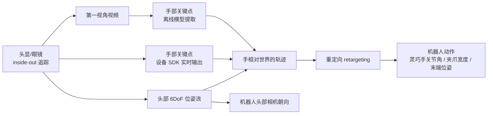

# 第十五课：人体追踪信号——头部位姿、手部关键点、佩戴位置与手部可见

> [!abstract] 本课覆盖的参数
> **头部位姿采样率**、**手部关键点数**、**手指自由度（人手侧）**、**佩戴位置**、**手部可见要求**
> 机器人侧的手指自由度已在 [[第七课 机器人本体：自由度、夹爪类型与夹爪开合记录]] 讲过，本课讲"人手侧"，以及两者之间的桥梁——重定向（retargeting）。

到目前为止，你采集数据的方式一直是 SO-101 主从臂：人手扶着主臂，主臂的关节读数直接就是 action。人和机器人之间隔着一套**同构的机械结构**，所以"人想做什么"和"机器人该做什么"几乎是同一组数字。

这一课换两个完全不同的场景，在这两个场景里，人和机器人之间没有这套机械结构了：

- **场景 (a)：VR 头显遥操作人形机器人。** 操作员戴着 VR 头显，头显追踪他的头部位姿，用来驱动机器人头部相机的朝向；头显同时追踪他的双手，手部关键点经过换算后驱动机器人的灵巧手。操作员看到的是机器人头部相机传回的画面。
- **场景 (b)：人戴头戴相机或智能眼镜做家务。** 没有机器人参与，人只是戴着设备正常洗碗、叠衣服、收拾桌面，设备记录第一视角视频、头部位姿，事后再从视频里提取手部关键点。这类数据被当作**人类示范数据源**，用于预训练或与机器人数据联合训练。

两个场景有一个共同点：**机器人动作不再是直接测出来的，而是从人体追踪信号"推算"出来的。** 头部位姿、手部关键点的质量，决定了推算出的动作标签的质量。[[第十四课 遥操作系统：输入设备、端到端时延与力反馈]] 讲的是遥操作系统的整体链路，这一课聚焦链路的最前端：人体到底被追踪成了什么数据。

---

## 1. 先建立全局图：人体追踪信号如何变成训练数据



| 场景 | 头部位姿用来做什么 | 手部关键点来自哪里 | 动作标签怎么来 |
|---|---|---|---|
| (a) VR 遥操作 | 实时驱动机器人头部；同时记录 | 头显 SDK 实时输出 | 实时重定向后发给机器人，机器人实际执行的指令写入 `action` |
| (b) 第一视角记录 | 还原相机运动；把手从相机系换到世界系 | 设备实时输出，或事后用视觉模型提取 | 事后重定向，得到"伪动作标签"（pseudo action label） |

记住这张图的含义：**任何一个环节的误差都会顺着箭头传下去，最终变成动作标签的误差。** 本课五个参数分别卡在这条链路的不同位置。

---

## 2. 头部位姿采样率

### ① 一句话定义

头部位姿采样率是头显或智能眼镜**每秒输出多少次头部 6 自由度位姿**（3 维位置 + 3 维朝向）的频率。

这些位姿通常来自 **inside-out 追踪**：设备上的相机观察周围环境，结合内置 IMU（惯性测量单元，Inertial Measurement Unit），实时估计设备自身在空间中的位置和朝向，不需要外部基站。常见消费级头显和研究用眼镜的位姿输出频率在**数十到一百多赫兹**量级（常与显示刷新率或 IMU 融合频率相关），具体以设备 SDK 文档和实测为准。

### ② 采集时它控制什么

**第一，相机运动能被还原得多细。** 在场景 (b) 里，头戴相机跟着头动。要知道"这一帧图像是从哪里、朝哪个方向拍的"，就要在这一帧的曝光时刻查到头部位姿。位姿采样越稀疏，中间越依赖插值。

**第二，手相对世界的运动能否算对。** 手部关键点通常先在**相机坐标系**（或头部坐标系）下得到。要得到"手在世界中怎么运动"，必须乘上头部位姿：

$$
{}^{W}\mathbf{p}_{\text{hand}}(t) = {}^{W}\mathbf{T}_{\text{head}}(t)\cdot{}^{\text{head}}\mathbf{p}_{\text{hand}}(t)
$$

这里 ${}^{W}\mathbf{T}_{\text{head}}(t)$ 是 $t$ 时刻头部在世界系下的位姿。如果这个位姿和手部关键点不是同一时刻的，算出的手就会"被头带着走"——头一转，手在世界中好像也跟着甩了一下，而实际上手根本没动。

**第三，在场景 (a) 里，机器人头部跟随的平滑度和时延。** 位姿采样率低，机器人头部跟随就会一顿一顿；位姿链路时延大，操作员转头后要过一阵才看到画面跟上，容易晕动和误操作（端到端时延的细节见第十四课）。

### ③ 最终生成什么数据

通常是一条独立于视频的位姿流，以及一份坐标系说明。一个示意的存储结构：

```text
episode_0001/
├── ego_rgb.mp4                 # 第一视角视频
├── ego_rgb_timestamps.npy      # 每帧曝光时间戳（纳秒，设备时钟）
├── head_pose.parquet           # 头部位姿流
├── hand_keypoints.parquet      # 手部关键点（见下一节）
└── meta.json                   # 坐标系、设备、佩戴信息
```

`head_pose.parquet` 的每一行（示意字段名）：

| 字段 | 示例值 | 说明 |
|---|---|---|
| `t_ns` | 1729400000123456789 | 位姿对应时刻，和视频时间戳用同一时钟 |
| `px, py, pz` | 0.12, 1.58, -0.33 | 头部在世界系下的位置，单位 m |
| `qx, qy, qz, qw` | 0.01, 0.38, -0.02, 0.92 | 朝向四元数，注意分量顺序 |
| `tracking_state` | `ok` / `limited` / `lost` | 追踪状态 |

`meta.json` 中必须写清坐标系约定（示意）：

```json
{
  "head_pose": {
    "nominal_rate_hz": 90,
    "frame": "world",
    "world_origin": "会话开始时设备所在位置",
    "up_axis": "+Y，与重力方向相反",
    "forward_axis": "-Z",
    "handedness": "right",
    "quat_order": "xyzw",
    "pose_semantics": "T_world_device（把设备系的点变换到世界系）"
  }
}
```

> [!warning] 坐标系约定不写清楚，数据就无法复用
> 不同引擎和 SDK 的约定差别很大：有的右手系、Y 轴向上、-Z 朝前；有的左手系；有的 Z 轴向上。世界原点可能是"开机时的位置""地面中心"或"上次重定位的锚点"。位姿语义是 $T_{\text{world}\leftarrow\text{device}}$ 还是它的逆，也必须说明。四元数分量顺序的陷阱见 [[补学 第一至五课的缺口与勘误]]。

### ④ 设置不当会出什么问题

| 问题 | 成因 | 在数据里的表现 |
|---|---|---|
| 位姿与画面不同步 | 位姿采样率低、位姿时间戳是"到达时间"而非"对应时刻"、两条流时钟不同 | 把位姿叠加到画面上时，静止物体在世界系中"晃动"；还原的手部世界轨迹在转头时出现虚假甩动 |
| 插值误差 | 采样间隔大，头部快速转动时线性插值偏离真实轨迹 | 转头段落的手部世界轨迹误差明显大于静止段 |
| 运动模糊 | 头部快速转动，相机曝光时间内画面移动 | 画面糊、手部关键点检测置信度下降或丢失，位姿追踪本身也可能退化为 `limited` |
| 追踪丢失与重定位跳变 | 环境纹理少、光照差、遮挡追踪相机 | 位姿突然跳变几厘米到几十厘米，或者整段 `lost` |
| 坐标系约定不明 | 没记录原点、重力方向、手性 | 不同批次的数据"上下颠倒"或"左右镜像"，合并后无法使用 |

用一个数值例子感受时间不同步的后果（示意数值）：头部以 $100^\circ/\text{s}$ 转动，位姿和画面错开 20 ms，那么朝向误差是：

$$
100^\circ/\text{s}\times 0.02\,\text{s}=2^\circ
$$

手在头前方约 0.5 m 处，这 $2^\circ$ 换算成手在世界系中的位置误差约为：

$$
0.5\,\text{m}\times\tan 2^\circ\approx 17\,\text{mm}
$$

17 mm 对于抓取一个杯子把手已经是一个不可忽视的误差。而人在做家务时，转头 $100^\circ/\text{s}$ 并不罕见。

### ⑤ 对 VLA 训练与部署的影响

- **场景 (b) 中，伪动作标签带上了"头动噪声"。** 如果模型用世界系下的手部轨迹作为动作标签，头部位姿的误差会直接混进动作里。模型学到的是"手在转头时会抖一下"，这种模式在机器人上毫无意义。更糟的是，这种误差和画面变化（转头导致画面平移）高度相关，模型很容易把它当成真实规律学进去。
- **场景 (a) 中，记录的头部位姿决定了"观测相机从哪看"。** 如果机器人头部跟随操作员头部运动，训练数据中观测视角会不断变化。部署时机器人头部由谁控制？如果由策略控制，头部动作也要作为动作的一部分学习；如果固定不动，部署时的视角分布就和训练时不同。验收时必须写清楚头部相机在采集和部署中的控制方式。
- **相对动作表示可以缓解全局误差。** 用"手相对于当前相机的位姿"或"相对于当前帧的未来位姿"作为动作，可以减少世界系漂移的影响，但前提是每一帧内部的时间对齐是准确的。下一课会更详细地讨论相对轨迹表示。

### ⑥ 验收与清洗

**规范怎么写：**
- 名义位姿采样率、实测间隔分布（中位数、P99、最大值）；
- 位姿时间戳的含义（对应时刻还是到达时刻）以及与视频是否同一时钟（时钟同步见 [[第一课 时间同步方式（Time Synchronization）]]）；
- 坐标系约定全文写入 `meta.json`；
- `tracking_state` 非 `ok` 的时长占比上限；
- 头部角速度超过阈值的帧占比（运动模糊风险）。

**拿到数据后怎么查：**
1. 统计位姿间隔分布，找长间隔和重复时间戳；
2. 对每个视频帧，找最近的位姿样本，统计"帧—位姿"时间差；
3. 计算头部角速度，标记高速转头段；
4. 检查位置相邻帧跳变，定位重定位事件；
5. 抽样把世界系中一个固定点（例如桌角）重投影到画面上，看它是否稳定——这是检验位姿、时间对齐、相机内外参整体是否正确的最直接方法。

代码见本课第 8 节。

---

## 3. 手部关键点数

### ① 一句话定义

手部关键点数是手部追踪系统**为每只手输出多少个关节点或特征点**的位置。

最常见的是 **21 关键点手部模型**：1 个腕部点，加上每根手指 4 个点（从掌指关节附近到指尖）。MediaPipe Hands 使用这个约定，很多基于 MANO（一种常用的参数化手部网格模型）的数据集也常整理成 21 点形式。部分 XR 设备 SDK 提供更多关节，例如 OpenXR 的手部追踪扩展定义了 26 个关节（额外包含掌心等点），其他设备通常在二十多个关节的量级，具体数量和命名以设备 SDK 文档为准。

```text
21 关键点约定（MediaPipe 风格编号）

            8   12  16  20      ← 指尖
            |   |   |   |
            7   11  15  19
            |   |   |   |
     4      6   10  14  18
      \     |   |   |   |
       3    5---9---13--17      ← 掌指关节附近
        \    \          /
         2    \        /
          \    \      /
           1----\----/
                 0              ← 腕部
```

### ② 采集时它控制什么

关键点数决定了**你能从人手中还原出哪些信息**：

| 想还原的信息 | 最少需要的关键点 | 说明 |
|---|---|---|
| 手的位置 | 1 个（腕部或掌心） | 只能当成一个移动的点 |
| 手腕朝向 | 至少 3 个不共线的点（如腕部、食指根、小指根） | 构成手掌平面，算出手掌法向和朝向 |
| 平行夹爪开合 | 拇指尖、食指尖 | 两点距离即可 |
| 每根手指的弯曲 | 每指至少 3~4 个点 | 21 点模型刚好满足 |
| 手指侧摆、拇指对掌 | 完整骨架 + 准确的 3D 坐标 | 2D 关键点很难可靠还原 |

除了数量，还有三个同样关键的属性，验收时必须一起写：

1. **2D 还是 3D。** 2D 关键点是图像像素坐标；3D 关键点有深度。很多单目视觉模型给出的"3D"其实是相对深度或根据手部尺寸先验估计的，绝对尺度不可靠。
2. **相对哪个坐标系。** 图像坐标系、相机坐标系、头部坐标系、世界坐标系，还是以腕部为原点的手局部坐标系？例如 MediaPipe 同时提供归一化图像坐标和一组以手为中心、单位为米的近似 3D 坐标（以你使用的版本文档为准）。
3. **置信度与可见性。** 每个点是否有置信度？被遮挡的点是"猜出来的"还是标记为缺失？

### ③ 最终生成什么数据

`hand_keypoints.parquet` 的示意结构（每行一个时刻、一只手）：

| 字段 | 形状 / 示例 | 说明 |
|---|---|---|
| `t_ns` | 1729400000130000000 | 与视频帧或位姿流对应的时间 |
| `hand` | `left` / `right` | 左右手 |
| `kp_xyz` | `[21, 3]` | 3D 关键点，单位 m |
| `kp_frame` | `camera` | 坐标系 |
| `kp_conf` | `[21]` | 每点置信度，范围 0~1 |
| `source` | `device_sdk_v2.3` / `offline_model_x` | 关键点来源，便于追溯 |

在场景 (a) 的 LeRobot 风格数据集中，可以把原始人体信号作为额外字段保存在机器人动作旁边（字段名为示意，以你使用的 LeRobot 版本和自定义特征配置为准）：

```json
{
  "observation.state": "[机器人关节状态]",
  "action": "[重定向后实际发给机器人的关节目标]",
  "human.head_pose": "[7]  位置 + 四元数",
  "human.left_hand_kp": "[21, 3]",
  "human.right_hand_kp": "[21, 3]"
}
```

> [!tip] 原始人体信号一定要保留
> `action` 是重定向之后的结果。如果只保存它，将来想换一种重定向方法、修正一个重定向 bug，就只能重新采集。保留原始关键点，就能离线重新生成动作。

### ④ 设置不当会出什么问题

- **关键点太少：** 只有腕部和几个指尖时，无法区分"手指弯曲"和"手指侧摆"，灵巧手的重定向会出现奇怪的姿势。
- **把 2D 当 3D 用：** 单目估计的深度误差大，手在深度方向"忽远忽近"，算出的手腕世界轨迹沿视线方向抖动。
- **遮挡时的处理不透明：** 很多模型在手指被遮挡时仍会输出一个"看起来合理"的位置，并给出不低的置信度。拿着杯子时，被杯子挡住的手指常常是模型"脑补"的。
- **左右手混淆：** 双手交叉或只露出一部分时，左右手标签可能互换，数据中表现为两只手的轨迹在某帧突然"交换"。
- **关键点编号约定不一致：** 不同来源的 21 点，编号顺序可能不同；26 点和 21 点之间的映射需要明确写出。混用会让"拇指"变成"食指"。

### ⑤ 对 VLA 训练与部署的影响

- **伪动作标签的上限由关键点质量决定。** 从人手中提取的动作，不可能比关键点本身更准。如果关键点在抓取的关键瞬间（手指包住物体、被物体遮挡）质量最差，那么模型在最需要准确动作的时刻学到的标签恰恰最不可靠。
- **置信度应该参与训练。** 一种常见做法是对低置信度时刻降低损失权重，或者直接把这些段落从动作监督中排除，只用作视觉预训练。
- **场景 (a) 的部署时，模型输出的是机器人动作，不再需要人手关键点。** 但如果训练数据中有大量"关键点抖动→重定向抖动→机器人动作抖动"，模型会学到这种抖动，部署时机器人手指持续颤动。

### ⑥ 验收与清洗

**规范怎么写：** 关键点数和编号约定（附图或编号表）、2D/3D、坐标系、单位、置信度定义、关键点来源（SDK 版本或模型版本）。

**拿到数据后怎么查：**
- 骨长一致性：同一个人的同一节指骨长度在整段中应基本不变，变化大说明关键点不稳定；
- 平均置信度和低置信度帧占比；
- 左右手标签跳变检测：相邻帧两只手腕位置是否发生"交换"；
- 指尖速度异常尖峰（人手不可能在一帧内移动十几厘米）。

---

## 4. 手指自由度（人手侧）与重定向

### ① 一句话定义

人手侧的手指自由度，是**人手各关节可独立运动的维度总数**。按建模方式不同，常见说法是人手（含或不含腕部）约有 20 多个自由度。而机器人灵巧手的**主动**自由度通常更少，很多灵巧手有十几个甚至只有六个左右的电机，平行夹爪则只有 1 个。

把人手的运动映射到自由度更少、结构不同的机器人手上，这个过程叫**重定向（retargeting）**。

### ② 采集时它控制什么

人手自由度本身不是你能设置的，但"人手侧自由度如何被测量和映射"是你要设计的。它控制的是**人的意图能有多少被机器人正确执行**。

常见的重定向方法：

| 方法 | 做法 | 优点 | 缺点 |
|---|---|---|---|
| 关节角直接映射 | 从关键点算出人手关节角，按对应关系直接赋给机器人关节，必要时缩放 | 简单、实时、可解释 | 人手和机器人手尺寸、关节轴不同，指尖位置对不上，捏取容易失败 |
| 指尖位置优化映射 | 求解机器人关节角，使机器人指尖位置（或指尖之间的相对向量）尽量接近人手 | 指尖接触更准，适合捏取 | 需要在线求解优化问题；可能有多解、跳变；可能出现机器人手指互相穿插 |
| 混合与约束 | 在优化中加入关节限位、碰撞约束、时间平滑项 | 更稳定 | 实现复杂，参数需要调 |
| 平行夹爪：只取开合宽度 | 用拇指尖与食指尖的距离映射到夹爪宽度 | 极简，对关键点质量要求低 | 丢失所有手指细节，只适合平行夹爪 |

对于平行夹爪，开合宽度的映射可以写成（示意）：

$$
w_{\text{gripper}} = \text{clip}\Big(k\cdot\big(\lVert\mathbf{p}_4-\mathbf{p}_8\rVert - d_0\big),\,0,\,w_{\max}\Big)
$$

其中 $\mathbf{p}_4$、$\mathbf{p}_8$ 是拇指尖和食指尖（21 点约定），$d_0$ 是人手捏紧时的残余距离，$k$ 是缩放系数，$w_{\max}$ 是夹爪最大开口。$d_0$ 和 $k$ 需要按人标定——手大的人和手小的人，同样的"捏紧"对应不同的指尖距离。

### ③ 最终生成什么数据

- 原始关键点（上一节）；
- 重定向结果：机器人关节目标，写入 `action`；
- 重定向配置：方法、版本、缩放系数、每个操作员的标定参数；
- 建议额外保存**重定向残差**，例如每帧"机器人指尖与人手指尖目标的距离误差"。

```json
{
  "retargeting": {
    "method": "fingertip_vector_optimization",
    "version": "1.4.0",
    "robot_hand": "示例灵巧手，主动自由度 12",
    "operator_calib": {"operator_id": "op_03", "scale": 1.08},
    "joint_limits_source": "robot_urdf_v2",
    "smoothing": "一阶低通，截止频率示意 8 Hz"
  }
}
```

### ④ 设置不当会出什么问题

- **重定向结果物理不可行：** 映射后的机器人手指互相穿插、超过关节限位后被截断，或者指尖没有接触物体。在数据里表现为：`action` 中的关节角大量贴在限位值上；视频中机器人手"握"住了物体，但指尖与物体之间有空隙。
- **人能做、机器人做不了：** 人手拇指的对掌和侧摆非常灵活，灵巧手的拇指可能只有两三个自由度。人用拇指和无名指捏起的物体，机器人可能根本无法复现。
- **尺寸不匹配：** 人手比机器人手小或大，直接映射关节角时，捏合动作在机器人上变成"空捏"或"捏过头"。
- **重定向跳变：** 优化法在多解之间切换，某一帧关节角突然跳变。
- **场景 (b) 的离线重定向缺少闭环：** 遥操作时操作员能看到机器人手并主动修正；离线重定向时没人修正，错误直接进入标签。

### ⑤ 对 VLA 训练与部署的影响

- **模型学的是"重定向后的动作"，不是"人的动作"。** 重定向方法一旦改变，整个动作分布都会改变。不同重定向版本的数据混合训练，等于混合了两种动作空间（[[第五课 动作空间（Action Space）]] 中强调的"动作语义一致"在这里同样成立）。
- **重定向误差 = 系统性动作偏差。** 例如重定向在捏取时总是让机器人指尖差 5 mm 闭合，模型就会学到"差 5 mm"的抓取，部署时捏取小物体频繁失败。
- **从人手提取的动作和机器人遥操作动作要分开标记。** 在联合训练中，常见做法是给不同数据源不同的动作头或标记位，避免模型混淆两种动作的分布。

### ⑥ 验收与清洗

- 规范写明：重定向方法与版本、机器人手型号和关节限位来源、每个操作员的标定参数、平滑滤波参数；
- 检查 `action` 中贴限位的帧占比（例如超过 5% 需复查，示例阈值）；
- 检查重定向残差分布，残差大的段落标记为低质量；
- 抽样回放：把重定向后的关节角在仿真或实机上回放，人工确认抓取姿态合理。

---

## 5. 佩戴位置

### ① 一句话定义

佩戴位置是**相机或追踪设备戴在人身上的哪个部位**，例如额头、眼镜位、胸前、头顶或腕部。

### ② 采集时它控制什么

佩戴位置决定了**视角**、**手在画面中出现的位置**、**抖动程度**，以及**与机器人相机视角之间的差距**。

| 佩戴位置 | 视角特点 | 手在画面中的位置 | 抖动 | 与机器人视角的接近程度 |
|---|---|---|---|---|
| 眼镜位（智能眼镜） | 最接近人眼看到的画面 | 画面下半部，低头操作时较居中 | 随头动，转头频繁 | 接近人形机器人头部相机 |
| 额头（头带） | 比眼镜略高略前 | 下半部，近处手部可能被裁掉 | 随头动；头带松动会额外晃动 | 接近人形机器人头部相机 |
| 头顶（俯拍） | 视角更高更俯 | 桌面操作时较居中 | 随头动 | 接近机械臂上方固定相机 |
| 胸前 | 不随转头变化，视野稳定 | 双手常在画面中下部，较完整 | 较小，但随身体转动和呼吸起伏 | 接近人形机器人胸部相机或固定"头顶相机" |
| 腕部 | 近距离看手和物体 | 手占据画面边缘或底部 | 随手运动剧烈变化 | 接近机械臂腕部相机（第九课） |

### ③ 最终生成什么数据

佩戴位置本身是元数据，但它决定了相机外参的含义。`meta.json` 中示意：

```json
{
  "mount": {
    "position": "forehead_strap",
    "device": "示例头戴运动相机",
    "tilt_deg_nominal": -25,
    "T_head_camera": "如有，给出相机相对头部（或位姿追踪设备）的外参",
    "mount_check": "每段开始前拍摄标定板确认，见第八课"
  },
  "wearer": {"wearer_id": "w_012", "height_cm_bucket": "170-180"}
}
```

身高只记录分段或不记录，取决于你的隐私策略。

### ④ 设置不当会出什么问题

- **佩戴松动：** 头带或胸带松动后，相机相对头部或身体会滑动、下垂、晃动。在 VR 头显或眼镜这类"相机与追踪器一体"的设备上，相机与追踪器之间是刚性的，问题较小；但如果是"追踪设备戴在头上、相机另外夹在帽檐"，两者之间的外参就会在采集中悄悄变化，手的世界轨迹全部带上偏差。数据里的表现：同一会话后半段，静止桌面在世界系中缓慢"下沉"或"倾斜"。
- **倾角不合适：** 额头相机倾角太小，低头操作时双手经常在画面下边缘外；倾角太大，抬头取物时看不到目标。
- **不同采集员佩戴不一致：** 身高、头型、佩戴习惯不同，视角分布差异大，模型可能把"视角高低"和"采集员习惯动作"绑在一起学。
- **遮挡：** 胸前相机在弯腰时可能被手臂或衣服遮挡；腕部相机被袖子遮挡。

### ⑤ 对 VLA 训练与部署的影响

这里引入一个关键概念：**具身差异（embodiment gap）**——人类示范与机器人之间在身体结构、外观、视角和动作空间上的差异。佩戴位置直接决定其中的"视角差异"。

| 差异类型 | 来源 | 后果 |
|---|---|---|
| 视角差异 | 人的佩戴位置与机器人相机位置不同 | 同一物体在画面中的位置、大小、遮挡关系不同 |
| 外观差异 | 画面中是人手，部署时是机器人手 | 模型学到的"手的样子"在部署时不存在 |
| 动作空间差异 | 人手 20 多自由度 vs 机器人有限自由度 | 需要重定向，带来误差（第 4 节） |
| 运动风格差异 | 人动作快、转头频繁；机器人慢且稳 | 时间尺度和视角变化频率不同 |

工程上缩小视角差异的常见思路：
- **让机器人相机尽量模仿人的佩戴位置**：例如人形机器人头部相机高度、倾角尽量对齐采集时的眼镜位视角；
- **反过来，让人模仿机器人**：如果部署机器人只有腕部相机，就优先采集腕部视角的人类数据；
- **统一佩戴规范**：固定倾角、固定佩戴方式，至少让人类数据内部的视角分布一致。

### ⑥ 验收与清洗

- 规范写明：佩戴部位、支架型号、名义倾角、每段开始前的检查方法（例如对着地面标记或标定板录几秒）；
- 清洗时统计每段画面中"地平线/桌面边缘"的平均位置或用位姿估计相机俯仰角，按采集员分组比较，找出佩戴异常的批次；
- 对外参可能变化的组合（追踪器与相机分离），检查每段开头和结尾的标定画面是否一致。

---

## 6. 手部可见要求

### ① 一句话定义

手部可见要求是对**双手和被操作物体在画面中出现的比例与时间占比**的约束，例如"操作过程中，至少一只手可见的帧占比不低于 90%，执行操作的手完整可见（腕部到指尖都在画面内）的帧占比不低于 70%"（示例阈值）。

### ② 采集时它控制什么

它约束的是采集员的**行为**和设备的**视角**：手要在画面中，操作的物体要在画面中，手和物体的接触区域尽量不被遮挡。对场景 (b) 来说，这条要求往往比任何画质参数都重要，因为**手不可见的帧，就无法提取手部姿态，也就无法生成动作标签。**

### ③ 最终生成什么数据

可见性本身通常是在验收或清洗阶段**计算出来**的，建议以逐帧标记的形式保存，供训练时筛选：

| 字段 | 示例 | 说明 |
|---|---|---|
| `frame_index` | 1532 | 帧号 |
| `left_visible` | true | 检测到左手 |
| `right_visible` | false | 未检测到右手 |
| `right_in_frame_ratio` | 0.0 | 右手关键点落在画面内的比例 |
| `active_hand_visible` | true | 执行操作的手是否可见（可人工或半自动标注） |

episode 级汇总写入质检报告，例如 `any_hand_visible_ratio: 0.94`，`longest_invisible_s: 1.8`。

### ④ 设置不当会出什么问题

- **手出画：** 低头不够、物体太靠下、伸手取远处物体时手离开画面。数据表现：关键点整段缺失，或者模型在画面边缘输出错误关键点。
- **手被遮挡：** 手伸进柜子、被锅挡住、被另一只手挡住。表现：关键点置信度降低，或者输出"脑补"的姿态。
- **只有手没有物体：** 手可见，但被操作物体在画面外，模型无法学到手和物体之间的关系。
- **不可见段落太长：** 一个关键动作（例如拧瓶盖）恰好在手被遮挡时完成，整条示范的核心信息丢失。

**隐私问题也属于"可见"的一部分。** 第一视角视频很容易拍到他人的脸、电脑或手机屏幕上的信息、文件、门牌、照片等。采集规范需要规定：采集环境中避免出现他人；必要时对人脸、屏幕区域打码；采集前取得相关人员同意。具体的合规要求需咨询法务，以适用的法规和协议原文为准（许可与来源问题见 [[第二十四课 数据集身份：名称版本、许可协议与视频来源]]）。

### ⑤ 对 VLA 训练与部署的影响

- **人类视频的价值有两层。** 第一层是**视觉表征**：即使没有动作标签，大量第一视角视频也能帮助模型学会"手和物体如何交互"的视觉规律，常用于预训练。第二层是**伪动作标签**：从手部关键点提取的动作，可以和机器人数据联合训练。第一层对手部可见要求宽松，第二层要求严格。
- **可见率低的数据，伪动作标签是断断续续的。** 如果用插值填补不可见段，模型会学到"插值出来的直线运动"，而真实的人在这段可能做了复杂的动作。
- **可见性偏差。** 如果只保留手可见的帧，数据会偏向"手在画面中央"的时刻，模型对"手刚进入画面"或"物体在画面边缘"的情形学得不够，部署时机器人手处于类似位置时表现变差。

### ⑥ 验收与清洗

**规范怎么写（示例）：**
- 操作期间任一手可见帧占比 ≥ 90%；
- 执行操作的手完整可见帧占比 ≥ 70%；
- 单次连续不可见不超过 2 s；
- 他人面部、屏幕内容出现时需打码或剔除该段。

**拿到数据后怎么查：** 用手部检测模型逐帧统计。这是一个**启发式**检查：检测模型本身会漏检（光照差、戴手套、手部模糊）和误检（把类似手的物体当成手），所以统计结果是"可见率的估计"，不是真值。见第 8 节代码。

---

## 7. 串联：五个参数如何共同决定伪动作标签质量

把本课的五个参数放进同一条链路：

```text
佩戴位置 ──► 视角、抖动 ──► 手部可见率
   │                           │
   ▼                           ▼
头部位姿采样率 ──► 相机/头部轨迹 ──┐
                                   ├──► 手在世界系中的轨迹 ──► 重定向 ──► 动作标签
手部关键点数 ──► 手在相机系中的姿态 ┘                   ▲
                                              手指自由度差异
```

**一个误差预算的例子（示意数值）。** 假设你要从场景 (b) 的数据中提取"手腕在世界系中的位置"作为动作标签，下游任务要求误差在 2 cm 以内：

| 误差来源 | 估算方法 | 示意误差 |
|---|---|---|
| 头部位姿与画面错开 10 ms，转头 $100^\circ/\text{s}$，手距 0.5 m | $0.5\times\tan(1^\circ)$ | 约 9 mm |
| 头部位姿本身的位置误差 | 以设备实测为准 | 约 5 mm |
| 单目关键点深度误差 | 以模型评测为准 | 约 10~20 mm |
| 佩戴松动导致外参变化（分离式设备） | 以标定画面对比为准 | 0~数十 mm |

误差最坏情况可能叠加，但各误差源并不总是同向，可以粗略按平方和开根估计典型误差。这样一算你会发现：**单目深度往往是最大的误差源**，而头部位姿同步问题只在转头时明显。这就给了你优化优先级：如果预算允许，优先使用能提供可靠 3D 手部追踪的设备，或者在转头剧烈的段落降低标签权重。

**与前面课程的关系：**

| 本课内容 | 前面的课程 |
|---|---|
| 位姿流与视频流对齐 | [[第二章 时间戳对齐误差]]：有时间戳不等于对齐准确 |
| 位姿采样率与插值 | [[第六课 控制频率、采样率与轨迹记录频率]]：多速率数据流 |
| 四元数顺序与符号 | [[补学 第一至五课的缺口与勘误]] |
| 相机相对头部的外参 | [[第八课 标定方式（Calibration）]] |
| 佩戴位置与视角 | [[第九课 相机布局：相机数量与位置、机位、安装高度与视场角]] |
| 转头运动模糊 | [[第十课 成像参数：分辨率、帧率、曝光白平衡与防抖]] |

---

## 8. 清洗实践

### 8.1 头部位姿：采样间隔、帧对齐与转头速度

```python
import numpy as np
import pandas as pd
from scipy.spatial.transform import Rotation as R

pose = pd.read_parquet("episode_0001/head_pose.parquet")       # 字段名为示意
t = pose["t_ns"].to_numpy() / 1e9                               # 转成秒
dt = np.diff(t)
print("位姿间隔 中位数 %.1f ms, P99 %.1f ms, 最大 %.1f ms"
      % (np.median(dt) * 1e3, np.percentile(dt, 99) * 1e3, dt.max() * 1e3))
print("重复或倒退的时间戳个数:", int((dt <= 0).sum()))

# 每个视频帧到最近位姿样本的时间差
frame_t = np.load("episode_0001/ego_rgb_timestamps.npy") / 1e9
idx = np.clip(np.searchsorted(t, frame_t), 1, len(t) - 1)
gap = np.minimum(np.abs(frame_t - t[idx - 1]), np.abs(t[idx] - frame_t))
print("帧-位姿最近时间差 P95 %.1f ms" % (np.percentile(gap, 95) * 1e3))

# 头部角速度（scipy 的四元数顺序为 [x, y, z, w]）
rot = R.from_quat(pose[["qx", "qy", "qz", "qw"]].to_numpy())
rel = rot[:-1].inv() * rot[1:]                      # 相邻两帧的相对旋转
ang_speed = np.degrees(rel.magnitude()) / np.maximum(dt, 1e-6)   # 度/秒
fast = ang_speed > 120                              # 示例阈值：120 度/秒
print("高速转头样本占比: %.1f%%" % (100 * fast.mean()))

# 位置跳变：相邻样本位移远超人体可能的速度，怀疑重定位跳变
pos = pose[["px", "py", "pz"]].to_numpy()
lin_speed = np.linalg.norm(np.diff(pos, axis=0), axis=1) / np.maximum(dt, 1e-6)
print("疑似位姿跳变位置:", np.where(lin_speed > 3.0)[0][:20])  # 示例阈值：3 m/s
```

说明：`rel.magnitude()` 计算的是相对旋转角，天然不受四元数符号翻转影响。这些阈值都是示例，快速但真实的转头也会触发"高速"标记；跳变检测也可能把真实的快速移动误判为跳变，需要结合视频确认。

### 8.2 手部可见率：用 MediaPipe 做启发式统计

```python
import cv2
import numpy as np
import mediapipe as mp

# 这里使用 mediapipe 的经典 solutions 接口；较新版本推荐 Tasks API，以你安装的版本为准
hands = mp.solutions.hands.Hands(static_image_mode=False, max_num_hands=2,
                                 min_detection_confidence=0.5,
                                 min_tracking_confidence=0.5)

cap = cv2.VideoCapture("episode_0001/ego_rgb.mp4")
fps = cap.get(cv2.CAP_PROP_FPS) or 30.0
stride = 3                                   # 每 3 帧检查一次，节省时间
n_checked, any_vis, both_vis, inside_ratio = 0, [], [], []
i = 0
while True:
    ok, frame = cap.read()
    if not ok:
        break
    if i % stride == 0:
        res = hands.process(cv2.cvtColor(frame, cv2.COLOR_BGR2RGB))
        lms = res.multi_hand_landmarks or []
        any_vis.append(len(lms) >= 1)
        both_vis.append(len(lms) >= 2)
        # 关键点落在画面内的比例（归一化坐标在 [0,1] 内），衡量手是否被画面裁切
        if lms:
            xy = np.array([[p.x, p.y] for p in lms[0].landmark])
            inside_ratio.append(np.mean((xy >= 0).all(1) & (xy <= 1).all(1)))
        n_checked += 1
    i += 1
cap.release()
hands.close()

any_vis = np.array(any_vis)
print("任一手可见帧占比: %.1f%%" % (100 * any_vis.mean()))
print("双手可见帧占比:   %.1f%%" % (100 * np.mean(both_vis)))
if inside_ratio:
    print("检测到的手中，关键点在画面内的平均比例: %.2f" % np.mean(inside_ratio))

# 最长连续不可见时长
longest, cur = 0, 0
for v in any_vis:
    cur = 0 if v else cur + 1
    longest = max(longest, cur)
print("最长连续不可见约 %.1f s" % (longest * stride / fps))
```

> [!warning] 这只是启发式检查
> - 检测器漏检（戴手套、强逆光、运动模糊）会让可见率被**低估**；误检（把类似手的物体当成手）会让可见率被**高估**。
> - "检测到手"不等于"执行操作的手可见"，更不等于"手与物体的接触区域可见"。
> - 抽样间隔 `stride` 较大时，短暂的不可见段会被漏掉。
> 建议把自动统计作为筛选，再对低于阈值和临界的 episode 做人工抽检。

### 8.3 从关键点提取平行夹爪开合宽度

```python
kp = np.load("episode_0001/right_hand_kp.npy")       # [T, 21, 3]，单位 m，示意文件
conf = np.load("episode_0001/right_hand_conf.npy")   # [T, 21]
pinch = np.linalg.norm(kp[:, 4] - kp[:, 8], axis=-1) # 21 点约定：4=拇指尖，8=食指尖
d0, k, w_max = 0.015, 1.0, 0.08                      # 示意标定参数，需按人标定
width = np.clip(k * (pinch - d0), 0, w_max)
valid = (conf[:, 4] > 0.5) & (conf[:, 8] > 0.5)      # 两个指尖置信度都足够才使用
width[~valid] = np.nan                                # 不可靠的帧标记为缺失，而不是硬插值
print("可用帧占比: %.1f%%" % (100 * valid.mean()))
```

---

## 9. 验收清单写法速查

| 字段 | 示例写法（阈值为示例，需按任务确定） |
|---|---|
| 头部位姿采样率 | 名义 90 Hz（以设备为准）；实测间隔 P99 ≤ 20 ms；与视频同一时钟；帧—位姿最近时间差 P95 ≤ 6 ms |
| 位姿坐标系 | 右手系，+Y 向上（与重力相反），世界原点为会话开始位置；四元数顺序 xyzw；位姿语义 $T_{\text{world}\leftarrow\text{device}}$ |
| 追踪状态 | 每段 `tracking_state != ok` 时长占比 ≤ 2%；重定位跳变需标记 |
| 手部关键点数 | 每手 21 点，MediaPipe 编号约定；3D，相机坐标系，单位 m；附每点置信度；记录来源与版本 |
| 手指自由度与重定向 | 机器人手主动自由度 12；指尖向量优化法 v1.4；每操作员标定缩放系数；保留原始关键点；贴限位帧占比 ≤ 5% |
| 佩戴位置 | 额头头带，名义下倾 25°；每段开始录制 3 s 地面标记用于检查；同一批次统一支架 |
| 手部可见要求 | 操作期任一手可见 ≥ 90%；操作手完整可见 ≥ 70%；连续不可见 ≤ 2 s；用检测模型统计并人工抽检 10% |
| 隐私 | 采集区域不出现他人；人脸、屏幕区域打码；具体要求以法务意见为准 |

---

## 10. 第十五课练习

**问题 1：头部位姿与画面不同步**

你从第一视角数据中还原手在世界系中的轨迹，发现每次转头时，手的世界轨迹都会出现一次"甩动"，而视频中手其实保持静止。最可能的原因是？

A. 手部关键点数太少
B. 头部位姿与视频帧的时间没有对齐（或位姿采样率太低、插值误差大）
C. 佩戴位置在胸前

**问题 2：关键点数与可还原信息**

某设备只输出每只手的腕部位置和五个指尖位置（共 6 点）。下列哪项最难可靠还原？

A. 平行夹爪的开合宽度
B. 手的大致位置
C. 每根手指各关节的弯曲角度

**问题 3：重定向**

你用"关节角直接映射"把人手动作映射到一只比人手大 30% 的灵巧手上，发现捏取小螺丝时机器人两指尖总合不拢。最合理的改进方向是？

A. 提高头部位姿采样率
B. 改用以指尖位置（或指尖相对向量）为目标的优化映射，并按操作员标定缩放
C. 把动作改成离散的开/合

**问题 4：佩戴位置与 embodiment gap**

你的部署机器人是一台只有腕部相机的机械臂。现在要采集人类第一视角数据辅助训练，以下哪种佩戴方案在"视角差异"上最小？

A. 智能眼镜
B. 腕部佩戴的相机
C. 头顶俯拍相机

**问题 5：开放思考题**

你拿到 1000 小时人戴眼镜做家务的视频，用检测模型统计出"任一手可见帧占比"平均为 75%。请说明：(1) 这批数据可以怎样分层使用；(2) 这个 75% 为什么不能直接当成真实可见率。

> [!question]- 参考答案（点击展开）
> 1. **B**。手实际静止，但世界系轨迹在转头时出现甩动，说明 $T_{\text{world}\leftarrow\text{head}}(t)$ 和手部关键点不是同一时刻的。按第 2 节的估算，10~20 ms 的错位在快速转头时就能造成厘米级误差。A 会导致手指姿态不准，但不会和转头同步出现；C 与转头无关，且胸前佩戴不随转头变化。
> 2. **C**。手指各关节的弯曲需要每根手指上的多个点，只有指尖时无法区分"弯曲"和"侧摆"，也无法确定中间关节的角度。A 只需拇指尖和食指尖；B 用腕部即可。
> 3. **B**。直接映射关节角时，尺寸差异会让指尖位置对不上。以指尖位置或指尖相对向量为目标做优化，可以让机器人指尖真正接近人手指尖的相对关系，再配合按人标定的缩放系数。A 与此无关；C 放弃了灵巧手的能力，对捏小螺丝并不能解决尺寸问题。
> 4. **B**。腕部相机视角与机械臂腕部相机最接近（近距离、手和物体占据画面主要区域）。眼镜和头顶俯拍更接近人形机器人头部或固定俯拍相机。
> 5. 参考思路：
>    - 分层使用：全部视频可用于视觉表征预训练（对可见性要求低）；手部可见率高、关键点置信度高的片段，提取伪动作标签用于联合训练；可见率低的片段只做视觉预训练，或经人工检查后剔除。不可见段不要用插值硬造动作标签。
>    - 75% 不是真值：检测模型有漏检（模糊、逆光、戴手套）和误检；"检测到手"不等于"执行操作的手完整可见"，也不等于手和物体接触区域可见；抽帧统计会漏掉短暂的不可见段。还应注意统计范围——如果包含了大量手本来就不在操作的"走路""找东西"片段，75% 可能低估了操作期间的可见率，因此最好先做任务分段再统计。

---

## 11. 小结

一句话总结本课：**当动作不再由同构主臂直接测量，而是从人的头和手"推算"出来时，头部位姿的时间对齐、手部关键点的维度与置信度、重定向方法、佩戴视角和手部可见率，共同决定了动作标签的上限。**

下一课 [[第十六课 手持与手机采集：机型、握持、采集App、位姿追踪与上传]] 会进入另一种"不用机器人也能采数据"的方式：人手持一个带相机的夹爪，或者直接用手机采集。你会看到，本课讲的位姿追踪、坐标系约定和具身差异问题，在那里以另一种形式再次出现，并且多了机型差异、App 版本和云端上传这些工程问题。
