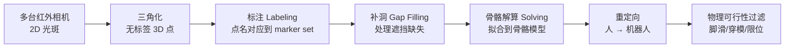

# 第十八课：动作捕捉——节点、骨骼模型、标记点、动捕相机与融合

> [!abstract] 本课覆盖的参数
> **节点数**、**骨骼模型**、**标记点数**、**动捕相机数量**、**捕捉空间尺寸**、**融合方式**
> 这是模块三的最后一课。动捕数据很少直接作为 VLA 的"图像-动作"训练对，它更常扮演两种角色：人形机器人的**动作来源**（经过重定向）和其他采集方式的**高精度位姿真值**。

假设你的团队接到两个任务。任务一：给一台人形机器人采集"从桌上拿起杯子、转身放到身后架子上"的全身示范，后续要把人的动作**重定向**（Retargeting）到机器人身上。任务二：给第十六课的手持夹爪和第十五课的头戴相机数据提供位姿真值，评估它们的 SLAM 轨迹到底准不准。

你走进一间光学动捕棚：天花板和立柱上一圈红外相机，演员穿着紧身衣，身上贴满了灰色的小反光球。隔壁组则在走廊里给另一位演员绑惯性动捕服，因为他们要采的是"在整层楼里推车走动"。

这两套系统最后都会交给你一个文件，里面写着"每一帧每个关节的旋转"。但这两个文件的误差来源完全不同：一个怕**遮挡**，一个怕**漂移**。本课要讲清楚的是：动捕数据里的每个数字是怎么被"解算"出来的，哪些环节会悄悄引入误差，以及这些误差到了机器人那一端会变成什么问题。

本课会频繁用到前面的知识：时间同步（[[第一课 时间同步方式（Time Synchronization）]]、[[第十三课 多机同步、全景拼接与投影格式]]）、坐标系标定（[[第八课 标定方式（Calibration）]]）、四元数与欧拉角（[[补学 第一至五课的缺口与勘误]]）、手部关键点（[[第十五课 人体追踪信号：头部位姿、手部关键点、佩戴位置与手部可见]]）和 IMU（[[第十六课 手持与手机采集：机型、握持、采集App、位姿追踪与上传]]）。

---

## 1. 先建立全局图：三类动捕

| 类型 | 原理 | 原始输出 | 主要优点 | 主要弱点 | 典型场景 |
|---|---|---|---|---|---|
| 光学动捕（被动标记） | 红外相机发光，拍摄身上的反光标记点，多相机三角化 | 每个标记点的 3D 轨迹 | 绝对位置精度高（棚内中心区常见毫米量级，以系统标定结果为准） | 怕遮挡，场地固定，设备昂贵 | 动捕棚、桌面操作真值、高精度全身动作 |
| 光学动捕（主动标记） | 标记点自身是 LED，可按编码闪烁 | 同上，且标记点身份更容易区分 | 标签交换更少 | 需供电和布线，穿戴更重 | 需要可靠识别标记点身份的场景 |
| 惯性动捕 | 每个身体段绑一个 IMU 节点，测量朝向 | 每个节点的朝向、加速度、角速度 | 不怕遮挡，可在户外和大范围移动 | 无绝对位置，存在漂移，怕磁干扰 | 大范围行走、户外、长时间录制 |
| 无标记视觉动捕 | 多视角或单目视频 + 人体姿态估计模型 | 关键点或参数化人体模型参数 | 穿戴成本低，可处理已有视频 | 精度和稳定性通常低于有标记系统，手指细节尤其难 | 大规模采集、互联网视频、粗略动作先验 |

光学动捕的处理链路比较长，理解它对后面每个参数都有帮助：



> [!important] 动捕数据在 VLA 体系里的位置
> 动捕系统记录的是**人的身体**，而不是机器人看到的画面和机器人执行的命令。所以它一般不能直接当作 VLA 的观测-动作对。常见用法是：
> 1. 重定向成机器人关节轨迹，用于训练人形机器人的全身控制器或作为动作先验；
> 2. 作为位姿真值，评估或校正其他传感器（SLAM、手部关键点、头显追踪）；
> 3. 与同步视频配对，为第一视角人类视频提供更准确的手部和身体动作标签。

---

## 2. 节点数（惯性动捕）

### ① 一句话定义

节点数是惯性动捕系统中**穿戴在身体上的 IMU 传感单元的数量**。每个节点绑定在一个身体段（例如前臂、大腿）上，测量这个身体段的朝向。

### ② 采集时它控制什么

**第一，能独立追踪多少个身体段。** 每个节点只直接测量它所在的那一段。没有节点的身体段，只能由算法根据相邻段"推断"出来。

| 节点配置（示意） | 能直接测量的部位 | 需要推断的部位 | 适用场景 |
|---|---|---|---|
| 稀疏配置（个位数节点，如头、骨盆、双腕、双小腿） | 少数关键段 | 大部分关节，依赖学习模型或强先验 | 粗略动作、消费级应用 |
| 全身套装（常见十几个节点量级，以产品为准） | 头、躯干、上臂、前臂、手背、大腿、小腿、脚等 | 脊柱内部弯曲、肩胛等细节 | 全身动作、人形机器人重定向 |
| 全身套装 + 数据手套 | 上述 + 手指 | 手指间的细小耦合 | 需要手部抓取信息的操作示范 |

手指需要额外的**数据手套**，手套有自己的传感器数量和类型（IMU、弯曲传感器等），这也应作为参数单独写明。全身节点数并不包含手指。

**第二，朝向估计的质量。** 每个节点的朝向由陀螺仪积分得到，再用加速度计（重力方向）修正俯仰和横滚，用磁力计修正航向（Yaw）。这带来三个固有问题：

- **漂移**：陀螺积分的误差会随时间累积；
- **磁干扰**：钢制桌子、机器人本体的电机、地板里的钢筋都会扭曲磁场，航向修正反而被带偏；
- **没有绝对位置**：IMU 只能测加速度，二次积分得到位置的误差增长极快。所以惯性动捕的**全局位置**通常靠"脚踩地时速度为零"这类接触假设和人体运动学链推算，长时间录制后整体位置会漂移。

**第三，传感器到骨段的对齐。** 节点绑在衣服上，它的朝向和骨头的朝向并不一致。每次穿戴后都要做一次标定姿势（例如 T-pose 或 N-pose，加上一小段走动），系统据此求出"传感器到骨段"的旋转。这一步做不好，后面所有数据都会带一个固定偏差。

### ③ 最终生成什么数据

惯性系统一般同时提供原始数据和解算后的骨骼数据：

```json
{
  "frame": 1520,
  "timestamp_s": 12.6667,
  "sensors": {
    "right_forearm": {
      "quat_wxyz": [0.912, 0.103, -0.381, 0.111],
      "acc_mps2": [0.21, 9.74, 0.35],
      "gyro_radps": [0.02, -0.15, 0.88],
      "mag_quality": "ok"
    }
  },
  "skeleton": {
    "root_position_m": [1.203, 0.004, 0.951],
    "joint_rotations": {"RightElbow": [0.97, 0.01, 0.24, -0.02]}
  },
  "status": {"right_forearm": {"battery": 0.71, "packet_loss": 0.0}}
}
```

以上为示意结构，字段名以你使用的软件导出为准。要特别注意：`root_position_m` 是**推算出来的**，不是测量出来的。

### ④ 设置不当会出什么问题

| 问题 | 原因 | 在数据里的表现 |
|---|---|---|
| 未覆盖的段动作丢失 | 节点太少，例如没有肩部节点 | 耸肩、含胸等动作在数据里完全不存在，肩部永远"标准姿势" |
| 某段持续偏一个角度 | 节点在衣服里滑动或绑带松了 | 某条前臂在整段录制中一直偏转若干度，和视频对不上 |
| 航向缓慢旋转 | 靠近钢制桌子或机器人时磁场被扭曲 | 演员原地站立，数据里身体却在缓慢转向；靠近桌子时手臂朝向突然偏移 |
| 全局位置漂移 | 位置靠推算 | 演员绕场一圈回到起点标记，数据里却停在离起点几十厘米外（示意量级） |
| 节点数据冻结 | 无线丢包或节点断电 | 某个节点的四元数连续很多帧完全不变 |
| 抓取信息缺失 | 没有数据手套 | 手腕轨迹完整，但手指开合全是默认姿态 |

### ⑤ 对 VLA 训练与部署的影响

惯性动捕擅长记录**相对运动**（关节角、身体姿态的风格），不擅长记录**相对环境的绝对位置**。这决定了它适合做什么：

- **适合**：人形机器人的步态、全身姿态、动作风格的先验。这些任务关心的是关节之间的协调，而不是人在世界里的精确坐标。
- **不适合**：桌面操作的末端轨迹真值。如果把惯性动捕里的手腕位置重定向成机器人末端目标，手和杯子之间的相对位置会带有漂移误差。机器人学到的是"伸手到一个大概的位置"，部署时表现为**抓空或撞到物体侧面**。
- **磁干扰最常发生在操作现场**：桌子、机器人、工具箱都在操作区附近。也就是说，误差恰好集中在你最关心的"接触前后"那几秒。

如果只做全身动作先验而没有手套，重定向出来的机器人手只能用默认手型，抓取相关的策略必须另外学习。

### ⑥ 验收与清洗

**规范写法：** 写明节点数及每个节点的绑定部位、手套型号与传感器数量、标定姿势、重新标定频率（例如每次穿戴后和每隔固定时长）、采集场地的磁环境检查结果。

**拿到数据后：**

1. **起止点漂移测试**：要求每段录制在同一个地面标记处开始和结束，比较首尾根节点位置的差值。
2. **节点冻结检测**：同一个节点的四元数连续 N 帧完全相同，大概率是丢包。
3. **和视频抽样对照**：在靠近桌子、机器人的时间段重点检查手臂朝向。

```python
import numpy as np

def frozen_segments(quat, min_len=30):
    """quat: [T, 4] 某个节点的四元数序列。返回连续完全不变的区段 (起始帧, 长度)。"""
    same = np.all(np.isclose(np.diff(quat, axis=0), 0.0, atol=1e-7), axis=1)  # [T-1]
    segs, start = [], None
    for i, s in enumerate(np.append(same, False)):   # 末尾补 False 方便收尾
        if s and start is None:
            start = i
        elif not s and start is not None:
            if i - start + 1 >= min_len:
                segs.append((start, i - start + 1))
            start = None
    return segs
```

这只是启发式检查：演员真的完全静止时，经过滤波的输出也可能几乎不变，所以要结合原始陀螺仪读数（真实传感器即使静止也会有噪声）判断。

---

## 3. 骨骼模型

### ① 一句话定义

骨骼模型是动捕系统用来**把原始测量解释成人体姿态**的层级结构：有哪些关节、谁是谁的父节点、每段骨头多长、每个关节允许怎样转动。

### ② 采集时它控制什么

**第一，输出数据的结构。** 骨骼模型定义了输出里有多少个关节、按什么顺序、叫什么名字。一个典型的层级结构如下：

```text
Hips (根节点，含全局平移和旋转)
├── Spine → Spine1 → Neck → Head
│            ├── LeftShoulder → LeftArm → LeftForeArm → LeftHand → (手指)
│            └── RightShoulder → RightArm → RightForeArm → RightHand → (手指)
├── LeftUpLeg → LeftLeg → LeftFoot → LeftToe
└── RightUpLeg → RightLeg → RightFoot → RightToe
```

每个关节的旋转是**相对父节点**定义的（局部旋转），所以手的世界位置要从根节点沿着链条一层层做正运动学（Forward Kinematics，FK）才能算出来。

**第二，受试者的骨长。** 同一个骨骼模型，要按受试者的身体尺寸设定每段骨头的长度。常见方法是测量身高、臂展、腿长等体测数据，或者让受试者做一组活动范围（Range of Motion，ROM）动作，由软件自动估计关节中心和骨长。

**第三，参数化人体模型。** 研究中常用参数化模型统一表示人体：

| 模型 | 表示内容 | 常见参数构成 |
|---|---|---|
| SMPL | 身体（不含手指细节） | 形状参数 $\beta$（体型）、姿态参数 $\theta$（常见为 24 个关节、每个 3 维轴角）、全局平移 |
| SMPL-X | 身体 + 手指 + 面部 | 在 SMPL 基础上增加手部和面部（下颌、眼球）关节及表情参数 |
| MANO | 单只手 | 手部形状参数 + 手指关节姿态；常见的 21 个手部关键点就可以由它导出 |

这类模型的好处是：形状和姿态分开表示，同一段动作可以换一个体型重新生成。具体维度以你使用的模型版本和代码为准。

**第四，参考姿势（Rest Pose）。** 关节旋转都是相对参考姿势定义的。同样是"手臂自然下垂"，如果参考姿势是 T-pose（手臂水平），肩关节旋转约为 $90^\circ$；如果参考姿势是 A-pose（手臂斜下），旋转值就小得多。**旋转数值离开了参考姿势就无法解释**，这和第五课"增量离开了参考点就无法解释"是同一个道理。

### ③ 最终生成什么数据

```json
{
  "skeleton": {
    "name": "studio_body_v2",
    "up_axis": "Z",
    "unit": "m",
    "rest_pose": "T-pose",
    "joints": ["Hips", "Spine", "Spine1", "Neck", "Head", "LeftArm", "LeftForeArm", "LeftHand"],
    "parents": [-1, 0, 1, 2, 3, 2, 5, 6],
    "offsets_m": [[0,0,0], [0,0,0.10], [0,0,0.12], [0,0,0.22], [0,0,0.10], [0.17,0,0.18], [0.28,0,0], [0.26,0,0]],
    "rotation_repr": "quaternion_wxyz",
    "subject": {"id": "S03", "height_m": 1.74, "arm_span_m": 1.76}
  },
  "motion": {
    "fps": 120,
    "root_translation_m": "[T, 3]",
    "local_rotations": "[T, J, 4]"
  }
}
```

以上为示意。如果使用 SMPL 系列模型，常见的存储形式是每个序列一组形状参数，加上逐帧的姿态参数和全局平移。

### ④ 设置不当会出什么问题

| 问题 | 在数据里的表现 |
|---|---|
| 骨长标定错误 | 关节角看起来正常，但 FK 算出的手位置偏离真实标记点，前臂长度设短 2 cm，手就"够不到"杯子 |
| 关节名称或顺序映射错误 | 左右手互换，或者手肘的旋转被当成手腕的旋转 |
| 欧拉角顺序不一致 | BVH 文件中每个关节的通道顺序可以不同，按错误顺序解析会出现肢体扭曲 |
| 参考姿势不一致 | 两个数据集合并后，同一个动作的肩部旋转整体相差几十度 |
| 坐标系约定不一致 | 一个是 Y 轴朝上，一个是 Z 轴朝上，合并后人"躺"在地上 |
| 骨骼过于简化 | 脊柱只有一节，弯腰捡东西时躯干形态失真 |

### ⑤ 对 VLA 训练与部署的影响

骨骼模型的影响主要体现在**重定向**：人的骨骼和人形机器人的骨骼几乎不可能完全匹配。

| 不匹配 | 例子 | 后果 |
|---|---|---|
| 比例 | 机器人手臂比人短 | 直接拷贝关节角，机器人的手到不了人手到达的位置 |
| 关节数 | 人的肩部有肩胛骨参与运动，机器人肩部只有 3 个旋转关节；人的手腕 3 自由度，机器人可能只有 2 个 | 某些姿态在机器人上无法复现，必须投影到可达空间 |
| 关节限位 | 人的手肘可以轻微过伸，机器人不行 | 重定向结果超出限位，执行时被截断或触发保护 |
| 手部结构 | 人手 5 指，机器人可能是 3 指灵巧手或二指夹爪（见 [[第七课 机器人本体：自由度、夹爪类型与夹爪开合记录]]） | 手指动作需要另外设计映射规则 |

常见的重定向思路可以分为三类：

| 方法 | 做法 | 优点 | 缺点 |
|---|---|---|---|
| 关节角直接映射 | 对应关节的角度直接复制，再按限位截断 | 简单、快 | 比例不同时末端位置错误 |
| 关键点位置匹配（IK 优化） | 让机器人的手、脚、头等关键点尽量贴近人的对应点（按比例缩放），用逆运动学求解 | 保证手脚位置 | 姿态可能不自然，求解可能不连续 |
| 带物理约束的跟踪 | 在仿真中用控制器或强化学习去跟踪参考动作 | 结果物理可行 | 成本高，可能偏离原动作 |

对**操作任务**而言，比关节角相似更重要的是**手和物体的相对关系**。人伸手 60 cm 拿到杯子，机器人手臂如果只够 45 cm，直接映射得到的轨迹会让机器人在空中"抓"一下。因此，用动捕数据做操作示范时，往往要把物体位置也纳入重定向目标。

### ⑥ 验收与清洗

**规范写法：** 骨骼模型名称与版本、关节列表与父子关系、旋转表示与欧拉角顺序、参考姿势、单位、坐标轴朝向、受试者体测数据、骨长标定方法。

**拿到数据后：** 做**骨长一致性检查**。同一位受试者在一段录制中，每段骨头的长度应该恒定。

> [!note] 什么时候这项检查有意义
> 如果数据是用固定骨长的骨骼做 FK 得到的（例如 BVH 中 OFFSET 固定），逐帧算出的骨长必然恒定，这项检查就失去意义。它真正有用的场景是：关节位置来自标记点估计的关节中心、无标记视觉动捕或关键点检测；以及**跨录制段**比较同一受试者的骨骼定义是否被改过。

代码见第 9 节。

---

## 4. 标记点数（光学动捕）

### ① 一句话定义

标记点数是光学动捕中**贴在受试者身上（以及物体上）的标记点数量**。与它配套的是标记点布置方案（Marker Set）：每个点贴在哪个解剖位置、叫什么名字。

### ② 采集时它控制什么

**第一，每个身体段能否被唯一确定。** 一个刚体在空间中的位姿有 6 个自由度。**至少 3 个不共线的标记点**才能确定一个刚体段的完整位姿。实际布置时，每段一般会多放冗余点，这样某个点被遮挡时仍能解算。

**第二，鲁棒性和成本的权衡。**

| 标记点多 | 标记点少 |
|---|---|
| 遮挡时有冗余，解算更稳定 | 穿戴快，演员动作更自然 |
| 可以估计更多细节（如脊柱弯曲） | 标注和补洞的工作量小 |
| 穿戴时间长，点间距小，容易被误标 | 一个点被遮挡就可能导致整段丢失 |

全身 marker set 常见为几十个标记点的量级，具体以你使用的 marker set 规范为准。

**第三，手部是难点。** 手指上的标记点直径很小（通常只有几毫米），相邻点非常近，手指弯曲时又经常互相遮挡。手部标记点比身体标记点更容易出现合并、误标和缺失。

**第四，物体也需要标记点。** 如果要记录手和杯子的相对关系，杯子上也要贴标记点，组成一个刚体。物体上的标记点排布要**不对称**，否则系统无法区分物体旋转了 $180^\circ$ 还是没转。

### ③ 最终生成什么数据

光学动捕最原始的产物是标记点轨迹：

```json
{
  "marker_labels": ["LFHD", "RFHD", "LELB", "LWRA", "LWRB", "CUP_1", "CUP_2", "CUP_3"],
  "fps": 120,
  "unit": "mm",
  "frames": {
    "1520": {
      "LWRA": {"xyz": [412.3, -88.1, 963.0], "residual": 0.6, "n_cameras": 5},
      "LWRB": {"xyz": null, "residual": null, "n_cameras": 0},
      "CUP_1": {"xyz": [455.0, -102.4, 801.7], "residual": 0.4, "n_cameras": 7}
    }
  },
  "gap_fill_log": [{"marker": "LWRB", "start": 1511, "end": 1534, "method": "rigid_body"}]
}
```

以上为示意结构。C3D 等格式中每个点每帧也会附带残差或有效性信息，具体编码以格式规范和导出软件为准。**一定要保留补洞记录**，否则你无法区分哪些数据是测出来的、哪些是算出来的。

### ④ 设置不当会出什么问题

| 问题 | 原因 | 在数据里的表现 |
|---|---|---|
| 遮挡缺失（Gap） | 标记点被身体、物体或桌子挡住 | 该点出现连续的空值，抓取时手腕内侧最常见 |
| 标签交换（Label Swap） | 两个相邻标记点距离很近，自动标注把名字对调 | 两条轨迹在某一帧突然交换位置，表现为瞬间跳变 |
| 标记点脱落 | 动作幅度大或出汗 | 某点从某帧起永久缺失，或者贴回后位置变了，骨段定义漂移 |
| 鬼点（Ghost Marker） | 反光物体被识别为标记点 | 场景中出现不属于任何人的"多余点"，可能被误标成真实标记点 |
| 皮肤伪影（Soft Tissue Artifact） | 标记点贴在肌肉或脂肪较多的位置 | 骨头没动，标记点随肌肉晃动 |
| 手部点合并 | 两个手指标记点在图像中重叠 | 两个点变成一个点，手指姿态解算出错 |

### ⑤ 对 VLA 训练与部署的影响

最关键的一点：**遮挡最严重的时刻，恰好是最重要的时刻。** 手伸进杯子把手、两只手交接物体、手指闭合，这些接触瞬间的标记点最容易被挡住。补洞算法通常用插值或刚体约束推算这段缺失，得到的轨迹**平滑但不一定真实**。

- 如果这段数据用作抓取示范，重定向后的机器人手指在接触时刻可能没有真正闭合，或者位置偏了 1~2 cm。模型从中学到的抓取时机就是错的。
- 未被清洗的标签交换会让轨迹出现"瞬移"。用作动作先验时，模型会认为这种不可能的动作也属于人类动作分布。部署到人形机器人上，轻则动作抖动，重则触发关节速度保护。
- 物体标记点让你可以得到**物体位姿真值**，这是动捕数据用于操作任务时最有价值的部分。没有物体标记点的动捕数据，只能告诉你人怎么动，不能告诉你人和物体的关系。

### ⑥ 验收与清洗

**规范写法：** marker set 名称与标记点清单（含物体刚体）、标记点直径、每段最少可见标记点数、允许的最大缺失率和最长缺失时长、补洞方法及是否保留补洞记录。

**拿到数据后：** 统计每个标记点的缺失率和最长缺失段；检测速度异常和同一刚体上两点间距离的突变（标签交换的典型特征）。代码见第 9 节。

---

## 5. 动捕相机数量与捕捉空间尺寸

这两个参数一起决定了"在哪里、能多准地看到标记点"，放在一起讲。

### ① 一句话定义

- **动捕相机数量**：动捕系统中同时观测标记点的红外相机台数，以及它们的布局。
- **捕捉空间尺寸**：系统标定后能够稳定、准确重建标记点的三维有效体积，常用"长 × 宽 × 高"描述。

### ② 采集时它控制什么

**第一，三角化的冗余度。** 一个标记点要被**至少 2 台相机同时看到**才能三角化出 3D 位置。实际中远远不够：演员转身时，自己的身体会挡住一半相机。相机越多、分布越均匀，每个标记点在任意时刻被足够多相机看到的概率越高。

**第二，标定质量。** 光学动捕常用**挥杆标定**（Wand Calibration）：拿着一根装有已知间距标记点的标定杆，在整个空间中挥动，系统据此求出每台相机的内外参；然后用一个标定直角尺设定地面和世界坐标系原点。标定结束后，软件会给出每台相机的**残差**，它反映了这台相机的观测和其他相机的重建结果吻合得多好。这和第八课讲的"标定必须有残差报告"是同一个原则。

**第三，采样率。** 光学动捕的采样率常见可以达到一百到数百赫兹，具体取决于相机型号和分辨率设置（以设备手册为准）。这比普通 RGB 相机高得多，所以和视频融合时一定会遇到重采样问题（见 [[第六课 控制频率、采样率与轨迹记录频率]]）。

**第四，空间决定能采什么任务。**

| 任务 | 需要的空间（示意量级） | 相机布局要点 |
|---|---|---|
| 桌面双手操作 | 桌面周围一两米范围 | 相机集中在桌子上方和四周，近距离、多角度，重点覆盖手部 |
| 原地全身动作 | 几米见方 | 高低两圈相机，兼顾脚和头 |
| 行走、搬运 | 十米量级甚至更大 | 需要大量相机，或者改用惯性动捕 |

**第五，边缘区域精度下降。** 空间中心通常被最多相机覆盖，越靠近边缘，能看到标记点的相机越少、视线夹角越差，精度随之下降。所以"捕捉空间尺寸"应该区分**名义空间**和**高精度区域**。

**第六，反光与红外干扰。** 金属、玻璃、亮面桌子、机器人的光滑外壳都会反射红外光，产生鬼点；阳光含有大量红外成分，靠窗的场地也会受干扰。采集前要做"空场扫描"，遮挡或屏蔽这些反光源。

### ③ 最终生成什么数据

```json
{
  "system": {"n_cameras": 16, "fps": 120, "layout": "two_rings_high_low"},
  "calibration": {
    "method": "wand",
    "time": "2026-10-20T09:12:00",
    "world_origin": "L-frame at table corner",
    "up_axis": "Z",
    "per_camera_residual_mm": {"cam01": 0.31, "cam02": 0.28, "cam07": 1.95}
  },
  "volume": {
    "nominal_m": [4.0, 4.0, 2.5],
    "high_accuracy_m": [2.0, 2.0, 2.0],
    "center_in_world_m": [0.0, 0.0, 1.0]
  }
}
```

以上全部是示意数值。注意 `cam07` 的残差明显高于其他相机，这通常意味着这台相机在标定后被碰过，或者镜头有污渍。逐帧数据中还应保留每个标记点被几台相机看到（`n_cameras`）和重建残差。

### ④ 设置不当会出什么问题

| 问题 | 在数据里的表现 |
|---|---|
| 相机太少或布局只覆盖身体 | 手部操作时大量缺失，尤其是身体背对的那只手 |
| 标定残差大或相机被碰 | 所有标记点带有系统性偏差，某些区域的点轨迹出现"毛刺" |
| 演员走到空间边缘 | 轨迹抖动增大，缺失增多，甚至整段丢失 |
| 空间太小 | 演员必须"缩手缩脚"，动作不自然；行走类动作被截断 |
| 反光物体未处理 | 鬼点被误标成真实标记点，产生突跳 |
| 标定后环境变化 | 移动了相机支架或桌子，没有重新标定，世界坐标系原点和真实桌面不再对应 |

### ⑤ 对 VLA 训练与部署的影响

- **位姿真值的精度上限。** 如果你用动捕评估第十六课手持夹爪的 SLAM 轨迹，动捕本身的误差必须比被评估对象小得多才有意义。在中心区域这通常不成问题，但如果评估路径经过空间边缘，你看到的"SLAM 误差"里有一部分其实是动捕误差。
- **数据覆盖的工作空间。** 捕捉空间限制了任务分布。如果所有桌面操作都在空间正中央的一小块区域完成，重定向出的机器人轨迹也只覆盖机器人工作空间的一小块。部署时目标物体放在边上，模型就没见过。
- **动作先验的完整性。** 空间太小时，行走、转身这类大范围动作会被截断或者频繁"走到边缘就停"。用这样的数据做全身控制先验，机器人学到的步态会缺少长距离稳定行走。

### ⑥ 验收与清洗

**规范写法：** 相机数量与型号、布局示意（可以用 `text` 代码块画）、采样率、标定方法、单相机残差阈值、标定频率（例如每天开机后、相机被移动后必须重新标定）、名义空间和高精度区域尺寸。

**拿到数据后：**

1. 统计每帧每个标记点的可见相机数，标出"可见相机数 < 3"的比例（阈值为示例）；
2. 按空间位置分区统计缺失率和残差，确认边缘区域的质量；
3. **标定杆长度测试**：标定杆两端标记点的真实间距已知，把它放在空间不同位置录一小段，计算重建间距与真实值的偏差。

```python
import numpy as np

def wand_length_error(p1, p2, true_len_mm):
    """p1, p2: [T, 3] 标定杆两端标记点轨迹（mm），缺失为 NaN。返回逐帧长度误差和统计。"""
    d = np.linalg.norm(p1 - p2, axis=1)
    err = d - true_len_mm
    valid = ~np.isnan(err)
    print("有效帧 %d，平均误差 %.2f mm，P95 绝对误差 %.2f mm"
          % (valid.sum(), np.nanmean(err), np.nanpercentile(np.abs(err), 95)))
    return err
```

把标定杆放在中心、四角和不同高度各录一段，就能得到一张简单的"空间精度分布表"。这只能反映两点间距的误差，不能完全代表绝对位置误差，但它是成本最低的现场检查手段。

---

## 6. 融合方式

### ① 一句话定义

融合方式是把动捕数据与其他数据源（另一种动捕、视频、机器人状态、力传感器等）**在时间和空间上合并成一份一致数据**的方法。

### ② 采集时它控制什么

常见的三种融合：

| 融合类型 | 分工 | 需要解决的问题 |
|---|---|---|
| 光学 + 惯性 | 光学提供绝对位置；惯性在光学被遮挡时补朝向和短时运动 | 两者的时间同步；切换时的平滑过渡；惯性漂移的在线校正 |
| 动捕 + 视频 | 动捕提供精确的身体和手部位姿；视频提供视觉观测（例如头戴相机画面） | 时间同步；把相机放进动捕坐标系（空间配准） |
| 动捕 + 机器人状态 | 动捕提供人或物体的真值；机器人记录关节和末端 | 机器人基座在动捕坐标系中的位姿；两套时钟的对齐 |

所有融合都绕不开两件事：

**时间同步。** 动捕系统通常支持硬件同步信号或时间码（Timecode），可以把视频相机、力传感器接到同一个同步源上。没有硬件同步时，只能用事件对齐（例如拍手、让一个带标记点的物体快速落下、闪一下 LED），或者用两路信号的运动相关性估计偏移。原理见 [[第一课 时间同步方式（Time Synchronization）]] 和 [[第十三课 多机同步、全景拼接与投影格式]]。

**空间配准。** 要把视频相机放进动捕坐标系，常见做法是在相机上安装一组标记点（作为刚体被动捕追踪），再做一次类似手眼标定的流程，求出"相机刚体"到"相机光心"的变换；机器人则在基座和末端贴标记点，求出机器人基座在动捕世界坐标系中的位姿。方法细节见 [[第八课 标定方式（Calibration）]]。

### ③ 最终生成什么数据

```json
{
  "fusion": {
    "time_sync": {"method": "hardware_sync + timecode", "mocap_fps": 120, "video_fps": 30,
                  "measured_offset_ms": 2.1, "offset_method": "LED flash event"},
    "spatial": {
      "T_world_from_headcam_rig": "逐帧，由动捕追踪得到",
      "T_headcam_rig_from_optical": {"matrix_4x4": "...", "residual_px": 0.8},
      "T_world_from_robot_base": {"matrix_4x4": "...", "residual_mm": 1.2}
    },
    "optical_inertial": {"source_flag_field": "pose_source", "values": ["optical", "inertial", "blend"]}
  }
}
```

逐帧数据里最好保留一个**来源标志**（例如 `pose_source`），说明这一帧某个关节的位置是光学测得的、惯性补的还是两者混合的。

### ④ 设置不当会出什么问题：融合失败的表现

| 失败类型 | 在数据里的表现 |
|---|---|
| 时间偏移 | 把动捕手部骨骼投影到视频上，静止时重合，快速运动时骨骼总是"领先"或"落后"于画面中的手 |
| 时钟漂移 | 录制开头对得很好，结尾错开越来越多 |
| 空间配准误差 | 投影的骨骼整体偏向一侧，或者随头部转动而左右摆动 |
| 光学与惯性切换跳变 | 遮挡结束、光学数据恢复的那一帧，位置突然"吸"回正确值 |
| 帧率不整除 | 120 Hz 动捕和 30 Hz 视频还好办，和 25 Hz 或可变帧率视频融合时，最近邻取帧会产生不均匀的误差 |

### ⑤ 对 VLA 训练与部署的影响

- 如果用动捕给第一视角视频提供手部动作标签，**时间偏移会直接变成动作标签的偏移**。这和第三课讲的 State/Action 对齐问题本质相同：模型看到的画面和它要预测的动作对应的是不同时刻。对快速抓取动作，几十毫秒的偏移就足以让"手刚碰到杯子"这一帧的标签变成"手已经握住杯子"。
- 如果用动捕评估机器人，机器人基座配准误差会被误认为机器人控制误差。
- 光学与惯性的切换跳变会混入速度和加速度信号，重定向后表现为机器人关节的冲击。

### ⑥ 验收与清洗

**规范写法：** 同步方式（硬件同步、时间码、事件对齐）、偏移测量方法与结果、各数据源采样率与重采样方法、空间配准方法与残差、是否保留来源标志。

**拿到数据后：**

1. **投影检查**：把动捕得到的 3D 手部关节投影到视频画面上，按固定间隔抽帧，人工确认重合度，重点看快速运动段。
2. **相关性估计时间偏移**：把两路信号（例如动捕手腕速度和视频估计的手部关键点速度，或者 IMU 角速度）重采样到同一频率，计算互相关，峰值位置就是偏移。

```python
import numpy as np

def estimate_offset(sig_a, sig_b, fps, max_lag_s=0.5):
    """sig_a, sig_b: 已重采样到同一 fps、等长的一维信号（例如手腕速度）。
    返回偏移秒数：正值表示 a 中的事件比 b 晚发生。"""
    a = (sig_a - sig_a.mean()) / (sig_a.std() + 1e-9)
    b = (sig_b - sig_b.mean()) / (sig_b.std() + 1e-9)
    max_lag = int(max_lag_s * fps)
    lags = np.arange(-max_lag, max_lag + 1)
    scores = []
    for k in lags:
        if k >= 0:
            s = np.mean(a[k:] * b[:len(b) - k])    # 比较 a[t+k] 与 b[t]
        else:
            s = np.mean(a[:k] * b[-k:])            # 比较 a[t] 与 b[t-k]
        scores.append(s)
    return lags[int(np.argmax(scores))] / fps
```

这个方法的分辨率受限于重采样频率，而且要求信号里有足够明显的运动变化。长时间静止或周期性重复的动作会让互相关出现多个峰值，结果不可靠。建议对录制的开头和结尾各估计一次：两者差别明显，说明存在时钟漂移。

---

## 7. 生成数据：常见文件格式

| 格式 | 内容层次 | 适合做什么 | 注意事项 |
|---|---|---|---|
| BVH | 文本格式。前半部分 `HIERARCHY` 定义骨骼层级、每个关节相对父节点的偏移（OFFSET）和通道（CHANNELS）；后半部分 `MOTION` 给出帧数、帧间隔和逐帧通道数值 | 骨骼动画交换、重定向 | 旋转是欧拉角，每个关节的通道顺序要按文件声明解析；单位和坐标轴没有强制规定 |
| C3D | 二进制格式，常见于生物力学。保存标记点 3D 轨迹，也可保存模拟量数据（如测力台），并有参数区记录标签、采样率等 | 标记点原始数据归档 | 存的是"点"而不是骨骼；需要自己解算或配合软件使用 |
| FBX | 三维软件常用的场景格式，可以同时包含骨骼、网格和动画曲线 | 和动画、游戏引擎、仿真资产对接 | 格式复杂，不同软件导出的细节差异较大 |
| 参数化模型参数（如 SMPL 系列，常存为 npz） | 形状参数、逐帧姿态参数、全局平移 | 学术研究、跨数据集统一表示 | 必须说明模型版本、性别模型、坐标系 |
| CSV / Parquet 自定义表 | 逐帧逐关节或逐标记点的数值列 | 自己的清洗和训练流水线 | 列名、单位和坐标系必须有配套说明 |

一个 BVH 文件的结构示意（数值为示意）：

```text
HIERARCHY
ROOT Hips
{
  OFFSET 0.0 0.0 0.0
  CHANNELS 6 Xposition Yposition Zposition Zrotation Xrotation Yrotation
  JOINT Spine
  {
    OFFSET 0.0 10.0 0.0
    CHANNELS 3 Zrotation Xrotation Yrotation
    ...
  }
}
MOTION
Frames: 2400
Frame Time: 0.008333
0.0 95.1 0.0 1.2 -0.5 3.4 ...
```

一次动捕采集的交付目录可以这样组织（示意）：

```text
mocap_session_20261020_S03/
├── calibration/
│   ├── camera_calibration.json       # 相机内外参、残差、世界坐标系定义
│   └── subject_S03_skeleton.json     # 骨骼模型、骨长、体测数据
├── raw/
│   └── take_001.c3d                  # 标记点原始轨迹（含残差）
├── processed/
│   ├── take_001_markers_filled.c3d   # 补洞后的标记点
│   ├── take_001_gapfill_log.json     # 补洞记录：哪个点、哪几帧、用什么方法
│   ├── take_001_skeleton.bvh         # 骨骼解算结果
│   └── take_001_quality.json         # 缺失率、跳变、骨长检查结果
├── video/
│   └── take_001_headcam.mp4          # 同步视频
└── sync/
    └── take_001_sync.json            # 同步方式、偏移测量
```

---

## 8. 串联：从动捕棚到机器人轨迹的误差链

把本课六个参数放在一条链上看，每一环都会给最终的机器人轨迹加一份误差：

```text
相机数量 / 空间尺寸 ──► 标记点 3D 精度（遮挡、边缘、残差）
标记点数 / marker set ──► 缺失与补洞比例、标签交换
节点数（惯性）        ──► 朝向漂移、全局位置漂移
骨骼模型 / 骨长        ──► 关节中心位置、FK 得到的手脚位置
融合方式              ──► 时间偏移、配准偏差、切换跳变
重定向                ──► 比例缩放、关节限位截断
物理过滤              ──► 脚滑、穿模、超限的帧被剔除或修正
```

**一个计算示例（示意数值）：** 你要把人手抓杯子的轨迹重定向到一台手臂较短的人形机器人上。人的肩到手腕约 0.55 m，机器人约 0.42 m。

- 如果按关节角直接映射，在手臂完全伸直的姿态下，机器人手腕的伸出距离只有人的约 $0.42/0.55\approx 76\%$。人手刚好碰到杯子时，机器人手离杯子还差十几厘米。
- 如果按末端位置匹配并整体缩放 0.76，机器人的手确实到达了"缩放后的杯子位置"，但真实杯子没有被缩放。正确做法是把物体也放进同一个坐标系，以"手相对物体"的关系作为重定向约束。

**光学还是惯性？** 回到开头的两个任务：

| 需求 | 更合适的选择 | 理由 |
|---|---|---|
| 桌面操作的手-物体相对位姿真值 | 光学动捕 + 物体刚体 | 需要毫米级绝对位置 |
| 整层楼推车行走的全身动作 | 惯性动捕（必要时加少量绝对定位手段） | 空间太大，光学成本不可接受 |
| 既要大范围移动又要关键时刻精确 | 光学 + 惯性融合 | 光学覆盖关键区域，惯性补遮挡和区域外 |

> [!tip] 和 VLA 的关系
> 动捕数据最终要走到机器人身上，必须经过"重定向 + 物理可行性过滤"。没有经过过滤的动捕重定向数据，常见三类问题：**脚滑**（脚在地面接触期间仍在水平移动）、**穿模**（手穿过桌面、脚陷进地面）、**超关节限位**。这些帧要么修正，要么剔除，否则人形机器人的全身控制器会学到物理上不可能执行的参考动作，部署时表现为踉跄、跌倒或频繁触发保护。

---

## 9. 清洗实践

以下代码都假设数据已经读成 numpy 数组，单位统一为米或毫米（代码中注明），缺失值为 `NaN`。读取 C3D 或 BVH 需要专门的解析库，这里不展开。

### 9.1 标记点缺失率与最长缺失段

```python
import numpy as np

def gap_stats(markers, labels, fps):
    """markers: [T, M, 3]，缺失为 NaN。打印每个标记点的缺失率和最长连续缺失时长。"""
    missing = np.isnan(markers).any(axis=2)              # [T, M]
    for m, name in enumerate(labels):
        col = missing[:, m]
        longest, run = 0, 0
        for v in col:
            run = run + 1 if v else 0
            longest = max(longest, run)
        print(f"{name:8s} 缺失率 {col.mean():6.2%}  最长缺失 {longest / fps:.2f} s")
```

### 9.2 跳变与标签交换检测

标签交换有两个特征：单点速度瞬间极大；同一刚体段上两个标记点的间距突然改变。

```python
def jump_and_pair_check(markers, fps, pair, max_speed=5.0, tol=0.01):
    """markers: [T, M, 3] 单位米。pair: 同一刚体段上的两个标记点索引 (i, j)。
    max_speed: 示例阈值（m/s）；tol: 间距允许偏差（米，示例）。"""
    speed = np.linalg.norm(np.diff(markers, axis=0), axis=2) * fps     # [T-1, M]
    jumps = np.argwhere(speed > max_speed)                             # NaN 比较结果为 False
    i, j = pair
    d = np.linalg.norm(markers[:, i] - markers[:, j], axis=1)
    ref = np.nanmedian(d)
    bad_pair = np.where(np.abs(d - ref) > tol)[0]
    return jumps, ref, bad_pair
```

真实的快速动作（例如甩手）也可能超过速度阈值；而刚体间距检查会受皮肤伪影影响，`tol` 太小会误报。两者同时报警的帧，才是最值得人工复查的。

### 9.3 骨长一致性检查

```python
def bone_length_check(joints, parents, names, rel_tol=0.03):
    """joints: [T, J, 3] 关节世界坐标（米）；parents[j] 为父节点索引，根节点为 -1。
    rel_tol: 相对偏差容忍度（示例 3%）。"""
    for j, p in enumerate(parents):
        if p < 0:
            continue
        L = np.linalg.norm(joints[:, j] - joints[:, p], axis=1)
        med = np.nanmedian(L)
        cv = np.nanstd(L) / (med + 1e-9)                   # 变异系数
        bad = np.nanmean(np.abs(L - med) > rel_tol * med)  # 超差帧比例
        print(f"{names[p]:>12s} -> {names[j]:<12s} 中位 {med*100:5.1f} cm  变异系数 {cv:.3f}  超差帧 {bad:.1%}")
```

再次提醒：这项检查对"固定骨长 + FK"得到的关节位置没有意义（结果必然恒定）。对这类数据，应该改为**跨录制段比较骨骼定义**：同一受试者不同 take 的 OFFSET 是否一致，以及骨长是否与体测数据大致吻合。

### 9.4 脚接触滑移检测

```python
def foot_skate(foot, fps, up_axis=2, h_thresh=0.02, v_thresh=0.15):
    """foot: [T, 3] 脚部关节或脚趾标记点的世界坐标（米）。
    h_thresh: 接触高度阈值（米，示例）；v_thresh: 接触期间允许的水平速度（m/s，示例）。"""
    height = foot[1:, up_axis] - np.nanpercentile(foot[:, up_axis], 5)  # 以接近地面的高度为零点
    vel = np.diff(foot, axis=0) * fps
    hspeed = np.linalg.norm(np.delete(vel, up_axis, axis=1), axis=1)    # 水平速度
    contact = height < h_thresh
    skate = contact & (hspeed > v_thresh)
    slide_m = np.nansum(hspeed[contact]) / fps                          # 接触期间累计水平滑移
    print(f"接触帧占比 {contact.mean():.1%}，滑移帧占比 {skate.mean():.1%}，累计滑移 {slide_m*100:.1f} cm")
    return skate
```

这里用"高度低于阈值"粗略判断接触，用第 5 百分位高度作为地面零点，是为了抵消脚部关节本身离地面有一段高度的问题。更可靠的接触判断要结合脚跟和脚趾两个点、测力台，或者人工标注。

### 9.5 物理可行性：关节限位

重定向之后，还要把机器人关节轨迹逐帧与机器人的位置限位、速度限位比较，统计超限帧比例（方法与第六课的跳变检测类似，只是阈值换成机器人手册给出的限位）。这只是运动学层面的检查；穿模和动力学可行性（例如重心是否落在支撑面内）需要在仿真中回放才能判断。

---

## 10. 验收清单写法速查

| 字段 | 示例写法（阈值为示例，需按任务确定） |
|---|---|
| 动捕类型 | 光学被动标记 + 双手惯性手套融合；另配一台头戴 RGB 相机 |
| 节点数 | 不适用（光学）；手套每只手含 N 个传感器，型号写明 |
| 骨骼模型 | 软件内置全身骨骼 vX，关节列表与父子关系见 `skeleton.json`；四元数 wxyz；参考姿势 T-pose；Z 轴朝上，单位米 |
| 受试者标定 | 每位受试者记录身高、臂展、腿长；每次穿戴后做 ROM 标定 |
| 标记点数 | 全身 marker set 名称及点数；每手 N 点；杯子刚体 4 点，非对称排布 |
| 缺失要求 | 单点缺失率 ≤ 5%；手部点最长缺失 ≤ 0.2 s；保留补洞记录 |
| 动捕相机数量 | N 台，高低两圈布局，布局图附后；采样率 120 Hz |
| 标定 | 每天开机后挥杆标定；单相机残差 ≤ 1 mm；相机被移动后重新标定 |
| 捕捉空间 | 名义 4 m × 4 m × 2.5 m；高精度区 2 m × 2 m，桌面位于中心；标定杆长度误差 P95 ≤ 1 mm |
| 融合方式 | 动捕与头戴相机硬件同步；LED 事件测得偏移 ≤ 5 ms；相机刚体配准重投影残差 ≤ 2 px |
| 交付格式 | 原始 C3D + 补洞后 C3D + BVH + 质量报告 JSON |
| 重定向与过滤 | 写明重定向方法与机器人模型版本；脚滑帧、超限帧比例 ≤ 1%，否则剔除该段 |

---

## 11. 第十八课练习

**问题 1：惯性动捕的适用范围**

你用一套惯性动捕服采集了 10 分钟桌面操作，计划把手腕轨迹重定向为机器人末端目标，用于训练抓取。下面哪一项是最需要担心的问题？

A. 惯性动捕的采样率不够高
B. 全局位置漂移和桌子附近的磁干扰，使手相对杯子的绝对位置不可信
C. 骨骼关节数太多，训练时维度过高

**问题 2：三角化**

某一帧中，一个手指标记点只被 1 台动捕相机看到。下面哪种说法正确？

A. 1 台相机就能准确确定它的 3D 位置
B. 无法单独三角化，这一帧该点要么缺失，要么依靠补洞或刚体约束推算
C. 只被 1 台相机看到时，精度反而最高，因为没有其他相机的干扰

**问题 3：异常骨长**

你对一段无标记视觉动捕的结果做骨长检查，发现某位受试者的左前臂长度大部分时间约 26 cm，但在第 1200~1240 帧变成约 31 cm，之后又恢复。最可能的原因是？

A. 受试者在这 40 帧内手臂真的变长了
B. 这段时间关节估计出错（例如手被遮挡、左右混淆或关键点跳到别的位置），应标记为可疑段复查
C. 采样率太低导致骨长变长

**问题 4：重定向**

人形机器人的手臂比演员短约四分之一。你把演员抓杯子时的手臂关节角直接复制给机器人，并把杯子放在与动捕时相同的位置。最可能看到什么？

A. 机器人的手会准确抓到杯子，因为关节角完全一样
B. 机器人的手在杯子前方空抓，手和杯子的相对位置不再成立
C. 只有动作速度会变慢，位置不受影响

**问题 5：开放思考题**

你要把光学动捕和一台头戴相机融合，用动捕的手部关节作为第一视角视频的动作标签。请设计两种检查时间偏移的方法，并说明各自的局限。

> [!question]- 参考答案（点击展开）
> 1. **B**。惯性动捕测得的是朝向，全局位置靠推算，长时间录制会漂移；桌子、机器人附近的磁干扰又会扭曲航向。手相对物体的绝对位置恰恰是抓取任务最关心的量。采样率通常不是瓶颈。
> 2. **B**。三角化至少需要 2 台相机同时看到同一个点。只有 1 台相机时只能确定一条射线，无法确定深度。实际系统中，这类点要么缺失，要么依靠同一刚体上的其他点或插值推算，补洞记录里应能查到。
> 3. **B**。同一受试者的骨长应该恒定。短时间的骨长突变几乎总是估计错误：遮挡、左右手混淆、关键点跳到物体或另一只手上。对光学动捕而言，类似现象往往对应标签交换。
> 4. **B**。关节角相同不代表末端位置相同。手臂短了约四分之一，伸出距离也随之缩短，人能碰到的杯子，机器人够不到。操作任务的重定向要以手相对物体的关系为约束，而不是只复制关节角。
> 5. 参考思路：
>    - 方法一：事件对齐。录制开始和结束时让一个带标记点的物体快速落到桌面（或闪一下带标记点的 LED），在视频中找到撞击帧，在动捕中找到速度突变帧，二者之差即偏移。局限：只能测量事件发生时刻的偏移，分辨率受视频帧间隔限制（30 FPS 约 33 ms），需要人工找帧。
>    - 方法二：运动相关性。用视频的手部关键点（第十五课）估计手腕速度，与动捕手腕速度做互相关（第 6 节代码）。局限：依赖视频关键点检测质量；静止或周期重复动作会产生多个峰值。
>    - 方法三：投影检查。把动捕手部关节投影到画面，观察快速运动段是否总是领先或落后。局限：偏移和配准误差会混在一起，需要先确认静止时投影重合。
>    - 无论哪种方法，都应在录制开头和结尾各测一次，以发现时钟漂移。

---

## 12. 小结与预告

到这里，模块三"人类示范与遥操作采集"就结束了。

一句话小结：**动捕数据的价值在于"准"，而它的每一份"准"都依赖于相机覆盖、标记点布置、骨骼标定和时空融合；到了机器人那一端，还必须经过重定向和物理过滤才算可用。**

下一课 [[第十九课 策略部署数据：策略版本、日志频率与人工接管]] 将进入模块四"部署后的数据回流"：机器人自己开始干活了，它产生的运行日志、失败案例和人工接管片段，会成为下一轮训练最有价值的数据。
