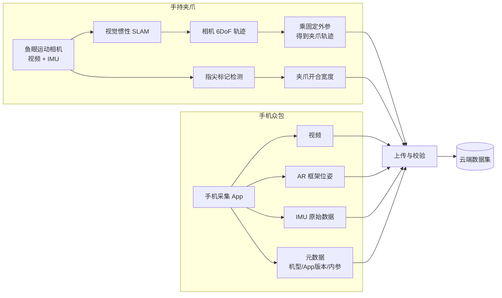

# 第十六课：手持与手机采集——机型、握持、采集App、位姿追踪与上传

> [!abstract] 本课覆盖的参数
> **机型下限**、**握持或固定方式**、**采集App及版本**、**位姿追踪方式**、**IMU采样率**、**联网与云端上传**
> 同时回顾 **夹爪开合记录** 在手持夹爪中的做法（机器人侧的夹爪开合记录见 [[第七课 机器人本体：自由度、夹爪类型与夹爪开合记录]]）。

上一课的人类示范数据有一个根本难题：人手和机器人手长得不一样，需要重定向。有没有办法让"人采集的数据"直接就是"机器人能执行的动作"？

一个很聪明的思路是：**让人拿着机器人的手去干活。** 以 UMI（Universal Manipulation Interface）为代表的手持夹爪方案就是这样做的：做一个和机器人末端同款的手持夹爪，在夹爪上刚性安装一台带鱼眼镜头的运动相机；人拿着它去厨房、去客厅完成任务；事后用视觉惯性 SLAM 从视频和相机内置 IMU 中还原相机的 6 自由度轨迹，换算成夹爪轨迹作为动作；夹爪指尖上贴有视觉标记，从画面中检测标记位置就能得到开合宽度。部署时，机器人装上同款夹爪和同款相机，看到的画面和采集时几乎一样。

另一个更"轻"的思路是：**用手机众包采集。** 写一个采集 App，让几百名志愿者用自己的手机拍摄"打开抽屉""把杯子放进水槽"这类视频，App 同时记录手机 AR 框架给出的相机位姿和 IMU 数据，上传到云端。

这两种方式都不需要机器人在场，成本低、场景多样，但也带来了一批 SO-101 采集中从未遇到的问题：**设备五花八门、人拿得不稳、App 会升级、位姿是"估计"出来的而不是读出来的、数据要从千家万户传回服务器。** 本课的六个参数就是围绕这些问题设计的。

---

## 1. 两种手持采集的数据链路



| 对比项 | SO-101 主从臂 | 手持夹爪（UMI 式） | 手机众包 |
|---|---|---|---|
| 动作从哪里来 | 主臂关节读数，直接测量 | SLAM 估计的夹爪位姿 + 标记检测的宽度 | AR 框架估计的相机位姿（需要再推算手/物体动作） |
| 设备一致性 | 同一台机器 | 同款硬件，较一致 | 机型各异，差异巨大 |
| 动作误差来源 | 编码器、标定 | SLAM 漂移、跳变、外参、标记检测 | AR 追踪质量、机型差异、握持 |
| 数据回传 | 本地硬盘 | 拷卡或上传 | 依赖网络上传 |

---

## 2. 机型下限

### ① 一句话定义

机型下限是**允许参与采集的设备的最低配置要求**，例如"系统版本不低于某版本、支持 AR 框架的 6DoF 追踪、后置主摄支持 1080p 30 FPS 稳定录制、可用存储不少于 20 GB"（示例写法）。对于手持夹爪，相当于"指定相机型号和固件版本"。

### ② 采集时它控制什么

规定机型下限，是为了控制以下几个会直接改变数据质量的因素：

| 因素 | 为什么重要 |
|---|---|
| 是否有 LiDAR / 深度 | 部分高端机型（如部分 iPhone Pro、iPad Pro）带 LiDAR，能提供深度，也能让 AR 追踪在弱纹理场景更稳定（深度相关内容见 [[第十二课 深度相机与LiDAR]]） |
| 相机质量 | 传感器尺寸、镜头、自动对焦、弱光噪声，决定画面清晰度和运动模糊程度 |
| IMU 质量 | 低端 IMU 噪声大、偏置不稳定，视觉惯性追踪更容易漂移 |
| AR 框架支持 | 手机端常用系统自带的 AR 框架（iOS 的 ARKit、Android 的 ARCore）提供实时位姿；不在支持列表中的机型无法获得可靠位姿 |
| 处理器 | 能否在录制视频的同时实时编码、运行追踪、写入 IMU，而不掉帧 |
| 存储空间 | 长时间录制时空间不足会中途停止或写坏文件 |
| 发热降频 | 连续录制几分钟后手机发热，系统可能自动降低帧率、分辨率或处理器频率 |

### ③ 最终生成什么数据

机型本身作为元数据写进每条数据，同时要记录与机型相关的**相机参数**：

```json
{
  "device": {
    "manufacturer": "示例厂商",
    "model": "ExamplePhone 15 Pro",
    "os_version": "示例 17.5",
    "has_lidar": true,
    "camera": "back_wide",
    "intrinsics": {"fx": 1412.3, "fy": 1412.3, "cx": 958.1, "cy": 541.7, "width": 1920, "height": 1080},
    "intrinsics_source": "AR 框架逐帧提供 / 出厂标定 / 自行标定",
    "distortion_model": "无（系统已校正）或 记录畸变参数"
  }
}
```

以上数值为示意。很多手机 AR 框架会逐帧提供相机内参，建议**逐帧或至少逐段**保存，因为对焦变化等因素可能使内参发生细微变化（以框架文档和实测为准）。

### ④ 设置不当会出什么问题

- **不设下限：** 低端机型追踪频繁丢失，位姿跳变；画面噪声大、模糊多；录到一半因发热或存储不足中断。数据表现为：大量短 episode、追踪状态异常比例高、帧率不稳定。
- **不记录机型：** 不同机型的视场角、色彩风格、畸变、锐化程度不同，数据集中混着多种"相机外观"，但你无法区分。模型可能把"某机型的偏色"当成场景特征。
- **不记录内参：** 位姿和图像之间的投影关系无法还原，没法把 3D 轨迹投到画面上验证，也没法做基于几何的数据增强或视角对齐。
- **下限设得过高：** 只有少数旗舰机能参与，众包规模和场景多样性下降，数据偏向特定人群和家庭环境。

### ⑤ 对 VLA 训练与部署的影响

- **机型差异 = 观测分布差异。** 部署时机器人上装的是某一款固定相机。如果训练数据里 80% 来自另一类机型，色彩、视场角、锐化风格都不一样，模型对部署相机画面会有"陌生感"。机型越分散，越需要按机型平衡采样，或在训练时做颜色和视场角增强（见 [[第二十二课 域随机化、生成模型与数据增强]]）。
- **内参差异影响空间理解。** 同样一个物体，在宽视场角镜头里显得更小、更靠中心。如果模型要从图像中推断"往哪里移动多少"，不同内参的数据混在一起，会削弱模型对距离的判断。
- **手持夹爪的做法正好相反：统一硬件。** UMI 式方案使用统一型号的相机和夹爪，部署时机器人也装同款，从根本上缩小了相机差异。

### ⑥ 验收与清洗

- 规范写明：允许的机型列表或最低配置、系统版本下限、必须记录的设备元数据字段；
- 清洗时按机型分组，统计每组的帧率稳定性、追踪丢失比例、平均亮度/色彩统计，找出表现异常的机型；
- 统计各机型的数据占比，评估是否需要在训练时重新加权。

---

## 3. 握持或固定方式

### ① 一句话定义

握持或固定方式是**采集设备如何与人体或环境相连**：手持、手腕绑带、胸前或头戴固定、三脚架固定等。

### ② 采集时它控制什么

它决定了三件事：

**第一，相机相对"执行动作的部件"的刚性关系。** 这是 UMI 式设备最核心的要求：相机必须与夹爪**刚性连接**。只有这样，相机到夹爪的变换 ${}^{c}\mathbf{T}_{g}$ 才是一个常数，才能把 SLAM 得到的相机位姿换算成夹爪位姿：

$$
{}^{W}\mathbf{T}_{g}(t)={}^{W}\mathbf{T}_{c}(t)\cdot{}^{c}\mathbf{T}_{g}
$$

如果相机是"夹"在夹爪上、会晃动，${}^{c}\mathbf{T}_{g}$ 就随时间变化，换算出的夹爪轨迹就带上了误差。

**第二，抖动程度。** 手持比三脚架抖得多；手腕绑带随手腕高频晃动；胸前固定随呼吸和步伐起伏。

**第三，视角与可达性。** 握持姿势决定相机朝向、手和物体在画面中的位置；对手持夹爪来说，握法还影响人能把夹爪伸到哪里、以什么角度接近物体。

| 方式 | 刚性关系 | 抖动 | 适合的数据 |
|---|---|---|---|
| 手持夹爪（相机刚性安装在夹爪上） | 相机—夹爪刚性 | 中等（来自手） | 末端轨迹 + 腕部视角，直接作为机器人动作 |
| 手机手持 | 相机—手无刚性关系 | 大 | 场景视频、相机轨迹，不能直接得到手的动作 |
| 手腕绑带 | 相机—手腕近似刚性 | 较大 | 腕部视角人类数据 |
| 胸前 / 头戴固定 | 相机—身体近似刚性 | 中等 | 第一视角数据（见上一课） |
| 三脚架 | 相机—环境刚性 | 极小 | 固定视角的第三人称数据 |

### ③ 最终生成什么数据

- 元数据中的握持方式和支架型号；
- 对于刚性安装，保存相机到夹爪（或到手腕）的外参，以及它的标定方法和日期：

```json
{
  "mount": {
    "type": "gripper_rigid",
    "fixture": "示例相机支架 v3（3D 打印）",
    "T_camera_gripper": {
      "translation_m": [0.0, 0.086, 0.152],
      "quat_xyzw": [0.0, 0.0, 0.0, 1.0],
      "source": "CAD 设计值，经标定板验证"
    }
  }
}
```

数值为示意。外参的标定方法见 [[第八课 标定方式（Calibration）]]。

### ④ 设置不当会出什么问题

- **支架松动：** 3D 打印支架长期使用后螺丝松动，相机相对夹爪偏转了几度。表现：夹爪轨迹整体偏移，部署时机器人总是"差一点"对不准物体；更隐蔽的是，画面中夹爪指尖的位置在不同批次之间有轻微变化。
- **握持不稳：** 高频抖动让画面模糊，也让 SLAM 特征跟踪更困难；动作轨迹中混入人手的生理性震颤。
- **握法不一致：** 有人习惯从上往下抓，有人习惯从侧面抓；有人握得靠前，有人握得靠后。如果握法改变了相机视角（例如手机横拍和竖拍混用），同一种任务的观测分布就会分裂。
- **手遮挡相机：** 手指或手掌挡住部分镜头，画面边缘出现大块"肉色"区域。

### ⑤ 对 VLA 训练与部署的影响

- **刚性关系是"人类数据直接变成机器人动作"的前提。** 手持夹爪数据之所以能直接用于部署，是因为机器人上安装了同款相机和夹爪，**相机—夹爪外参与采集时相同**。只要这个外参在采集和部署之间一致，模型输出的"相对相机的夹爪运动"就能在机器人上原样执行。如果部署机器人上的相机安装位置稍有不同，模型看到的画面和预测的动作之间的几何关系就会错位。
- **抖动会被学进动作。** 手持数据中的微小抖动如果不处理，模型会学到"轻微颤动"的动作风格；机器人执行时这种颤动可能被放大。常见做法是对轨迹做适度平滑，但要注意平滑本身会引入时延或削弱真实的快速动作。
- **握法差异影响动作分布。** 不同握法对应不同的接近方向，多模态的动作分布需要模型有足够的表达能力（这也是一些方法使用扩散模型等生成式动作头的原因之一）。

### ⑥ 验收与清洗

- 规范写明：握持/固定方式、支架型号与版本、外参值与标定日期、外参复查周期（例如每天开工前检查一次，示例）；
- 手持夹爪：抽样检查画面中夹爪指尖的像素位置是否稳定（指尖相对相机是刚性的，正常情况下位置只随开合变化）；
- 手机：检查横竖屏方向是否统一（元数据或图像宽高比）；
- 用 IMU 或位姿的高频成分估计抖动强度，按采集员分组比较。

---

## 4. 采集App及版本

### ① 一句话定义

采集App及版本是**用来录制数据的软件名称和精确版本号**（包括手持相机的固件版本）。

### ② 采集时它控制什么

采集 App 决定了几乎所有"看不见"的参数：

| App 决定的内容 | 举例 |
|---|---|
| 分辨率、帧率、编码 | 1920×1080、30 FPS、H.264 / HEVC、码率（编码见 [[第十一课 编码格式与码率]]） |
| 曝光、白平衡、防抖策略 | 是否锁定曝光、是否关闭电子防抖（防抖会裁切和扭曲画面，破坏内参和位姿的几何关系，见 [[第十课 成像参数：分辨率、帧率、曝光白平衡与防抖]]） |
| 时间戳来源 | 用传感器时间戳、系统时间，还是写文件时的时间 |
| 是否记录位姿和 IMU | 记录多少、以什么频率、用什么坐标系 |
| 元数据格式 | 字段名、单位、四元数顺序 |
| 帧率模式 | 恒定帧率还是可变帧率（很多手机录像默认可能产生可变帧率视频，以实测为准） |

### ③ 最终生成什么数据

每条数据都必须带上 App 名称和版本，最好还带上**实际生效的录制配置**（而不是"App 的默认配置"）：

```json
{
  "app": {
    "name": "ExampleCapture",
    "version": "2.4.1",
    "build": "241005",
    "effective_config": {
      "resolution": [1920, 1080],
      "fps_target": 30,
      "codec": "hevc",
      "bitrate_mbps": 20,
      "stabilization": "off",
      "exposure_lock": true,
      "pose_source": "ar_framework",
      "imu_rate_hz_target": 200,
      "quat_order": "xyzw",
      "camera_frame_convention": "x右 y上 -z前（需转换到 OpenCV 约定 x右 y下 z前）"
    }
  }
}
```

### ④ 设置不当会出什么问题

**最典型的事故：版本升级悄悄改变了参数。** 例如：

| 版本变化 | 你可能没注意到的后果 |
|---|---|
| 2.3 → 2.4：默认编码从 H.264 改为 HEVC | 训练流水线某个解码库不支持，部分视频读取失败或速度骤降 |
| 2.4 → 2.5：默认分辨率从 1080p 改为 720p | 新批次画面更模糊，内参也随之变化 |
| 2.5 → 2.6：位姿导出时"修正"了坐标系 | 新批次的轨迹相对旧批次"转了 90°"或"上下颠倒" |
| 某次修复：时间戳改为传感器时间 | 新旧批次的视频—位姿对齐方式不同，旧批次存在固定偏移 |

在众包场景中，用户手机上的 App 版本更新不同步，同一天采集的数据可能来自三四个不同版本。

### ⑤ 对 VLA 训练与部署的影响

- **不一致批次是"静默污染"。** 坐标系约定变化不会让程序报错，但会让一部分数据的动作方向完全相反。模型在训练中同时看到"往前推"和"往后推"对应同样的画面变化，学到的是两者的平均——往往是"不动"或犹豫。
- **分辨率和编码变化造成观测分布漂移。** 模型可能把"画面清晰度"和"任务阶段"或"场景"错误关联，因为某些任务恰好只在新版本中采集。
- **可追溯性。** 部署时发现问题，要能追溯到"哪些训练数据来自哪个版本"，否则无法定位和修复。

### ⑥ 验收与清洗

- 规范写明：允许使用的 App 版本列表；每条数据必须包含 App 名称、版本、构建号和实际生效配置；版本发布时附变更说明（哪些参数改变）；
- 清洗时**按 App 版本分组**检查分辨率、帧率、编码、码率、位姿坐标轴统计（例如重力方向在位姿中的分量）是否一致；
- 发现不一致批次后，要么转换到统一约定，要么单独标记，不要直接混合。

代码见本课第 10 节。

---

## 5. 位姿追踪方式

### ① 一句话定义

位姿追踪方式是**用什么方法得到相机（或末端）在每一时刻的 6 自由度位姿**。

| 方式 | 原理 | 尺度 | 典型问题 |
|---|---|---|---|
| 视觉惯性里程计 / SLAM（VIO / VI-SLAM） | 跟踪画面特征点，融合 IMU 估计运动；SLAM 还会建图和回环 | 单目纯视觉无绝对尺度；加入 IMU 后可估计尺度 | 漂移、重定位跳变、弱纹理丢失 |
| 手机 AR 框架 | 系统级 VIO（部分机型融合 LiDAR） | 有尺度 | 黑盒，参数不可控；不同机型质量不同 |
| 离线 SLAM（如 ORB-SLAM3 一类开源系统） | 录完后离线处理，可建图、回环、全局优化 | 视觉惯性模式下有尺度 | 处理慢；失败需要重处理或剔除 |
| 外部动作捕捉 | 环境中的相机追踪设备上的标记点 | 有尺度，精度高 | 只能在动捕棚内使用（见第十八课） |
| 机器人运动学 | 读关节角，正运动学计算末端位姿 | 有尺度 | 只适用于机器人采集，不适用于手持 |

UMI 式方案的公开描述中，使用离线视觉惯性 SLAM（基于 ORB-SLAM3）处理运动相机的视频和 IMU 数据，并会先对场景建图，再把每段示范定位到地图中。具体流程以其开源代码为准。

### ② 采集时它控制什么

位姿追踪方式决定了**动作标签的精度、尺度和稳定性**。对于手持夹爪，**位姿就是动作**；对于手机采集，位姿是还原场景几何和相机运动的基础。

它也间接约束了采集行为：
- VIO/SLAM 需要纹理丰富的环境，白墙、玻璃、镜面、强反光会让追踪变差；
- 需要足够的视差：原地纯旋转时，单目视觉很难估计深度；
- 很多 SLAM 需要初始化动作（例如开始时缓慢平移晃动几秒），采集规范需要规定。

### ③ 最终生成什么数据

每帧一个 6DoF 位姿（位置 + 四元数），加上追踪状态和坐标系说明：

```text
episode_0042/
├── video.mp4
├── frame_timestamps.npy           # [T] 每帧时间（纳秒）
├── camera_trajectory.csv          # 每帧相机位姿
├── gripper_trajectory.csv         # 乘外参后的夹爪位姿（手持夹爪）
├── gripper_width.csv              # 开合宽度（见第 7 节）
├── imu.csv                        # IMU 原始数据（见第 6 节）
└── meta.json
```

`camera_trajectory.csv` 示意：

```text
frame_index,t_ns,x,y,z,qx,qy,qz,qw,tracking_state
0,1729400000000000000,0.000,0.000,0.000,0.000,0.000,0.000,1.000,ok
1,1729400000033366000,0.001,0.000,-0.002,0.001,0.002,0.000,1.000,ok
2,1729400000066733000,0.003,0.001,-0.004,0.002,0.003,0.000,1.000,ok
```

`meta.json` 中要写明：世界系原点（"地图原点"还是"会话起点"）、重力方向、单位、四元数顺序、位姿语义（$T_{\text{world}\leftarrow\text{camera}}$）、相机坐标轴约定。手机 AR 框架的相机坐标系常与 OpenCV 约定不同（例如一个是 y 向上、-z 朝前，另一个是 y 向下、z 朝前），转换时出错会让轨迹整体翻转，务必核对。

### ④ 设置不当会出什么问题

| 故障 | 在数据里的表现 |
|---|---|
| **尺度错误** | 纯单目 SLAM 没有尺度，轨迹整体放大或缩小；机器人执行时动作幅度不对 |
| **漂移** | 长时间录制后位置累积偏差，同一个桌面在轨迹末尾"高了 3 cm" |
| **重定位跳变** | 追踪恢复或回环时，位姿突然跳变几厘米，相邻两帧间出现不可能的大位移 |
| **追踪丢失** | 一段时间没有位姿，或者位姿冻结不动而画面在动 |
| **坐标系约定错误** | 轨迹方向反了、轴互换了 |

**位姿误差直接变成动作误差。** 在 SO-101 中，动作是编码器读数，误差在毫米以下；在手持采集中，动作是 SLAM 估计值，跳变和漂移都会原样变成动作标签。

### ⑤ 对 VLA 训练与部署的影响

**影响一：全局漂移 vs 相对轨迹。** 如果用"世界系下的绝对夹爪位姿"作为动作，SLAM 漂移和地图原点的随意性都会进入标签：两段示范在同一张桌子上，但由于原点不同，绝对坐标完全不同。一种常见改进是使用**相对轨迹**作为动作——以当前时刻的末端位姿为参考，表示未来各时刻的位姿：

$$
\mathbf{a}_{t,k}=\big({}^{W}\mathbf{T}_{g}(t)\big)^{-1}\cdot{}^{W}\mathbf{T}_{g}(t+k),\quad k=1,\dots,H
$$

这样，世界原点在哪里、长时间漂移了多少，对 $\mathbf{a}_{t,k}$ 的影响都很小——只要**短时间窗内**的相对运动是准的。UMI 的公开描述中也采用了相对轨迹形式的动作表示。部署时，机器人用自己的正运动学得到当前末端位姿，再把相对动作换算成目标位姿执行。

**影响二：跳变会教坏模型。** 一个 5 cm 的重定位跳变，在相对轨迹里就是"下一帧突然向某个方向移动 5 cm"。如果不清洗，模型会在类似画面中输出突然的大动作，部署时机器人猛地一冲。

**影响三：位姿质量与场景相关。** 弱纹理场景（白色桌面、玻璃柜）的轨迹质量差，如果不剔除，模型在这些场景中学到的动作更嘈杂，部署时在这些场景中表现也更差。

### ⑥ 验收与清洗

- 规范写明：追踪方式和软件版本、是否建图、初始化流程、坐标系约定、追踪状态字段、允许的丢失比例；
- 清洗时检测相邻帧平移和旋转突变（跳变），统计追踪丢失段；
- 对于有地图的方案，检查同一场景的多段示范是否能定位到同一地图；
- 抽样把轨迹投影回画面（例如把夹爪未来位置画在当前画面上）人工检查。

---

## 6. IMU采样率

### ① 一句话定义

IMU 采样率是**惯性测量单元每秒输出多少次加速度和角速度测量**。手机和运动相机中的 IMU 常见采样率在**数百赫兹量级**（具体以设备与系统 API 实际可获取的频率为准，App 请求的频率不一定等于实际频率）。

### ② 采集时它控制什么

IMU 在手持采集中有三个用途：

1. **视觉惯性融合。** 在两帧图像之间，IMU 提供高频的运动信息，帮助 VIO/SLAM 预测运动、恢复尺度、在画面模糊时维持追踪。
2. **运动模糊检测。** 某帧曝光期间的角速度大，说明这一帧大概率模糊。
3. **时间对齐。** 相机运动和 IMU 测量的角速度高度相关，可以用来估计或检验视频与 IMU 之间的时间偏移。

要让 IMU 发挥作用，有两个前提必须满足：**IMU 与相机之间的时间偏移已知**，**IMU 与相机之间的外参（相对位置和朝向）已知**。这两者通常需要用标定工具（如 Kalibr 这类相机—IMU 联合标定工具）标定，详见 [[第八课 标定方式（Calibration）]]。

### ③ 最终生成什么数据

一条独立的高频数据流：

```text
t_ns,ax,ay,az,gx,gy,gz
1729400000000000000,0.12,9.79,-0.31,0.002,-0.010,0.004
1729400000005000000,0.13,9.80,-0.30,0.003,-0.011,0.004
```

加速度单位 m/s²，角速度单位 rad/s（示意数据；有的系统会输出以 g 为单位的加速度或去除重力后的"用户加速度"，必须在元数据中说明）。`meta.json` 中写明：名义采样率、坐标轴方向、单位、是否包含重力、时间戳与视频是否同一时钟、相机—IMU 时间偏移与外参。

### ④ 设置不当会出什么问题

- **采样率不足：** 快速晃动时，IMU 积分误差变大，VIO 在画面模糊段更容易失败。
- **时间戳不准或抖动大：** IMU 样本的时间戳是"到达 App 的时间"而不是"测量时间"时，间隔会忽长忽短。VIO 对时间极为敏感，时间戳误差会直接变成位姿漂移。
- **相机—IMU 时间偏移未标定：** 例如偏移 10 ms 没有补偿，VIO 会把"图像看到的转动"和"IMU 测到的转动"错开，快速运动时误差显著。
- **丢样：** 系统繁忙时 IMU 数据丢失一段，积分出现断层。
- **单位或坐标轴混乱：** 不同机型、不同 API 的轴向和单位不同，融合时结果完全错误。

### ⑤ 对 VLA 训练与部署的影响

- **间接影响：** 对多数 VLA 而言，IMU 本身不一定作为模型输入，但它决定了位姿轨迹质量，进而决定了动作标签质量。IMU 问题引起的 VIO 漂移和跳变，最终表现为第 5 节中的动作标签错误。
- **直接影响（如果作为输入）：** 如果把 IMU 作为观测模态，部署时机器人上的 IMU 必须安装在同样的位置、使用同样的坐标系和预处理，否则训练与部署的输入分布不同。高频 IMU 与低频推理的融合问题，与 [[第六课 控制频率、采样率与轨迹记录频率]] 中力传感器的处理思路一致。
- **用于数据筛选：** 用 IMU 角速度标记模糊帧，在训练时降低这些帧的权重，可以减少模型对模糊画面的依赖。

### ⑥ 验收与清洗

- 规范写明：名义 IMU 采样率、实测间隔分布要求（如 P99 不超过名义周期的 2 倍，示例）、时间戳来源、单位与坐标轴、相机—IMU 时间偏移和外参的标定方法与数值；
- 清洗时检查 IMU 时间戳间隔、重复和倒退、长时间中断；
- 用陀螺仪角速度与位姿差分得到的角速度做互相关，粗略检验时间偏移是否合理（本课第 9 节给出思路）。

---

## 7. 回顾：手持夹爪的开合记录

[[第七课 机器人本体：自由度、夹爪类型与夹爪开合记录]] 讲了机器人夹爪的开合记录，那里开合量可以直接从电机编码器读出。手持夹爪由人手捏合，没有电机，需要另外测量。

### ① 一句话定义

手持夹爪的开合记录是**用传感方法测量人手捏合时两指之间的距离**，并转换成机器人夹爪可执行的开合指令。

### ② 采集时它控制什么

它决定了"何时抓、抓多紧"这一关键动作维度能否被准确记录。常见做法有两种：

| 方法 | 做法 | 优点 | 缺点 |
|---|---|---|---|
| 视觉标记检测 | 在两个指尖贴上视觉基准标记（如 ArUco 类标记），从相机画面检测两个标记的位置，换算成宽度 | 不需要额外电子元件，宽度和画面天然同步 | 标记被遮挡、模糊、反光时检测失败 |
| 编码器 / 电位器 | 在夹爪转轴或滑轨上安装角度或位移传感器 | 稳定、不受画面影响 | 需要额外硬件和单独的时间同步 |

### ③ 最终生成什么数据

```text
frame_index,t_ns,width_m,detect_ok
0,1729400000000000000,0.082,1
1,1729400000033366000,0.081,1
2,1729400000066733000,,0
```

检测失败的帧应明确标记 `detect_ok=0`，宽度留空，而不是填 0——0 表示"完全闭合"，填 0 会制造虚假的抓取动作。

### ④ 设置不当会出什么问题

- **检测失败处理不当：** 失败帧填 0 或保持上一值不加标记，导致虚假抓取或错过真实抓取时刻；
- **宽度映射错误：** 手持夹爪最大开口 8 cm，机器人夹爪最大开口 10 cm，如果不做映射，机器人永远不能完全打开；如果用比例映射，机器人抓取时的实际夹紧位置又可能与手持时不同；
- **夹持物体时的宽度含义：** 手持夹爪抓住杯子后宽度停在杯子直径处，机器人执行时如果使用位置控制，要考虑是否需要"再收紧一点"以产生足够夹持力（与第七课讨论的连续值与二值问题相关）。

### ⑤ 对 VLA 训练与部署的影响

开合宽度往往是动作向量中对任务成败最敏感的一维。检测失败造成的"闪烁"（开—合—开）会让模型学到犹豫的抓取；映射错误会让部署时的抓取总是太松或太紧。

### ⑥ 验收与清洗

- 规范写明：测量方法、标记尺寸与类型、检测失败的标记方式、与机器人夹爪的宽度映射函数；
- 清洗时统计检测失败率；对短时间的失败段（例如少于 3 帧，示例）可以插值，长段则标记为不可用；检测开合"闪烁"（在极短时间内反复开合）。

---

## 8. 联网与云端上传

### ① 一句话定义

联网与云端上传是**采集到的数据何时、以什么方式、经过什么处理传到服务器**的规定。

### ② 采集时它控制什么

| 环节 | 需要规定的内容 |
|---|---|
| 上传时机 | 边录边传（实时），还是录完后在 WiFi 下批量上传 |
| 传输可靠性 | 是否支持断点续传；失败重试策略 |
| 是否转码压缩 | 上传前是否重新编码以节省流量（**二次压缩会造成画质损失**） |
| 完整性校验 | 上传前后计算哈希（如 SHA-256），比对一致 |
| 元数据同步 | 视频、位姿、IMU、元数据是否作为一个整体上传，缺一不可 |
| 隐私与安全 | 上传前是否脱敏（人脸、屏幕、位置信息）、传输与存储加密、访问权限控制 |
| 本地删除策略 | 确认上传成功并校验后才允许删除本地文件 |

一个数据量估算（示意数值）：1080p、30 FPS、码率 15 Mbps 的视频录制 10 分钟：

$$
15\,\text{Mbps}\times 600\,\text{s}=9000\,\text{Mb}\approx 1125\,\text{MB}
$$

一个志愿者每天录一小时就是约 6.75 GB。用移动数据实时上传既昂贵又不稳定，这就是很多 App 选择"WiFi 下批量上传"的原因，也是一些 App 偷偷"上传前转码"的动机。

### ③ 最终生成什么数据

每条数据附带一份上传清单（manifest），服务器端据此校验：

```json
{
  "episode_id": "u1832_20261018_0007",
  "files": [
    {"name": "video.mp4", "bytes": 1179648000, "sha256": "9f2c...e1"},
    {"name": "camera_trajectory.csv", "bytes": 2410331, "sha256": "41ab...07"},
    {"name": "imu.csv", "bytes": 15832110, "sha256": "c7d0...9a"},
    {"name": "meta.json", "bytes": 3120, "sha256": "08e5...3b"}
  ],
  "transcoded_before_upload": false,
  "upload": {"started": "2026-10-18T21:03:11Z", "completed": "2026-10-18T21:19:42Z", "retries": 2},
  "privacy": {"face_blur": "server_side", "gps_stripped": true}
}
```

### ④ 设置不当会出什么问题

- **上传失败导致数据缺失：** 视频上传成功了，位姿文件没上传；或者元数据丢失，无法知道机型和 App 版本。
- **文件损坏：** 网络中断后没有断点续传，服务器上留下截断的视频，只能播放一半或完全无法解码。
- **二次压缩：** App 为省流量把 20 Mbps 的视频转码成 4 Mbps，细节和纹理丢失，压缩伪影增加；更隐蔽的是，转码可能改变帧率（可变帧率转恒定帧率时插帧或丢帧），破坏视频帧与位姿时间戳的对应关系。
- **重复上传：** 重试机制设计不当，同一段数据上传两次，数据集中出现重复样本，评估时训练集和测试集可能"泄漏"。
- **隐私泄露：** 未脱敏的视频包含人脸、家庭住址信息、屏幕内容；文件元数据里带着 GPS 位置。具体合规要求需咨询法务，以适用法规和用户协议原文为准。

### ⑤ 对 VLA 训练与部署的影响

- **残缺数据比没有数据更危险。** 缺少位姿的视频如果被错误地配上了另一条数据的位姿（例如文件名冲突），模型会学到完全错误的画面—动作对应关系。
- **二次压缩造成观测分布漂移。** 训练数据是转码后的低码率视频，部署时机器人相机输出的是高质量原始画面（或另一种压缩），模型面对的图像统计特性不同。
- **重复数据影响评估。** 重复样本让模型对少数场景过拟合，同时让验证集指标虚高。

### ⑥ 验收与清洗

- 规范写明：上传时机、是否允许转码（建议原始文件上传，如需压缩须在服务器端统一进行并保留原始文件）、哈希算法、断点续传要求、必须一起上传的文件列表、隐私处理流程与责任方；
- 服务器端入库时：逐文件校验哈希和大小；检查清单中的文件是否齐全；用 `ffprobe` 一类工具检查视频的编码、码率、帧数与元数据是否一致；按内容哈希去重；
- 对不完整的数据：标记为"待补传"，而不是直接进入训练集。

---

## 9. 串联：从手里的设备到训练集里的一行动作

**一条手持夹爪数据的生命周期：**

```text
机型/相机固件 ──► 画面质量、IMU 质量
       │
握持/刚性安装 ──► 外参 T_camera_gripper 是否恒定
       │
App/固件版本 ──► 分辨率、编码、时间戳、坐标系约定
       │
IMU 采样率 + 时间偏移 ──► VIO/SLAM 质量
       │
位姿追踪方式 ──► 相机轨迹（尺度、漂移、跳变）
       │                 × 外参
       ▼
夹爪轨迹 + 开合宽度 ──► 相对轨迹动作标签
       │
上传 ──► 完整性、是否二次压缩
       ▼
训练集
```

**计算示例：外参误差如何放大成动作误差（示意数值）。** 假设相机到夹爪指尖的距离约 0.15 m，支架松动导致相机相对夹爪偏转了 $2^\circ$，但你仍使用原来的外参。那么从相机位姿推算出的指尖位置误差约为：

$$
0.15\,\text{m}\times\tan 2^\circ\approx 5\,\text{mm}
$$

这是一个**系统性**误差：所有数据都朝同一个方向偏 5 mm。更麻烦的是，部署机器人上的支架是没松动的，模型从"偏了 2° 的画面"学到的动作，到了机器人上会表现为固定方向的抓取偏差。

**计算示例：IMU 时间偏移的影响（示意数值）。** 手持夹爪快速转动时角速度可达 $200^\circ/\text{s}$。若相机—IMU 时间偏移 5 ms 没有补偿：

$$
200^\circ/\text{s}\times 0.005\,\text{s}=1^\circ
$$

VIO 每一次融合都会面对"图像和 IMU 对不上 $1^\circ$"的矛盾，快速运动段的轨迹精度明显下降，甚至导致追踪失败。

**与前面课程的关系：**

| 本课问题 | 相关课程 |
|---|---|
| 视频、位姿、IMU 三条流的时间对齐 | [[第一课 时间同步方式（Time Synchronization）]]、[[第二章 时间戳对齐误差]] |
| 相对轨迹 vs 绝对位姿 | [[第五课 动作空间（Action Space）]] |
| 四元数顺序与符号连续性 | [[补学 第一至五课的缺口与勘误]] |
| 相机—IMU 外参与时间偏移、相机—夹爪外参 | [[第八课 标定方式（Calibration）]] |
| 防抖、曝光对 SLAM 的影响 | [[第十课 成像参数：分辨率、帧率、曝光白平衡与防抖]] |
| 二次压缩与码率 | [[第十一课 编码格式与码率]] |
| 视角差异与具身差异 | [[第十五课 人体追踪信号：头部位姿、手部关键点、佩戴位置与手部可见]] |

---

## 10. 清洗实践

### 10.1 检测位姿跳变

```python
import numpy as np
import pandas as pd
from scipy.spatial.transform import Rotation as R

traj = pd.read_csv("episode_0042/camera_trajectory.csv")      # 字段名为示意
pos = traj[["x", "y", "z"]].to_numpy()
rot = R.from_quat(traj[["qx", "qy", "qz", "qw"]].to_numpy())  # scipy 顺序 [x, y, z, w]

d_trans = np.linalg.norm(np.diff(pos, axis=0), axis=1)        # 相邻帧平移量（m）
d_rot = np.degrees((rot[:-1].inv() * rot[1:]).magnitude())    # 相邻帧旋转角（度），不受符号翻转影响

def robust_outliers(x, k=8.0):
    """中位数 + k 倍 MAD 的鲁棒阈值；k 为示例值"""
    med = np.median(x)
    mad = np.median(np.abs(x - med)) + 1e-9
    return np.where(x > med + k * 1.4826 * mad)[0]

jump_t = robust_outliers(d_trans)
jump_r = robust_outliers(d_rot)
# 同时设一个物理上限：手持运动在 1/30 s 内平移超过 5 cm 基本不可能（示例阈值）
hard = np.where(d_trans > 0.05)[0]
print("平移突变帧:", jump_t[:20])
print("旋转突变帧:", jump_r[:20])
print("超过物理上限的帧:", hard[:20])

# 追踪丢失或冻结：画面在动，位姿完全不变
frozen = np.where((d_trans < 1e-6) & (d_rot < 1e-4))[0]
print("位姿冻结帧数:", len(frozen))
if "tracking_state" in traj:
    print("非 ok 追踪状态占比: %.1f%%" % (100 * (traj["tracking_state"] != "ok").mean()))
```

局限：真实的快速甩动也可能被判为突变，静止放置时也会出现"冻结"。需要结合 IMU 角速度（真实运动时 IMU 也有响应，跳变时没有）和视频人工确认。

### 10.2 检查 IMU 时间戳

```python
imu = pd.read_csv("episode_0042/imu.csv")
t = imu["t_ns"].to_numpy().astype(np.int64)
dt_ms = np.diff(t) / 1e6
nominal_ms = 1000.0 / 200                                  # 名义 200 Hz（示例）
print("实测平均频率 %.1f Hz" % (1000.0 / dt_ms.mean()))
print("间隔 中位数 %.2f ms, P99 %.2f ms, 最大 %.2f ms"
      % (np.median(dt_ms), np.percentile(dt_ms, 99), dt_ms.max()))
print("重复或倒退:", int((dt_ms <= 0).sum()))
print("中断（> 3 倍名义周期）:", int((dt_ms > 3 * nominal_ms).sum()))
print("间隔抖动（标准差）%.2f ms" % dt_ms.std())

# IMU 覆盖范围应包住整段视频
frame_t = np.load("episode_0042/frame_timestamps.npy").astype(np.int64)
print("IMU 是否覆盖视频首尾:", t[0] <= frame_t[0] and t[-1] >= frame_t[-1])
```

如果间隔呈现"一串很短、一个很长"的规律，往往说明时间戳是批量到达 App 时打上的，而不是测量时刻。

### 10.3 按 App 版本和机型分组检查

```python
import json, glob

rows = []
for p in glob.glob("dataset/*/meta.json"):                 # 目录结构为示意
    m = json.load(open(p, encoding="utf-8"))
    cfg = m["app"]["effective_config"]
    rows.append({
        "episode": p.split("/")[-2],
        "app_version": m["app"]["version"],
        "model": m["device"]["model"],
        "width": cfg["resolution"][0],
        "height": cfg["resolution"][1],
        "codec": cfg["codec"],
        "fps": cfg["fps_target"],
        "fx": m["device"]["intrinsics"]["fx"],
    })
meta = pd.DataFrame(rows)

# 每个 App 版本内部，关键配置应当一致；不同版本之间的差异要能解释
summary = meta.groupby("app_version").agg(
    n=("episode", "count"),
    resolutions=("width", lambda s: sorted(set(s))),
    codecs=("codec", lambda s: sorted(set(s))),
    fps=("fps", lambda s: sorted(set(s))),
)
print(summary)

# 各机型占比，评估是否需要重新加权
print(meta["model"].value_counts(normalize=True).head(10))
```

还可以加入"位姿中重力方向的平均分量"作为一列：如果某个版本的重力方向突然从 $-Y$ 变成 $-Z$，基本可以断定坐标系约定改变了。

### 10.4 上传完整性校验

```python
import hashlib

def sha256_of(path, chunk=1 << 20):
    h = hashlib.sha256()
    with open(path, "rb") as f:
        for block in iter(lambda: f.read(chunk), b""):
            h.update(block)
    return h.hexdigest()

manifest = json.load(open("incoming/u1832_20261018_0007/manifest.json", encoding="utf-8"))
for item in manifest["files"]:
    path = f"incoming/{manifest['episode_id']}/{item['name']}"
    try:
        ok = sha256_of(path) == item["sha256"]
    except FileNotFoundError:
        ok = False
    print(item["name"], "OK" if ok else "缺失或损坏")
```

哈希一致只能证明"服务器上的文件和 App 端计算哈希时的文件一致"。如果 App 在计算哈希**之前**就做了转码，哈希仍会一致，所以还要检查 `transcoded_before_upload` 字段和视频实际码率。

---

## 11. 验收清单写法速查

| 字段 | 示例写法（阈值为示例，需按任务确定） |
|---|---|
| 机型下限 | 支持 AR 框架 6DoF 追踪的机型；系统版本 ≥ 指定版本；1080p30 连续录制 15 分钟不降帧；可用存储 ≥ 20 GB；每条数据记录机型和逐帧内参 |
| 握持或固定方式 | 相机刚性安装于手持夹爪支架 v3；外参 $T_{\text{camera}\leftarrow\text{gripper}}$ 每日开工前复核；手机统一横屏 |
| 采集App及版本 | 仅允许 2.4.x；每条数据记录名称、版本、构建号、实际生效配置；版本变更须附参数变更说明 |
| 位姿追踪方式 | 离线视觉惯性 SLAM（指定软件版本），先建图后定位；每帧位置 + 四元数（xyzw）；世界系 +Z 与重力相反；追踪丢失占比 ≤ 2%；跳变帧需标记 |
| IMU采样率 | 名义 200 Hz；实测 P99 间隔 ≤ 10 ms；无倒退；相机—IMU 时间偏移与外参经标定并写入元数据 |
| 夹爪开合记录 | 指尖视觉标记检测；失败帧 `detect_ok=0` 且宽度留空；短于 3 帧的失败段可插值；附宽度映射函数 |
| 联网与云端上传 | 仅 WiFi 批量上传；禁止客户端转码；SHA-256 逐文件校验；清单文件齐全才入库；人脸服务器端打码、去除 GPS；隐私合规以法务意见为准 |

---

## 12. 第十六课练习

**问题 1：App 版本**

你发现某个众包数据集中，约 15% 的 episode 的相机轨迹方向与其他数据"上下颠倒"。最有效的排查第一步是？

A. 增加训练轮数，让模型自己适应
B. 按 App 版本（和机型）分组统计轨迹中重力方向的分量，看颠倒的数据是否集中在某个版本
C. 把所有轨迹取反

**问题 2：刚性连接**

UMI 式手持夹爪要求相机与夹爪刚性连接，最根本的原因是？

A. 刚性连接可以提高视频分辨率
B. 只有刚性连接时，相机到夹爪的外参才是常数，才能把 SLAM 得到的相机位姿换算成夹爪位姿
C. 刚性连接可以替代时间同步

**问题 3：IMU 与 VIO**

某批手持数据在快速转动段频繁出现轨迹跳变，而慢速段正常。以下哪个原因**最不可能**？

A. 相机—IMU 时间偏移没有标定或标定错误
B. IMU 时间戳是到达时间而非测量时间，抖动很大
C. 上传时使用了 SHA-256 校验

**问题 4：二次压缩**

App 在上传前把视频从 20 Mbps 转码为 4 Mbps，且在计算哈希之前完成转码。下列说法正确的是？

A. 服务器端的哈希校验能发现这个问题
B. 哈希校验无法发现，需要检查转码标记字段和视频实际码率；转码还可能改变帧率，破坏帧与位姿的对应
C. 转码只影响文件大小，对训练没有影响

**问题 5：开放思考题**

你的手持夹爪数据中，每段示范都有 SLAM 漂移，最后几秒的位置误差可达 2~3 cm，但短时间内的相对运动很准。请说明为什么使用"相对当前帧的未来位姿"作为动作可以缓解这个问题，以及这种做法在部署时需要什么前提。

> [!question]- 参考答案（点击展开）
> 1. **B**。"一部分数据颠倒"是典型的不一致批次症状，最可能来自 App 版本升级改变了坐标系约定（或某机型的轴向差异）。先分组定位原因，再决定统一转换或单独标记。A 会让模型学到相互矛盾的动作；C 会把正确的数据也弄错。
> 2. **B**。公式 ${}^{W}\mathbf{T}_{g}(t)={}^{W}\mathbf{T}_{c}(t)\cdot{}^{c}\mathbf{T}_{g}$ 成立的前提是 ${}^{c}\mathbf{T}_{g}$ 恒定。部署时机器人装同款相机和夹爪，外参一致，模型学到的"相对相机的夹爪运动"才能直接执行。
> 3. **C**。SHA-256 校验只关乎文件完整性，与 VIO 精度无关。A 和 B 都会在快速运动时放大"图像与 IMU 不一致"的问题，与"快速段出错、慢速段正常"的现象吻合。
> 4. **B**。哈希只能证明传输前后文件一致，无法知道 App 在算哈希前做过什么。需要检查转码标记和实际码率。转码造成的画质下降会让训练观测与部署观测分布不同；帧率变化会破坏视频帧与位姿时间戳的对应关系。
> 5. 参考思路：
>    - 漂移是低频、累积的误差，在几秒的时间窗内变化很小。相对动作 $\mathbf{a}_{t,k}=\big({}^{W}\mathbf{T}_{g}(t)\big)^{-1}{}^{W}\mathbf{T}_{g}(t+k)$ 只依赖窗口内的相对运动，全局漂移和世界原点的选择大多被抵消。
>    - 部署前提：机器人能准确得到自己当前的末端位姿（通常由正运动学提供），从而把相对动作换算成目标位姿；相机与夹爪的安装关系与采集时一致；动作块覆盖的时长与采集频率一致（第六课）；训练与部署使用同一套相对动作的定义（参考帧、四元数顺序、坐标轴）。
>    - 局限：相对表示不能消除短时间内的跳变，跳变仍需清洗；如果任务依赖绝对位置（例如"放到桌面固定标记处"），还需要视觉观测来提供绝对参考。

---

## 13. 小结

一句话总结本课：**手持和手机采集用"估计出来的位姿"代替了"读出来的关节角"，所以设备一致性、刚性安装、App 版本、追踪方式、IMU 时间质量和上传完整性，每一项都会直接写进动作标签和观测分布。**

下一课 [[第十七课 力与触觉：采样率、量程与触觉通道]] 将从"看"转向"摸"：六维力/力矩传感器和触觉传感器以数百到数千赫兹记录接触过程，你会看到为什么插孔、擦拭、处理柔性物体这类任务仅靠视觉很难做好，以及力信号的饱和、零漂和重力补偿如何影响数据质量。
