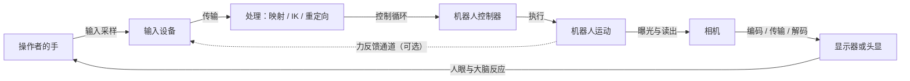

# 第十四课：遥操作系统：输入设备、端到端时延与力反馈

> [!abstract] 本课覆盖的参数
> **输入设备型号**、**端到端时延**、**力反馈**
> 这三个参数共同决定了"人是在什么条件下做出示范的"：用什么设备发出指令，指令和反馈要多久才走完一圈，以及人能不能感觉到机器人碰到了什么。

> [!note] 模块三导读：人类示范与遥操作采集
> 模块一解决"数据在时间和动作语义上是否正确"，模块二解决"模型看到的画面是否合格"。模块三换一个角度：**示范是人做出来的，人的操作条件会被原样写进数据。** 本模块依次讲遥操作系统（本课）、人体追踪信号（第十五课）、手持与手机采集（第十六课）、力与触觉（第十七课）、动作捕捉（第十八课）。它们的共同主题是：同一个任务，换一种采集方式，示范的质量、风格和可用的信号都会变。

你用 SO-101 主从臂采了 50 条"把方块放进杯子"的示范，训练出的策略能完成任务。后来实验室来了一套 VR 头显，同事用 VR 手柄通过网络远程操作另一台机械臂，也采了 50 条同样的任务。你把两批数据合在一起训练，结果模型反而变差：机器人接近杯子时会停下来、等一会儿、再挪一点，有时候冲过头又退回来。你回放 VR 那批数据，发现几乎每条示范都是这种"走走停停"的节奏。

问题不在模型，也不在 VR 设备本身"不好"，而在于**两套遥操作系统给操作者的条件完全不同**：输入设备不同，映射方式不同，从手动到眼睛看到结果的时延不同。这些差别全都被记录进了动作轨迹里。

本课和前面课程的关系：

| 前面学过的 | 本课的延伸 |
|---|---|
| [[补学 第一至五课的缺口与勘误]] 补 3 | 主从臂中 action 领先 state，是端到端时延在数据里能直接看到的那一部分 |
| [[第五课 动作空间（Action Space）]] | 输入设备的类型，很大程度上决定了动作空间 |
| [[第六课 控制频率、采样率与轨迹记录频率]] | 控制周期是时延的组成部分；部署时的推理时延与遥操作时延是同一类问题 |
| [[第十三课 多机同步、全景拼接与投影格式]] | 测量时延本质上是一次"输入设备与机器人之间"的同步测量 |

---

## 1. 先看清整个遥操作回路

遥操作系统是一个**以人为控制器的闭环**：人看到画面，做出动作，动作变成机器人指令，机器人运动，相机拍到结果，结果又显示给人看。



本课的三个参数分别落在这个回路的三个位置：**输入设备**是回路的入口；**端到端时延**是走完回路要多久；**力反馈**是一条额外的、从机器人回到人手的通道。

---

## 2. 输入设备型号

### ① 一句话定义

输入设备型号是**操作者用来发出指令的硬件及其固件版本**，连同它把人的动作映射成机器人指令的方式。

### ② 采集时它控制什么

**第一，人的动作如何映射到机器人。** 常见设备与映射方式：

| 设备类型 | 例子 | 映射方式 | 自然得到的动作空间 |
|---|---|---|---|
| 同构主从臂 | SO-101 主臂与从臂、ALOHA 式双臂主从系统 | 关节对关节直接映射 | 关节绝对位置 |
| 异构主手 | 结构与机器人不同的主控臂、桌面式力反馈手柄 | 读取主手末端位姿 → 逆运动学（IK）求机器人关节 | 末端位姿，或经 IK 后的关节位置 |
| 3D 鼠标 | SpaceMouse 一类六自由度鼠标 | 推、扭的幅度映射为末端的速度 | 末端速度或位置增量 |
| 游戏手柄 / 键盘 | 摇杆、按键 | 摇杆偏移映射为速度，按键映射为固定步长 | 末端或关节的速度、增量 |
| VR 头显与手柄 | 头显追踪手柄位姿 | 手柄相对位姿 → 机器人末端位姿 → IK | 末端位姿（常为相对于"按下离合键"时刻的相对位姿） |
| VR 手势追踪 / 数据手套 | 头显摄像头追踪手指，或手套上的弯曲传感器 | 人手关键点 → 重定向（retargeting）到灵巧手关节 | 灵巧手关节位置 |
| 外骨骼 | 穿戴在手臂或手上的机械结构 | 人体关节角 → 机器人关节（结构相近时直接映射，不同时需重定向） | 关节位置 |
| 动捕驱动 | 光学或惯性动捕追踪人体 | 人体骨骼姿态 → 重定向到人形机器人 | 全身关节位置 |

三种映射方式的本质区别：

| 映射方式 | 优点 | 代价 |
|---|---|---|
| 关节到关节 | 没有 IK，不存在奇异点和多解；人直接"摆出"机器人的姿态 | 需要与机器人结构一致的主臂，一种机器人一套主臂 |
| 末端位姿 + IK | 一套输入设备可以驱动不同机器人 | IK 可能多解、在奇异点附近不稳定；人只控制末端，关节姿态由 IK 决定 |
| 人手重定向 | 能操作多指灵巧手，人手动作最自然 | 人手和机器手尺寸、自由度不同，重定向算法本身是误差来源 |

很多基于末端位姿的设备（VR 手柄、3D 鼠标）还有一个**离合（clutch）**机制：按住某个键时机器人才跟随，松开后人可以把手挪回舒适位置再继续。还常有**运动缩放**：人手移动 1 cm，机器人移动 0.5 cm，用来换取精细操作。

**第二，动作数据的精度、噪声和频率。**

| 指标 | 主从臂 | VR 手柄 | 手势追踪 | 3D 鼠标 |
|---|---|---|---|---|
| 精度来源 | 关节编码器分辨率（总线舵机常见每圈 4096 刻度量级，约 0.09°，以舵机手册为准） | 头显的光学或惯性追踪 | 摄像头视觉估计 | 传感器量化与死区 |
| 典型噪声 | 小，主要是机械间隙 | 毫米级抖动，追踪丢失时跳变 | 遮挡时手指关键点跳变 | 小，但人难以只推一个方向 |
| 采样频率 | 由控制循环读取频率决定 | 由头显追踪频率决定 | 由头显摄像头和算法决定 | 由设备与驱动决定 |

以上为常见量级的定性比较，具体以设备手册和实测为准。

**第三，示范风格。** 这是最容易被忽略、却对训练影响最大的一点。同一个任务，不同设备采出的轨迹**分布**不同：

- 主从臂：人直接带着机械臂动，轨迹平滑、自然，关节姿态多样；
- 3D 鼠标：人很难同时精确控制六个方向，常常先平移、再旋转，轨迹在空间中呈"分段直线"；
- VR 手柄：动作流畅、速度快，但带有手部抖动，离合时会出现停顿；
- 手势追踪：手指动作丰富，但遮挡时轨迹会突然跳变或冻结。

**第四，设备与固件版本。** 同一型号设备，固件升级可能改变追踪滤波、坐标系约定或输出频率。VR 头显系统更新后，手柄位姿的平滑程度可能完全不同。

### ③ 最终生成什么数据

在 LeRobot 中，遥操作设备以 teleoperator 的形式配置（例如 SO-101 主臂，也有键盘、手柄等，具体支持的设备和字段名以你使用的版本为准）。对 SO-101 主从臂，`action` 就是主臂读数（见补学 补 1）。对其他设备，建议**同时保存"设备原始输入"和"映射后发给机器人的指令"**：

```json
{
  "teleop": {
    "device_type": "vr_controller",
    "device_model": "<头显与手柄型号>",
    "firmware": "<系统与固件版本>",
    "tracking_rate_hz": 72,
    "mapping": "ee_pose_relative_to_clutch + ik",
    "ik_solver": "<求解器名称与版本>",
    "motion_scale": 0.7,
    "clutch": true,
    "retargeting": null
  }
}
```

每一帧的数据可以包含（字段名为示意）：

| 字段 | 含义 | 示例 |
|---|---|---|
| `teleop.raw_pose` | 手柄在头显坐标系下的原始位姿 | $[x,y,z,q_w,q_x,q_y,q_z]$ |
| `teleop.clutch` | 离合是否按下 | 1 / 0 |
| `teleop.ik_ok` | IK 是否成功收敛 | 1 / 0 |
| `action` | 最终发给机器人的指令 | 关节目标位置 |
| `observation.state` | 机器人实际状态 | 关节位置 |

为什么要两者都存？因为映射方式（缩放比例、IK 求解器）以后可能需要改。只存映射后的结果，就无法重新生成；只存原始输入，就不知道当时机器人实际收到了什么。

### ④ 设置不当会出什么问题

| 问题 | 在数据里的表现 |
|---|---|
| 没有记录设备型号，混用多种设备 | 同一任务的轨迹分布呈现明显的几簇，速度、平滑度差异很大，但无法区分来源 |
| IK 在奇异点附近不稳定 | 末端指令平滑，关节指令却突然大幅跳变（例如腕部关节翻转 180°） |
| 追踪丢失 | 手柄位姿冻结若干帧后突然跳到新位置，动作出现阶跃 |
| 离合状态没记录 | 松开离合期间人手在移动、机器人不动，如果只存原始输入，会被误认为机器人"没跟上" |
| 运动缩放比例中途改变 | 同一批数据中，同样的手部动作对应不同的机器人位移 |
| 固件升级未记录 | 某个日期之后的数据抖动程度或坐标约定突然变化 |

### ⑤ 对 VLA 训练与部署的影响

**影响一：混合数据带来多模态。** 把主从臂和 3D 鼠标的示范混在一起，同一个画面下会对应两种明显不同的动作分布：一种是平滑的曲线接近，一种是分段直线接近。用均方误差回归单个动作的模型，会学到两者的"平均"，既不像曲线也不像折线，可能哪条路线都走不好。ACT 中的 CVAE、扩散或流匹配类动作头更能表达多模态，但模型仍然要猜"现在该用哪种风格"。

更好的做法是：**每条轨迹记录设备类型**，训练时要么只用一种设备的数据，要么把设备类型作为条件或用于数据分组；如果设备之间风格差异过大，要评估混合是否真的有收益。

**影响二：设备决定了动作空间，进而决定能否混用。** 主从臂天然给出关节绝对位置，VR 手柄天然给出末端位姿。如果要混合，必须统一到同一种动作空间（第五课），而且转换过程（IK 或正运动学）本身会引入误差。

**影响三：设备噪声会被模型学成"习惯"。** VR 手柄的手部抖动和手势追踪的跳变，会以动作噪声的形式进入数据。模型可能把高频抖动当成需要复现的动作，部署时表现为末端轻微震颤，在精细任务中会碰歪物体。

**影响四：部署时没有输入设备，但有它的"影子"。** 模型部署后不再需要遥操作设备，但它输出的动作风格完全继承了示范设备。用 3D 鼠标示范训练出来的策略，部署时同样会"先平移、再旋转"，这在需要协调运动的任务中效率很低。

### ⑥ 验收与清洗

**规范里要写清楚：** 设备类型、型号、固件版本；映射方式（关节直接映射 / 末端位姿 + IK / 重定向），IK 求解器或重定向算法及版本；运动缩放比例、离合机制；每条轨迹的设备编号。

**拿到数据后怎么查：** 按设备分组，比较各组的平均速度、轨迹时长、加速度分布；检查 IK 失败标志和关节跳变；检查原始输入中的冻结与跳变（追踪丢失的特征）。

---

## 3. 端到端时延

### ① 一句话定义

端到端时延是**从操作者做出动作，到机器人执行，再到操作者通过画面看到这个结果，整个回路所用的时间**。

工程上常分成两段来测：

- **动作到动作时延（motion-to-motion）**：从人手开始动，到机器人开始动；
- **动作到画面时延（motion-to-photon）**：从人手开始动，到操作者在屏幕或头显上看到机器人动。

### ② 采集时它控制什么

**第一，它由各个环节累加而成。** 下面是两种典型系统的时延拆解，**全部为示意数值**，用于理解量级和结构，实际以测量为准：

| 环节 | SO-101 本地主从臂（人直接看从臂） | VR 远程遥操作（人看头显画面） |
|---|---|---|
| 输入采样 | 读取主臂舵机，数毫秒 | 手柄追踪，约一个追踪周期 |
| 传输 | 本机 USB，数毫秒 | 网络上行，十到数十毫秒 |
| 处理（映射 / IK） | 几乎没有 | 数毫秒到十几毫秒 |
| 等待控制周期 | 30 Hz 下平均约 17 ms，最坏约 33 ms | 同样取决于控制频率 |
| 执行（舵机响应） | 数十毫秒 | 数十毫秒 |
| 相机采集 | 不经过相机 | 曝光 + 读出，约一帧 |
| 编码 / 传输 / 解码 | 不经过 | 数十毫秒到上百毫秒 |
| 显示 | 不经过（人眼直接看） | 一到两个刷新周期 |
| **合计（量级）** | **数十毫秒** | **一两百毫秒或更多** |

这个对比揭示了一个重要事实：**SO-101 本地主从臂的操作者是直接用眼睛看从臂的，画面路径几乎没有时延**；而通过相机画面远程操作时，相机、编码、网络、显示每一步都在叠加时延。

**第二，时延决定了操作者的行为方式。** 假设操作者手部速度为 $v$，时延为 $L$，当操作者看到"机器人到达目标"时，他的手早已越过目标约：

$$
\Delta x\approx v\cdot L
$$

示意数值：$v=0.3$ m/s，$L=200$ ms，$\Delta x\approx6$ cm。这在桌面操作中是很大的距离。操作者面对这种情况，会自然地发展出两种应对方式：

- **过冲后修正**：冲过头，看到画面后再拉回来；
- **走走停停**：动一点、停下来等画面跟上、再动一点。遥操作研究中常把这种策略称为"移动-等待"（move-and-wait）。

两种方式都会让示范**变慢、变碎、不流畅**。时延越大、任务越精细，这种现象越明显。

**第三，时延的波动比均值更伤人。** 平均 100 ms 但稳定的时延，操作者能慢慢适应；平均 80 ms 但偶尔跳到 300 ms 的时延（例如无线网络抖动），操作者无法建立稳定的预期，会更频繁地停顿。

### ③ 最终生成什么数据

端到端时延本身**通常不会出现在数据集的任何字段里**，这正是它危险的地方。它在数据中留下的是间接痕迹：

| 痕迹 | 在哪里看到 |
|---|---|
| action 领先 state | 同一行的 `action` 与 `observation.state` 之间的跟踪滞后（补学 补 3），这只是回路中"机器人侧"的一段 |
| 停顿片段 | 动作速度接近零的区间，出现在任务中间而不是开头结尾 |
| 过冲修正 | 某个关节冲过目标后短时间内反向 |
| 示范时长偏长 | 同样任务，高时延系统的轨迹明显更长 |

所以时延必须**作为元数据单独测量和记录**：

```json
{
  "latency_measurement": {
    "method": "high_speed_camera_240fps",
    "date": "2026-10-18",
    "n_trials": 30,
    "motion_to_motion_ms": {"median": 62, "p95": 85, "max": 110},
    "motion_to_photon_ms": {"median": 158, "p95": 210, "max": 290},
    "network": "5GHz WiFi, same LAN",
    "display": "<头显型号>, <刷新率>"
  }
}
```

（数值为示意。）每当系统配置变化（换网络、换显示设备、改控制频率、改编码参数），都要重新测量。

**怎么测量：**

1. **高速相机法。** 用一台高帧率相机（例如 240 FPS，每帧约 4.2 ms）同时拍下输入设备和机器人（以及显示屏，如果测动作到画面时延）。操作者做一个突然的动作，逐帧数出"输入设备开始动"到"机器人开始动"之间相隔多少帧。例如相隔 36 帧，时延约 $36/240=0.15$ s。重复几十次，统计分布。
2. **LED 或屏幕计时器法。** 让输入事件同时点亮一个 LED，或在画面中放一块显示毫秒计时的屏幕，与机器人或显示画面同框拍摄。原理和上一课用共同事件做同步完全一样，精度受屏幕刷新率和相机帧率限制。
3. **数据内估计法（只测机器人侧）。** 对 action 和 state 做互相关，估计跟踪滞后（补学 补 3 的代码）。它只能测出"指令到执行"这一段，测不出相机、网络、显示部分。

### ④ 设置不当会出什么问题

| 问题 | 在数据里的表现 |
|---|---|
| 时延大 | 示范中充满停顿和过冲修正，轨迹时长显著增加 |
| 时延波动大 | 停顿时长没有规律，同一操作者不同轨迹的节奏差异大 |
| 时延未测量、未记录 | 无法解释为什么某批数据"手感"不同，也无法判断能否混用 |
| 采集画面与操作者画面不同 | 数据集录的是本地相机的原始画面，操作者看的是延迟后的流；模型看到的观测与操作者决策时看到的并不相同 |
| 只测了动作到动作时延 | 忽略了画面路径，低估了操作者实际承受的时延 |

第四点值得展开：在 VR 远程遥操作中，数据集里记录的 `observation.images` 通常来自机器人端相机的原始帧，时间戳在机器人端；而操作者做出动作时看到的，是经过编码、传输、显示的**更早的**画面。所以数据里"图像 $o_t$ 配动作 $a_t$"的样本，实际上是操作者根据 $o_{t-L}$ 做出的反应。这正是第三课"Action 时间语义"问题在遥操作中的一个隐蔽版本。

### ⑤ 对 VLA 训练与部署的影响

**影响一：模型会学会犹豫。** 模仿学习的目标是复现示范。如果示范在"接近杯子"的阶段经常停顿 0.5 秒，模型就会学到"看到这个画面时，动作应该保持不动"。部署时的表现是：**机器人在关键位置停住、不再前进**。更糟的是，停顿时画面几乎不变、动作也几乎不变，模型可能陷入"画面没变 → 继续不动 → 画面依然没变"的循环。

**影响二：模型会学会过冲和修正。** 如果示范经常冲过头再拉回来，模型会学到这种"来回"的动作模式。部署时表现为末端在目标附近来回摆动，难以稳定放置。注意，操作者的修正是基于他看到的延迟画面做出的；而模型部署时的反馈回路和时延与操作者完全不同，所以这些修正动作对模型来说**没有意义，只是噪声**。

**影响三：动作速度整体变慢。** 时延大的系统中，操作者会自然地放慢速度来减少过冲。训练出的策略也会偏慢，执行时间更长；在需要一定速度才能完成的任务（例如甩动、抛接）中直接失败。

**影响四：与部署时的推理时延是同一个问题。** [[第六课 控制频率、采样率与轨迹记录频率]] 讲过，VLA 推理一次可能需要几十到几百毫秒，执行动作块时，机器人用的是"几百毫秒前的观测"做出的决策。这与遥操作者面对的处境完全相同：**部署时的策略，本身就是一个有时延的"操作者"。** 区别在于，人能感知并适应时延，而策略只会按训练数据的方式行动。

这也是为什么同一个 action 的时间语义要在全链路上保持一致：示范中 action 领先 state 多少帧，训练时动作块怎么切，部署时推理时延多大，三者需要放在一起考虑。

### ⑥ 验收与清洗

**规范里要写清楚：** 两类时延的测量方法、测量次数、中位数、P95、最大值；测量时的网络与显示配置；配置变更后重新测量的规则；操作者看到的画面来源（直接观察 / 本地显示器 / 头显视频流）。

**拿到数据后怎么查：** 用第 6 节的代码检测停顿和过冲修正片段，统计它们占轨迹时长的比例；按采集系统、日期、操作者分组比较。

---

## 4. 力反馈

### ① 一句话定义

力反馈是**遥操作时把机器人受到的力（或接触信息）传回给操作者的机制**，让操作者"感觉到"机器人碰到了什么、用了多大力。

### ② 采集时它控制什么

**第一，操作者能获得什么样的接触信息。** 常见形式：

| 形式 | 做法 | 操作者感受到的信息 |
|---|---|---|
| 无力反馈 | 主臂扭矩关闭，只作为"带编码器的手柄" | 只能靠眼睛判断是否接触 |
| 被动力反馈 | 主臂本身的重力、摩擦、阻尼，或简单的重力补偿 | 主臂的手感，与机器人受力无关 |
| 主动双边力反馈 | 主臂电机根据从臂的位置误差或测得的力，主动对人手施加力 | 接触时主臂被"顶住"，力的大小与方向近似可感 |
| 触觉手柄 | 桌面式力反馈设备，按末端受力输出力 | 末端三维力 |
| 振动提示 | 检测到接触或力超过阈值时手柄振动 | 只知道"碰到了"，不知道多大力 |
| 视觉替代 | 在画面上叠加力的数值或颜色条 | 需要操作者分心去看 |

SO-101 的主臂在常见的 LeRobot 遥操作配置下处于扭矩关闭状态，属于**无力反馈**（以你的配置为准）。理论上主臂舵机也可以上电主动施力，但这需要额外开发，而且总线舵机的力控能力有限。

**第二，反馈增益与稳定性。** 主动力反馈需要设定增益：机器人受 1 N 的力，人手感受到多大的力。增益太小没感觉，太大会让主从系统振荡。**时延与力反馈耦合时尤其危险**：力信号延迟到达，人手按延迟的力修正动作，修正又延迟传到机器人，系统容易发散。这是双边遥操作控制中经典的稳定性问题，往往需要专门的控制方法来保证稳定。

**第三，操作者的施力方式。** 有没有力反馈，直接改变操作者在接触阶段的行为（见 ④）。

### ③ 最终生成什么数据

力反馈本身是"给人的信号"，**通常不会被记录**。但有两类相关数据应该记录：

**一是力反馈的配置：**

```json
{
  "force_feedback": {
    "enabled": false,
    "type": "none",
    "gain": null,
    "source_signal": null,
    "notes": "主臂扭矩关闭；操作者仅凭视觉判断接触"
  }
}
```

**二是机器人侧的受力或可替代信号。** 即使操作者感受不到力，数据里也应该尽量保存机器人受力相关的信息：

| 信号 | 来源 | 说明 |
|---|---|---|
| 腕部力 / 力矩 | 六维力传感器 | 最直接，见 [[第十七课 力与触觉：采样率、量程与触觉通道]] |
| 电机电流或负载 | 部分总线舵机可读取负载或电流寄存器 | 间接反映受力，噪声大，以舵机手册和 LeRobot 版本为准 |
| action 与 state 的差 | 位置控制下，物体挡住了关节，指令与实际位置之间出现持续差值 | 不需要额外硬件，见下文 |

第三点对 SO-101 特别有用。夹爪抓住方块时，主臂夹爪可能已经捏到了底，而从臂夹爪被方块挡住停在半开位置。这时同一行里：

```text
action  夹爪 = 5    （主臂几乎全闭，示意数值）
state   夹爪 = 32   （从臂被方块挡住）
差值    27          → 位置控制下，这个差值越大，舵机施加的夹持力通常越大
```

这个持续的差值就是"操作者想要的夹持力"的间接记录。

### ④ 设置不当会出什么问题

**没有力反馈时：**

- **用力过大。** 操作者看不出夹爪已经夹紧，继续捏主臂，从臂舵机长时间以高电流对抗物体：软的物体被压坏，纸杯被捏扁，舵机发热甚至触发保护；
- **接触任务示范质量差。** 擦桌子、插孔、按按钮这类需要控制接触力的任务，操作者只能靠画面猜，示范中接触力忽大忽小，有时根本没接触到桌面，有时压得过深；
- **接触瞬间的冲击。** 看不出物体距离，夹爪以较快速度撞上物体或桌面。

在数据中的表现：夹爪的 action 与 state 差值在抓取阶段持续很大且因人而异；接触阶段的末端位置指令"压进"了物体表面以下；电流或负载在接触时出现尖峰。

**有力反馈时**，示范通常更柔顺：接触力更稳定，夹持力更一致，接触前会自然减速。但如果**增益设置不当**，可能出现：主从振荡，在数据中表现为接触阶段的高频抖动；操作者因为反馈太强而"不敢用力"，任务完成不了。

### ⑤ 对 VLA 训练与部署的影响

**影响一：纯视觉策略在接触丰富的任务上有天然局限。** 当前多数 VLA 只用图像和关节状态作为输入。图像里看不到接触力，关节位置在接触时几乎不变。对于擦拭、插入、拧紧这类任务，"该用多大力"的信息根本不在模型输入中。模型只能从视觉线索（物体是否变形、是否移动）间接推断，这在很多情况下不够。

**影响二：没有力反馈的示范，力的"意图"是不一致的。** 同样是夹方块，有时操作者捏到底，有时只捏一半，夹爪的 action 差别很大，而画面几乎一样。模型看到的是"同一个画面对应差异很大的夹爪指令"，学到的是平均值。部署时夹持力可能偏小导致滑落，或偏大导致压坏。

**影响三：位置指令中隐含了力，但它和机器人的刚度绑定。** 前面说过，位置控制下"指令压进物体多深"决定了施加多大力。这个关系取决于舵机的控制增益和刚度。训练用的机器人和部署用的机器人如果舵机参数不同（甚至只是换了一批舵机、改了控制增益），同样的 action 会产生不同的力。

**影响四：记录机器人侧受力，为后续留出空间。** 即使当前模型不用力信号，保存了力或电流，以后就可以：用它检测接触时刻、切分任务阶段；剔除"用力过大"的示范；训练以力为输入的策略。不记录，这些都无法恢复。

### ⑥ 验收与清洗

**规范里要写清楚：** 是否有力反馈、类型、增益、反馈信号来源；机器人侧记录了哪些受力相关信号（力传感器、电流、负载）及其采样率；夹爪等接触部件的最大允许指令差值或电流阈值。

**拿到数据后怎么查：** 统计抓取阶段夹爪 action 与 state 的差值分布，标记差值异常大的轨迹（可能夹坏物体）；如果有电流或负载数据，统计超过阈值的时长；对接触任务，检查接触阶段的末端位置是否异常地"压入"物体表面。

---

## 5. 串联：三个参数如何一起塑造示范

**输入设备决定时延结构。** 主从臂可以在本地用 USB 直连，时延主要来自控制周期和舵机响应；VR 手柄常配合视频流远程操作，时延主要来自相机、编码、网络和显示。设备选择基本决定了时延的量级。

**时延与力反馈互相制约。** 时延小时，主动力反馈容易做稳定；时延大时，力反馈可能引起振荡，往往只能退化为振动提示或视觉提示。所以远程遥操作系统往往既有大时延、又缺乏有效的力反馈，这是两个问题的叠加。

**三个参数一起写进轨迹。** 用一个示意场景对比两套系统采集的"把方块放进杯子"：

| 指标（示意数值） | SO-101 本地主从臂 | VR 远程遥操作 |
|---|---|---|
| 输入设备 | 同构主臂，关节直接映射 | VR 手柄，末端位姿 + IK，离合 |
| 端到端时延（动作到画面） | 数十毫秒（人直接看从臂） | 约 150~250 ms |
| 力反馈 | 无 | 无，仅接触时振动提示 |
| 平均轨迹时长 | 8 s | 14 s |
| 停顿时长占比 | 5% | 25% |
| 过冲修正次数 / 条 | 0.5 | 3 |

两批数据都是"成功完成任务的示范"，但它们教给模型的动作节奏完全不同。混合时，至少要做到：按系统分组统计这些指标；对停顿和修正片段做处理；在元数据中区分来源。

**一个时延换算的例子：** 回到 $\Delta x\approx v\cdot L$。若希望过冲不超过 1 cm，在 $L=200$ ms 下操作者手速要低于 $0.01/0.2=0.05$ m/s，即每秒 5 cm，这是非常慢的速度。这说明：**大时延系统要么接受慢速示范，要么接受大量修正动作。** 降低时延对数据质量的提升，往往比更换更贵的输入设备更明显。

---

## 6. 清洗实践：识别停顿与过冲修正

**检查一：停顿检测。** 在任务中间，动作速度持续接近零的区间，可能是操作者在"等画面"。

```python
import numpy as np

def find_pauses(action, fps, vel_thr, min_dur_s=0.3, ignore_edges_s=1.0):
    """action: [T, D] 动作序列（建议去掉夹爪维度）。
    返回 [(起始帧, 结束帧)] 停顿区间，结束帧不含。"""
    vel = np.linalg.norm(np.diff(action, axis=0), axis=1) * fps   # 每秒变化量，单位与 action 一致
    still = vel < vel_thr
    edge = int(ignore_edges_s * fps)
    still[:edge] = False                                         # 开头结尾的静止是正常的
    still[len(still) - edge:] = False
    padded = np.concatenate([[False], still, [False]]).astype(int)
    d = np.diff(padded)
    starts, ends = np.flatnonzero(d == 1), np.flatnonzero(d == -1)  # 连续静止区间的起止
    min_len = int(round(min_dur_s * fps))
    return [(int(s), int(e)) for s, e in zip(starts, ends) if e - s >= min_len]

# 用法示例：阈值取该数据集运动速度分布的较低分位（示例做法）
# vel_all = np.linalg.norm(np.diff(act, axis=0), axis=1) * fps
# pauses = find_pauses(act[:, :5], fps=30, vel_thr=np.percentile(vel_all, 10))
```

`action` 的各维度单位可能不同（例如 SO-101 的归一化范围值），这里直接求范数只适合各维度量纲相近的情况；更稳妥的做法是先按数据集的统计量归一化再计算。

**检查二：过冲修正检测。** 在单个关节上寻找"朝一个方向运动一段，紧接着短暂反向回拉"的模式。

```python
import numpy as np

def find_corrections(q, fps, deadband, min_amp, min_back, max_gap_s=0.5):
    """q: 单个关节的动作序列 [T]。返回 [(起始帧, 结束帧)] 疑似过冲修正区间。
    min_amp: 前一段同向运动的最小幅度；min_back: 反向回拉的最小幅度（单位同 q）。"""
    dq = np.diff(q)
    sign = np.where(dq > deadband, 1, np.where(dq < -deadband, -1, 0))  # 死区内视为静止
    segs, i = [], 0                                    # 同向运动段：(起点, 终点, 方向, 幅度)
    while i < len(sign):
        if sign[i] == 0:
            i += 1
            continue
        j = i
        while j + 1 < len(sign) and sign[j + 1] == sign[i]:
            j += 1
        if segs and segs[-1][2] == sign[i] and (i - segs[-1][1]) / fps <= max_gap_s:  # 短暂静止隔开的同向段合并
            s0 = segs.pop()[0]
            segs.append((s0, j + 1, sign[i], abs(q[j + 1] - q[s0])))
        else:
            segs.append((i, j + 1, sign[i], abs(q[j + 1] - q[i])))
        i = j + 1
    events = []
    for a, b in zip(segs, segs[1:]):
        gap = (b[0] - a[1]) / fps
        # 前一段幅度足够大，紧接着反向回拉一小段（不超过前一段幅度），且两段间隔很短
        if a[2] != b[2] and a[3] >= min_amp and min_back <= b[3] <= a[3] and gap <= max_gap_s:
            events.append((int(a[0]), int(b[1])))
    return events
```

怎么用这两个结果：

- 统计每条轨迹中停顿时长占比、修正次数，按采集系统、操作者、日期分组比较；
- 占比明显偏高的轨迹，人工回放确认后可以剔除；
- 对保留的轨迹，可以考虑把过长的停顿片段裁短（注意：裁剪会改变时间轴，必须同时处理图像、状态和动作，并保证裁剪后动作的时间语义仍然正确）。

> [!warning] 这些只是启发式检查
> 不是所有停顿都是坏的：等待夹爪闭合、等待物体稳定是任务本身需要的停顿。不是所有反向都是过冲：拧瓶盖、擦拭本来就是往复运动。阈值需要结合任务确定，判定结果需要回放视频人工确认。

**检查三：从高速视频数出时延。** 高速相机法的计算很简单，但要记得统计分布：

```python
import numpy as np

cam_fps = 240
frame_gaps = np.array([36, 34, 39, 35, 41, 37, 36, 52, 35, 38])   # 每次试验数出的帧差（示意）
lat_ms = frame_gaps / cam_fps * 1000
print("中位数 %.0f ms，P95 %.0f ms，最大 %.0f ms" %
      (np.median(lat_ms), np.percentile(lat_ms, 95), lat_ms.max()))
print("单次测量分辨率约 %.1f ms" % (1000 / cam_fps))
```

---

## 7. 验收清单写法速查

| 字段 | 示例写法（阈值为示例，需按任务确定） |
|---|---|
| 输入设备型号 | SO-101 主臂（同构），舵机型号与固件记录在 `teleop.json`；每条轨迹记录 `device_id` |
| 映射方式 | 关节对关节直接映射，无缩放；如为 VR：末端相对位姿 + IK，缩放 0.7，离合开启，IK 求解器与版本记录 |
| 原始输入 | 非主从臂设备同时保存原始输入与映射后指令；保存离合状态与 IK 成功标志 |
| 端到端时延 | 高速相机法 240 FPS，每次配置变更后测 30 次；动作到画面时延中位数 ≤ 150 ms，P95 ≤ 200 ms |
| 画面来源 | 操作者直接观察从臂 / 头显视频流（写明编码与网络配置） |
| 力反馈 | 无；或：主动双边力反馈，增益 0.5，信号来源为腕部六维力传感器 |
| 机器人侧受力 | 记录舵机负载或电流（与控制循环同频），或腕部力传感器（单独高频存储） |
| 示范质量 | 任务中段停顿时长占比 ≤ 15%；每条过冲修正 ≤ 3 次；超出者人工复核 |
| 接触安全 | 夹爪 action 与 state 差值持续超过阈值且超过 2 s 的轨迹人工复核是否夹坏物体 |

---

## 8. 第十四课练习

**问题 1：混合不同输入设备的数据**

你把 SO-101 主从臂示范和 3D 鼠标示范混在一起训练一个用均方误差回归单步动作的策略，两批数据都没有标注设备来源。最可能的问题是？

A. 没有问题，数据越多越好
B. 同一画面对应两种风格不同的动作分布，回归模型会学到两者的平均，可能哪种路线都走不好；应记录设备来源并评估是否分组或作为条件
C. 3D 鼠标的数据一定是错误的，必须删除

**问题 2：时延测量**

你用 240 FPS 高速相机同时拍主臂和从臂，数出从"主臂开始动"到"从臂开始动"相隔 36 帧。这次测得的动作到动作时延约为？

A. 36 ms
B. 150 ms
C. 1.2 s

**问题 3：停顿片段**

一批 VR 远程遥操作数据中，几乎每条轨迹在接近目标时都有多次约 0.5 秒的停顿。用这批数据训练后，部署时最可能出现什么现象？原因是什么？

A. 机器人动作更精确，因为停顿让模型学会了谨慎
B. 机器人在接近目标时停住或犹豫，因为模型把"等待延迟画面"的停顿当成了该画面下的正确动作
C. 不会有任何影响，因为停顿时动作为零，不产生损失

**问题 4：力反馈与夹爪数据**

SO-101 主从臂没有力反馈。在抓取阶段，你发现夹爪的 action 一直比 state 小很多（主臂几乎全闭、从臂被物体挡住）。以下理解哪项最准确？

A. 这是数据错误，应该把 action 改成等于 state
B. 这个差值在位置控制下间接反映了夹持力；不同轨迹的差值差别很大，说明操作者施加的力不一致，部署时夹持力可能偏大或偏小
C. 这说明时间戳没有对齐

**问题 5：开放思考题**

你要为一个"用海绵擦掉白板上的字"的任务设计遥操作采集方案，候选是 SO-101 主从臂（本地、无力反馈）和 VR 远程遥操作（时延约 200 ms、无力反馈）。请从输入设备、端到端时延、力反馈三个角度分析两种方案的风险，并说明你会额外记录哪些数据。

> [!question]- 参考答案（点击展开）
> 1. **B**。不同设备的示范风格不同，混合后动作分布是多模态的。单步均方误差回归会把两种模式平均掉。不是数据越多越好，也不是某种设备的数据一定错误，关键是要知道来源并决定如何使用。
> 2. **B**。$36/240=0.15$ s。注意这是单次测量，应重复多次统计中位数和 P95；测量分辨率约 4.2 ms。
> 3. **B**。模仿学习会复现示范中的停顿。停顿时动作并非"零损失"，模型同样在学习"这个画面下应保持不动"，这是监督信号的一部分。部署时的反馈回路与操作者不同，这些停顿对策略没有意义，只会造成犹豫甚至卡死。
> 4. **B**。位置控制下，指令被物体挡住形成的持续差值，近似对应舵机施加的夹持力。它不是错误，也不是时间问题，而是"没有力反馈时操作者力度不一致"的直接证据。清洗时可以据此发现用力过大的示范，规范中可以约定夹持方式。
> 5. 参考思路：
>    - 输入设备：主从臂关节直接映射，动作自然，但擦拭需要沿白板平面运动，关节空间示范的平面性取决于操作者手感；VR 末端控制更容易沿平面运动，但手部抖动会带来压力波动。
>    - 时延：主从臂本地时延小，适合接触任务；VR 约 200 ms 时延会让操作者在接触时反复试探，示范中出现大量停顿和"压下-抬起"的修正。
>    - 力反馈：两者都没有，擦拭力完全靠视觉判断（字是否被擦掉、海绵是否变形），示范中的接触力会很不一致。
>    - 额外记录：腕部力传感器或至少舵机电流 / 负载；action 与 state 的差值；擦拭前后白板画面用于判定任务完成度；时延实测分布；设备与映射配置。
>    - 结论倾向：在两者之中，本地主从臂更适合这个接触任务；若必须用 VR，应先降低时延，并增加振动或视觉形式的接触提示。

---

## 9. 小结

一句话：**遥操作数据记录的不只是"人想让机器人做什么"，还有"人在什么条件下做出的这个决定"——输入设备决定动作的形态和风格，端到端时延决定示范是否流畅，力反馈决定接触阶段的力度是否一致；这些条件如果不测量、不记录，就会以犹豫、过冲和力度不一的形式悄悄进入模型。**

本课讨论的是"人通过设备操作机器人"。下一课 [[第十五课 人体追踪信号：头部位姿、手部关键点、佩戴位置与手部可见]] 会把镜头转向人自己：当示范来自人直接用手做家务，而不是操作机器人时，我们需要记录人的头部位姿、手部关键点，以及相机戴在哪里、手是否始终在画面中。
